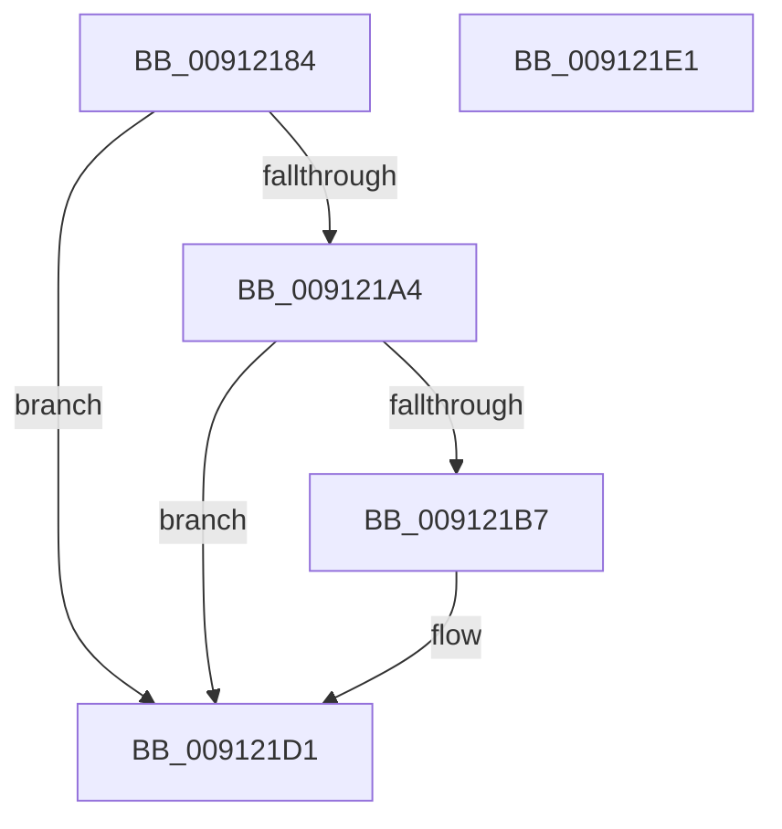

# PopPowerAggregatorDiagTraceEvent

- RVA: `0x00912184`–`0x009121E2` (길이 `94` bytes)
- VA: `0x0000000140912184`
- 실행 섹션: `PAGE`
- PDB 이름 있음: `예`; PDB Function 태그: `아니요`
- unwind 정보 RVA: `0x000794E0`
- 디코드: `26`개 명령, `94/94` bytes 표시
- 미해석 바이트: `0` (있으면 어셈블리에 `.byte`로 보존)

> 이 문서는 커널 이미지의 기계어와 PDB 기호를 분석해 생성했습니다. 4번과 5번은 함수 원형과 자료형을 바이너리 사용 방식에서 추정한 C 해석이며 원본 소스 복구 결과는 아닙니다.

## 1. Dependencies

- 직접 호출 지점: **2**; 고유 호출 대상: **2**
- 직접 호출자로 확인된 함수: **4**
- RIP 상대 이미지 참조: **2**

### Outgoing calls
- `0x009121AE` → [EtwEventEnabled](../../text/39/EtwEventEnabled_function_00392450.md) (function, `0x00392450`)
- `0x009121CC` → [EtwWrite](../../text/41/EtwWrite_function_0041C720.md) (function, `0x0041C720`)

### Direct callers
- [PopPowerAggregatorDozeTimerArm](../76/PopPowerAggregatorDozeTimerArm_function_007643BC.md) at `0x0076444D`
- [PopPowerAggregatorDozeTimerWorker](../76/PopPowerAggregatorDozeTimerWorker_function_00764490.md) at `0x0076453E`
- [PopNotifyCsStateExited](PopNotifyCsStateExited_function_00911F60.md) at `0x00911F88`
- [PopPowerAggregatorWorker](PopPowerAggregatorWorker_function_00911FB0.md) at `0x00911FCC`
- [PopPowerAggregatorWorker](PopPowerAggregatorWorker_function_00911FB0.md) at `0x00912018`

### Static image references
- `0x00912193` → RVA `0x00E67858` (`.data`; read)
- `0x009121A7` → RVA `0x00F0B408` (`.data`; read)

## 2. Other-region calls and transfers

- 다른 실행 섹션으로 향하는 call: **2**
  - `0x009121AE` → [EtwEventEnabled](../../text/39/EtwEventEnabled_function_00392450.md) (`PAGE` → `.text`)
  - `0x009121CC` → [EtwWrite](../../text/41/EtwWrite_function_0041C720.md) (`PAGE` → `.text`)
- 별도 외부 분기/꼬리 이동을 확인하지 못했습니다.

## 3. Assembly (complete function range)

```asm
00912184  48 89 5C 24 08                  mov qword ptr [rsp + 8], rbx
00912189  48 89 74 24 10                  mov qword ptr [rsp + 0x10], rsi
0091218E  57                              push rdi
0091218F  48 83 EC 30                     sub rsp, 0x30
00912193  80 3D BE 56 55 00 00            cmp byte ptr [rip + 0x5556be], 0
0091219A  49 8B F8                        mov rdi, r8
0091219D  8B F2                           mov esi, edx
0091219F  48 8B D9                        mov rbx, rcx
009121A2  74 2D                           je 0x1409121d1
009121A4  48 8B D1                        mov rdx, rcx
009121A7  48 8B 0D 5A 92 5F 00            mov rcx, qword ptr [rip + 0x5f925a]
009121AE  E8 9D 02 A8 FF                  call 0x140392450
009121B3  84 C0                           test al, al
009121B5  74 1A                           je 0x1409121d1
009121B7  48 8B 0D 4A 92 5F 00            mov rcx, qword ptr [rip + 0x5f924a]
009121BE  44 8B CE                        mov r9d, esi
009121C1  45 33 C0                        xor r8d, r8d
009121C4  48 89 7C 24 20                  mov qword ptr [rsp + 0x20], rdi
009121C9  48 8B D3                        mov rdx, rbx
009121CC  E8 4F A5 B0 FF                  call 0x14041c720
009121D1  48 8B 5C 24 40                  mov rbx, qword ptr [rsp + 0x40]
009121D6  48 8B 74 24 48                  mov rsi, qword ptr [rsp + 0x48]
009121DB  48 83 C4 30                     add rsp, 0x30
009121DF  5F                              pop rdi
009121E0  C3                              ret
009121E1  CC                              int3
```

## 4. C-style interpretation (structured pseudocode)

```c
__int64 __fastcall PopPowerAggregatorDiagTraceEvent(__int64 a1, int a2, __int64 a3)
{
    __int64 result;
    __int64 v_rsp;
    unsigned __int64 v_stack_m18;
    unsigned __int64 v_stack_p10;
    unsigned __int64 v_stack_p8;

    v_stack_p8 = v_rbx;
    v_stack_p10 = v_rsi;
    v_rsp = (v_rsp) - (48);
    if ((*(unsigned __int8 *)(v_rip + 5592766)) == 0) goto loc_009121D1;
    result = EtwEventEnabled(*(unsigned __int64 *)(v_rip + 6263386), a1, a3, a4);
    if ((unsigned __int8)(result) != 0) {
        a1 = *(unsigned __int64 *)(v_rip + 6263370);
        a4 = (unsigned int)((unsigned int)(a2));
        a3 = 0;
        v_stack_m18 = 0;
        a2 = a1;
        result = EtwWrite(a1, a2, a3, a4);
    }
    v_rsp = (v_rsp) + (48);
    return result;
}
```

## 5. (Beta) C Style

```c
int64_t PopPowerAggregatorDiagTraceEvent(int64_t Arg1, int32_t Arg2, int64_t Arg3)
{
    int64_t result;
    int64_t local_rsp;
    uint64_t v_stack_m18;
    uint64_t v_stack_p10;
    uint64_t v_stack_p8;

    v_stack_p8 = local_rbx;
    v_stack_p10 = local_rsi;
    local_rsp = (local_rsp) - (48);
    if ((*(uint8_t *)(v_rip + 0x5556BE)) == 0) goto loc_009121D1;
    result = EtwEventEnabled(*(uint64_t *)(v_rip + 0x5F925A), Arg1, Arg3, a4);
    if ((uint8_t)(result) != 0) {
        Arg1 = *(uint64_t *)(v_rip + 0x5F924A);
        a4 = (uint32_t)((uint32_t)(Arg2));
        Arg3 = 0;
        v_stack_m18 = 0;
        Arg2 = Arg1;
        result = EtwWrite(Arg1, Arg2, Arg3, a4);
    }
    local_rsp = (local_rsp) + (48);
    return result;
}
```

## 6. Execution-region graph

[열기: 2D/3D 그래프와 함수 탐색 컨트롤 패널](../../../control-panel.html?section=page&rva=0x00912184&view=graph)

- 2D 그래프는 위에서 아래로 흐르고, 3D 그래프는 빈 공간을 드래그해 회전합니다. Shift+드래그는 이동, 휠은 확대·축소, 함수 노드 선택은 대상 보고서 이동입니다.

### Static fallback


