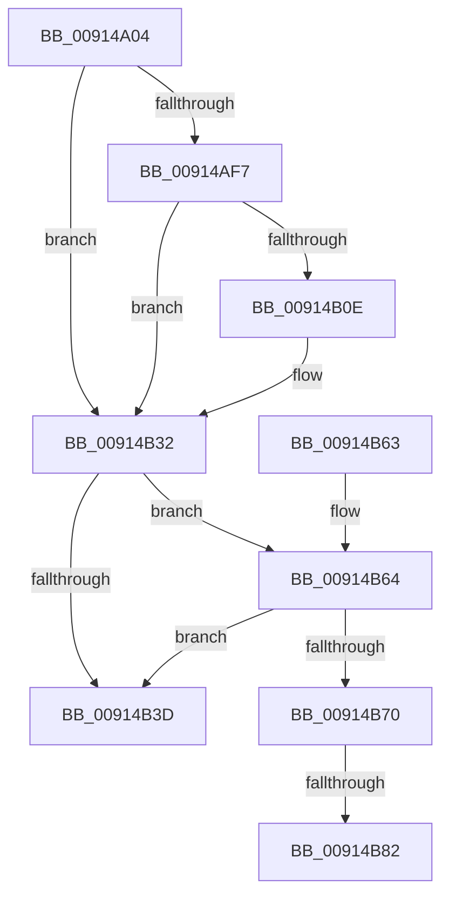

# PopPowerAggregatorDiagTraceHandleIntent

- RVA: `0x00914A04`–`0x00914B8F` (길이 `395` bytes)
- VA: `0x0000000140914A04`
- 실행 섹션: `PAGE`
- PDB 이름 있음: `예`; PDB Function 태그: `예`
- unwind 정보 RVA: `0x0008A624`
- 디코드: `86`개 명령, `395/395` bytes 표시
- 미해석 바이트: `0` (있으면 어셈블리에 `.byte`로 보존)

> 이 문서는 커널 이미지의 기계어와 PDB 기호를 분석해 생성했습니다. 4번과 5번은 함수 원형과 자료형을 바이너리 사용 방식에서 추정한 C 해석이며 원본 소스 복구 결과는 아닙니다.

## 1. Dependencies

- 직접 호출 지점: **3**; 고유 호출 대상: **3**
- 직접 호출자로 확인된 함수: **1**
- RIP 상대 이미지 참조: **4**

### Outgoing calls
- `0x00914B05` → [EtwEventEnabled](../../text/39/EtwEventEnabled_function_00392450.md) (function, `0x00392450`)
- `0x00914B2D` → [EtwWrite](../../text/41/EtwWrite_function_0041C720.md) (function, `0x0041C720`)
- `0x00914B47` → [_security_check_cookie](../../text/6A/_security_check_cookie_function_006AC640.md) (function, `0x006AC640`)

### Direct callers
- [PopPowerAggregatorRecordIntent](PopPowerAggregatorRecordIntent_function_00914850.md) at `0x009148AD`

### Static image references
- `0x00914A2A` → RVA `0x00E0A740` (`.data`; read)
- `0x00914A53` → RVA `0x00E67858` (`.data`; read)
- `0x00914AF7` → RVA `0x00F0B408` (`.data`; read)
- `0x00914AFE` → RVA `0x00011B38` (`.rdata`; read)

## 2. Other-region calls and transfers

- 다른 실행 섹션으로 향하는 call: **3**
  - `0x00914B05` → [EtwEventEnabled](../../text/39/EtwEventEnabled_function_00392450.md) (`PAGE` → `.text`)
  - `0x00914B2D` → [EtwWrite](../../text/41/EtwWrite_function_0041C720.md) (`PAGE` → `.text`)
  - `0x00914B47` → [_security_check_cookie](../../text/6A/_security_check_cookie_function_006AC640.md) (`PAGE` → `.text`)
- call이 아닌 외부 분기/꼬리 이동: **2**
  - `0x00914B7C` → [sub_00B217B6](../B2/Unknown_function_00B217B6.md) (`tail-transfer`)
  - `0x00914B8A` → [sub_00B217B6](../B2/Unknown_function_00B217B6.md) (`tail-transfer`)

## 3. Assembly (complete function range)

```asm
00914A04  48 8B C4                        mov rax, rsp
00914A07  48 89 58 20                     mov qword ptr [rax + 0x20], rbx
00914A0B  44 89 40 18                     mov dword ptr [rax + 0x18], r8d
00914A0F  89 50 10                        mov dword ptr [rax + 0x10], edx
00914A12  89 48 08                        mov dword ptr [rax + 8], ecx
00914A15  55                              push rbp
00914A16  56                              push rsi
00914A17  57                              push rdi
00914A18  41 56                           push r14
00914A1A  41 57                           push r15
00914A1C  48 8D A8 28 FF FF FF            lea rbp, [rax - 0xd8]
00914A23  48 81 EC B0 01 00 00            sub rsp, 0x1b0
00914A2A  48 8B 05 0F 5D 4F 00            mov rax, qword ptr [rip + 0x4f5d0f]
00914A31  48 33 C4                        xor rax, rsp
00914A34  48 89 85 A0 00 00 00            mov qword ptr [rbp + 0xa0], rax
00914A3B  48 8B BD 00 01 00 00            mov rdi, qword ptr [rbp + 0x100]
00914A42  48 8D 85 E0 00 00 00            lea rax, [rbp + 0xe0]
00914A49  48 8B B5 10 01 00 00            mov rsi, qword ptr [rbp + 0x110]
00914A50  45 33 F6                        xor r14d, r14d
00914A53  44 38 35 FE 2D 55 00            cmp byte ptr [rip + 0x552dfe], r14b
00914A5A  49 8B D9                        mov rbx, r9
00914A5D  48 89 44 24 60                  mov qword ptr [rsp + 0x60], rax
00914A62  48 8D 85 E8 00 00 00            lea rax, [rbp + 0xe8]
00914A69  48 89 44 24 70                  mov qword ptr [rsp + 0x70], rax
00914A6E  48 8D 85 F0 00 00 00            lea rax, [rbp + 0xf0]
00914A75  48 89 45 80                     mov qword ptr [rbp - 0x80], rax
00914A79  41 8D 4E 18                     lea ecx, [r14 + 0x18]
00914A7D  48 8D 85 08 01 00 00            lea rax, [rbp + 0x108]
00914A84  48 C7 44 24 68 04 00 00 00      mov qword ptr [rsp + 0x68], 4
00914A8D  48 89 45 90                     mov qword ptr [rbp - 0x70], rax
00914A91  48 8D 44 24 50                  lea rax, [rsp + 0x50]
00914A96  48 89 45 C0                     mov qword ptr [rbp - 0x40], rax
00914A9A  48 8D 44 24 34                  lea rax, [rsp + 0x34]
00914A9F  48 89 45 D0                     mov qword ptr [rbp - 0x30], rax
00914AA3  48 C7 44 24 78 04 00 00 00      mov qword ptr [rsp + 0x78], 4
00914AAC  48 C7 45 88 04 00 00 00         mov qword ptr [rbp - 0x78], 4
00914AB4  48 C7 45 98 04 00 00 00         mov qword ptr [rbp - 0x68], 4
00914ABC  48 89 5D A0                     mov qword ptr [rbp - 0x60], rbx
00914AC0  48 C7 45 A8 04 00 00 00         mov qword ptr [rbp - 0x58], 4
00914AC8  48 89 7D B0                     mov qword ptr [rbp - 0x50], rdi
00914ACC  48 C7 45 B8 04 00 00 00         mov qword ptr [rbp - 0x48], 4
00914AD4  4C 89 74 24 50                  mov qword ptr [rsp + 0x50], r14
00914AD9  48 C7 45 C8 08 00 00 00         mov qword ptr [rbp - 0x38], 8
00914AE1  89 4C 24 34                     mov dword ptr [rsp + 0x34], ecx
00914AE5  48 C7 45 D8 04 00 00 00         mov qword ptr [rbp - 0x28], 4
00914AED  48 89 75 E0                     mov qword ptr [rbp - 0x20], rsi
00914AF1  48 89 4D E8                     mov qword ptr [rbp - 0x18], rcx
00914AF5  74 3B                           je 0x140914b32
00914AF7  48 8B 0D 0A 69 5F 00            mov rcx, qword ptr [rip + 0x5f690a]
00914AFE  48 8D 15 33 D0 6F FF            lea rdx, [rip - 0x902fcd]
00914B05  E8 46 D9 A7 FF                  call 0x140392450
00914B0A  84 C0                           test al, al
00914B0C  74 24                           je 0x140914b32
00914B0E  48 8B 0D F3 68 5F 00            mov rcx, qword ptr [rip + 0x5f68f3]
00914B15  48 8D 44 24 60                  lea rax, [rsp + 0x60]
00914B1A  45 8D 4E 09                     lea r9d, [r14 + 9]
00914B1E  48 89 44 24 20                  mov qword ptr [rsp + 0x20], rax
00914B23  45 33 C0                        xor r8d, r8d
00914B26  48 8D 15 0B D0 6F FF            lea rdx, [rip - 0x902ff5]
00914B2D  E8 EE 7B B0 FF                  call 0x14041c720
00914B32  44 8B 0B                        mov r9d, dword ptr [rbx]
00914B35  44 8B 1F                        mov r11d, dword ptr [rdi]
00914B38  45 3B CB                        cmp r9d, r11d
00914B3B  75 27                           jne 0x140914b64
00914B3D  48 8B 8D A0 00 00 00            mov rcx, qword ptr [rbp + 0xa0]
00914B44  48 33 CC                        xor rcx, rsp
00914B47  E8 F4 7A D9 FF                  call 0x1406ac640
00914B4C  48 8B 9C 24 F8 01 00 00         mov rbx, qword ptr [rsp + 0x1f8]
00914B54  48 81 C4 B0 01 00 00            add rsp, 0x1b0
00914B5B  41 5F                           pop r15
00914B5D  41 5E                           pop r14
00914B5F  5F                              pop rdi
00914B60  5E                              pop rsi
00914B61  5D                              pop rbp
00914B62  C3                              ret
00914B63  CC                              int3
00914B64  44 8B 95 08 01 00 00            mov r10d, dword ptr [rbp + 0x108]
00914B6B  45 85 D2                        test r10d, r10d
00914B6E  78 CD                           js 0x140914b3d
00914B70  BF 01 00 00 00                  mov edi, 1
00914B75  45 0F B6 C6                     movzx r8d, r14b
00914B79  44 3B CF                        cmp r9d, edi
00914B7C  0F 85 34 CC 20 00               jne 0x140b217b6
00914B82  44 38 73 1B                     cmp byte ptr [rbx + 0x1b], r14b
00914B86  44 0F 45 C7                     cmovne r8d, edi
00914B8A  E9 27 CC 20 00                  jmp 0x140b217b6
```

## 4. C-style interpretation (structured pseudocode)

```c
__int64 __fastcall PopPowerAggregatorDiagTraceHandleIntent(int a1, int a2, int a3, __int64 a4)
{
    __int64 result;
    __int64 v_r14;
    __int64 v_rsp;
    unsigned __int64 v_stack_m160;
    unsigned __int64 v_stack_m168;
    unsigned __int64 v_stack_m170;
    unsigned __int64 v_stack_m178;
    unsigned __int64 v_stack_m188;
    unsigned __int64 v_stack_m1A4;
    unsigned __int64 v_stack_m1B8;
    unsigned __int64 v_stack_p20;

    *(unsigned __int64 *)(v_rsp + 32) = v_rbx;
    *(unsigned int *)(v_rsp + 24) = a3;
    *(unsigned int *)(v_rsp + 16) = a2;
    *(unsigned int *)(v_rsp + 8) = a1;
    v_rsp = (v_rsp) - (432);
    result = (*(unsigned __int64 *)(v_rip + 5201167)) ^ (v_rsp);
    *(unsigned __int64 *)(v_rsp - 216 + 160) = result;
    v_r14 = 0;
    v_stack_m178 = v_rsp - 216 + 224;
    v_stack_m168 = v_rsp - 216 + 232;
    *(unsigned __int64 *)(v_rsp - 216 - 128) = v_rsp - 216 + 240;
    v_stack_m170 = 4;
    *(unsigned __int64 *)(v_rsp - 216 - 112) = v_rsp - 216 + 264;
    *(unsigned __int64 *)(v_rsp - 216 - 64) = v_stack_m188;
    *(unsigned __int64 *)(v_rsp - 216 - 48) = v_stack_m1A4;
    v_stack_m160 = 4;
    *(unsigned __int64 *)(v_rsp - 216 - 120) = 4;
    *(unsigned __int64 *)(v_rsp - 216 - 104) = 4;
    *(unsigned __int64 *)(v_rsp - 216 - 96) = a4;
    *(unsigned __int64 *)(v_rsp - 216 - 88) = 4;
    *(unsigned __int64 *)(v_rsp - 216 - 80) = *(unsigned __int64 *)(v_rsp - 216 + 256);
    *(unsigned __int64 *)(v_rsp - 216 - 72) = 4;
    v_stack_m188 = 0;
    *(unsigned __int64 *)(v_rsp - 216 - 56) = 8;
    v_stack_m1A4 = (unsigned int)(v_r14 + 24);
    *(unsigned __int64 *)(v_rsp - 216 - 40) = 4;
    *(unsigned __int64 *)(v_rsp - 216 - 32) = *(unsigned __int64 *)(v_rsp - 216 + 272);
    *(unsigned __int64 *)(v_rsp - 216 - 24) = v_r14 + 24;
    if ((*(unsigned __int8 *)(v_rip + 5582334)) == 0) goto loc_00914B32;
    result = EtwEventEnabled(*(unsigned __int64 *)(v_rip + 6252810), v_rip - 9449421, a3, a4);
    if ((unsigned __int8)(result) != 0) {
        a1 = *(unsigned __int64 *)(v_rip + 6252787);
        result = v_stack_m178;
        a4 = v_r14 + 9;
        v_stack_m1B8 = result;
        a3 = 0;
        a2 = v_rip - 9449461;
        result = EtwWrite(a1, a2, a3, a4);
    }
    if (((unsigned int)((unsigned int)(*(unsigned int *)(a4)))) != ((unsigned int)((unsigned int)(*(unsigned int *)(*(unsigned __int64 *)(v_rsp - 216 + 256)))))) goto loc_00914B64;
loc_00914B3D:
    a1 = (*(unsigned __int64 *)(v_rsp - 216 + 160)) ^ (v_rsp);
    result = _security_check_cookie(a1, a2, a3, (unsigned int)(*(unsigned int *)(a4)));
    v_rsp = (v_rsp) + (432);
    return result;
loc_00914B64:
    if (sign_flag) goto loc_00914B3D;
    a3 = 0;
    if ((*(unsigned __int8 *)(v_stack_p20 + 27)) != 0) { a3 = 1; }
}
```

## 5. (Beta) C Style

```c
int64_t PopPowerAggregatorDiagTraceHandleIntent(int32_t Arg1, int32_t Arg2, int32_t Arg3, void *Arg4)
{
    uint8_t *arg4 = (uint8_t *)Arg4;

    int64_t result;
    int64_t local_r14;
    int64_t local_rsp;
    uint64_t v_stack_m160;
    uint64_t v_stack_m168;
    uint64_t v_stack_m170;
    uint64_t v_stack_m178;
    uint64_t v_stack_m188;
    uint64_t v_stack_m1A4;
    uint64_t v_stack_m1B8;
    uint64_t v_stack_p20;

    *(uint64_t *)(local_rsp + 0x20) = local_rbx;
    *(uint32_t *)(local_rsp + 0x18) = Arg3;
    *(uint32_t *)(local_rsp + 0x10) = Arg2;
    *(uint32_t *)(local_rsp + 0x8) = Arg1;
    local_rsp = (local_rsp) - (432);
    result = (*(uint64_t *)(v_rip + 0x4F5D0F)) ^ (local_rsp);
    *(uint64_t *)(local_rsp - 0xD8 + 0xA0) = result;
    local_r14 = 0;
    v_stack_m178 = local_rsp - 216 + 224;
    v_stack_m168 = local_rsp - 216 + 232;
    *(uint64_t *)(local_rsp - 0xD8 - 0x80) = local_rsp - 216 + 240;
    v_stack_m170 = 4;
    *(uint64_t *)(local_rsp - 0xD8 - 0x70) = local_rsp - 216 + 264;
    *(uint64_t *)(local_rsp - 0xD8 - 0x40) = v_stack_m188;
    *(uint64_t *)(local_rsp - 0xD8 - 0x30) = v_stack_m1A4;
    v_stack_m160 = 4;
    *(uint64_t *)(local_rsp - 0xD8 - 0x78) = 4;
    *(uint64_t *)(local_rsp - 0xD8 - 0x68) = 4;
    *(void **)(local_rsp - 0xD8 - 0x60) = Arg4;
    *(uint64_t *)(local_rsp - 0xD8 - 0x58) = 4;
    *(uint64_t *)(local_rsp - 0xD8 - 0x50) = *(uint64_t *)(local_rsp - 0xD8 + 0x100);
    *(uint64_t *)(local_rsp - 0xD8 - 0x48) = 4;
    v_stack_m188 = 0;
    *(uint64_t *)(local_rsp - 0xD8 - 0x38) = 8;
    v_stack_m1A4 = (uint32_t)(local_r14 + 24);
    *(uint64_t *)(local_rsp - 0xD8 - 0x28) = 4;
    *(uint64_t *)(local_rsp - 0xD8 - 0x20) = *(uint64_t *)(local_rsp - 0xD8 + 0x110);
    *(uint64_t *)(local_rsp - 0xD8 - 0x18) = local_r14 + 24;
    if ((*(uint8_t *)(v_rip + 0x552DFE)) == 0) goto loc_00914B32;
    result = EtwEventEnabled(*(uint64_t *)(v_rip + 0x5F690A), v_rip - 9449421, Arg3, Arg4);
    if ((uint8_t)(result) != 0) {
        Arg1 = *(uint64_t *)(v_rip + 0x5F68F3);
        result = v_stack_m178;
        Arg4 = local_r14 + 9;
        v_stack_m1B8 = result;
        Arg3 = 0;
        Arg2 = v_rip - 9449461;
        result = EtwWrite(Arg1, Arg2, Arg3, Arg4);
    }
    if (((uint32_t)((uint32_t)(*(uint32_t *)(arg4)))) != ((uint32_t)((uint32_t)(*(uint32_t *)(*(uint64_t *)(local_rsp - 0xD8 + 0x100)))))) goto loc_00914B64;
loc_00914B3D:
    Arg1 = (*(uint64_t *)(local_rsp - 0xD8 + 0xA0)) ^ (local_rsp);
    result = _security_check_cookie(Arg1, Arg2, Arg3, (uint32_t)(*(uint32_t *)(arg4)));
    local_rsp = (local_rsp) + (432);
    return result;
loc_00914B64:
    if (sign_flag) goto loc_00914B3D;
    Arg3 = 0;
    if ((*(uint8_t *)(v_stack_p20 + 0x1B)) != 0) { Arg3 = 1; }
}
```

### 관측된 메모리 오프셋

구조체 형식이 확인되지 않은 접근은 인자 기준의 오프셋으로만 기록했습니다.

| 기준 인자 | 오프셋 표현 | 폭 (bit) | 접근 |
|---|---:|---:|---|
| `Arg4` | `+ 0x0` | `32` | `R` |
| `Arg4` | `+ 0x1B` | `8` | `R` |

## 6. Execution-region graph

[열기: 2D/3D 그래프와 함수 탐색 컨트롤 패널](../../../control-panel.html?section=page&rva=0x00914A04&view=graph)

- 2D 그래프는 위에서 아래로 흐르고, 3D 그래프는 빈 공간을 드래그해 회전합니다. Shift+드래그는 이동, 휠은 확대·축소, 함수 노드 선택은 대상 보고서 이동입니다.

### Static fallback


