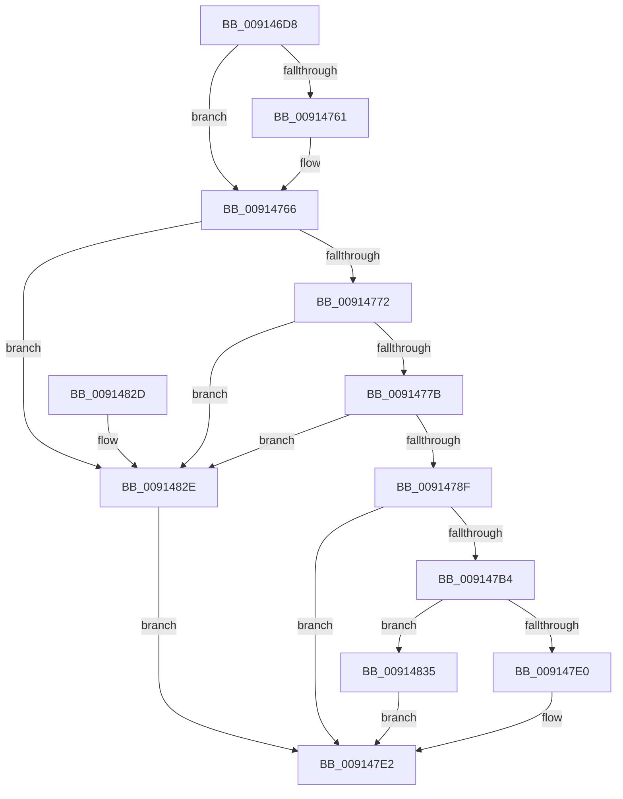

# PopPowerAggregatorHandleIntentUnsafe

- RVA: `0x009146D8`–`0x00914848` (길이 `368` bytes)
- VA: `0x00000001409146D8`
- 실행 섹션: `PAGE`
- PDB 이름 있음: `예`; PDB Function 태그: `아니요`
- unwind 정보 RVA: `0x0008A5D8`
- 디코드: `90`개 명령, `368/368` bytes 표시
- 미해석 바이트: `0` (있으면 어셈블리에 `.byte`로 보존)

> 이 문서는 커널 이미지의 기계어와 PDB 기호를 분석해 생성했습니다. 4번과 5번은 함수 원형과 자료형을 바이너리 사용 방식에서 추정한 C 해석이며 원본 소스 복구 결과는 아닙니다.

## 1. Dependencies

- 직접 호출 지점: **4**; 고유 호출 대상: **4**
- 직접 호출자로 확인된 함수: **7**
- RIP 상대 이미지 참조: **7**

### Outgoing calls
- `0x009147A9` → [guard_dispatch_icall](../../text/6B/guard_dispatch_icall_function_006BAAD0.md) (function, `0x006BAAD0`)
- `0x009147D7` → [PopPowerAggregatorIsAtTargetState](PopPowerAggregatorIsAtTargetState_function_00915930.md) (function, `0x00915930`)
- `0x00914809` → [PopPowerAggregatorRecordIntent](PopPowerAggregatorRecordIntent_function_00914850.md) (function, `0x00914850`)
- `0x00914841` → [PopPowerAggregatorScheduleWorker](PopPowerAggregatorScheduleWorker_function_00912B9C.md) (function, `0x00912B9C`)

### Direct callers
- [PopPowerAggregatorDozeTimerWorker](../76/PopPowerAggregatorDozeTimerWorker_function_00764490.md) at `0x00764584`
- [PopPowerAggregatorForceSessionSwitch](../76/PopPowerAggregatorForceSessionSwitch_function_007648D0.md) at `0x00764948`
- [PopPowerAggregatorNotifyPdcPhaseState](../76/PopPowerAggregatorNotifyPdcPhaseState_function_00764C54.md) at `0x00764CE0`
- [PopPowerAggregatorTriggerAdaptiveAction](../76/PopPowerAggregatorTriggerAdaptiveAction_function_00765240.md) at `0x007652B1`
- [PopTriggerMonitorPowerEvent](PopTriggerMonitorPowerEvent_function_0091446C.md) at `0x009145A2`
- [PopPowerAggregatorHandleIntent](PopPowerAggregatorHandleIntent_function_00914670.md) at `0x009146A6`
- [PopPowerAggregatorNotifySuspendResume](../AB/PopPowerAggregatorNotifySuspendResume_function_00AB9728.md) at `0x00AB9792`

### Static image references
- `0x009146F7` → RVA `0x00F09750` (`.data`; read)
- `0x00914705` → RVA `0x00F09740` (`.data`; read)
- `0x0091470F` → RVA `0x00F09760` (`.data`; read)
- `0x00914720` → RVA `0x00F09740` (`.data`; write)
- `0x00914727` → RVA `0x00F09770` (`.data`; read)
- `0x0091477B` → RVA `0x00FD8D30` (`PAGEDATA`; read)
- `0x009147C8` → RVA `0x00F09770` (`.data`; write)

## 2. Other-region calls and transfers

- 다른 실행 섹션으로 향하는 call: **1**
  - `0x009147A9` → [guard_dispatch_icall](../../text/6B/guard_dispatch_icall_function_006BAAD0.md) (`PAGE` → `.text`)
- 별도 외부 분기/꼬리 이동을 확인하지 못했습니다.

## 3. Assembly (complete function range)

```asm
009146D8  48 8B C4                        mov rax, rsp
009146DB  48 89 58 08                     mov qword ptr [rax + 8], rbx
009146DF  48 89 70 10                     mov qword ptr [rax + 0x10], rsi
009146E3  48 89 78 18                     mov qword ptr [rax + 0x18], rdi
009146E7  4C 89 70 20                     mov qword ptr [rax + 0x20], r14
009146EB  55                              push rbp
009146EC  48 8D 68 A1                     lea rbp, [rax - 0x5f]
009146F0  48 81 EC B0 00 00 00            sub rsp, 0xb0
009146F7  0F 10 05 52 50 5F 00            movups xmm0, xmmword ptr [rip + 0x5f5052]
009146FE  83 65 0B 00                     and dword ptr [rbp + 0xb], 0
00914702  45 8B F1                        mov r14d, r9d
00914705  48 8B 05 34 50 5F 00            mov rax, qword ptr [rip + 0x5f5034]
0091470C  41 8B F0                        mov esi, r8d
0091470F  0F 10 0D 4A 50 5F 00            movups xmm1, xmmword ptr [rip + 0x5f504a]
00914716  48 FF C0                        inc rax
00914719  48 63 F9                        movsxd rdi, ecx
0091471C  0F 11 45 27                     movups xmmword ptr [rbp + 0x27], xmm0
00914720  48 89 05 19 50 5F 00            mov qword ptr [rip + 0x5f5019], rax
00914727  F2 0F 10 05 41 50 5F 00         movsd xmm0, qword ptr [rip + 0x5f5041]
0091472F  48 89 45 0F                     mov qword ptr [rbp + 0xf], rax
00914733  33 C0                           xor eax, eax
00914735  F2 0F 11 45 47                  movsd qword ptr [rbp + 0x47], xmm0
0091473A  0F 57 C0                        xorps xmm0, xmm0
0091473D  C7 45 FF 05 00 00 00            mov dword ptr [rbp - 1], 5
00914744  44 89 4D 07                     mov dword ptr [rbp + 7], r9d
00914748  89 7D 03                        mov dword ptr [rbp + 3], edi
0091474B  48 89 45 F7                     mov qword ptr [rbp - 9], rax
0091474F  F3 0F 7F 45 17                  movdqu xmmword ptr [rbp + 0x17], xmm0
00914754  0F 11 45 E7                     movups xmmword ptr [rbp - 0x19], xmm0
00914758  0F 11 4D 37                     movups xmmword ptr [rbp + 0x37], xmm1
0091475C  48 85 D2                        test rdx, rdx
0091475F  74 05                           je 0x140914766
00914761  8B 02                           mov eax, dword ptr [rdx]
00914763  89 45 E7                        mov dword ptr [rbp - 0x19], eax
00914766  8D 47 FF                        lea eax, [rdi - 1]
00914769  83 F8 09                        cmp eax, 9
0091476C  0F 87 BC 00 00 00               ja 0x14091482e
00914772  83 FE 02                        cmp esi, 2
00914775  0F 87 B3 00 00 00               ja 0x14091482e
0091477B  48 8D 0D AE 45 6C 00            lea rcx, [rip + 0x6c45ae]
00914782  48 8B 04 F9                     mov rax, qword ptr [rcx + rdi*8]
00914786  48 85 C0                        test rax, rax
00914789  0F 84 9F 00 00 00               je 0x14091482e
0091478F  48 8D 4D E7                     lea rcx, [rbp - 0x19]
00914793  4C 8B CA                        mov r9, rdx
00914796  48 89 4C 24 20                  mov qword ptr [rsp + 0x20], rcx
0091479B  48 8D 55 FF                     lea rdx, [rbp - 1]
0091479F  48 8D 0D 9A 4F 5F 00            lea rcx, [rip + 0x5f4f9a]
009147A6  44 8B C7                        mov r8d, edi
009147A9  E8 22 63 DA FF                  call 0x1406baad0
009147AE  8B D8                           mov ebx, eax
009147B0  85 C0                           test eax, eax
009147B2  78 2E                           js 0x1409147e2
009147B4  0F 10 45 FF                     movups xmm0, xmmword ptr [rbp - 1]
009147B8  0F 10 4D 0F                     movups xmm1, xmmword ptr [rbp + 0xf]
009147BC  0F 11 05 8D 4F 5F 00            movups xmmword ptr [rip + 0x5f4f8d], xmm0
009147C3  F2 0F 10 45 1F                  movsd xmm0, qword ptr [rbp + 0x1f]
009147C8  F2 0F 11 05 A0 4F 5F 00         movsd qword ptr [rip + 0x5f4fa0], xmm0
009147D0  0F 11 0D 89 4F 5F 00            movups xmmword ptr [rip + 0x5f4f89], xmm1
009147D7  E8 54 11 00 00                  call 0x140915930
009147DC  84 C0                           test al, al
009147DE  74 55                           je 0x140914835
009147E0  33 DB                           xor ebx, ebx
009147E2  48 8D 45 E7                     lea rax, [rbp - 0x19]
009147E6  45 8B CE                        mov r9d, r14d
009147E9  48 89 44 24 38                  mov qword ptr [rsp + 0x38], rax
009147EE  44 8B C6                        mov r8d, esi
009147F1  48 8D 45 FF                     lea rax, [rbp - 1]
009147F5  89 5C 24 30                     mov dword ptr [rsp + 0x30], ebx
009147F9  48 89 44 24 28                  mov qword ptr [rsp + 0x28], rax
009147FE  8B D7                           mov edx, edi
00914800  48 8D 45 27                     lea rax, [rbp + 0x27]
00914804  48 89 44 24 20                  mov qword ptr [rsp + 0x20], rax
00914809  E8 42 00 00 00                  call 0x140914850
0091480E  4C 8D 9C 24 B0 00 00 00         lea r11, [rsp + 0xb0]
00914816  8B C3                           mov eax, ebx
00914818  49 8B 5B 10                     mov rbx, qword ptr [r11 + 0x10]
0091481C  49 8B 73 18                     mov rsi, qword ptr [r11 + 0x18]
00914820  49 8B 7B 20                     mov rdi, qword ptr [r11 + 0x20]
00914824  4D 8B 73 28                     mov r14, qword ptr [r11 + 0x28]
00914828  49 8B E3                        mov rsp, r11
0091482B  5D                              pop rbp
0091482C  C3                              ret
0091482D  CC                              int3
0091482E  BB 0D 00 00 C0                  mov ebx, 0xc000000d
00914833  EB AD                           jmp 0x1409147e2
00914835  48 8D 0D 04 4F 5F 00            lea rcx, [rip + 0x5f4f04]
0091483C  BB 03 01 00 00                  mov ebx, 0x103
00914841  E8 56 E3 FF FF                  call 0x140912b9c
00914846  EB 9A                           jmp 0x1409147e2
```

## 4. C-style interpretation (structured pseudocode)

```c
__int64 __fastcall PopPowerAggregatorHandleIntentUnsafe(int a1, __int64 a2, int a3, int a4)
{
    __int64 result;
    __int64 v_rbx;
    __int64 v_rsp;
    unsigned __int64 v_stack_m8;
    unsigned __int64 v_stack_m80;
    unsigned int v_stack_m88;
    unsigned __int64 v_stack_m90;
    unsigned __int64 v_stack_m98;

    *(unsigned __int64 *)(v_rsp + 8) = v_rbx;
    *(unsigned __int64 *)(v_rsp + 16) = v_rsi;
    *(unsigned __int64 *)(v_rsp + 24) = v_rdi;
    *(unsigned __int64 *)(v_rsp + 32) = v_r14;
    v_rsp = (v_rsp) - (176);
    result = (*(unsigned __int64 *)(v_rip + 6246452)) + 1;
    *(unsigned __int64 *)(v_rsp - 95 + 39) = v_xmm0;
    *(unsigned __int64 *)(v_rip + 6246425) = result;
    *(unsigned __int64 *)(v_rsp - 95 + 15) = result;
    result = 0;
    *(unsigned __int64 *)(v_rsp - 95 + 71) = v_xmm0;
    *(unsigned int *)(v_rsp - 95 - 1) = 5;
    *(unsigned int *)(v_rsp - 95 + 7) = a4;
    *(unsigned int *)(v_rsp - 95 + 3) = (unsigned int)((int)(a1));
    *(unsigned __int64 *)(v_rsp - 95 - 9) = 0;
    *(unsigned __int64 *)(v_rsp - 95 + 23) = v_xmm0;
    *(unsigned __int64 *)(v_rsp - 95 - 25) = v_xmm0;
    *(unsigned __int64 *)(v_rsp - 95 + 55) = v_xmm1;
    if (a2 != 0) {
        result = *(unsigned int *)(a2);
        *(unsigned int *)(v_rsp - 95 - 25) = (unsigned int)(result);
    }
    if (((unsigned int)((int)(a1) - 1)) > 9) goto loc_0091482E;
    if (((unsigned int)((unsigned int)(a3))) > 2) goto loc_0091482E;
    if (*(unsigned __int64 *)(v_rip + 7095726 + (int)(a1) * 8) == 0) goto loc_0091482E;
    v_stack_m98 = v_rsp - 95 - 25;
    result = guard_dispatch_icall(v_rip + 6246298, v_rsp - 95 - 1, (unsigned int)((unsigned int)((int)(a1))), a2);
    if (sign_flag) goto loc_009147E2;
    *(unsigned __int64 *)(v_rip + 6246285) = v_xmm0;
    *(unsigned __int64 *)(v_rip + 6246304) = v_xmm0;
    *(unsigned __int64 *)(v_rip + 6246281) = v_xmm1;
    result = PopPowerAggregatorIsAtTargetState(v_rip + 6246298, v_rsp - 95 - 1, (unsigned int)((unsigned int)((int)(a1))), a2);
    if ((unsigned __int8)(result) == 0) goto loc_00914835;
    v_rbx = 0;
loc_009147E2:
    v_stack_m80 = v_rsp - 95 - 25;
    v_stack_m88 = 0;
    v_stack_m90 = v_rsp - 95 - 1;
    v_stack_m98 = v_rsp - 95 + 39;
    result = PopPowerAggregatorRecordIntent(v_rip + 6246298, (unsigned int)((unsigned int)((int)(a1))), (unsigned int)((unsigned int)((unsigned int)(a3))), (unsigned int)((unsigned int)((unsigned int)(a4))));
    return 0;
loc_0091482E:
    goto loc_009147E2;
loc_00914835:
    result = PopPowerAggregatorScheduleWorker(v_rip + 6246148, (unsigned int)((unsigned int)((int)(a1))), (unsigned int)((unsigned int)((unsigned int)(a3))), (unsigned int)((unsigned int)((unsigned int)(a4))));
    goto loc_009147E2;
}
```

## 5. (Beta) C Style

```c
int64_t PopPowerAggregatorHandleIntentUnsafe(void *Arg1, int64_t Arg2, int32_t Arg3, int32_t Arg4)
{
    uint8_t *arg1 = (uint8_t *)Arg1;

    int64_t result;
    int64_t local_rbx;
    int64_t local_rsp;
    uint64_t v_stack_m8;
    uint64_t v_stack_m80;
    uint32_t v_stack_m88;
    uint64_t v_stack_m90;
    uint64_t v_stack_m98;

    *(uint64_t *)(local_rsp + 0x8) = local_rbx;
    *(uint64_t *)(local_rsp + 0x10) = local_rsi;
    *(uint64_t *)(local_rsp + 0x18) = local_rdi;
    *(uint64_t *)(local_rsp + 0x20) = local_r14;
    local_rsp = (local_rsp) - (176);
    result = (*(uint64_t *)(v_rip + 0x5F5034)) + 1;
    *(uint64_t *)(local_rsp - 0x5F + 0x27) = v_xmm0;
    *(uint64_t *)(v_rip + 0x5F5019) = result;
    *(uint64_t *)(local_rsp - 0x5F + 0xF) = result;
    result = 0;
    *(uint64_t *)(local_rsp - 0x5F + 0x47) = v_xmm0;
    *(uint32_t *)(local_rsp - 0x5F - 0x1) = 5;
    *(uint32_t *)(local_rsp - 0x5F + 0x7) = Arg4;
    *(uint32_t *)(local_rsp - 0x5F + 0x3) = (uint32_t)((int32_t)(Arg1));
    *(uint64_t *)(local_rsp - 0x5F - 0x9) = 0;
    *(uint64_t *)(local_rsp - 0x5F + 0x17) = v_xmm0;
    *(uint64_t *)(local_rsp - 0x5F - 0x19) = v_xmm0;
    *(uint64_t *)(local_rsp - 0x5F + 0x37) = v_xmm1;
    if (Arg2 != 0) {
        result = *(uint32_t *)(Arg2);
        *(uint32_t *)(local_rsp - 0x5F - 0x19) = (uint32_t)(result);
    }
    if (((uint32_t)((int32_t)(Arg1) - 1)) > 9) goto loc_0091482E;
    if (((uint32_t)((uint32_t)(Arg3))) > 2) goto loc_0091482E;
    if (*(uint64_t *)(v_rip + 0x6C45AE + (int32_t)(arg1) * 8) == 0) goto loc_0091482E;
    v_stack_m98 = local_rsp - 95 - 25;
    result = guard_dispatch_icall(v_rip + 6246298, local_rsp - 95 - 1, (uint32_t)((uint32_t)((int32_t)(Arg1))), Arg2);
    if (sign_flag) goto loc_009147E2;
    *(uint64_t *)(v_rip + 0x5F4F8D) = v_xmm0;
    *(uint64_t *)(v_rip + 0x5F4FA0) = v_xmm0;
    *(uint64_t *)(v_rip + 0x5F4F89) = v_xmm1;
    result = PopPowerAggregatorIsAtTargetState(v_rip + 6246298, local_rsp - 95 - 1, (uint32_t)((uint32_t)((int32_t)(Arg1))), Arg2);
    if ((uint8_t)(result) == 0) goto loc_00914835;
    local_rbx = 0;
loc_009147E2:
    v_stack_m80 = local_rsp - 95 - 25;
    v_stack_m88 = 0;
    v_stack_m90 = local_rsp - 95 - 1;
    v_stack_m98 = local_rsp - 95 + 39;
    result = PopPowerAggregatorRecordIntent(v_rip + 6246298, (uint32_t)((uint32_t)((int32_t)(Arg1))), (uint32_t)((uint32_t)((uint32_t)(Arg3))), (uint32_t)((uint32_t)((uint32_t)(Arg4))));
    return 0;
loc_0091482E:
    goto loc_009147E2;
loc_00914835:
    result = PopPowerAggregatorScheduleWorker(v_rip + 6246148, (uint32_t)((uint32_t)((int32_t)(Arg1))), (uint32_t)((uint32_t)((uint32_t)(Arg3))), (uint32_t)((uint32_t)((uint32_t)(Arg4))));
    goto loc_009147E2;
}
```

### 관측된 메모리 오프셋

구조체 형식이 확인되지 않은 접근은 인자 기준의 오프셋으로만 기록했습니다.

| 기준 인자 | 오프셋 표현 | 폭 (bit) | 접근 |
|---|---:|---:|---|
| `Arg1` | `- 0x1` | `32` | `R` |

## 6. Execution-region graph

[열기: 2D/3D 그래프와 함수 탐색 컨트롤 패널](../../../control-panel.html?section=page&rva=0x009146D8&view=graph)

- 2D 그래프는 위에서 아래로 흐르고, 3D 그래프는 빈 공간을 드래그해 회전합니다. Shift+드래그는 이동, 휠은 확대·축소, 함수 노드 선택은 대상 보고서 이동입니다.

### Static fallback


