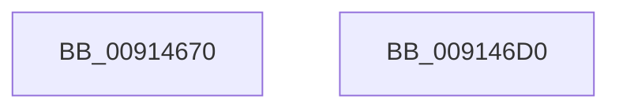

# PopPowerAggregatorHandleIntent

- RVA: `0x00914670`–`0x009146D1` (길이 `97` bytes)
- VA: `0x0000000140914670`
- 실행 섹션: `PAGE`
- PDB 이름 있음: `예`; PDB Function 태그: `아니요`
- unwind 정보 RVA: `0x0005C954`
- 디코드: `27`개 명령, `97/97` bytes 표시
- 미해석 바이트: `0` (있으면 어셈블리에 `.byte`로 보존)

> 이 문서는 커널 이미지의 기계어와 PDB 기호를 분석해 생성했습니다. 4번과 5번은 함수 원형과 자료형을 바이너리 사용 방식에서 추정한 C 해석이며 원본 소스 복구 결과는 아닙니다.

## 1. Dependencies

- 직접 호출 지점: **3**; 고유 호출 대상: **3**
- 직접 호출자로 확인된 함수: **1**
- RIP 상대 이미지 참조: **1**

### Outgoing calls
- `0x00914696` → [PopAcquireRwLockExclusive](../../text/43/PopAcquireRwLockExclusive_function_00430B44.md) (function, `0x00430B44`)
- `0x009146A6` → [PopPowerAggregatorHandleIntentUnsafe](PopPowerAggregatorHandleIntentUnsafe_function_009146D8.md) (function, `0x009146D8`)
- `0x009146B4` → [PopReleaseRwLock](../../text/2D/PopReleaseRwLock_function_002DFBBC.md) (function, `0x002DFBBC`)

### Direct callers
- [PopDirectedDripsInitializeBroadcast](../A4/PopDirectedDripsInitializeBroadcast_function_00A4D634.md) at `0x00A4D849`

### Static image references
- `0x00914689` → RVA `0x00F09710` (`.data`; read)

## 2. Other-region calls and transfers

- 다른 실행 섹션으로 향하는 call: **2**
  - `0x00914696` → [PopAcquireRwLockExclusive](../../text/43/PopAcquireRwLockExclusive_function_00430B44.md) (`PAGE` → `.text`)
  - `0x009146B4` → [PopReleaseRwLock](../../text/2D/PopReleaseRwLock_function_002DFBBC.md) (`PAGE` → `.text`)
- 별도 외부 분기/꼬리 이동을 확인하지 못했습니다.

## 3. Assembly (complete function range)

```asm
00914670  48 89 5C 24 08                  mov qword ptr [rsp + 8], rbx
00914675  48 89 6C 24 10                  mov qword ptr [rsp + 0x10], rbp
0091467A  48 89 74 24 18                  mov qword ptr [rsp + 0x18], rsi
0091467F  57                              push rdi
00914680  48 83 EC 20                     sub rsp, 0x20
00914684  8B E9                           mov ebp, ecx
00914686  41 8B D9                        mov ebx, r9d
00914689  48 8D 0D 80 50 5F 00            lea rcx, [rip + 0x5f5080]
00914690  41 8B F8                        mov edi, r8d
00914693  48 8B F2                        mov rsi, rdx
00914696  E8 A9 C4 B1 FF                  call 0x140430b44
0091469B  44 8B CB                        mov r9d, ebx
0091469E  44 8B C7                        mov r8d, edi
009146A1  48 8B D6                        mov rdx, rsi
009146A4  8B CD                           mov ecx, ebp
009146A6  E8 2D 00 00 00                  call 0x1409146d8
009146AB  48 8D 0D 5E 50 5F 00            lea rcx, [rip + 0x5f505e]
009146B2  8B D8                           mov ebx, eax
009146B4  E8 03 B5 9C FF                  call 0x1402dfbbc
009146B9  48 8B 6C 24 38                  mov rbp, qword ptr [rsp + 0x38]
009146BE  8B C3                           mov eax, ebx
009146C0  48 8B 5C 24 30                  mov rbx, qword ptr [rsp + 0x30]
009146C5  48 8B 74 24 40                  mov rsi, qword ptr [rsp + 0x40]
009146CA  48 83 C4 20                     add rsp, 0x20
009146CE  5F                              pop rdi
009146CF  C3                              ret
009146D0  CC                              int3
```

## 4. C-style interpretation (structured pseudocode)

```c
__int64 __fastcall PopPowerAggregatorHandleIntent(int a1, __int64 a2, int a3, int a4)
{
    __int64 result;
    __int64 v_rsp;
    unsigned __int64 v_stack_p10;
    unsigned __int64 v_stack_p18;
    unsigned __int64 v_stack_p8;

    v_stack_p8 = v_rbx;
    v_stack_p10 = v_rbp;
    v_stack_p18 = v_rsi;
    v_rsp = (v_rsp) - (32);
    result = PopAcquireRwLockExclusive(v_rip + 6246528, a2, a3, a4);
    result = PopPowerAggregatorHandleIntentUnsafe((unsigned int)((unsigned int)((unsigned int)(a1))), a2, (unsigned int)((unsigned int)((unsigned int)(a3))), (unsigned int)((unsigned int)((unsigned int)(a4))));
    result = PopReleaseRwLock(v_rip + 6246494, a2, (unsigned int)((unsigned int)((unsigned int)(a3))), (unsigned int)((unsigned int)((unsigned int)(a4))));
    v_rsp = (v_rsp) + (32);
    return (unsigned int)((unsigned int)((unsigned int)((unsigned int)(result))));
}
```

## 5. (Beta) C Style

```c
int64_t PopPowerAggregatorHandleIntent(int32_t Arg1, int64_t Arg2, int32_t Arg3, int32_t Arg4)
{
    int64_t result;
    int64_t local_rsp;
    uint64_t v_stack_p10;
    uint64_t v_stack_p18;
    uint64_t v_stack_p8;

    v_stack_p8 = local_rbx;
    v_stack_p10 = local_rbp;
    v_stack_p18 = local_rsi;
    local_rsp = (local_rsp) - (32);
    result = PopAcquireRwLockExclusive(v_rip + 6246528, Arg2, Arg3, Arg4);
    result = PopPowerAggregatorHandleIntentUnsafe((uint32_t)((uint32_t)((uint32_t)(Arg1))), Arg2, (uint32_t)((uint32_t)((uint32_t)(Arg3))), (uint32_t)((uint32_t)((uint32_t)(Arg4))));
    result = PopReleaseRwLock(v_rip + 6246494, Arg2, (uint32_t)((uint32_t)((uint32_t)(Arg3))), (uint32_t)((uint32_t)((uint32_t)(Arg4))));
    local_rsp = (local_rsp) + (32);
    return (uint32_t)((uint32_t)((uint32_t)((uint32_t)(result))));
}
```

## 6. Execution-region graph

[열기: 2D/3D 그래프와 함수 탐색 컨트롤 패널](../../../control-panel.html?section=page&rva=0x00914670&view=graph)

- 2D 그래프는 위에서 아래로 흐르고, 3D 그래프는 빈 공간을 드래그해 회전합니다. Shift+드래그는 이동, 휠은 확대·축소, 함수 노드 선택은 대상 보고서 이동입니다.

### Static fallback


