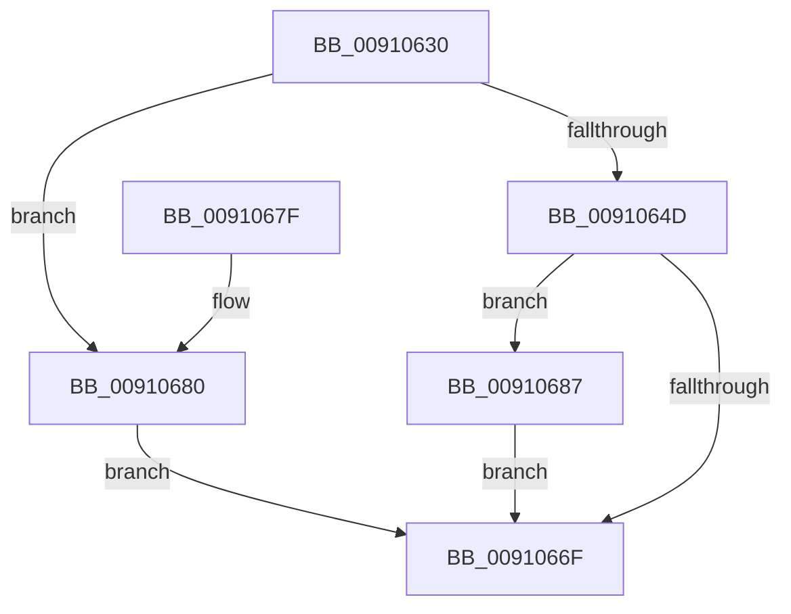

# PopPowerAggregatorHandleSystemTransitionIntent

- RVA: `0x00910630`–`0x0091069F` (길이 `111` bytes)
- VA: `0x0000000140910630`
- 실행 섹션: `PAGE`
- PDB 이름 있음: `예`; PDB Function 태그: `아니요`
- unwind 정보 RVA: `0x0008A0F4`
- 디코드: `34`개 명령, `111/111` bytes 표시
- 미해석 바이트: `0` (있으면 어셈블리에 `.byte`로 보존)

> 이 문서는 커널 이미지의 기계어와 PDB 기호를 분석해 생성했습니다. 4번과 5번은 함수 원형과 자료형을 바이너리 사용 방식에서 추정한 C 해석이며 원본 소스 복구 결과는 아닙니다.

## 1. Dependencies

- 직접 호출 지점: **1**; 고유 호출 대상: **1**
- 직접 호출자로 확인된 함수: **0**
- RIP 상대 이미지 참조: **0**

### Outgoing calls
- `0x00910666` → [PopPowerAggregatorDetermineTargetSystemPowerState](PopPowerAggregatorDetermineTargetSystemPowerState_function_009106A8.md) (function, `0x009106A8`)

### Direct callers
- 이 함수 시작 RVA로 연결되는 직접 call은 확인되지 않았습니다. 간접 호출은 완전히 역산할 수 없습니다.

### Static image references
- 디코드된 RIP-relative 메모리 참조가 없습니다.

## 2. Other-region calls and transfers

- 다른 실행 섹션으로 향하는 call: **0**
- 별도 외부 분기/꼬리 이동을 확인하지 못했습니다.

## 3. Assembly (complete function range)

```asm
00910630  48 8B C4                        mov rax, rsp
00910633  48 89 58 10                     mov qword ptr [rax + 0x10], rbx
00910637  48 89 70 18                     mov qword ptr [rax + 0x18], rsi
0091063B  57                              push rdi
0091063C  48 83 EC 20                     sub rsp, 0x20
00910640  83 60 08 00                     and dword ptr [rax + 8], 0
00910644  48 8B DA                        mov rbx, rdx
00910647  83 79 10 03                     cmp dword ptr [rcx + 0x10], 3
0091064B  74 33                           je 0x140910680
0091064D  41 8B 39                        mov edi, dword ptr [r9]
00910650  41 83 F8 0A                     cmp r8d, 0xa
00910654  4C 8B 4C 24 50                  mov r9, qword ptr [rsp + 0x50]
00910659  4C 8D 40 08                     lea r8, [rax + 8]
0091065D  40 0F 94 C6                     sete sil
00910661  8B CF                           mov ecx, edi
00910663  40 8A D6                        mov dl, sil
00910666  E8 3D 00 00 00                  call 0x1409106a8
0091066B  85 C0                           test eax, eax
0091066D  79 18                           jns 0x140910687
0091066F  48 8B 5C 24 38                  mov rbx, qword ptr [rsp + 0x38]
00910674  48 8B 74 24 40                  mov rsi, qword ptr [rsp + 0x40]
00910679  48 83 C4 20                     add rsp, 0x20
0091067D  5F                              pop rdi
0091067E  C3                              ret
0091067F  CC                              int3
00910680  B8 03 A0 00 C0                  mov eax, 0xc000a003
00910685  EB E8                           jmp 0x14091066f
00910687  8B 44 24 30                     mov eax, dword ptr [rsp + 0x30]
0091068B  89 43 1C                        mov dword ptr [rbx + 0x1c], eax
0091068E  33 C0                           xor eax, eax
00910690  C7 03 04 00 00 00               mov dword ptr [rbx], 4
00910696  40 88 73 18                     mov byte ptr [rbx + 0x18], sil
0091069A  89 7B 20                        mov dword ptr [rbx + 0x20], edi
0091069D  EB D0                           jmp 0x14091066f
```

## 4. C-style interpretation (structured pseudocode)

```c
__int64 __fastcall PopPowerAggregatorHandleSystemTransitionIntent(__int64 a1, __int64 a2, int a3, __int64 a4, __int64 a5)
{
    __int64 result;
    __int64 v_rsi;
    __int64 v_rsp;
    unsigned __int64 v_stack_p10;
    unsigned __int64 v_stack_p18;
    unsigned int v_stack_p30;

    *(unsigned __int64 *)(v_rsp + 16) = v_rbx;
    *(unsigned __int64 *)(v_rsp + 24) = v_rsi;
    v_rsp = (v_rsp) - (32);
    if ((*(unsigned int *)(a1 + 16)) == 3) goto loc_00910680;
    v_rsi = (a3 == 10) ? 1 : 0;
    result = PopPowerAggregatorDetermineTargetSystemPowerState((unsigned int)((unsigned int)((unsigned int)(*(unsigned int *)(a4)))), (unsigned __int8)(v_rsi), v_rsp + 8, a5);
    if (!sign_flag) goto loc_00910687;
loc_0091066F:
    v_rsp = (v_rsp) + (32);
    return result;
loc_00910680:
    goto loc_0091066F;
loc_00910687:
    *(unsigned int *)(v_stack_p10 + 28) = (unsigned int)((unsigned int)(v_stack_p30));
    result = 0;
    *(unsigned int *)(v_stack_p10) = 4;
    *(unsigned __int8 *)(v_stack_p10 + 24) = (unsigned __int8)(v_stack_p18);
    *(unsigned int *)(v_stack_p10 + 32) = (unsigned int)((unsigned int)(*(unsigned int *)(a4)));
    goto loc_0091066F;
}
```

## 5. (Beta) C Style

```c
int64_t PopPowerAggregatorHandleSystemTransitionIntent(void *Arg1, void *Arg2, int32_t Arg3, void *Arg4, int64_t Arg5)
{
    uint8_t *arg1 = (uint8_t *)Arg1;
    uint8_t *arg2 = (uint8_t *)Arg2;
    uint8_t *arg4 = (uint8_t *)Arg4;

    int64_t result;
    int64_t local_rsi;
    int64_t local_rsp;
    uint64_t v_stack_p10;
    uint64_t v_stack_p18;
    uint32_t v_stack_p30;

    *(uint64_t *)(local_rsp + 0x10) = local_rbx;
    *(uint64_t *)(local_rsp + 0x18) = local_rsi;
    local_rsp = (local_rsp) - (32);
    if ((*(uint32_t *)(arg1 + 0x10)) == 3) goto loc_00910680;
    local_rsi = (Arg3 == 10) ? 1 : 0;
    result = PopPowerAggregatorDetermineTargetSystemPowerState((uint32_t)((uint32_t)((uint32_t)(*(uint32_t *)(arg4)))), (uint8_t)(local_rsi), local_rsp + 8, Arg5);
    if (!sign_flag) goto loc_00910687;
loc_0091066F:
    local_rsp = (local_rsp) + (32);
    return result;
loc_00910680:
    goto loc_0091066F;
loc_00910687:
    *(uint32_t *)(v_stack_p10 + 0x1C) = (uint32_t)((uint32_t)(v_stack_p30));
    result = 0;
    *(uint32_t *)(v_stack_p10) = 4;
    *(uint8_t *)(v_stack_p10 + 0x18) = (uint8_t)(v_stack_p18);
    *(uint32_t *)(v_stack_p10 + 0x20) = (uint32_t)((uint32_t)(*(uint32_t *)(arg4)));
    goto loc_0091066F;
}
```

### 관측된 메모리 오프셋

구조체 형식이 확인되지 않은 접근은 인자 기준의 오프셋으로만 기록했습니다.

| 기준 인자 | 오프셋 표현 | 폭 (bit) | 접근 |
|---|---:|---:|---|
| `Arg1` | `+ 0x10` | `32` | `R` |
| `Arg2` | `+ 0x0` | `32` | `W` |
| `Arg2` | `+ 0x18` | `8` | `W` |
| `Arg2` | `+ 0x1C` | `32` | `W` |
| `Arg2` | `+ 0x20` | `32` | `W` |
| `Arg4` | `+ 0x0` | `32` | `R` |

## 6. Execution-region graph

[열기: 2D/3D 그래프와 함수 탐색 컨트롤 패널](../../../control-panel.html?section=page&rva=0x00910630&view=graph)

- 2D 그래프는 위에서 아래로 흐르고, 3D 그래프는 빈 공간을 드래그해 회전합니다. Shift+드래그는 이동, 휠은 확대·축소, 함수 노드 선택은 대상 보고서 이동입니다.

### Static fallback


