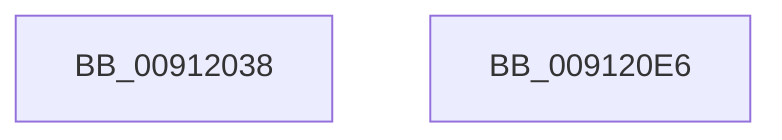

# PopPowerAggregatorInvokeStateMachine

- RVA: `0x00912038`–`0x009120E7` (길이 `175` bytes)
- VA: `0x0000000140912038`
- 실행 섹션: `PAGE`
- PDB 이름 있음: `예`; PDB Function 태그: `아니요`
- unwind 정보 RVA: `0x0005CF00`
- 디코드: `36`개 명령, `175/175` bytes 표시
- 미해석 바이트: `0` (있으면 어셈블리에 `.byte`로 보존)

> 이 문서는 커널 이미지의 기계어와 PDB 기호를 분석해 생성했습니다. 4번과 5번은 함수 원형과 자료형을 바이너리 사용 방식에서 추정한 C 해석이며 원본 소스 복구 결과는 아닙니다.

## 1. Dependencies

- 직접 호출 지점: **4**; 고유 호출 대상: **3**
- 직접 호출자로 확인된 함수: **1**
- RIP 상대 이미지 참조: **7**

### Outgoing calls
- `0x0091204A` → [PopPowerAggregatorAllocateLogEntry](PopPowerAggregatorAllocateLogEntry_function_00915F7C.md) (function, `0x00915F7C`)
- `0x00912096` → [PopPowerAggregatorDiagTraceHandlerInvoke](PopPowerAggregatorDiagTraceHandlerInvoke_function_009120F0.md) (function, `0x009120F0`)
- `0x009120C3` → [guard_dispatch_icall](../../text/6B/guard_dispatch_icall_function_006BAAD0.md) (function, `0x006BAAD0`)
- `0x009120D6` → [PopPowerAggregatorAllocateLogEntry](PopPowerAggregatorAllocateLogEntry_function_00915F7C.md) (function, `0x00915F7C`)

### Direct callers
- [PopPowerAggregatorWorker](PopPowerAggregatorWorker_function_00911FB0.md) at `0x00911FEC`

### Static image references
- `0x00912043` → RVA `0x00F09740` (`.data`; read)
- `0x0091204F` → RVA `0x00F09750` (`.data`; read)
- `0x00912056` → RVA `0x00F09778` (`.data`; read)
- `0x00912068` → RVA `0x00F09760` (`.data`; read)
- `0x00912073` → RVA `0x00F09770` (`.data`; read)
- `0x0091208B` → RVA `0x00F09788` (`.data`; read)
- `0x009120B8` → RVA `0x00FD8EE0` (`PAGEDATA`; read)

## 2. Other-region calls and transfers

- 다른 실행 섹션으로 향하는 call: **1**
  - `0x009120C3` → [guard_dispatch_icall](../../text/6B/guard_dispatch_icall_function_006BAAD0.md) (`PAGE` → `.text`)
- 별도 외부 분기/꼬리 이동을 확인하지 못했습니다.

## 3. Assembly (complete function range)

```asm
00912038  40 53                           push rbx
0091203A  48 83 EC 20                     sub rsp, 0x20
0091203E  BA 03 00 00 00                  mov edx, 3
00912043  48 8D 0D F6 76 5F 00            lea rcx, [rip + 0x5f76f6]
0091204A  E8 2D 3F 00 00                  call 0x140915f7c
0091204F  0F 10 05 FA 76 5F 00            movups xmm0, xmmword ptr [rip + 0x5f76fa]
00912056  48 8D 15 1B 77 5F 00            lea rdx, [rip + 0x5f771b]
0091205D  48 8D 0D EC 76 5F 00            lea rcx, [rip + 0x5f76ec]
00912064  0F 11 40 18                     movups xmmword ptr [rax + 0x18], xmm0
00912068  0F 10 0D F1 76 5F 00            movups xmm1, xmmword ptr [rip + 0x5f76f1]
0091206F  0F 11 48 28                     movups xmmword ptr [rax + 0x28], xmm1
00912073  F2 0F 10 05 F5 76 5F 00         movsd xmm0, qword ptr [rip + 0x5f76f5]
0091207B  F2 0F 11 40 38                  movsd qword ptr [rax + 0x38], xmm0
00912080  0F 10 0D F1 76 5F 00            movups xmm1, xmmword ptr [rip + 0x5f76f1]
00912087  0F 11 48 40                     movups xmmword ptr [rax + 0x40], xmm1
0091208B  0F 10 05 F6 76 5F 00            movups xmm0, xmmword ptr [rip + 0x5f76f6]
00912092  0F 11 40 50                     movups xmmword ptr [rax + 0x50], xmm0
00912096  E8 55 00 00 00                  call 0x1409120f0
0091209B  48 63 05 AE 76 5F 00            movsxd rax, dword ptr [rip + 0x5f76ae]
009120A2  48 8D 0D 97 76 5F 00            lea rcx, [rip + 0x5f7697]
009120A9  48 8D 14 40                     lea rdx, [rax + rax*2]
009120AD  48 63 05 C4 76 5F 00            movsxd rax, dword ptr [rip + 0x5f76c4]
009120B4  4C 8D 04 50                     lea r8, [rax + rdx*2]
009120B8  48 8D 05 21 6E 6C 00            lea rax, [rip + 0x6c6e21]
009120BF  4A 8B 04 C0                     mov rax, qword ptr [rax + r8*8]
009120C3  E8 08 8A DA FF                  call 0x1406baad0
009120C8  BA 04 00 00 00                  mov edx, 4
009120CD  48 8D 0D 6C 76 5F 00            lea rcx, [rip + 0x5f766c]
009120D4  8B D8                           mov ebx, eax
009120D6  E8 A1 3E 00 00                  call 0x140915f7c
009120DB  89 58 18                        mov dword ptr [rax + 0x18], ebx
009120DE  8B C3                           mov eax, ebx
009120E0  48 83 C4 20                     add rsp, 0x20
009120E4  5B                              pop rbx
009120E5  C3                              ret
009120E6  CC                              int3
```

## 4. C-style interpretation (structured pseudocode)

```c
__int64 __fastcall PopPowerAggregatorInvokeStateMachine(void)
{
    __int64 result;
    __int64 v_rsp;

    v_rsp = (v_rsp) - (32);
    result = PopPowerAggregatorAllocateLogEntry(v_rip + 6256374, 3, a3, a4);
    *(unsigned __int64 *)(result + 24) = v_xmm0;
    *(unsigned __int64 *)(result + 40) = v_xmm1;
    *(unsigned __int64 *)(result + 56) = v_xmm0;
    *(unsigned __int64 *)(result + 64) = v_xmm1;
    *(unsigned __int64 *)(result + 80) = v_xmm0;
    result = PopPowerAggregatorDiagTraceHandlerInvoke(v_rip + 6256364, v_rip + 6256411, a3, a4);
    result = guard_dispatch_icall(v_rip + 6256279, (int)(*(unsigned int *)(v_rip + 6256302)) + (int)(*(unsigned int *)(v_rip + 6256302)) * 2, (int)(*(unsigned int *)(v_rip + 6256324)) + (int)(*(unsigned int *)(v_rip + 6256302)) + (int)(*(unsigned int *)(v_rip + 6256302)) * 2 * 2, a4);
    result = PopPowerAggregatorAllocateLogEntry(v_rip + 6256236, 4, (int)(*(unsigned int *)(v_rip + 6256324)) + (int)(*(unsigned int *)(v_rip + 6256302)) + (int)(*(unsigned int *)(v_rip + 6256302)) * 2 * 2, a4);
    *(unsigned int *)(result + 24) = (unsigned int)((unsigned int)((unsigned int)(result)));
    v_rsp = (v_rsp) + (32);
    return (unsigned int)((unsigned int)((unsigned int)((unsigned int)(result))));
}
```

## 5. (Beta) C Style

```c
void PopPowerAggregatorInvokeStateMachine(void)
{
    int64_t result;
    int64_t local_rsp;

    local_rsp = (local_rsp) - (32);
    result = PopPowerAggregatorAllocateLogEntry(v_rip + 6256374, 3, a3, a4);
    *(uint64_t *)(result + 0x18) = v_xmm0;
    *(uint64_t *)(result + 0x28) = v_xmm1;
    *(uint64_t *)(result + 0x38) = v_xmm0;
    *(uint64_t *)(result + 0x40) = v_xmm1;
    *(uint64_t *)(result + 0x50) = v_xmm0;
    result = PopPowerAggregatorDiagTraceHandlerInvoke(v_rip + 6256364, v_rip + 6256411, a3, a4);
    result = guard_dispatch_icall(v_rip + 6256279, (int32_t)(*(uint32_t *)(v_rip + 0x5F76AE)) + (int32_t)(*(uint32_t *)(v_rip + 0x5F76AE)) * 2, (int32_t)(*(uint32_t *)(v_rip + 0x5F76C4)) + (int32_t)(*(uint32_t *)(v_rip + 0x5F76AE)) + (int32_t)(*(uint32_t *)(v_rip + 0x5F76AE)) * 2 * 2, a4);
    result = PopPowerAggregatorAllocateLogEntry(v_rip + 6256236, 4, (int32_t)(*(uint32_t *)(v_rip + 0x5F76C4)) + (int32_t)(*(uint32_t *)(v_rip + 0x5F76AE)) + (int32_t)(*(uint32_t *)(v_rip + 0x5F76AE)) * 2 * 2, a4);
    *(uint32_t *)(result + 0x18) = (uint32_t)((uint32_t)((uint32_t)(result)));
    local_rsp = (local_rsp) + (32);
    return (uint32_t)((uint32_t)((uint32_t)((uint32_t)(result))));
}
```

## 6. Execution-region graph

[열기: 2D/3D 그래프와 함수 탐색 컨트롤 패널](../../../control-panel.html?section=page&rva=0x00912038&view=graph)

- 2D 그래프는 위에서 아래로 흐르고, 3D 그래프는 빈 공간을 드래그해 회전합니다. Shift+드래그는 이동, 휠은 확대·축소, 함수 노드 선택은 대상 보고서 이동입니다.

### Static fallback


