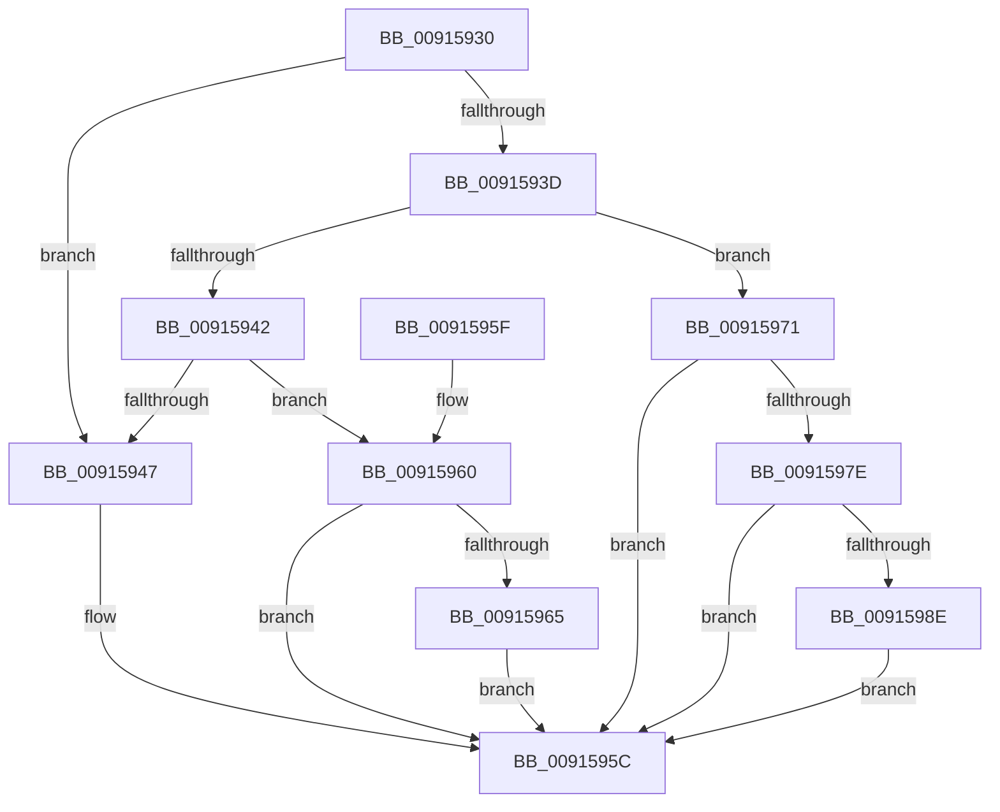

# PopPowerAggregatorIsAtTargetState

- RVA: `0x00915930`–`0x00915992` (길이 `98` bytes)
- VA: `0x0000000140915930`
- 실행 섹션: `PAGE`
- PDB 이름 있음: `예`; PDB Function 태그: `아니요`
- unwind 정보 RVA: `0x000DB714`
- 디코드: `28`개 명령, `98/98` bytes 표시
- 미해석 바이트: `0` (있으면 어셈블리에 `.byte`로 보존)

> 이 문서는 커널 이미지의 기계어와 PDB 기호를 분석해 생성했습니다. 4번과 5번은 함수 원형과 자료형을 바이너리 사용 방식에서 추정한 C 해석이며 원본 소스 복구 결과는 아닙니다.

## 1. Dependencies

- 직접 호출 지점: **0**; 고유 호출 대상: **0**
- 직접 호출자로 확인된 함수: **1**
- RIP 상대 이미지 참조: **4**

### Outgoing calls
- 직접 디코드된 call 명령이 없습니다.

### Direct callers
- [PopPowerAggregatorHandleIntentUnsafe](PopPowerAggregatorHandleIntentUnsafe_function_009146D8.md) at `0x009147D7`

### Static image references
- `0x00915930` → RVA `0x00F09750` (`.data`; read)
- `0x00915947` → RVA `0x00F09778` (`.data`; read)
- `0x0091597E` → RVA `0x00F09760` (`.data`; read)
- `0x00915985` → RVA `0x00F09780` (`.data`; read)

## 2. Other-region calls and transfers

- 다른 실행 섹션으로 향하는 call: **0**
- 별도 외부 분기/꼬리 이동을 확인하지 못했습니다.

## 3. Assembly (complete function range)

```asm
00915930  48 8B 0D 19 3E 5F 00            mov rcx, qword ptr [rip + 0x5f3e19]
00915937  33 D2                           xor edx, edx
00915939  85 C9                           test ecx, ecx
0091593B  74 0A                           je 0x140915947
0091593D  83 E9 01                        sub ecx, 1
00915940  74 2F                           je 0x140915971
00915942  83 E9 01                        sub ecx, 1
00915945  75 19                           jne 0x140915960
00915947  F7 05 27 3E 5F 00 FD FF FF FF   test dword ptr [rip + 0x5f3e27], 0xfffffffd
00915951  B9 01 00 00 00                  mov ecx, 1
00915956  0F B6 D2                        movzx edx, dl
00915959  0F 44 D1                        cmove edx, ecx
0091595C  8A C2                           mov al, dl
0091595E  C3                              ret
0091595F  CC                              int3
00915960  83 E9 01                        sub ecx, 1
00915963  75 F7                           jne 0x14091595c
00915965  83 3D 0C 3E 5F 00 05            cmp dword ptr [rip + 0x5f3e0c], 5
0091596C  0F 94 C2                        sete dl
0091596F  EB EB                           jmp 0x14091595c
00915971  B9 01 00 00 00                  mov ecx, 1
00915976  39 0D FC 3D 5F 00               cmp dword ptr [rip + 0x5f3dfc], ecx
0091597C  75 DE                           jne 0x14091595c
0091597E  48 8B 05 DB 3D 5F 00            mov rax, qword ptr [rip + 0x5f3ddb]
00915985  48 39 05 F4 3D 5F 00            cmp qword ptr [rip + 0x5f3df4], rax
0091598C  75 CE                           jne 0x14091595c
0091598E  8A D1                           mov dl, cl
00915990  EB CA                           jmp 0x14091595c
```

## 4. C-style interpretation (structured pseudocode)

```c
__int64 __fastcall PopPowerAggregatorIsAtTargetState(__int64 a1, int a2)
{
    a2 = 0;
    if ((unsigned int)(*(unsigned __int64 *)(v_rip + 6241817)) == 0) goto loc_00915947;
    a1 = (unsigned int)((*(unsigned __int64 *)(v_rip + 6241817)) - (1));
    if (condition_is_equal) goto loc_00915971;
    a1 = (unsigned int)((a1) - (1));
    if (condition_is_not_equal) goto loc_00915960;
loc_00915947:
    a2 = 0;
    if (((*(unsigned int *)(v_rip + 6241831)) & (0xFFFFFFFDULL)) == 0) { a2 = 1; }
loc_0091595C:
    return (unsigned __int8)(a2);
loc_00915960:
    a1 = (unsigned int)((1) - (1));
    if (condition_is_not_equal) goto loc_0091595C;
    a2 = ((*(unsigned int *)(v_rip + 6241804)) == 5) ? 1 : 0;
    goto loc_0091595C;
loc_00915971:
    if ((*(unsigned int *)(v_rip + 6241788)) != 1) goto loc_0091595C;
    if ((*(unsigned __int64 *)(v_rip + 6241780)) != (*(unsigned __int64 *)(v_rip + 6241755))) goto loc_0091595C;
    goto loc_0091595C;
}
```

## 5. (Beta) C Style

```c
int64_t PopPowerAggregatorIsAtTargetState(int64_t Arg1, int32_t Arg2)
{
    Arg2 = 0;
    if ((uint32_t)(*(uint64_t *)(v_rip + 0x5F3E19)) == 0) goto loc_00915947;
    Arg1 = (uint32_t)((*(uint64_t *)(v_rip + 0x5F3E19)) - (1));
    if (condition_is_equal) goto loc_00915971;
    Arg1 = (uint32_t)((Arg1) - (1));
    if (condition_is_not_equal) goto loc_00915960;
loc_00915947:
    Arg2 = 0;
    if (((*(uint32_t *)(v_rip + 0x5F3E27)) & (0xFFFFFFFDULL)) == 0) { Arg2 = 1; }
loc_0091595C:
    return (uint8_t)(Arg2);
loc_00915960:
    Arg1 = (uint32_t)((1) - (1));
    if (condition_is_not_equal) goto loc_0091595C;
    Arg2 = ((*(uint32_t *)(v_rip + 0x5F3E0C)) == 5) ? 1 : 0;
    goto loc_0091595C;
loc_00915971:
    if ((*(uint32_t *)(v_rip + 0x5F3DFC)) != 1) goto loc_0091595C;
    if ((*(uint64_t *)(v_rip + 0x5F3DF4)) != (*(uint64_t *)(v_rip + 0x5F3DDB))) goto loc_0091595C;
    goto loc_0091595C;
}
```

## 6. Execution-region graph

[열기: 2D/3D 그래프와 함수 탐색 컨트롤 패널](../../../control-panel.html?section=page&rva=0x00915930&view=graph)

- 2D 그래프는 위에서 아래로 흐르고, 3D 그래프는 빈 공간을 드래그해 회전합니다. Shift+드래그는 이동, 휠은 확대·축소, 함수 노드 선택은 대상 보고서 이동입니다.

### Static fallback


