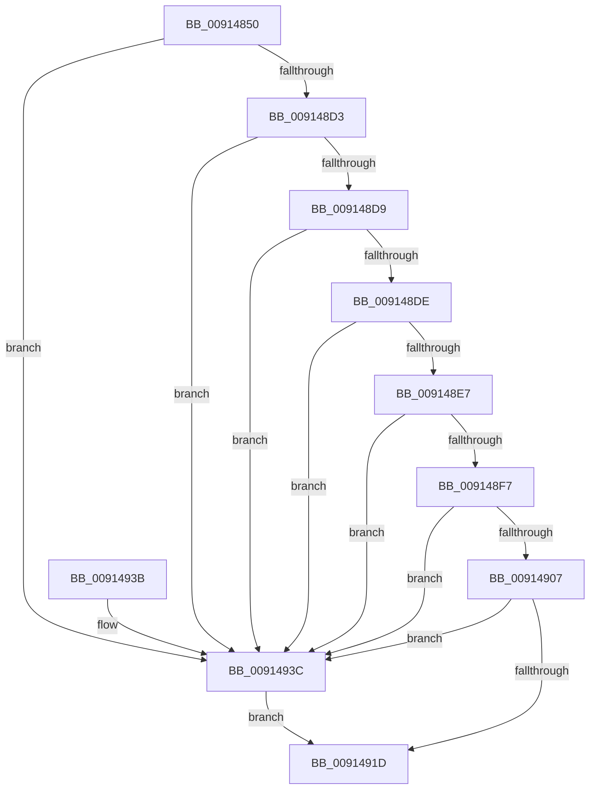

# PopPowerAggregatorRecordIntent

- RVA: `0x00914850`–`0x009149AE` (길이 `350` bytes)
- VA: `0x0000000140914850`
- 실행 섹션: `PAGE`
- PDB 이름 있음: `예`; PDB Function 태그: `아니요`
- unwind 정보 RVA: `0x0008A5F8`
- 디코드: `90`개 명령, `350/350` bytes 표시
- 미해석 바이트: `0` (있으면 어셈블리에 `.byte`로 보존)

> 이 문서는 커널 이미지의 기계어와 PDB 기호를 분석해 생성했습니다. 4번과 5번은 함수 원형과 자료형을 바이너리 사용 방식에서 추정한 C 해석이며 원본 소스 복구 결과는 아닙니다.

## 1. Dependencies

- 직접 호출 지점: **5**; 고유 호출 대상: **4**
- 직접 호출자로 확인된 함수: **1**
- RIP 상대 이미지 참조: **3**

### Outgoing calls
- `0x009148AD` → [PopPowerAggregatorDiagTraceHandleIntent](PopPowerAggregatorDiagTraceHandleIntent_function_00914A04.md) (function, `0x00914A04`)
- `0x009148EE` → [PopPowerAggregatorAreTargetStatesEqual](PopPowerAggregatorAreTargetStatesEqual_function_009158C8.md) (function, `0x009158C8`)
- `0x009148FE` → [PopPowerAggregatorAreTargetStatesEqual](PopPowerAggregatorAreTargetStatesEqual_function_009158C8.md) (function, `0x009158C8`)
- `0x0091490C` → [KeQueryInterruptTimePrecise](../../text/20/KeQueryInterruptTimePrecise_function_00209530.md) (function, `0x00209530`)
- `0x00914948` → [PopPowerAggregatorAllocateLogEntry](PopPowerAggregatorAllocateLogEntry_function_00915F7C.md) (function, `0x00915F7C`)

### Direct callers
- [PopPowerAggregatorHandleIntentUnsafe](PopPowerAggregatorHandleIntentUnsafe_function_009146D8.md) at `0x00914809`

### Static image references
- `0x009148B2` → RVA `0x00F09A08` (`.data`; read)
- `0x009148C4` → RVA `0x00F09A10` (`.data`; read)
- `0x00914941` → RVA `0x00F09740` (`.data`; read)

## 2. Other-region calls and transfers

- 다른 실행 섹션으로 향하는 call: **1**
  - `0x0091490C` → [KeQueryInterruptTimePrecise](../../text/20/KeQueryInterruptTimePrecise_function_00209530.md) (`PAGE` → `.text`)
- 별도 외부 분기/꼬리 이동을 확인하지 못했습니다.

## 3. Assembly (complete function range)

```asm
00914850  48 8B C4                        mov rax, rsp
00914853  48 89 58 10                     mov qword ptr [rax + 0x10], rbx
00914857  48 89 68 18                     mov qword ptr [rax + 0x18], rbp
0091485B  48 89 70 20                     mov qword ptr [rax + 0x20], rsi
0091485F  57                              push rdi
00914860  41 54                           push r12
00914862  41 55                           push r13
00914864  41 56                           push r14
00914866  41 57                           push r15
00914868  48 83 EC 40                     sub rsp, 0x40
0091486C  4C 8B A4 24 A8 00 00 00         mov r12, qword ptr [rsp + 0xa8]
00914874  41 8B E9                        mov ebp, r9d
00914877  48 8B B4 24 90 00 00 00         mov rsi, qword ptr [rsp + 0x90]
0091487F  45 8B E8                        mov r13d, r8d
00914882  44 8B BC 24 A0 00 00 00         mov r15d, dword ptr [rsp + 0xa0]
0091488A  44 8B F2                        mov r14d, edx
0091488D  48 8B BC 24 98 00 00 00         mov rdi, qword ptr [rsp + 0x98]
00914895  4C 8B CE                        mov r9, rsi
00914898  4C 89 60 C8                     mov qword ptr [rax - 0x38], r12
0091489C  44 8B C5                        mov r8d, ebp
0091489F  44 89 78 C0                     mov dword ptr [rax - 0x40], r15d
009148A3  41 8B D5                        mov edx, r13d
009148A6  41 8B CE                        mov ecx, r14d
009148A9  48 89 78 B8                     mov qword ptr [rax - 0x48], rdi
009148AD  E8 52 01 00 00                  call 0x140914a04
009148B2  8B 05 50 51 5F 00               mov eax, dword ptr [rip + 0x5f5150]
009148B8  FF C8                           dec eax
009148BA  83 E0 1F                        and eax, 0x1f
009148BD  48 69 D8 98 00 00 00            imul rbx, rax, 0x98
009148C4  48 8D 05 45 51 5F 00            lea rax, [rip + 0x5f5145]
009148CB  48 03 D8                        add rbx, rax
009148CE  83 3B 01                        cmp dword ptr [rbx], 1
009148D1  75 69                           jne 0x14091493c
009148D3  44 39 73 18                     cmp dword ptr [rbx + 0x18], r14d
009148D7  75 63                           jne 0x14091493c
009148D9  39 6B 38                        cmp dword ptr [rbx + 0x38], ebp
009148DC  75 5E                           jne 0x14091493c
009148DE  44 39 BB 90 00 00 00            cmp dword ptr [rbx + 0x90], r15d
009148E5  75 55                           jne 0x14091493c
009148E7  48 8D 4B 40                     lea rcx, [rbx + 0x40]
009148EB  48 8B D6                        mov rdx, rsi
009148EE  E8 D5 0F 00 00                  call 0x1409158c8
009148F3  84 C0                           test al, al
009148F5  74 45                           je 0x14091493c
009148F7  48 8D 4B 68                     lea rcx, [rbx + 0x68]
009148FB  48 8B D7                        mov rdx, rdi
009148FE  E8 C5 0F 00 00                  call 0x1409158c8
00914903  84 C0                           test al, al
00914905  74 35                           je 0x14091493c
00914907  48 8D 4C 24 70                  lea rcx, [rsp + 0x70]
0091490C  E8 1F 4C 8F FF                  call 0x140209530
00914911  48 2B 43 08                     sub rax, qword ptr [rbx + 8]
00914915  48 3D 80 F0 FA 02               cmp rax, 0x2faf080
0091491B  73 1F                           jae 0x14091493c
0091491D  4C 8D 5C 24 40                  lea r11, [rsp + 0x40]
00914922  49 8B 5B 38                     mov rbx, qword ptr [r11 + 0x38]
00914926  49 8B 6B 40                     mov rbp, qword ptr [r11 + 0x40]
0091492A  49 8B 73 48                     mov rsi, qword ptr [r11 + 0x48]
0091492E  49 8B E3                        mov rsp, r11
00914931  41 5F                           pop r15
00914933  41 5E                           pop r14
00914935  41 5D                           pop r13
00914937  41 5C                           pop r12
00914939  5F                              pop rdi
0091493A  C3                              ret
0091493B  CC                              int3
0091493C  BA 01 00 00 00                  mov edx, 1
00914941  48 8D 0D F8 4D 5F 00            lea rcx, [rip + 0x5f4df8]
00914948  E8 2F 16 00 00                  call 0x140915f7c
0091494D  44 89 70 18                     mov dword ptr [rax + 0x18], r14d
00914951  41 0F 10 04 24                  movups xmm0, xmmword ptr [r12]
00914956  0F 11 40 1C                     movups xmmword ptr [rax + 0x1c], xmm0
0091495A  F2 41 0F 10 4C 24 10            movsd xmm1, qword ptr [r12 + 0x10]
00914961  F2 0F 11 48 2C                  movsd qword ptr [rax + 0x2c], xmm1
00914966  44 89 68 34                     mov dword ptr [rax + 0x34], r13d
0091496A  89 68 38                        mov dword ptr [rax + 0x38], ebp
0091496D  0F 10 06                        movups xmm0, xmmword ptr [rsi]
00914970  0F 11 40 40                     movups xmmword ptr [rax + 0x40], xmm0
00914974  0F 10 4E 10                     movups xmm1, xmmword ptr [rsi + 0x10]
00914978  0F 11 48 50                     movups xmmword ptr [rax + 0x50], xmm1
0091497C  F2 0F 10 46 20                  movsd xmm0, qword ptr [rsi + 0x20]
00914981  F2 0F 11 40 60                  movsd qword ptr [rax + 0x60], xmm0
00914986  0F 10 07                        movups xmm0, xmmword ptr [rdi]
00914989  0F 11 40 68                     movups xmmword ptr [rax + 0x68], xmm0
0091498D  0F 10 4F 10                     movups xmm1, xmmword ptr [rdi + 0x10]
00914991  0F 11 48 78                     movups xmmword ptr [rax + 0x78], xmm1
00914995  F2 0F 10 47 20                  movsd xmm0, qword ptr [rdi + 0x20]
0091499A  F2 0F 11 80 88 00 00 00         movsd qword ptr [rax + 0x88], xmm0
009149A2  44 89 B8 90 00 00 00            mov dword ptr [rax + 0x90], r15d
009149A9  E9 6F FF FF FF                  jmp 0x14091491d
```

## 4. C-style interpretation (structured pseudocode)

```c
__int64 __fastcall PopPowerAggregatorRecordIntent(__int64 a1, int a2, int a3, int a4, __int64 a5, __int64 a6, unsigned int a7, __int64 a8)
{
    __int64 result;
    __int64 v_rbx;
    __int64 v_rsp;
    unsigned __int64 v_stack_m28;
    unsigned __int64 v_stack_p8;

    *(unsigned __int64 *)(v_rsp + 16) = v_rbx;
    *(unsigned __int64 *)(v_rsp + 24) = v_rbp;
    *(unsigned __int64 *)(v_rsp + 32) = v_rsi;
    v_rsp = (v_rsp) - (64);
    *(unsigned __int64 *)(v_rsp - 56) = a8;
    *(unsigned int *)(v_rsp - 64) = (unsigned int)((unsigned int)(a7));
    *(unsigned __int64 *)(v_rsp - 72) = a6;
    result = PopPowerAggregatorDiagTraceHandleIntent((unsigned int)((unsigned int)((unsigned int)(a2))), (unsigned int)((unsigned int)((unsigned int)(a3))), (unsigned int)((unsigned int)((unsigned int)(a4))), a5);
    result = (unsigned int)(((unsigned int)(*(unsigned int *)(v_rip + 6246736))) - 1);
    result = (unsigned int)((result) & (31));
    v_rbx = (v_rbx) * (result);
    v_rbx = (v_rbx) + (v_rip + 6246725);
    if ((*(unsigned int *)(v_rbx)) != 1) goto loc_0091493C;
    if ((*(unsigned int *)(v_rbx + 24)) != ((unsigned int)((unsigned int)(a2)))) goto loc_0091493C;
    if ((*(unsigned int *)(v_rbx + 56)) != ((unsigned int)((unsigned int)(a4)))) goto loc_0091493C;
    if ((*(unsigned int *)(v_rbx + 144)) != ((unsigned int)((unsigned int)(a7)))) goto loc_0091493C;
    result = PopPowerAggregatorAreTargetStatesEqual(v_rbx + 64, a5, (unsigned int)((unsigned int)((unsigned int)(a4))), a5);
    if ((unsigned __int8)(result) == 0) goto loc_0091493C;
    result = PopPowerAggregatorAreTargetStatesEqual(v_rbx + 104, a6, (unsigned int)((unsigned int)((unsigned int)(a4))), a5);
    if ((unsigned __int8)(result) == 0) goto loc_0091493C;
    result = KeQueryInterruptTimePrecise(v_stack_p8, a6, (unsigned int)((unsigned int)((unsigned int)(a4))), a5);
    result = (result) - (*(unsigned __int64 *)(v_rbx + 8));
    if (result >= 0x2FAF080ULL) goto loc_0091493C;
loc_0091491D:
    return result;
loc_0091493C:
    result = PopPowerAggregatorAllocateLogEntry(v_rip + 6245880, 1, (unsigned int)((unsigned int)((unsigned int)(a4))), a5);
    *(unsigned int *)(result + 24) = (unsigned int)((unsigned int)(a2));
    *(unsigned __int64 *)(result + 28) = v_xmm0;
    *(unsigned __int64 *)(result + 44) = v_xmm1;
    *(unsigned int *)(result + 52) = (unsigned int)((unsigned int)(a3));
    *(unsigned int *)(result + 56) = (unsigned int)(*(unsigned __int64 *)(v_stack_m28 + 64));
    *(unsigned __int64 *)(result + 64) = v_xmm0;
    *(unsigned __int64 *)(result + 80) = v_xmm1;
    *(unsigned __int64 *)(result + 96) = v_xmm0;
    *(unsigned __int64 *)(result + 104) = v_xmm0;
    *(unsigned __int64 *)(result + 120) = v_xmm1;
    *(unsigned __int64 *)(result + 136) = v_xmm0;
    *(unsigned int *)(result + 144) = (unsigned int)((unsigned int)(a7));
    goto loc_0091491D;
}
```

## 5. (Beta) C Style

```c
int64_t PopPowerAggregatorRecordIntent(int64_t Arg1, int32_t Arg2, int32_t Arg3, int32_t Arg4, void *Arg5, void *Arg6, uint32_t Arg7, void *Arg8)
{
    uint8_t *arg5 = (uint8_t *)Arg5;
    uint8_t *arg6 = (uint8_t *)Arg6;
    uint8_t *arg8 = (uint8_t *)Arg8;

    int64_t result;
    int64_t local_rbx;
    int64_t local_rsp;
    uint64_t v_stack_m28;
    uint64_t v_stack_p8;

    *(uint64_t *)(local_rsp + 0x10) = local_rbx;
    *(uint64_t *)(local_rsp + 0x18) = local_rbp;
    *(uint64_t *)(local_rsp + 0x20) = local_rsi;
    local_rsp = (local_rsp) - (64);
    *(void **)(local_rsp - 0x38) = Arg8;
    *(uint32_t *)(local_rsp - 0x40) = (uint32_t)((uint32_t)(Arg7));
    *(void **)(local_rsp - 0x48) = Arg6;
    result = PopPowerAggregatorDiagTraceHandleIntent((uint32_t)((uint32_t)((uint32_t)(Arg2))), (uint32_t)((uint32_t)((uint32_t)(Arg3))), (uint32_t)((uint32_t)((uint32_t)(Arg4))), Arg5);
    result = (uint32_t)(((uint32_t)(*(uint32_t *)(v_rip + 0x5F5150))) - 1);
    result = (uint32_t)((result) & (31));
    local_rbx = (local_rbx) * (result);
    local_rbx = (local_rbx) + (v_rip + 6246725);
    if ((*(uint32_t *)(local_rbx)) != 1) goto loc_0091493C;
    if ((*(uint32_t *)(local_rbx + 0x18)) != ((uint32_t)((uint32_t)(Arg2)))) goto loc_0091493C;
    if ((*(uint32_t *)(local_rbx + 0x38)) != ((uint32_t)((uint32_t)(Arg4)))) goto loc_0091493C;
    if ((*(uint32_t *)(local_rbx + 0x90)) != ((uint32_t)((uint32_t)(Arg7)))) goto loc_0091493C;
    result = PopPowerAggregatorAreTargetStatesEqual(local_rbx + 64, Arg5, (uint32_t)((uint32_t)((uint32_t)(Arg4))), Arg5);
    if ((uint8_t)(result) == 0) goto loc_0091493C;
    result = PopPowerAggregatorAreTargetStatesEqual(local_rbx + 104, Arg6, (uint32_t)((uint32_t)((uint32_t)(Arg4))), Arg5);
    if ((uint8_t)(result) == 0) goto loc_0091493C;
    result = KeQueryInterruptTimePrecise(v_stack_p8, Arg6, (uint32_t)((uint32_t)((uint32_t)(Arg4))), Arg5);
    result = (result) - (*(uint64_t *)(local_rbx + 0x8));
    if (result >= 0x2FAF080ULL) goto loc_0091493C;
loc_0091491D:
    return result;
loc_0091493C:
    result = PopPowerAggregatorAllocateLogEntry(v_rip + 6245880, 1, (uint32_t)((uint32_t)((uint32_t)(Arg4))), Arg5);
    *(uint32_t *)(result + 0x18) = (uint32_t)((uint32_t)(Arg2));
    *(uint64_t *)(result + 0x1C) = v_xmm0;
    *(uint64_t *)(result + 0x2C) = v_xmm1;
    *(uint32_t *)(result + 0x34) = (uint32_t)((uint32_t)(Arg3));
    *(uint32_t *)(result + 0x38) = (uint32_t)(*(uint64_t *)(v_stack_m28 + 0x40));
    *(uint64_t *)(result + 0x40) = v_xmm0;
    *(uint64_t *)(result + 0x50) = v_xmm1;
    *(uint64_t *)(result + 0x60) = v_xmm0;
    *(uint64_t *)(result + 0x68) = v_xmm0;
    *(uint64_t *)(result + 0x78) = v_xmm1;
    *(uint64_t *)(result + 0x88) = v_xmm0;
    *(uint32_t *)(result + 0x90) = (uint32_t)((uint32_t)(Arg7));
    goto loc_0091491D;
}
```

### 관측된 메모리 오프셋

구조체 형식이 확인되지 않은 접근은 인자 기준의 오프셋으로만 기록했습니다.

| 기준 인자 | 오프셋 표현 | 폭 (bit) | 접근 |
|---|---:|---:|---|
| `Arg5` | `+ 0x0` | `128` | `R` |
| `Arg5` | `+ 0x10` | `128` | `R` |
| `Arg5` | `+ 0x20` | `64` | `R` |
| `Arg6` | `+ 0x0` | `128` | `R` |
| `Arg6` | `+ 0x10` | `128` | `R` |
| `Arg6` | `+ 0x20` | `64` | `R` |
| `Arg8` | `+ 0x0` | `128` | `R` |
| `Arg8` | `+ 0x10` | `64` | `R` |

## 6. Execution-region graph

[열기: 2D/3D 그래프와 함수 탐색 컨트롤 패널](../../../control-panel.html?section=page&rva=0x00914850&view=graph)

- 2D 그래프는 위에서 아래로 흐르고, 3D 그래프는 빈 공간을 드래그해 회전합니다. Shift+드래그는 이동, 휠은 확대·축소, 함수 노드 선택은 대상 보고서 이동입니다.

### Static fallback


