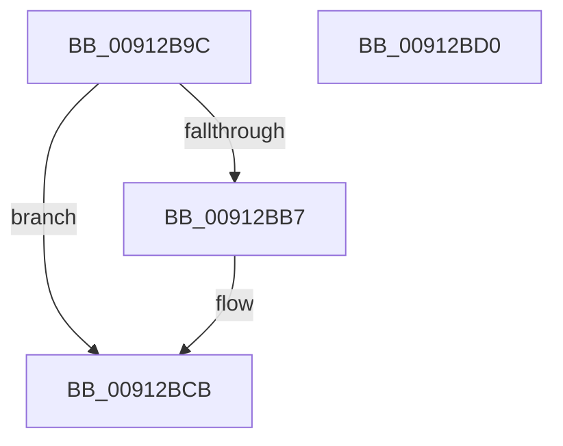

# PopPowerAggregatorScheduleWorker

- RVA: `0x00912B9C`–`0x00912BD1` (길이 `53` bytes)
- VA: `0x0000000140912B9C`
- 실행 섹션: `PAGE`
- PDB 이름 있음: `예`; PDB Function 태그: `아니요`
- unwind 정보 RVA: `0x0005C788`
- 디코드: `15`개 명령, `53/53` bytes 표시
- 미해석 바이트: `0` (있으면 어셈블리에 `.byte`로 보존)

> 이 문서는 커널 이미지의 기계어와 PDB 기호를 분석해 생성했습니다. 4번과 5번은 함수 원형과 자료형을 바이너리 사용 방식에서 추정한 C 해석이며 원본 소스 복구 결과는 아닙니다.

## 1. Dependencies

- 직접 호출 지점: **1**; 고유 호출 대상: **1**
- 직접 호출자로 확인된 함수: **6**
- RIP 상대 이미지 참조: **0**

### Outgoing calls
- `0x00912BC6` → [ExQueueWorkItem](../../text/2F/ExQueueWorkItem_function_002F9520.md) (function, `0x002F9520`)

### Direct callers
- [PopPowerAggregatorNotifyDisplayPoweredOn](../70/PopPowerAggregatorNotifyDisplayPoweredOn_function_007003C4.md) at `0x007003EB`
- [PopPowerAggregatorSessionSwitchWorker](../76/PopPowerAggregatorSessionSwitchWorker_function_00764FB0.md) at `0x00764FE5`
- [PopNotifyCsStateExited](PopNotifyCsStateExited_function_00911F60.md) at `0x00911F77`
- [PopPowerAggregatorHandleIntentUnsafe](PopPowerAggregatorHandleIntentUnsafe_function_009146D8.md) at `0x00914841`
- [PopPowerAggregatorNotifyPdcSleepTransition](../AB/PopPowerAggregatorNotifyPdcSleepTransition_function_00AB11E0.md) at `0x00AB125F`
- [sub_00B39700](../B3/Unknown_function_00B39700.md) at `0x00B3973D`

### Static image references
- 디코드된 RIP-relative 메모리 참조가 없습니다.

## 2. Other-region calls and transfers

- 다른 실행 섹션으로 향하는 call: **1**
  - `0x00912BC6` → [ExQueueWorkItem](../../text/2F/ExQueueWorkItem_function_002F9520.md) (`PAGE` → `.text`)
- 별도 외부 분기/꼬리 이동을 확인하지 못했습니다.

## 3. Assembly (complete function range)

```asm
00912B9C  48 83 EC 28                     sub rsp, 0x28
00912BA0  44 8B 41 08                     mov r8d, dword ptr [rcx + 8]
00912BA4  BA 01 00 00 00                  mov edx, 1
00912BA9  41 8B C0                        mov eax, r8d
00912BAC  83 C8 02                        or eax, 2
00912BAF  89 41 08                        mov dword ptr [rcx + 8], eax
00912BB2  44 84 C2                        test dl, r8b
00912BB5  75 14                           jne 0x140912bcb
00912BB7  41 83 C8 03                     or r8d, 3
00912BBB  44 89 41 08                     mov dword ptr [rcx + 8], r8d
00912BBF  48 81 C1 D0 15 00 00            add rcx, 0x15d0
00912BC6  E8 55 69 9E FF                  call 0x1402f9520
00912BCB  48 83 C4 28                     add rsp, 0x28
00912BCF  C3                              ret
00912BD0  CC                              int3
```

## 4. C-style interpretation (structured pseudocode)

```c
__int64 __fastcall PopPowerAggregatorScheduleWorker(__int64 a1)
{
    __int64 result;
    __int64 v_rsp;

    v_rsp = (v_rsp) - (40);
    result = (unsigned int)(((unsigned int)((unsigned int)((unsigned int)(*(unsigned int *)(a1 + 8))))) | (2));
    *(unsigned int *)(a1 + 8) = (unsigned int)(result);
    if (((1) & ((unsigned __int8)((unsigned int)(*(unsigned int *)(a1 + 8))))) == 0) {
        a3 = (unsigned int)(((unsigned int)(*(unsigned int *)(a1 + 8))) | (3));
        *(unsigned int *)(a1 + 8) = (unsigned int)(a3);
        a1 = (a1) + (0x15D0ULL);
        result = ExQueueWorkItem(a1, 1, a3, a4);
    }
    v_rsp = (v_rsp) + (40);
    return result;
}
```

## 5. (Beta) C Style

```c
int64_t PopPowerAggregatorScheduleWorker(void *Arg1)
{
    uint8_t *arg1 = (uint8_t *)Arg1;

    int64_t result;
    int64_t local_rsp;

    local_rsp = (local_rsp) - (40);
    result = (uint32_t)(((uint32_t)((uint32_t)((uint32_t)(*(uint32_t *)(arg1 + 0x8))))) | (2));
    *(uint32_t *)(arg1 + 0x8) = (uint32_t)(result);
    if (((1) & ((uint8_t)((uint32_t)(*(uint32_t *)(arg1 + 0x8))))) == 0) {
        a3 = (uint32_t)(((uint32_t)(*(uint32_t *)(arg1 + 0x8))) | (3));
        *(uint32_t *)(arg1 + 0x8) = (uint32_t)(a3);
        Arg1 = (Arg1) + (0x15D0ULL);
        result = ExQueueWorkItem(Arg1, 1, a3, a4);
    }
    local_rsp = (local_rsp) + (40);
    return result;
}
```

### 관측된 메모리 오프셋

구조체 형식이 확인되지 않은 접근은 인자 기준의 오프셋으로만 기록했습니다.

| 기준 인자 | 오프셋 표현 | 폭 (bit) | 접근 |
|---|---:|---:|---|
| `Arg1` | `+ 0x8` | `32` | `R` |
| `Arg1` | `+ 0x8` | `32` | `W` |

## 6. Execution-region graph

[열기: 2D/3D 그래프와 함수 탐색 컨트롤 패널](../../../control-panel.html?section=page&rva=0x00912B9C&view=graph)

- 2D 그래프는 위에서 아래로 흐르고, 3D 그래프는 빈 공간을 드래그해 회전합니다. Shift+드래그는 이동, 휠은 확대·축소, 함수 노드 선택은 대상 보고서 이동입니다.

### Static fallback


