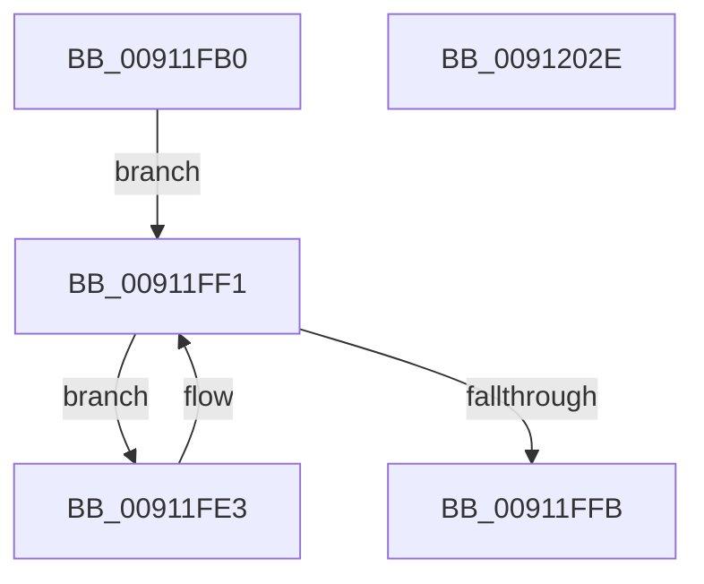

# PopPowerAggregatorWorker

- RVA: `0x00911FB0`–`0x0091202F` (길이 `127` bytes)
- VA: `0x0000000140911FB0`
- 실행 섹션: `PAGE`
- PDB 이름 있음: `예`; PDB Function 태그: `아니요`
- unwind 정보 RVA: `0x0005C788`
- 디코드: `28`개 명령, `127/127` bytes 표시
- 미해석 바이트: `0` (있으면 어셈블리에 `.byte`로 보존)

> 이 문서는 커널 이미지의 기계어와 PDB 기호를 분석해 생성했습니다. 4번과 5번은 함수 원형과 자료형을 바이너리 사용 방식에서 추정한 C 해석이며 원본 소스 복구 결과는 아닙니다.

## 1. Dependencies

- 직접 호출 지점: **5**; 고유 호출 대상: **4**
- 직접 호출자로 확인된 함수: **0**
- RIP 상대 이미지 참조: **7**

### Outgoing calls
- `0x00911FBB` → [PopAcquireRwLockExclusive](../../text/43/PopAcquireRwLockExclusive_function_00430B44.md) (function, `0x00430B44`)
- `0x00911FCC` → [PopPowerAggregatorDiagTraceEvent](PopPowerAggregatorDiagTraceEvent_function_00912184.md) (function, `0x00912184`)
- `0x00911FEC` → [PopPowerAggregatorInvokeStateMachine](PopPowerAggregatorInvokeStateMachine_function_00912038.md) (function, `0x00912038`)
- `0x00912018` → [PopPowerAggregatorDiagTraceEvent](PopPowerAggregatorDiagTraceEvent_function_00912184.md) (function, `0x00912184`)
- `0x00912024` → [PopReleaseRwLock](../../text/2D/PopReleaseRwLock_function_002DFBBC.md) (function, `0x002DFBBC`)

### Direct callers
- 이 함수 시작 RVA로 연결되는 직접 call은 확인되지 않았습니다. 간접 호출은 완전히 역산할 수 없습니다.

### Static image references
- `0x00911FB4` → RVA `0x00F09710` (`.data`; read)
- `0x00911FC3` → RVA `0x00011988` (`.rdata`; read)
- `0x00911FDA` → RVA `0x00F0AD30` (`.data`; write)
- `0x00911FE6` → RVA `0x00F09748` (`.data`; write)
- `0x00911FF1` → RVA `0x00F09748` (`.data`; read)
- `0x00911FFB` → RVA `0x00F0AD30` (`.data`; read/write)
- `0x00912003` → RVA `0x00011978` (`.rdata`; read)

## 2. Other-region calls and transfers

- 다른 실행 섹션으로 향하는 call: **2**
  - `0x00911FBB` → [PopAcquireRwLockExclusive](../../text/43/PopAcquireRwLockExclusive_function_00430B44.md) (`PAGE` → `.text`)
  - `0x00912024` → [PopReleaseRwLock](../../text/2D/PopReleaseRwLock_function_002DFBBC.md) (`PAGE` → `.text`)
- 별도 외부 분기/꼬리 이동을 확인하지 못했습니다.

## 3. Assembly (complete function range)

```asm
00911FB0  48 83 EC 28                     sub rsp, 0x28
00911FB4  48 8D 0D 55 77 5F 00            lea rcx, [rip + 0x5f7755]
00911FBB  E8 84 EB B1 FF                  call 0x140430b44
00911FC0  45 33 C0                        xor r8d, r8d
00911FC3  48 8D 0D BE F9 6F FF            lea rcx, [rip - 0x900642]
00911FCA  33 D2                           xor edx, edx
00911FCC  E8 B3 01 00 00                  call 0x140912184
00911FD1  65 48 8B 04 25 88 01 00 00      mov rax, qword ptr gs:[0x188]
00911FDA  48 89 05 4F 8D 5F 00            mov qword ptr [rip + 0x5f8d4f], rax
00911FE1  EB 0E                           jmp 0x140911ff1
00911FE3  83 E0 FD                        and eax, 0xfffffffd
00911FE6  89 05 5C 77 5F 00               mov dword ptr [rip + 0x5f775c], eax
00911FEC  E8 47 00 00 00                  call 0x140912038
00911FF1  8B 05 51 77 5F 00               mov eax, dword ptr [rip + 0x5f7751]
00911FF7  A8 02                           test al, 2
00911FF9  75 E8                           jne 0x140911fe3
00911FFB  48 83 25 2D 8D 5F 00 00         and qword ptr [rip + 0x5f8d2d], 0
00912003  48 8D 0D 6E F9 6F FF            lea rcx, [rip - 0x900692]
0091200A  83 E0 FE                        and eax, 0xfffffffe
0091200D  45 33 C0                        xor r8d, r8d
00912010  33 D2                           xor edx, edx
00912012  89 05 30 77 5F 00               mov dword ptr [rip + 0x5f7730], eax
00912018  E8 67 01 00 00                  call 0x140912184
0091201D  48 8D 0D EC 76 5F 00            lea rcx, [rip + 0x5f76ec]
00912024  E8 93 DB 9C FF                  call 0x1402dfbbc
00912029  48 83 C4 28                     add rsp, 0x28
0091202D  C3                              ret
0091202E  CC                              int3
```

## 4. C-style interpretation (structured pseudocode)

```c
__int64 __fastcall PopPowerAggregatorWorker(__int64 a1, int a2, int a3)
{
    __int64 result;
    __int64 v_rsp;

    v_rsp = (v_rsp) - (40);
    result = PopAcquireRwLockExclusive(v_rip + 6256469, a2, a3, a4);
    a3 = 0;
    a2 = 0;
    result = PopPowerAggregatorDiagTraceEvent(v_rip - 9438786, a2, a3, a4);
    *(unsigned __int64 *)(v_rip + 6262095) = *(unsigned __int64 *)(gs_base + (0 + 392));
    goto loc_00911FF1;
loc_00911FE3:
    result = (unsigned int)((*(unsigned __int64 *)(gs_base + (0 + 392))) & (0xFFFFFFFDULL));
    *(unsigned int *)(v_rip + 6256476) = (unsigned int)(result);
    result = PopPowerAggregatorInvokeStateMachine(v_rip - 9438786, a2, a3, a4);
loc_00911FF1:
    if ((((unsigned __int8)((unsigned int)(*(unsigned int *)(v_rip + 6256465)))) & (2)) != 0) goto loc_00911FE3;
    result = (unsigned int)(((unsigned int)(*(unsigned int *)(v_rip + 6256465))) & (0xFFFFFFFEULL));
    a3 = 0;
    a2 = 0;
    *(unsigned int *)(v_rip + 6256432) = (unsigned int)(result);
    result = PopPowerAggregatorDiagTraceEvent(v_rip - 9438866, a2, a3, a4);
    result = PopReleaseRwLock(v_rip + 6256364, a2, a3, a4);
    v_rsp = (v_rsp) + (40);
    return result;
}
```

## 5. (Beta) C Style

```c
int64_t PopPowerAggregatorWorker(int64_t Arg1, int32_t Arg2, int32_t Arg3)
{
    int64_t result;
    int64_t local_rsp;

    local_rsp = (local_rsp) - (40);
    result = PopAcquireRwLockExclusive(v_rip + 6256469, Arg2, Arg3, a4);
    Arg3 = 0;
    Arg2 = 0;
    result = PopPowerAggregatorDiagTraceEvent(v_rip - 9438786, Arg2, Arg3, a4);
    *(uint64_t *)(v_rip + 0x5F8D4F) = *(uint64_t *)(gs_base + (0 + 0x188));
    goto loc_00911FF1;
loc_00911FE3:
    result = (uint32_t)((*(uint64_t *)(gs_base + (0 + 0x188))) & (0xFFFFFFFDULL));
    *(uint32_t *)(v_rip + 0x5F775C) = (uint32_t)(result);
    result = PopPowerAggregatorInvokeStateMachine(v_rip - 9438786, Arg2, Arg3, a4);
loc_00911FF1:
    if ((((uint8_t)((uint32_t)(*(uint32_t *)(v_rip + 0x5F7751)))) & (2)) != 0) goto loc_00911FE3;
    result = (uint32_t)(((uint32_t)(*(uint32_t *)(v_rip + 0x5F7751))) & (0xFFFFFFFEULL));
    Arg3 = 0;
    Arg2 = 0;
    *(uint32_t *)(v_rip + 0x5F7730) = (uint32_t)(result);
    result = PopPowerAggregatorDiagTraceEvent(v_rip - 9438866, Arg2, Arg3, a4);
    result = PopReleaseRwLock(v_rip + 6256364, Arg2, Arg3, a4);
    local_rsp = (local_rsp) + (40);
    return result;
}
```

## 6. Execution-region graph

[열기: 2D/3D 그래프와 함수 탐색 컨트롤 패널](../../../control-panel.html?section=page&rva=0x00911FB0&view=graph)

- 2D 그래프는 위에서 아래로 흐르고, 3D 그래프는 빈 공간을 드래그해 회전합니다. Shift+드래그는 이동, 휠은 확대·축소, 함수 노드 선택은 대상 보고서 이동입니다.

### Static fallback


