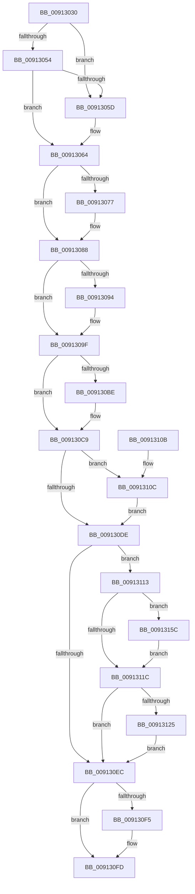

# PopPowerRequestDelete

- RVA: `0x00913030`–`0x00913169` (길이 `313` bytes)
- VA: `0x0000000140913030`
- 실행 섹션: `PAGE`
- PDB 이름 있음: `예`; PDB Function 태그: `아니요`
- unwind 정보 RVA: `0x0008A3BC`
- 디코드: `81`개 명령, `313/313` bytes 표시
- 미해석 바이트: `0` (있으면 어셈블리에 `.byte`로 보존)

> 이 문서는 커널 이미지의 기계어와 PDB 기호를 분석해 생성했습니다. 4번과 5번은 함수 원형과 자료형을 바이너리 사용 방식에서 추정한 C 해석이며 원본 소스 복구 결과는 아닙니다.

## 1. Dependencies

- 직접 호출 지점: **13**; 고유 호출 대상: **13**
- 직접 호출자로 확인된 함수: **0**
- RIP 상대 이미지 참조: **3**

### Outgoing calls
- `0x00913046` → [PopAcquireRwLockExclusive](../../text/43/PopAcquireRwLockExclusive_function_00430B44.md) (function, `0x00430B44`)
- `0x0091307C` → [ObfDereferenceObjectWithTag](../../text/2F/ObfDereferenceObjectWithTag_function_002F78E0.md) (function, `0x002F78E0`)
- `0x009130A8` → [PopPowerRequestTableDeleteEntry](PopPowerRequestTableDeleteEntry_function_00913170.md) (function, `0x00913170`)
- `0x009130B4` → [PopReleaseRwLock](../../text/2D/PopReleaseRwLock_function_002DFBBC.md) (function, `0x002DFBBC`)
- `0x009130C4` → [PsReleaseProcessWakeCounter](../88/PsReleaseProcessWakeCounter_function_0088B940.md) (function, `0x0088B940`)
- `0x009130CD` → [PoDestroyReasonContext](../../text/23/PoDestroyReasonContext_function_00230944.md) (function, `0x00230944`)
- `0x009130E1` → [PopDiagTracePowerRequestClose](PopDiagTracePowerRequestClose_function_009131A0.md) (function, `0x009131A0`)
- `0x009130F8` → [PopUmpoSendPowerRequestOverrideCleanup](PopUmpoSendPowerRequestOverrideCleanup_function_00913230.md) (function, `0x00913230`)
- `0x0091310C` → [SleepstudyHelperDestroyBlocker](../../text/48/SleepstudyHelperDestroyBlocker_function_00486930.md) (function, `0x00486930`)
- `0x00913113` → [TtmIsEnabled](TtmIsEnabled_function_009143D8.md) (function, `0x009143D8`)
- `0x00913134` → [memset](../../text/6C/memset_function_006C6C40.md) (function, `0x006C6C40`)
- `0x00913155` → [PopUmpoSendPowerMessage](../../text/23/PopUmpoSendPowerMessage_function_00230730.md) (function, `0x00230730`)
- `0x00913162` → [TtmNotifySessionPowerRequestDeleted](../77/TtmNotifySessionPowerRequestDeleted_function_00776E10.md) (function, `0x00776E10`)

### Direct callers
- 이 함수 시작 RVA로 연결되는 직접 call은 확인되지 않았습니다. 간접 호출은 완전히 역산할 수 없습니다.

### Static image references
- `0x0091303F` → RVA `0x00F0ED20` (`.data`; read)
- `0x009130A2` → RVA `0x00F0ED50` (`.data`; read/write)
- `0x0091311C` → RVA `0x00F0EFB0` (`.data`; read)

## 2. Other-region calls and transfers

- 다른 실행 섹션으로 향하는 call: **7**
  - `0x00913046` → [PopAcquireRwLockExclusive](../../text/43/PopAcquireRwLockExclusive_function_00430B44.md) (`PAGE` → `.text`)
  - `0x0091307C` → [ObfDereferenceObjectWithTag](../../text/2F/ObfDereferenceObjectWithTag_function_002F78E0.md) (`PAGE` → `.text`)
  - `0x009130B4` → [PopReleaseRwLock](../../text/2D/PopReleaseRwLock_function_002DFBBC.md) (`PAGE` → `.text`)
  - `0x009130CD` → [PoDestroyReasonContext](../../text/23/PoDestroyReasonContext_function_00230944.md) (`PAGE` → `.text`)
  - `0x0091310C` → [SleepstudyHelperDestroyBlocker](../../text/48/SleepstudyHelperDestroyBlocker_function_00486930.md) (`PAGE` → `.text`)
  - `0x00913134` → [memset](../../text/6C/memset_function_006C6C40.md) (`PAGE` → `.text`)
  - `0x00913155` → [PopUmpoSendPowerMessage](../../text/23/PopUmpoSendPowerMessage_function_00230730.md) (`PAGE` → `.text`)
- 별도 외부 분기/꼬리 이동을 확인하지 못했습니다.

## 3. Assembly (complete function range)

```asm
00913030  48 89 5C 24 08                  mov qword ptr [rsp + 8], rbx
00913035  57                              push rdi
00913036  48 83 EC 70                     sub rsp, 0x70
0091303A  48 8B D9                        mov rbx, rcx
0091303D  33 FF                           xor edi, edi
0091303F  48 8D 0D DA BC 5F 00            lea rcx, [rip + 0x5fbcda]
00913046  E8 F9 DA B1 FF                  call 0x140430b44
0091304B  48 8B 0B                        mov rcx, qword ptr [rbx]
0091304E  48 39 59 08                     cmp qword ptr [rcx + 8], rbx
00913052  75 09                           jne 0x14091305d
00913054  48 8B 43 08                     mov rax, qword ptr [rbx + 8]
00913058  48 39 18                        cmp qword ptr [rax], rbx
0091305B  74 07                           je 0x140913064
0091305D  B9 03 00 00 00                  mov ecx, 3
00913062  CD 29                           int 0x29
00913064  48 89 08                        mov qword ptr [rax], rcx
00913067  48 89 41 08                     mov qword ptr [rcx + 8], rax
0091306B  48 8B 8B 88 00 00 00            mov rcx, qword ptr [rbx + 0x88]
00913072  48 85 C9                        test rcx, rcx
00913075  74 11                           je 0x140913088
00913077  BA 50 6F 50 72                  mov edx, 0x72506f50
0091307C  E8 5F 48 9E FF                  call 0x1402f78e0
00913081  48 21 BB 88 00 00 00            and qword ptr [rbx + 0x88], rdi
00913088  48 8B 83 90 00 00 00            mov rax, qword ptr [rbx + 0x90]
0091308F  48 85 C0                        test rax, rax
00913092  74 0B                           je 0x14091309f
00913094  48 83 A3 90 00 00 00 00         and qword ptr [rbx + 0x90], 0
0091309C  48 8B F8                        mov rdi, rax
0091309F  8B 4B 24                        mov ecx, dword ptr [rbx + 0x24]
009130A2  FF 0D A8 BC 5F 00               dec dword ptr [rip + 0x5fbca8]
009130A8  E8 C3 00 00 00                  call 0x140913170
009130AD  48 8D 0D 6C BC 5F 00            lea rcx, [rip + 0x5fbc6c]
009130B4  E8 03 CB 9C FF                  call 0x1402dfbbc
009130B9  48 85 FF                        test rdi, rdi
009130BC  74 0B                           je 0x1409130c9
009130BE  48 8B D3                        mov rdx, rbx
009130C1  48 8B CF                        mov rcx, rdi
009130C4  E8 77 88 F7 FF                  call 0x14088b940
009130C9  48 8B 4B 60                     mov rcx, qword ptr [rbx + 0x60]
009130CD  E8 72 D8 91 FF                  call 0x140230944
009130D2  48 8B 8B A0 00 00 00            mov rcx, qword ptr [rbx + 0xa0]
009130D9  48 85 C9                        test rcx, rcx
009130DC  75 2E                           jne 0x14091310c
009130DE  48 8B CB                        mov rcx, rbx
009130E1  E8 BA 00 00 00                  call 0x1409131a0
009130E6  83 7B 68 00                     cmp dword ptr [rbx + 0x68], 0
009130EA  75 27                           jne 0x140913113
009130EC  80 BB 98 00 00 00 00            cmp byte ptr [rbx + 0x98], 0
009130F3  75 08                           jne 0x1409130fd
009130F5  48 8B CB                        mov rcx, rbx
009130F8  E8 33 01 00 00                  call 0x140913230
009130FD  48 8B 9C 24 80 00 00 00         mov rbx, qword ptr [rsp + 0x80]
00913105  48 83 C4 70                     add rsp, 0x70
00913109  5F                              pop rdi
0091310A  C3                              ret
0091310B  CC                              int3
0091310C  E8 1F 38 B7 FF                  call 0x140486930
00913111  EB CB                           jmp 0x1409130de
00913113  E8 C0 12 00 00                  call 0x1409143d8
00913118  84 C0                           test al, al
0091311A  75 40                           jne 0x14091315c
0091311C  80 3D 8D BE 5F 00 00            cmp byte ptr [rip + 0x5fbe8d], 0
00913123  74 C7                           je 0x1409130ec
00913125  BF 48 00 00 00                  mov edi, 0x48
0091312A  48 8D 4C 24 20                  lea rcx, [rsp + 0x20]
0091312F  44 8B C7                        mov r8d, edi
00913132  33 D2                           xor edx, edx
00913134  E8 07 3B DB FF                  call 0x1406c6c40
00913139  8B 43 24                        mov eax, dword ptr [rbx + 0x24]
0091313C  48 8D 4C 24 20                  lea rcx, [rsp + 0x20]
00913141  45 33 C9                        xor r9d, r9d
00913144  89 44 24 28                     mov dword ptr [rsp + 0x28], eax
00913148  45 33 C0                        xor r8d, r8d
0091314B  C7 44 24 20 11 00 00 00         mov dword ptr [rsp + 0x20], 0x11
00913153  8B D7                           mov edx, edi
00913155  E8 D6 D5 91 FF                  call 0x140230730
0091315A  EB 90                           jmp 0x1409130ec
0091315C  8B 53 24                        mov edx, dword ptr [rbx + 0x24]
0091315F  8B 4B 10                        mov ecx, dword ptr [rbx + 0x10]
00913162  E8 A9 3C E6 FF                  call 0x140776e10
00913167  EB B3                           jmp 0x14091311c
```

## 4. C-style interpretation (structured pseudocode)

```c
__int64 __fastcall PopPowerRequestDelete(__int64 a1, __int64 a2, __int64 a3, int a4)
{
    __int64 result;
    __int64 v_rdi;
    __int64 v_rsp;
    unsigned __int64 v_stack_p20;
    unsigned int v_stack_p28;
    unsigned __int64 v_stack_p8;

    v_stack_p8 = v_rbx;
    v_rsp = (v_rsp) - (112);
    v_rdi = 0;
    result = PopAcquireRwLockExclusive(v_rip + 6274266, a2, a3, a4);
    if ((*(unsigned __int64 *)(*(unsigned __int64 *)(a1) + 8)) != a1) goto loc_0091305D;
    if ((*(unsigned __int64 *)(*(unsigned __int64 *)(a1 + 8))) != a1) {
        a1 = 3;
    }
    *(unsigned __int64 *)(*(unsigned __int64 *)(a1 + 8)) = a1;
    *(unsigned __int64 *)(a1 + 8) = *(unsigned __int64 *)(a1 + 8);
    result = *(unsigned __int64 *)(a1 + 8);
    if (*(unsigned __int64 *)(a1 + 136) != 0) {
        a2 = 0x72506F50ULL;
        result = ObfDereferenceObjectWithTag(*(unsigned __int64 *)(a1 + 136), a2, a3, a4);
    }
    if (*(unsigned __int64 *)(a1 + 144) != 0) {
        v_rdi = *(unsigned __int64 *)(a1 + 144);
    }
    result = PopPowerRequestTableDeleteEntry((unsigned int)(*(unsigned int *)(a1 + 36)), a2, a3, a4);
    result = PopReleaseRwLock(v_rip + 6274156, a2, a3, a4);
    if (v_rdi != 0) {
        a2 = a1;
        a1 = v_rdi;
        result = PsReleaseProcessWakeCounter(a1, a2, a3, a4);
    }
    result = PoDestroyReasonContext(*(unsigned __int64 *)(a1 + 96), a2, a3, a4);
    if (*(unsigned __int64 *)(a1 + 160) != 0) goto loc_0091310C;
loc_009130DE:
    result = PopDiagTracePowerRequestClose(a1, a2, a3, a4);
    if ((*(unsigned int *)(a1 + 104)) != 0) goto loc_00913113;
loc_009130EC:
    if ((*(unsigned __int8 *)(a1 + 152)) == 0) {
        a1 = a1;
        result = PopUmpoSendPowerRequestOverrideCleanup(a1, a2, a3, a4);
    }
    v_rsp = (v_rsp) + (112);
    return result;
loc_0091310C:
    result = SleepstudyHelperDestroyBlocker(a1, a2, a3, a4);
    goto loc_009130DE;
loc_00913113:
    result = TtmIsEnabled(a1, a2, a3, a4);
    if ((unsigned __int8)(result) != 0) goto loc_0091315C;
loc_0091311C:
    if ((*(unsigned __int8 *)(v_rip + 6274701)) == 0) goto loc_009130EC;
    a2 = 0;
    result = memset(v_stack_p20, a2, 72, a4);
    a4 = 0;
    v_stack_p28 = (unsigned int)((unsigned int)(*(unsigned int *)(v_stack_p8 + 36)));
    a3 = 0;
    v_stack_p20 = 17;
    result = PopUmpoSendPowerMessage(v_stack_p20, 72, a3, a4);
    goto loc_009130EC;
loc_0091315C:
    result = TtmNotifySessionPowerRequestDeleted((unsigned int)(*(unsigned int *)(v_stack_p8 + 16)), (unsigned int)(*(unsigned int *)(v_stack_p8 + 36)), a3, a4);
    goto loc_0091311C;
}
```

## 5. (Beta) C Style

```c
int64_t PopPowerRequestDelete(void *Arg1, int64_t Arg2, int64_t Arg3, int32_t Arg4)
{
    uint8_t *arg1 = (uint8_t *)Arg1;

    int64_t result;
    int64_t local_rdi;
    int64_t local_rsp;
    uint64_t v_stack_p20;
    uint32_t v_stack_p28;
    uint64_t v_stack_p8;

    v_stack_p8 = local_rbx;
    local_rsp = (local_rsp) - (112);
    local_rdi = 0;
    result = PopAcquireRwLockExclusive(v_rip + 6274266, Arg2, Arg3, Arg4);
    if ((*(uint64_t *)(*(uint64_t *)(arg1) + 0x8)) != Arg1) goto loc_0091305D;
    if ((*(uint64_t *)(*(uint64_t *)(arg1 + 0x8))) != Arg1) {
        Arg1 = 3;
    }
    *(void **)(*(uint64_t *)(arg1 + 0x8)) = Arg1;
    *(uint64_t *)(arg1 + 0x8) = *(uint64_t *)(arg1 + 0x8);
    result = *(uint64_t *)(arg1 + 0x8);
    if (*(uint64_t *)(arg1 + 0x88) != 0) {
        Arg2 = 0x72506F50ULL;
        result = ObfDereferenceObjectWithTag(*(uint64_t *)(arg1 + 0x88), Arg2, Arg3, Arg4);
    }
    if (*(uint64_t *)(arg1 + 0x90) != 0) {
        local_rdi = *(uint64_t *)(arg1 + 0x90);
    }
    result = PopPowerRequestTableDeleteEntry((uint32_t)(*(uint32_t *)(arg1 + 0x24)), Arg2, Arg3, Arg4);
    result = PopReleaseRwLock(v_rip + 6274156, Arg2, Arg3, Arg4);
    if (local_rdi != 0) {
        Arg2 = Arg1;
        Arg1 = local_rdi;
        result = PsReleaseProcessWakeCounter(Arg1, Arg2, Arg3, Arg4);
    }
    result = PoDestroyReasonContext(*(uint64_t *)(arg1 + 0x60), Arg2, Arg3, Arg4);
    if (*(uint64_t *)(arg1 + 0xA0) != 0) goto loc_0091310C;
loc_009130DE:
    result = PopDiagTracePowerRequestClose(Arg1, Arg2, Arg3, Arg4);
    if ((*(uint32_t *)(arg1 + 0x68)) != 0) goto loc_00913113;
loc_009130EC:
    if ((*(uint8_t *)(arg1 + 0x98)) == 0) {
        Arg1 = Arg1;
        result = PopUmpoSendPowerRequestOverrideCleanup(Arg1, Arg2, Arg3, Arg4);
    }
    local_rsp = (local_rsp) + (112);
    return result;
loc_0091310C:
    result = SleepstudyHelperDestroyBlocker(Arg1, Arg2, Arg3, Arg4);
    goto loc_009130DE;
loc_00913113:
    result = TtmIsEnabled(Arg1, Arg2, Arg3, Arg4);
    if ((uint8_t)(result) != 0) goto loc_0091315C;
loc_0091311C:
    if ((*(uint8_t *)(v_rip + 0x5FBE8D)) == 0) goto loc_009130EC;
    Arg2 = 0;
    result = memset(v_stack_p20, Arg2, 72, Arg4);
    Arg4 = 0;
    v_stack_p28 = (uint32_t)((uint32_t)(*(uint32_t *)(v_stack_p8 + 0x24)));
    Arg3 = 0;
    v_stack_p20 = 17;
    result = PopUmpoSendPowerMessage(v_stack_p20, 72, Arg3, Arg4);
    goto loc_009130EC;
loc_0091315C:
    result = TtmNotifySessionPowerRequestDeleted((uint32_t)(*(uint32_t *)(v_stack_p8 + 0x10)), (uint32_t)(*(uint32_t *)(v_stack_p8 + 0x24)), Arg3, Arg4);
    goto loc_0091311C;
}
```

### 관측된 메모리 오프셋

구조체 형식이 확인되지 않은 접근은 인자 기준의 오프셋으로만 기록했습니다.

| 기준 인자 | 오프셋 표현 | 폭 (bit) | 접근 |
|---|---:|---:|---|
| `Arg1` | `+ 0x0` | `64` | `R` |
| `Arg1` | `+ 0x8` | `64` | `R` |
| `Arg1` | `+ 0x10` | `32` | `R` |
| `Arg1` | `+ 0x24` | `32` | `R` |
| `Arg1` | `+ 0x60` | `64` | `R` |
| `Arg1` | `+ 0x68` | `32` | `R` |
| `Arg1` | `+ 0x88` | `64` | `R` |
| `Arg1` | `+ 0x88` | `64` | `R/W` |
| `Arg1` | `+ 0x90` | `64` | `R` |
| `Arg1` | `+ 0x90` | `64` | `R/W` |
| `Arg1` | `+ 0x98` | `8` | `R` |
| `Arg1` | `+ 0xA0` | `64` | `R` |

## 6. Execution-region graph

[열기: 2D/3D 그래프와 함수 탐색 컨트롤 패널](../../../control-panel.html?section=page&rva=0x00913030&view=graph)

- 2D 그래프는 위에서 아래로 흐르고, 3D 그래프는 빈 공간을 드래그해 회전합니다. Shift+드래그는 이동, 휠은 확대·축소, 함수 노드 선택은 대상 보고서 이동입니다.

### Static fallback


