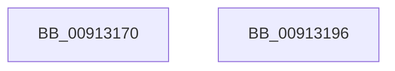

# PopPowerRequestTableDeleteEntry

- RVA: `0x00913170`–`0x00913197` (길이 `39` bytes)
- VA: `0x0000000140913170`
- 실행 섹션: `PAGE`
- PDB 이름 있음: `예`; PDB Function 태그: `아니요`
- unwind 정보 RVA: `0x0005D2F4`
- 디코드: `10`개 명령, `39/39` bytes 표시
- 미해석 바이트: `0` (있으면 어셈블리에 `.byte`로 보존)

> 이 문서는 커널 이미지의 기계어와 PDB 기호를 분석해 생성했습니다. 4번과 5번은 함수 원형과 자료형을 바이너리 사용 방식에서 추정한 C 해석이며 원본 소스 복구 결과는 아닙니다.

## 1. Dependencies

- 직접 호출 지점: **1**; 고유 호출 대상: **1**
- 직접 호출자로 확인된 함수: **2**
- RIP 상대 이미지 참조: **1**

### Outgoing calls
- `0x0091318C` → [RtlDeleteElementGenericTableAvl](../../text/3E/RtlDeleteElementGenericTableAvl_function_003EE750.md) (function, `0x003EE750`)

### Direct callers
- [PopPowerRequestCreateCommon](../../text/23/PopPowerRequestCreateCommon_function_00230150.md) at `0x002303BE`
- [PopPowerRequestDelete](PopPowerRequestDelete_function_00913030.md) at `0x009130A8`

### Static image references
- `0x00913185` → RVA `0x00F0EDC0` (`.data`; read)

## 2. Other-region calls and transfers

- 다른 실행 섹션으로 향하는 call: **1**
  - `0x0091318C` → [RtlDeleteElementGenericTableAvl](../../text/3E/RtlDeleteElementGenericTableAvl_function_003EE750.md) (`PAGE` → `.text`)
- 별도 외부 분기/꼬리 이동을 확인하지 못했습니다.

## 3. Assembly (complete function range)

```asm
00913170  48 83 EC 38                     sub rsp, 0x38
00913174  0F 57 C0                        xorps xmm0, xmm0
00913177  48 8D 54 24 20                  lea rdx, [rsp + 0x20]
0091317C  0F 11 44 24 20                  movups xmmword ptr [rsp + 0x20], xmm0
00913181  89 4C 24 28                     mov dword ptr [rsp + 0x28], ecx
00913185  48 8D 0D 34 BC 5F 00            lea rcx, [rip + 0x5fbc34]
0091318C  E8 BF B5 AD FF                  call 0x1403ee750
00913191  48 83 C4 38                     add rsp, 0x38
00913195  C3                              ret
00913196  CC                              int3
```

## 4. C-style interpretation (structured pseudocode)

```c
__int64 __fastcall PopPowerRequestTableDeleteEntry(int a1)
{
    __int64 result;
    __int64 v_rsp;
    unsigned int v_stack_m10;
    unsigned __int64 v_stack_m18;

    v_rsp = (v_rsp) - (56);
    v_stack_m18 = v_xmm0;
    v_stack_m10 = a1;
    result = RtlDeleteElementGenericTableAvl(v_rip + 6274100, v_stack_m18, a3, a4);
    v_rsp = (v_rsp) + (56);
    return result;
}
```

## 5. (Beta) C Style

```c
int64_t PopPowerRequestTableDeleteEntry(int32_t Arg1)
{
    int64_t result;
    int64_t local_rsp;
    uint32_t v_stack_m10;
    uint64_t v_stack_m18;

    local_rsp = (local_rsp) - (56);
    v_stack_m18 = v_xmm0;
    v_stack_m10 = Arg1;
    result = RtlDeleteElementGenericTableAvl(v_rip + 6274100, v_stack_m18, a3, a4);
    local_rsp = (local_rsp) + (56);
    return result;
}
```

## 6. Execution-region graph

[열기: 2D/3D 그래프와 함수 탐색 컨트롤 패널](../../../control-panel.html?section=page&rva=0x00913170&view=graph)

- 2D 그래프는 위에서 아래로 흐르고, 3D 그래프는 빈 공간을 드래그해 회전합니다. Shift+드래그는 이동, 휠은 확대·축소, 함수 노드 선택은 대상 보고서 이동입니다.

### Static fallback


