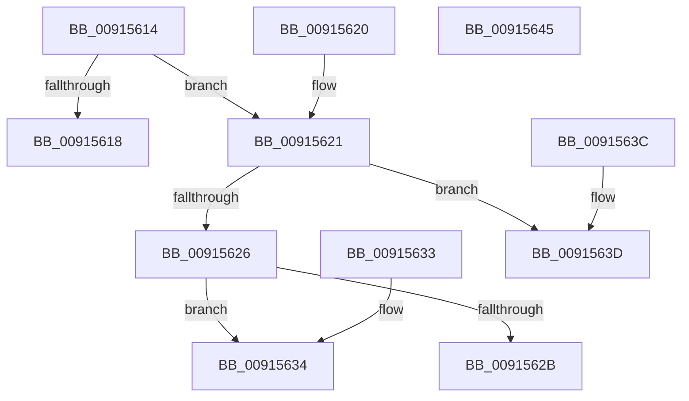

# PopPrintUserActivityPresence

- RVA: `0x00915614`–`0x00915646` (길이 `50` bytes)
- VA: `0x0000000140915614`
- 실행 섹션: `PAGE`
- PDB 이름 있음: `예`; PDB Function 태그: `아니요`
- unwind 정보 RVA: `0x000DB714`
- 디코드: `18`개 명령, `50/50` bytes 표시
- 미해석 바이트: `0` (있으면 어셈블리에 `.byte`로 보존)

> 이 문서는 커널 이미지의 기계어와 PDB 기호를 분석해 생성했습니다. 4번과 5번은 함수 원형과 자료형을 바이너리 사용 방식에서 추정한 C 해석이며 원본 소스 복구 결과는 아닙니다.

## 1. Dependencies

- 직접 호출 지점: **0**; 고유 호출 대상: **0**
- 직접 호출자로 확인된 함수: **2**
- RIP 상대 이미지 참조: **4**

### Outgoing calls
- 직접 디코드된 call 명령이 없습니다.

### Direct callers
- [PopSetSessionUserStatus](PopSetSessionUserStatus_function_00914BB8.md) at `0x00914BDF`
- [sub_00B218E0](../B2/Unknown_function_00B218E0.md) at `0x00B218FD`

### Static image references
- `0x00915618` → RVA `0x00B03250` (` ?? ::NNGAKEGL::`string'`; read)
- `0x0091562B` → RVA `0x00B03290` (` ?? ::NNGAKEGL::`string'`; read)
- `0x00915634` → RVA `0x00B03280` (` ?? ::NNGAKEGL::`string'`; read)
- `0x0091563D` → RVA `0x00B03220` (` ?? ::NNGAKEGL::`string'`; read)

## 2. Other-region calls and transfers

- 다른 실행 섹션으로 향하는 call: **0**
- 별도 외부 분기/꼬리 이동을 확인하지 못했습니다.

## 3. Assembly (complete function range)

```asm
00915614  85 C9                           test ecx, ecx
00915616  75 09                           jne 0x140915621
00915618  48 8D 05 31 DC 1E 00            lea rax, [rip + 0x1edc31]
0091561F  C3                              ret
00915620  CC                              int3
00915621  83 E9 01                        sub ecx, 1
00915624  74 17                           je 0x14091563d
00915626  83 F9 01                        cmp ecx, 1
00915629  75 09                           jne 0x140915634
0091562B  48 8D 05 5E DC 1E 00            lea rax, [rip + 0x1edc5e]
00915632  C3                              ret
00915633  CC                              int3
00915634  48 8D 05 45 DC 1E 00            lea rax, [rip + 0x1edc45]
0091563B  C3                              ret
0091563C  CC                              int3
0091563D  48 8D 05 DC DB 1E 00            lea rax, [rip + 0x1edbdc]
00915644  C3                              ret
00915645  CC                              int3
```

## 4. C-style interpretation (structured pseudocode)

```c
__int64 __fastcall PopPrintUserActivityPresence(int a1)
{
    if (a1 != 0) goto loc_00915621;
    return v_rip + 2022449;
loc_00915621:
    a1 = (unsigned int)((a1) - (1));
    if (condition_is_equal) goto loc_0091563D;
    if (a1 != 1) goto loc_00915634;
    return v_rip + 2022494;
loc_00915634:
    return v_rip + 2022469;
loc_0091563D:
    return v_rip + 2022364;
}
```

## 5. (Beta) C Style

```c
int64_t PopPrintUserActivityPresence(int32_t Arg1)
{
    if (Arg1 != 0) goto loc_00915621;
    return v_rip + 2022449;
loc_00915621:
    Arg1 = (uint32_t)((Arg1) - (1));
    if (condition_is_equal) goto loc_0091563D;
    if (Arg1 != 1) goto loc_00915634;
    return v_rip + 2022494;
loc_00915634:
    return v_rip + 2022469;
loc_0091563D:
    return v_rip + 2022364;
}
```

## 6. Execution-region graph

[열기: 2D/3D 그래프와 함수 탐색 컨트롤 패널](../../../control-panel.html?section=page&rva=0x00915614&view=graph)

- 2D 그래프는 위에서 아래로 흐르고, 3D 그래프는 빈 공간을 드래그해 회전합니다. Shift+드래그는 이동, 휠은 확대·축소, 함수 노드 선택은 대상 보고서 이동입니다.

### Static fallback


