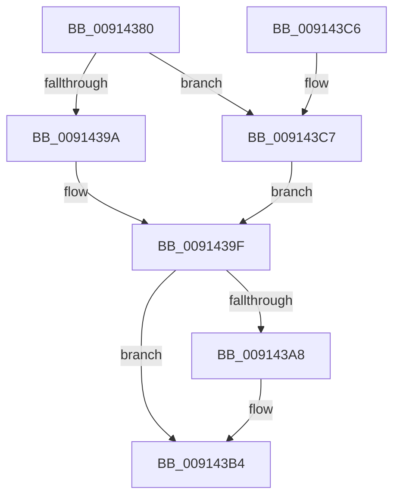

# PopProcessSessionDisplayStateChange

- RVA: `0x00914380`–`0x009143D0` (길이 `80` bytes)
- VA: `0x0000000140914380`
- 실행 섹션: `PAGE`
- PDB 이름 있음: `예`; PDB Function 태그: `아니요`
- unwind 정보 RVA: `0x00068908`
- 디코드: `27`개 명령, `80/80` bytes 표시
- 미해석 바이트: `0` (있으면 어셈블리에 `.byte`로 보존)

> 이 문서는 커널 이미지의 기계어와 PDB 기호를 분석해 생성했습니다. 4번과 5번은 함수 원형과 자료형을 바이너리 사용 방식에서 추정한 C 해석이며 원본 소스 복구 결과는 아닙니다.

## 1. Dependencies

- 직접 호출 지점: **4**; 고유 호출 대상: **4**
- 직접 호출자로 확인된 함수: **2**
- RIP 상대 이미지 참조: **0**

### Outgoing calls
- `0x0091439A` → [PopDisarmIdlePhaseWatchdog](PopDisarmIdlePhaseWatchdog_function_00914408.md) (function, `0x00914408`)
- `0x0091439F` → [TtmIsEnabled](TtmIsEnabled_function_009143D8.md) (function, `0x009143D8`)
- `0x009143AD` → [PopTriggerMonitorPowerEvent](PopTriggerMonitorPowerEvent_function_0091446C.md) (function, `0x0091446C`)
- `0x009143C9` → [PopArmIdlePhaseWatchdog](../98/PopArmIdlePhaseWatchdog_function_0098A10C.md) (function, `0x0098A10C`)

### Direct callers
- [PopMonitorInvocation](../76/PopMonitorInvocation_function_00769710.md) at `0x00769793`
- [NtPowerInformation](../95/NtPowerInformation_function_00955D80.md) at `0x00956DC4`

### Static image references
- 디코드된 RIP-relative 메모리 참조가 없습니다.

## 2. Other-region calls and transfers

- 다른 실행 섹션으로 향하는 call: **0**
- 별도 외부 분기/꼬리 이동을 확인하지 못했습니다.

## 3. Assembly (complete function range)

```asm
00914380  48 89 5C 24 08                  mov qword ptr [rsp + 8], rbx
00914385  48 89 74 24 10                  mov qword ptr [rsp + 0x10], rsi
0091438A  57                              push rdi
0091438B  48 83 EC 20                     sub rsp, 0x20
0091438F  33 DB                           xor ebx, ebx
00914391  8B FA                           mov edi, edx
00914393  40 8A F1                        mov sil, cl
00914396  84 C9                           test cl, cl
00914398  74 2D                           je 0x1409143c7
0091439A  E8 69 00 00 00                  call 0x140914408
0091439F  E8 34 00 00 00                  call 0x1409143d8
009143A4  84 C0                           test al, al
009143A6  75 0C                           jne 0x1409143b4
009143A8  8B D7                           mov edx, edi
009143AA  40 8A CE                        mov cl, sil
009143AD  E8 BA 00 00 00                  call 0x14091446c
009143B2  8B D8                           mov ebx, eax
009143B4  48 8B 74 24 38                  mov rsi, qword ptr [rsp + 0x38]
009143B9  8B C3                           mov eax, ebx
009143BB  48 8B 5C 24 30                  mov rbx, qword ptr [rsp + 0x30]
009143C0  48 83 C4 20                     add rsp, 0x20
009143C4  5F                              pop rdi
009143C5  C3                              ret
009143C6  CC                              int3
009143C7  8B CF                           mov ecx, edi
009143C9  E8 3E 5D 07 00                  call 0x14098a10c
009143CE  EB CF                           jmp 0x14091439f
```

## 4. C-style interpretation (structured pseudocode)

```c
__int64 __fastcall PopProcessSessionDisplayStateChange(unsigned __int8 a1, int a2)
{
    __int64 result;
    __int64 v_rbx;
    __int64 v_rsp;
    unsigned __int64 v_stack_p10;
    unsigned __int64 v_stack_p8;

    v_stack_p8 = v_rbx;
    v_stack_p10 = v_rsi;
    v_rsp = (v_rsp) - (32);
    v_rbx = 0;
    if (a1 == 0) goto loc_009143C7;
    result = PopDisarmIdlePhaseWatchdog(a1, a2, a3, a4);
loc_0091439F:
    result = TtmIsEnabled(a1, a2, a3, a4);
    if ((unsigned __int8)(result) == 0) {
        a2 = (unsigned int)((unsigned int)(a2));
        a1 = a1;
        result = PopTriggerMonitorPowerEvent(a1, a2, a3, a4);
        v_rbx = (unsigned int)(result);
    }
    v_rsp = (v_rsp) + (32);
    return (unsigned int)((unsigned int)(v_rbx));
loc_009143C7:
    result = PopArmIdlePhaseWatchdog((unsigned int)((unsigned int)((unsigned int)(a2))), a2, a3, a4);
    goto loc_0091439F;
}
```

## 5. (Beta) C Style

```c
int64_t PopProcessSessionDisplayStateChange(uint8_t Arg1, int32_t Arg2)
{
    int64_t result;
    int64_t local_rbx;
    int64_t local_rsp;
    uint64_t v_stack_p10;
    uint64_t v_stack_p8;

    v_stack_p8 = local_rbx;
    v_stack_p10 = local_rsi;
    local_rsp = (local_rsp) - (32);
    local_rbx = 0;
    if (Arg1 == 0) goto loc_009143C7;
    result = PopDisarmIdlePhaseWatchdog(Arg1, Arg2, a3, a4);
loc_0091439F:
    result = TtmIsEnabled(Arg1, Arg2, a3, a4);
    if ((uint8_t)(result) == 0) {
        Arg2 = (uint32_t)((uint32_t)(Arg2));
        Arg1 = Arg1;
        result = PopTriggerMonitorPowerEvent(Arg1, Arg2, a3, a4);
        local_rbx = (uint32_t)(result);
    }
    local_rsp = (local_rsp) + (32);
    return (uint32_t)((uint32_t)(local_rbx));
loc_009143C7:
    result = PopArmIdlePhaseWatchdog((uint32_t)((uint32_t)((uint32_t)(Arg2))), Arg2, a3, a4);
    goto loc_0091439F;
}
```

## 6. Execution-region graph

[열기: 2D/3D 그래프와 함수 탐색 컨트롤 패널](../../../control-panel.html?section=page&rva=0x00914380&view=graph)

- 2D 그래프는 위에서 아래로 흐르고, 3D 그래프는 빈 공간을 드래그해 회전합니다. Shift+드래그는 이동, 휠은 확대·축소, 함수 노드 선택은 대상 보고서 이동입니다.

### Static fallback


