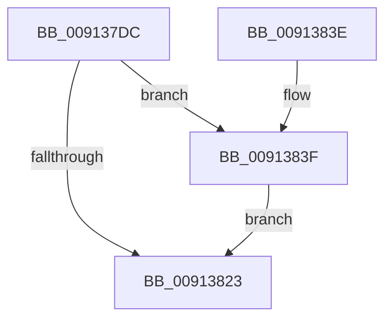

# PopReleaseAdaptiveLock

- RVA: `0x009137DC`–`0x0091388E` (길이 `178` bytes)
- VA: `0x00000001409137DC`
- 실행 섹션: `PAGE`
- PDB 이름 있음: `예`; PDB Function 태그: `아니요`
- unwind 정보 RVA: `0x0008A4B0`
- 디코드: `41`개 명령, `178/178` bytes 표시
- 미해석 바이트: `0` (있으면 어셈블리에 `.byte`로 보존)

> 이 문서는 커널 이미지의 기계어와 PDB 기호를 분석해 생성했습니다. 4번과 5번은 함수 원형과 자료형을 바이너리 사용 방식에서 추정한 C 해석이며 원본 소스 복구 결과는 아닙니다.

## 1. Dependencies

- 직접 호출 지점: **5**; 고유 호출 대상: **5**
- 직접 호출자로 확인된 함수: **15**
- RIP 상대 이미지 참조: **6**

### Outgoing calls
- `0x00913815` → [ExReleaseResourceLite](../../text/25/ExReleaseResourceLite_function_0025FA10.md) (function, `0x0025FA10`)
- `0x0091381A` → [KeLeaveCriticalRegion](../../text/25/KeLeaveCriticalRegion_function_0025D8B0.md) (function, `0x0025D8B0`)
- `0x0091382B` → [_security_check_cookie](../../text/6A/_security_check_cookie_function_006AC640.md) (function, `0x006AC640`)
- `0x00913858` → [PopSendSessionInfo](PopSendSessionInfo_function_00911E6C.md) (function, `0x00911E6C`)
- `0x00913887` → [PopDispatchStateCallout](PopDispatchStateCallout_function_0091248C.md) (function, `0x0091248C`)

### Direct callers
- [PopAdaptiveGetSystemInitiatedRebootTargetState](../70/PopAdaptiveGetSystemInitiatedRebootTargetState_function_00701398.md) at `0x0070141E`
- [PopActiveLockScreenPowerRequest](../76/PopActiveLockScreenPowerRequest_function_0076B530.md) at `0x0076B549`
- [PopAdaptivePowerSettingCallback](../76/PopAdaptivePowerSettingCallback_function_0076B7A0.md) at `0x0076B968`
- [PopAdaptiveSetSystemInitiatedRebootTargetStateOverride](../76/PopAdaptiveSetSystemInitiatedRebootTargetStateOverride_function_0076B9F0.md) at `0x0076BA50`
- [PopAdaptiveWnfCallback](../76/PopAdaptiveWnfCallback_function_0076BAB0.md) at `0x0076BB90`
- [PopSessionConnectionChange](../76/PopSessionConnectionChange_function_0076BDEC.md) at `0x0076BE7E`
- [PopSessionConnectionChangeV2](../76/PopSessionConnectionChangeV2_function_0076BEA8.md) at `0x0076BF39`
- [PopSessionWinlogonNotification](../76/PopSessionWinlogonNotification_function_0076BF60.md) at `0x0076BFF6`
- [PopAdaptiveGetBootIsUnattended](PopAdaptiveGetBootIsUnattended_function_00911EC8.md) at `0x00911F38`
- [PopIsLockConsoleTimeoutActive](PopIsLockConsoleTimeoutActive_function_0091238C.md) at `0x009123FA`
- [PopSetDisplayStatus](PopSetDisplayStatus_function_009129E0.md) at `0x00912A59`
- [PopAdaptiveGetBootTargetSystemState](PopAdaptiveGetBootTargetSystemState_function_00912AC8.md) at `0x00912B35`
- [PopUserPresenceHostStateChange](PopUserPresenceHostStateChange_function_00912DB8.md) at `0x00912E1D`
- [PopAdaptiveGetBootIsSystemInitiated](PopAdaptiveGetBootIsSystemInitiated_function_0091375C.md) at `0x009137C3`
- [PopAdaptiveGetSessionState](PopAdaptiveGetSessionState_function_00913894.md) at `0x00913902`

### Static image references
- `0x009137E6` → RVA `0x00E0A740` (`.data`; read)
- `0x009137F5` → RVA `0x00F08220` (`.data`; read)
- `0x009137FB` → RVA `0x00F08140` (`.data`; read)
- `0x00913802` → RVA `0x00F08238` (`.data`; read)
- `0x0091380A` → RVA `0x00FD82A0` (`PAGEDATA`; read/write)
- `0x0091383F` → RVA `0x00011B88` (`.rdata`; read)

## 2. Other-region calls and transfers

- 다른 실행 섹션으로 향하는 call: **3**
  - `0x00913815` → [ExReleaseResourceLite](../../text/25/ExReleaseResourceLite_function_0025FA10.md) (`PAGE` → `.text`)
  - `0x0091381A` → [KeLeaveCriticalRegion](../../text/25/KeLeaveCriticalRegion_function_0025D8B0.md) (`PAGE` → `.text`)
  - `0x0091382B` → [_security_check_cookie](../../text/6A/_security_check_cookie_function_006AC640.md) (`PAGE` → `.text`)
- 별도 외부 분기/꼬리 이동을 확인하지 못했습니다.

## 3. Assembly (complete function range)

```asm
009137DC  48 89 5C 24 08                  mov qword ptr [rsp + 8], rbx
009137E1  57                              push rdi
009137E2  48 83 EC 70                     sub rsp, 0x70
009137E6  48 8B 05 53 6F 4F 00            mov rax, qword ptr [rip + 0x4f6f53]
009137ED  48 33 C4                        xor rax, rsp
009137F0  48 89 44 24 68                  mov qword ptr [rsp + 0x68], rax
009137F5  8A 1D 25 4A 5F 00               mov bl, byte ptr [rip + 0x5f4a25]
009137FB  48 8D 0D 3E 49 5F 00            lea rcx, [rip + 0x5f493e]
00913802  8B 3D 30 4A 5F 00               mov edi, dword ptr [rip + 0x5f4a30]
00913808  33 C0                           xor eax, eax
0091380A  48 21 05 8F 4A 6C 00            and qword ptr [rip + 0x6c4a8f], rax
00913811  89 44 24 2C                     mov dword ptr [rsp + 0x2c], eax
00913815  E8 F6 C1 94 FF                  call 0x14025fa10
0091381A  E8 91 A0 94 FF                  call 0x14025d8b0
0091381F  84 DB                           test bl, bl
00913821  75 1C                           jne 0x14091383f
00913823  48 8B 4C 24 68                  mov rcx, qword ptr [rsp + 0x68]
00913828  48 33 CC                        xor rcx, rsp
0091382B  E8 10 8E D9 FF                  call 0x1406ac640
00913830  48 8B 9C 24 80 00 00 00         mov rbx, qword ptr [rsp + 0x80]
00913838  48 83 C4 70                     add rsp, 0x70
0091383C  5F                              pop rdi
0091383D  C3                              ret
0091383E  CC                              int3
0091383F  0F 10 05 42 E3 6F FF            movups xmm0, xmmword ptr [rip - 0x901cbe]
00913846  83 64 24 60 00                  and dword ptr [rsp + 0x60], 0
0091384B  4C 8D 4C 24 50                  lea r9, [rsp + 0x50]
00913850  8B CF                           mov ecx, edi
00913852  F3 0F 7F 44 24 50               movdqu xmmword ptr [rsp + 0x50], xmm0
00913858  E8 0F E6 FF FF                  call 0x140911e6c
0091385D  0F 57 C0                        xorps xmm0, xmm0
00913860  89 7C 24 20                     mov dword ptr [rsp + 0x20], edi
00913864  33 C0                           xor eax, eax
00913866  48 8D 54 24 20                  lea rdx, [rsp + 0x20]
0091386B  48 89 44 24 48                  mov qword ptr [rsp + 0x48], rax
00913870  48 8D 4C 24 28                  lea rcx, [rsp + 0x28]
00913875  C7 44 24 48 07 00 00 00         mov dword ptr [rsp + 0x48], 7
0091387D  0F 11 44 24 28                  movups xmmword ptr [rsp + 0x28], xmm0
00913882  0F 11 44 24 38                  movups xmmword ptr [rsp + 0x38], xmm0
00913887  E8 00 EC FF FF                  call 0x14091248c
0091388C  EB 95                           jmp 0x140913823
```

## 4. C-style interpretation (structured pseudocode)

```c
__int64 __fastcall PopReleaseAdaptiveLock(void)
{
    __int64 result;
    __int64 v_rsp;
    unsigned __int64 v_stack_m10;
    unsigned int v_stack_m4C;
    unsigned int v_stack_p20;
    unsigned __int64 v_stack_p28;
    unsigned __int64 v_stack_p38;
    unsigned __int64 v_stack_p48;
    unsigned __int64 v_stack_p50;
    unsigned int v_stack_p60;
    unsigned __int64 v_stack_p8;

    v_stack_p8 = v_rbx;
    v_rsp = (v_rsp) - (112);
    result = (*(unsigned __int64 *)(v_rip + 5205843)) ^ (v_rsp);
    v_stack_m10 = result;
    result = 0;
    v_stack_m4C = 0;
    result = ExReleaseResourceLite(v_rip + 6244670, a2, a3, a4);
    result = KeLeaveCriticalRegion(v_rip + 6244670, a2, a3, a4);
    if ((unsigned __int8)(*(unsigned __int8 *)(v_rip + 6244901)) != 0) goto loc_0091383F;
loc_00913823:
    a1 = (v_stack_m10) ^ (v_rsp);
    result = _security_check_cookie(a1, a2, a3, a4);
    v_rsp = (v_rsp) + (112);
    return result;
loc_0091383F:
    v_stack_p50 = v_xmm0;
    result = PopSendSessionInfo((unsigned int)((unsigned int)((unsigned int)(*(unsigned int *)(v_rip + 6244912)))), a2, a3, v_stack_p50);
    v_stack_p20 = (unsigned int)((unsigned int)(*(unsigned int *)(v_rip + 6244912)));
    result = 0;
    v_stack_p48 = 0;
    v_stack_p48 = 7;
    v_stack_p28 = v_xmm0;
    v_stack_p38 = v_xmm0;
    result = PopDispatchStateCallout(v_stack_p28, v_stack_p20, a3, v_stack_p50);
    goto loc_00913823;
}
```

## 5. (Beta) C Style

```c
void PopReleaseAdaptiveLock(void)
{
    int64_t result;
    int64_t local_rsp;
    uint64_t v_stack_m10;
    uint32_t v_stack_m4C;
    uint32_t v_stack_p20;
    uint64_t v_stack_p28;
    uint64_t v_stack_p38;
    uint64_t v_stack_p48;
    uint64_t v_stack_p50;
    uint32_t v_stack_p60;
    uint64_t v_stack_p8;

    v_stack_p8 = local_rbx;
    local_rsp = (local_rsp) - (112);
    result = (*(uint64_t *)(v_rip + 0x4F6F53)) ^ (local_rsp);
    v_stack_m10 = result;
    result = 0;
    v_stack_m4C = 0;
    result = ExReleaseResourceLite(v_rip + 6244670, a2, a3, a4);
    result = KeLeaveCriticalRegion(v_rip + 6244670, a2, a3, a4);
    if ((uint8_t)(*(uint8_t *)(v_rip + 0x5F4A25)) != 0) goto loc_0091383F;
loc_00913823:
    a1 = (v_stack_m10) ^ (local_rsp);
    result = _security_check_cookie(a1, a2, a3, a4);
    local_rsp = (local_rsp) + (112);
    return result;
loc_0091383F:
    v_stack_p50 = v_xmm0;
    result = PopSendSessionInfo((uint32_t)((uint32_t)((uint32_t)(*(uint32_t *)(v_rip + 0x5F4A30)))), a2, a3, v_stack_p50);
    v_stack_p20 = (uint32_t)((uint32_t)(*(uint32_t *)(v_rip + 0x5F4A30)));
    result = 0;
    v_stack_p48 = 0;
    v_stack_p48 = 7;
    v_stack_p28 = v_xmm0;
    v_stack_p38 = v_xmm0;
    result = PopDispatchStateCallout(v_stack_p28, v_stack_p20, a3, v_stack_p50);
    goto loc_00913823;
}
```

## 6. Execution-region graph

[열기: 2D/3D 그래프와 함수 탐색 컨트롤 패널](../../../control-panel.html?section=page&rva=0x009137DC&view=graph)

- 2D 그래프는 위에서 아래로 흐르고, 3D 그래프는 빈 공간을 드래그해 회전합니다. Shift+드래그는 이동, 휠은 확대·축소, 함수 노드 선택은 대상 보고서 이동입니다.

### Static fallback


