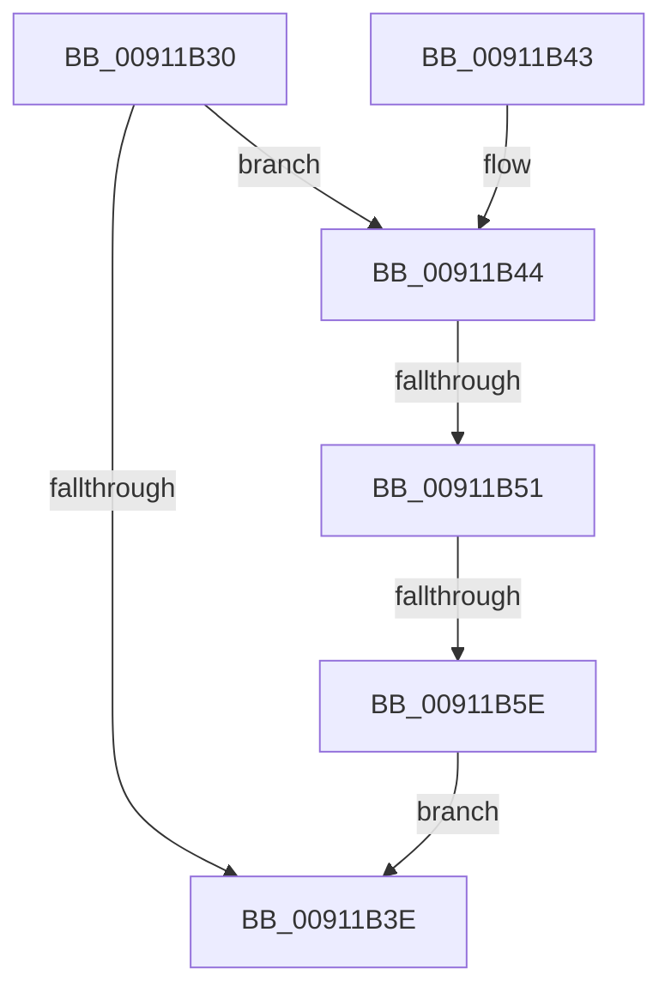

# PopRemoveReasonRecordByReasonCode

- RVA: `0x00911B30`–`0x00911B74` (길이 `68` bytes)
- VA: `0x0000000140911B30`
- 실행 섹션: `PAGE`
- PDB 이름 있음: `예`; PDB Function 태그: `예`
- unwind 정보 RVA: `0x0008A250`
- 디코드: `19`개 명령, `68/68` bytes 표시
- 미해석 바이트: `0` (있으면 어셈블리에 `.byte`로 보존)

> 이 문서는 커널 이미지의 기계어와 PDB 기호를 분석해 생성했습니다. 4번과 5번은 함수 원형과 자료형을 바이너리 사용 방식에서 추정한 C 해석이며 원본 소스 복구 결과는 아닙니다.

## 1. Dependencies

- 직접 호출 지점: **2**; 고유 호출 대상: **2**
- 직접 호출자로 확인된 함수: **4**
- RIP 상대 이미지 참조: **0**

### Outgoing calls
- `0x00911B34` → [PopGetReasonListByReasonCode](PopGetReasonListByReasonCode_function_00911B7C.md) (function, `0x00911B7C`)
- `0x00911B6D` → [ExFreePoolWithTag](../../poolcode/B8/ExFreePoolWithTag_function_00B82870.md) (function, `0x00B82870`)

### Direct callers
- [PopUpdateUpgradeInProgress](../75/PopUpdateUpgradeInProgress_function_00754880.md) at `0x00754A02`
- [PopEnableHiberFile](../90/PopEnableHiberFile_function_0090F850.md) at `0x0090F8BA`
- [PopEnableHiberFile](../90/PopEnableHiberFile_function_0090F850.md) at `0x0090F8C2`
- [PopEnableHiberFile](../90/PopEnableHiberFile_function_0090F850.md) at `0x0090F8CA`
- [PopEnableHiberFile](../90/PopEnableHiberFile_function_0090F850.md) at `0x0090F8D2`
- [PopEnableHiberFile](../90/PopEnableHiberFile_function_0090F850.md) at `0x0090F8DA`
- [PopEnableHiberFile](../90/PopEnableHiberFile_function_0090F850.md) at `0x0090F8E2`
- [PopFilterCapabilities](PopFilterCapabilities_function_0091141C.md) at `0x00911528`
- [PopFilterCapabilities](PopFilterCapabilities_function_0091141C.md) at `0x00911566`
- [PopFilterCapabilities](PopFilterCapabilities_function_0091141C.md) at `0x0091157D`
- [PopLogDisabledSleepReason](PopLogDisabledSleepReason_function_00911730.md) at `0x0091175E`

### Static image references
- 디코드된 RIP-relative 메모리 참조가 없습니다.

## 2. Other-region calls and transfers

- 다른 실행 섹션으로 향하는 call: **1**
  - `0x00911B6D` → [ExFreePoolWithTag](../../poolcode/B8/ExFreePoolWithTag_function_00B82870.md) (`PAGE` → `POOLCODE`)
- call이 아닌 외부 분기/꼬리 이동: **2**
  - `0x00911B4B` → [sub_00B21798](../B2/Unknown_function_00B21798.md) (`tail-transfer`)
  - `0x00911B58` → [sub_00B21798](../B2/Unknown_function_00B21798.md) (`tail-transfer`)

## 3. Assembly (complete function range)

```asm
00911B30  48 83 EC 28                     sub rsp, 0x28
00911B34  E8 43 00 00 00                  call 0x140911b7c
00911B39  48 85 C0                        test rax, rax
00911B3C  75 06                           jne 0x140911b44
00911B3E  48 83 C4 28                     add rsp, 0x28
00911B42  C3                              ret
00911B43  CC                              int3
00911B44  48 8B 10                        mov rdx, qword ptr [rax]
00911B47  48 39 42 08                     cmp qword ptr [rdx + 8], rax
00911B4B  0F 85 47 FC 20 00               jne 0x140b21798
00911B51  48 8B 48 08                     mov rcx, qword ptr [rax + 8]
00911B55  48 39 01                        cmp qword ptr [rcx], rax
00911B58  0F 85 3A FC 20 00               jne 0x140b21798
00911B5E  48 89 11                        mov qword ptr [rcx], rdx
00911B61  48 89 4A 08                     mov qword ptr [rdx + 8], rcx
00911B65  BA 63 62 75 66                  mov edx, 0x66756263
00911B6A  48 8B C8                        mov rcx, rax
00911B6D  E8 FE 0C 27 00                  call 0x140b82870
00911B72  EB CA                           jmp 0x140911b3e
```

## 4. C-style interpretation (structured pseudocode)

```c
__int64 __fastcall PopRemoveReasonRecordByReasonCode(void)
{
    __int64 result;
    __int64 v_rsp;

    v_rsp = (v_rsp) - (40);
    result = PopGetReasonListByReasonCode(a1, a2, a3, a4);
    if (result != 0) goto loc_00911B44;
loc_00911B3E:
    v_rsp = (v_rsp) + (40);
    return result;
loc_00911B44:
    *(unsigned __int64 *)(*(unsigned __int64 *)(result + 8)) = *(unsigned __int64 *)(result);
    *(unsigned __int64 *)(*(unsigned __int64 *)(result) + 8) = *(unsigned __int64 *)(result + 8);
    result = ExFreePoolWithTag(result, (unsigned int)(0x66756263ULL), a3, a4);
    goto loc_00911B3E;
}
```

## 5. (Beta) C Style

```c
void PopRemoveReasonRecordByReasonCode(void)
{
    int64_t result;
    int64_t local_rsp;

    local_rsp = (local_rsp) - (40);
    result = PopGetReasonListByReasonCode(a1, a2, a3, a4);
    if (result != 0) goto loc_00911B44;
loc_00911B3E:
    local_rsp = (local_rsp) + (40);
    return result;
loc_00911B44:
    *(uint64_t *)(*(uint64_t *)(result + 0x8)) = *(uint64_t *)(result);
    *(uint64_t *)(*(uint64_t *)(result) + 0x8) = *(uint64_t *)(result + 0x8);
    result = ExFreePoolWithTag(result, (uint32_t)(0x66756263ULL), a3, a4);
    goto loc_00911B3E;
}
```

## 6. Execution-region graph

[열기: 2D/3D 그래프와 함수 탐색 컨트롤 패널](../../../control-panel.html?section=page&rva=0x00911B30&view=graph)

- 2D 그래프는 위에서 아래로 흐르고, 3D 그래프는 빈 공간을 드래그해 회전합니다. Shift+드래그는 이동, 휠은 확대·축소, 함수 노드 선택은 대상 보고서 이동입니다.

### Static fallback


