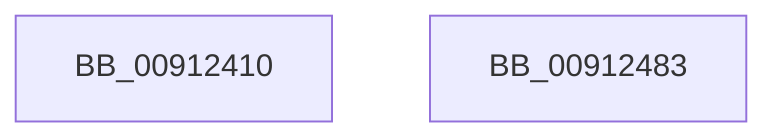

# PopResumeServices

- RVA: `0x00912410`–`0x00912484` (길이 `116` bytes)
- VA: `0x0000000140912410`
- 실행 섹션: `PAGE`
- PDB 이름 있음: `예`; PDB Function 태그: `아니요`
- unwind 정보 RVA: `0x0008A2E0`
- 디코드: `27`개 명령, `116/116` bytes 표시
- 미해석 바이트: `0` (있으면 어셈블리에 `.byte`로 보존)

> 이 문서는 커널 이미지의 기계어와 PDB 기호를 분석해 생성했습니다. 4번과 5번은 함수 원형과 자료형을 바이너리 사용 방식에서 추정한 C 해석이며 원본 소스 복구 결과는 아닙니다.

## 1. Dependencies

- 직접 호출 지점: **7**; 고유 호출 대상: **4**
- 직접 호출자로 확인된 함수: **1**
- RIP 상대 이미지 참조: **4**

### Outgoing calls
- `0x0091242A` → [KeQueryPerformanceCounter](../../text/37/KeQueryPerformanceCounter_function_0037E7E0.md) (function, `0x0037E7E0`)
- `0x0091243D` → [PopDiagTraceEventNoPayload](../../text/49/PopDiagTraceEventNoPayload_function_004982F8.md) (function, `0x004982F8`)
- `0x00912447` → [PopCheckpointSystemSleep](../../pagelk/B7/PopCheckpointSystemSleep_function_00B77C90.md) (function, `0x00B77C90`)
- `0x00912454` → [PopDispatchStateCallout](PopDispatchStateCallout_function_0091248C.md) (function, `0x0091248C`)
- `0x0091245B` → [KeQueryPerformanceCounter](../../text/37/KeQueryPerformanceCounter_function_0037E7E0.md) (function, `0x0037E7E0`)
- `0x0091246E` → [PopDiagTraceEventNoPayload](../../text/49/PopDiagTraceEventNoPayload_function_004982F8.md) (function, `0x004982F8`)
- `0x00912478` → [PopCheckpointSystemSleep](../../pagelk/B7/PopCheckpointSystemSleep_function_00B77C90.md) (function, `0x00B77C90`)

### Direct callers
- [PopIssueActionRequest](../A9/PopIssueActionRequest_function_00A9CE54.md) at `0x00A9D1B8`

### Static image references
- `0x0091242F` → RVA `0x000119B8` (`.rdata`; read)
- `0x00912436` → RVA `0x00F0C360` (`.data`; write)
- `0x00912460` → RVA `0x000119A8` (`.rdata`; read)
- `0x00912467` → RVA `0x00F0C368` (`.data`; write)

## 2. Other-region calls and transfers

- 다른 실행 섹션으로 향하는 call: **6**
  - `0x0091242A` → [KeQueryPerformanceCounter](../../text/37/KeQueryPerformanceCounter_function_0037E7E0.md) (`PAGE` → `.text`)
  - `0x0091243D` → [PopDiagTraceEventNoPayload](../../text/49/PopDiagTraceEventNoPayload_function_004982F8.md) (`PAGE` → `.text`)
  - `0x00912447` → [PopCheckpointSystemSleep](../../pagelk/B7/PopCheckpointSystemSleep_function_00B77C90.md) (`PAGE` → `PAGELK`)
  - `0x0091245B` → [KeQueryPerformanceCounter](../../text/37/KeQueryPerformanceCounter_function_0037E7E0.md) (`PAGE` → `.text`)
  - `0x0091246E` → [PopDiagTraceEventNoPayload](../../text/49/PopDiagTraceEventNoPayload_function_004982F8.md) (`PAGE` → `.text`)
  - `0x00912478` → [PopCheckpointSystemSleep](../../pagelk/B7/PopCheckpointSystemSleep_function_00B77C90.md) (`PAGE` → `PAGELK`)
- 별도 외부 분기/꼬리 이동을 확인하지 못했습니다.

## 3. Assembly (complete function range)

```asm
00912410  88 54 24 10                     mov byte ptr [rsp + 0x10], dl
00912414  53                              push rbx
00912415  48 83 EC 20                     sub rsp, 0x20
00912419  83 64 24 38 00                  and dword ptr [rsp + 0x38], 0
0091241E  48 8B D9                        mov rbx, rcx
00912421  C7 41 20 06 00 00 00            mov dword ptr [rcx + 0x20], 6
00912428  33 C9                           xor ecx, ecx
0091242A  E8 B1 C3 A6 FF                  call 0x14037e7e0
0091242F  48 8D 0D 82 F5 6F FF            lea rcx, [rip - 0x900a7e]
00912436  48 89 05 23 9F 5F 00            mov qword ptr [rip + 0x5f9f23], rax
0091243D  E8 B6 5E B8 FF                  call 0x1404982f8
00912442  B9 27 00 00 00                  mov ecx, 0x27
00912447  E8 44 58 26 00                  call 0x140b77c90
0091244C  48 8D 54 24 38                  lea rdx, [rsp + 0x38]
00912451  48 8B CB                        mov rcx, rbx
00912454  E8 33 00 00 00                  call 0x14091248c
00912459  33 C9                           xor ecx, ecx
0091245B  E8 80 C3 A6 FF                  call 0x14037e7e0
00912460  48 8D 0D 41 F5 6F FF            lea rcx, [rip - 0x900abf]
00912467  48 89 05 FA 9E 5F 00            mov qword ptr [rip + 0x5f9efa], rax
0091246E  E8 85 5E B8 FF                  call 0x1404982f8
00912473  B9 28 00 00 00                  mov ecx, 0x28
00912478  E8 13 58 26 00                  call 0x140b77c90
0091247D  48 83 C4 20                     add rsp, 0x20
00912481  5B                              pop rbx
00912482  C3                              ret
00912483  CC                              int3
```

## 4. C-style interpretation (structured pseudocode)

```c
__int64 __fastcall PopResumeServices(__int64 a1, unsigned __int8 a2)
{
    __int64 result;
    __int64 v_rsp;
    unsigned __int8 v_stack_p10;

    v_stack_p10 = a2;
    v_rsp = (v_rsp) - (32);
    *(unsigned int *)(a1 + 32) = 6;
    a1 = 0;
    result = KeQueryPerformanceCounter(a1, a2, a3, a4);
    *(unsigned __int64 *)(v_rip + 6266659) = result;
    result = PopDiagTraceEventNoPayload(v_rip - 9439870, a2, a3, a4);
    result = PopCheckpointSystemSleep(39, a2, a3, a4);
    result = PopDispatchStateCallout(0, v_stack_p10, a3, a4);
    a1 = 0;
    result = KeQueryPerformanceCounter(a1, v_stack_p10, a3, a4);
    *(unsigned __int64 *)(v_rip + 6266618) = result;
    result = PopDiagTraceEventNoPayload(v_rip - 9439935, v_stack_p10, a3, a4);
    result = PopCheckpointSystemSleep(40, v_stack_p10, a3, a4);
    v_rsp = (v_rsp) + (32);
    return result;
}
```

## 5. (Beta) C Style

```c
int64_t PopResumeServices(void *Arg1, uint8_t Arg2)
{
    uint8_t *arg1 = (uint8_t *)Arg1;

    int64_t result;
    int64_t local_rsp;
    uint8_t v_stack_p10;

    v_stack_p10 = Arg2;
    local_rsp = (local_rsp) - (32);
    *(uint32_t *)(arg1 + 0x20) = 6;
    Arg1 = 0;
    result = KeQueryPerformanceCounter(Arg1, Arg2, a3, a4);
    *(uint64_t *)(v_rip + 0x5F9F23) = result;
    result = PopDiagTraceEventNoPayload(v_rip - 9439870, Arg2, a3, a4);
    result = PopCheckpointSystemSleep(39, Arg2, a3, a4);
    result = PopDispatchStateCallout(0, v_stack_p10, a3, a4);
    Arg1 = 0;
    result = KeQueryPerformanceCounter(Arg1, v_stack_p10, a3, a4);
    *(uint64_t *)(v_rip + 0x5F9EFA) = result;
    result = PopDiagTraceEventNoPayload(v_rip - 9439935, v_stack_p10, a3, a4);
    result = PopCheckpointSystemSleep(40, v_stack_p10, a3, a4);
    local_rsp = (local_rsp) + (32);
    return result;
}
```

### 관측된 메모리 오프셋

구조체 형식이 확인되지 않은 접근은 인자 기준의 오프셋으로만 기록했습니다.

| 기준 인자 | 오프셋 표현 | 폭 (bit) | 접근 |
|---|---:|---:|---|
| `Arg1` | `+ 0x20` | `32` | `W` |

## 6. Execution-region graph

[열기: 2D/3D 그래프와 함수 탐색 컨트롤 패널](../../../control-panel.html?section=page&rva=0x00912410&view=graph)

- 2D 그래프는 위에서 아래로 흐르고, 3D 그래프는 빈 공간을 드래그해 회전합니다. Shift+드래그는 이동, 휠은 확대·축소, 함수 노드 선택은 대상 보고서 이동입니다.

### Static fallback


