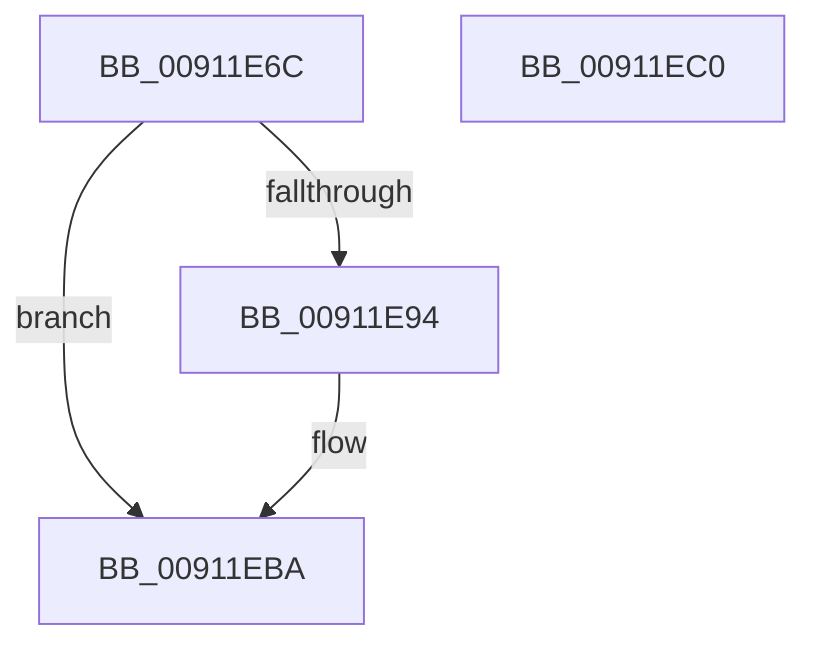

# PopSendSessionInfo

- RVA: `0x00911E6C`–`0x00911EC1` (길이 `85` bytes)
- VA: `0x0000000140911E6C`
- 실행 섹션: `PAGE`
- PDB 이름 있음: `예`; PDB Function 태그: `아니요`
- unwind 정보 RVA: `0x0008A2A0`
- 디코드: `25`개 명령, `85/85` bytes 표시
- 미해석 바이트: `0` (있으면 어셈블리에 `.byte`로 보존)

> 이 문서는 커널 이미지의 기계어와 PDB 기호를 분석해 생성했습니다. 4번과 5번은 함수 원형과 자료형을 바이너리 사용 방식에서 추정한 C 해석이며 원본 소스 복구 결과는 아닙니다.

## 1. Dependencies

- 직접 호출 지점: **1**; 고유 호출 대상: **1**
- 직접 호출자로 확인된 함수: **2**
- RIP 상대 이미지 참조: **1**

### Outgoing calls
- `0x00911EB5` → [PopInvokeWin32Callout](PopInvokeWin32Callout_function_009125F4.md) (function, `0x009125F4`)

### Direct callers
- [PopAdaptivePowerSettingCallback](../76/PopAdaptivePowerSettingCallback_function_0076B7A0.md) at `0x0076B9B1`
- [PopReleaseAdaptiveLock](PopReleaseAdaptiveLock_function_009137DC.md) at `0x00913858`

### Static image references
- `0x00911E7D` → RVA `0x00F06628` (`.data`; read)

## 2. Other-region calls and transfers

- 다른 실행 섹션으로 향하는 call: **0**
- 별도 외부 분기/꼬리 이동을 확인하지 못했습니다.

## 3. Assembly (complete function range)

```asm
00911E6C  89 4C 24 08                     mov dword ptr [rsp + 8], ecx
00911E70  55                              push rbp
00911E71  48 8B EC                        mov rbp, rsp
00911E74  48 83 EC 60                     sub rsp, 0x60
00911E78  0F 57 C0                        xorps xmm0, xmm0
00911E7B  33 C0                           xor eax, eax
00911E7D  38 05 A5 47 5F 00               cmp byte ptr [rip + 0x5f47a5], al
00911E83  0F 11 45 C0                     movups xmmword ptr [rbp - 0x40], xmm0
00911E87  89 45 F0                        mov dword ptr [rbp - 0x10], eax
00911E8A  0F 11 45 D0                     movups xmmword ptr [rbp - 0x30], xmm0
00911E8E  0F 11 45 E0                     movups xmmword ptr [rbp - 0x20], xmm0
00911E92  74 26                           je 0x140911eba
00911E94  4C 89 4D E0                     mov qword ptr [rbp - 0x20], r9
00911E98  44 8D 40 01                     lea r8d, [rax + 1]
00911E9C  4C 8D 4D 10                     lea r9, [rbp + 0x10]
00911EA0  C7 45 D8 14 00 00 00            mov dword ptr [rbp - 0x28], 0x14
00911EA7  48 8D 55 C0                     lea rdx, [rbp - 0x40]
00911EAB  89 45 E8                        mov dword ptr [rbp - 0x18], eax
00911EAE  8D 48 05                        lea ecx, [rax + 5]
00911EB1  48 89 45 F0                     mov qword ptr [rbp - 0x10], rax
00911EB5  E8 3A 07 00 00                  call 0x1409125f4
00911EBA  48 83 C4 60                     add rsp, 0x60
00911EBE  5D                              pop rbp
00911EBF  C3                              ret
00911EC0  CC                              int3
```

## 4. C-style interpretation (structured pseudocode)

```c
__int64 __fastcall PopSendSessionInfo(int a1, __int64 a2, __int64 a3, __int64 a4)
{
    __int64 result;
    __int64 v_rsp;
    unsigned int v_stack_m18;
    unsigned int v_stack_m20;
    unsigned __int64 v_stack_m28;
    unsigned int v_stack_m30;
    unsigned __int64 v_stack_m38;
    unsigned __int64 v_stack_m48;
    unsigned int v_stack_p8;

    v_stack_p8 = a1;
    v_rsp = (v_rsp) - (96);
    result = 0;
    v_stack_m48 = v_xmm0;
    v_stack_m18 = 0;
    v_stack_m38 = v_xmm0;
    v_stack_m28 = v_xmm0;
    if ((*(unsigned __int8 *)(v_rip + 6244261)) != 0) {
        v_stack_m28 = a4;
        a3 = result + 1;
        a4 = v_stack_p8;
        v_stack_m30 = 20;
        a2 = v_stack_m48;
        v_stack_m20 = 0;
        a1 = result + 5;
        v_stack_m18 = 0;
        result = PopInvokeWin32Callout(a1, a2, a3, a4);
    }
    v_rsp = (v_rsp) + (96);
    return result;
}
```

## 5. (Beta) C Style

```c
int64_t PopSendSessionInfo(int32_t Arg1, int64_t Arg2, int64_t Arg3, int64_t Arg4)
{
    int64_t result;
    int64_t local_rsp;
    uint32_t v_stack_m18;
    uint32_t v_stack_m20;
    uint64_t v_stack_m28;
    uint32_t v_stack_m30;
    uint64_t v_stack_m38;
    uint64_t v_stack_m48;
    uint32_t v_stack_p8;

    v_stack_p8 = Arg1;
    local_rsp = (local_rsp) - (96);
    result = 0;
    v_stack_m48 = v_xmm0;
    v_stack_m18 = 0;
    v_stack_m38 = v_xmm0;
    v_stack_m28 = v_xmm0;
    if ((*(uint8_t *)(v_rip + 0x5F47A5)) != 0) {
        v_stack_m28 = Arg4;
        Arg3 = result + 1;
        Arg4 = v_stack_p8;
        v_stack_m30 = 20;
        Arg2 = v_stack_m48;
        v_stack_m20 = 0;
        Arg1 = result + 5;
        v_stack_m18 = 0;
        result = PopInvokeWin32Callout(Arg1, Arg2, Arg3, Arg4);
    }
    local_rsp = (local_rsp) + (96);
    return result;
}
```

## 6. Execution-region graph

[열기: 2D/3D 그래프와 함수 탐색 컨트롤 패널](../../../control-panel.html?section=page&rva=0x00911E6C&view=graph)

- 2D 그래프는 위에서 아래로 흐르고, 3D 그래프는 빈 공간을 드래그해 회전합니다. Shift+드래그는 이동, 휠은 확대·축소, 함수 노드 선택은 대상 보고서 이동입니다.

### Static fallback


