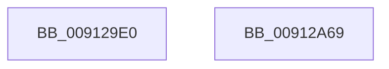

# PopSetDisplayStatus

- RVA: `0x009129E0`–`0x00912A6A` (길이 `138` bytes)
- VA: `0x00000001409129E0`
- 실행 섹션: `PAGE`
- PDB 이름 있음: `예`; PDB Function 태그: `아니요`
- unwind 정보 RVA: `0x0008A2AC`
- 디코드: `32`개 명령, `138/138` bytes 표시
- 미해석 바이트: `0` (있으면 어셈블리에 `.byte`로 보존)

> 이 문서는 커널 이미지의 기계어와 PDB 기호를 분석해 생성했습니다. 4번과 5번은 함수 원형과 자료형을 바이너리 사용 방식에서 추정한 C 해석이며 원본 소스 복구 결과는 아닙니다.

## 1. Dependencies

- 직접 호출 지점: **4**; 고유 호출 대상: **4**
- 직접 호출자로 확인된 함수: **2**
- RIP 상대 이미지 참조: **3**

### Outgoing calls
- `0x009129FC` → [PsGetProcessSessionIdEx](../../text/22/PsGetProcessSessionIdEx_function_0022F8F0.md) (function, `0x0022F8F0`)
- `0x00912A31` → [ExAcquireResourceExclusiveLite](../../text/21/ExAcquireResourceExclusiveLite_function_00214E20.md) (function, `0x00214E20`)
- `0x00912A54` → [PopSetSessionDisplayStatus](PopSetSessionDisplayStatus_function_00912E7C.md) (function, `0x00912E7C`)
- `0x00912A59` → [PopReleaseAdaptiveLock](PopReleaseAdaptiveLock_function_009137DC.md) (function, `0x009137DC`)

### Direct callers
- [NtPowerInformation](../95/NtPowerInformation_function_00955D80.md) at `0x00956DCD`
- [PopPowerInformationInternal](../A8/PopPowerInformationInternal_function_00A8B7C0.md) at `0x00A8BCE6`

### Static image references
- `0x00912A04` → RVA `0x00F08140` (`.data`; read)
- `0x00912A44` → RVA `0x00FD82A0` (`PAGEDATA`; write)
- `0x00912A4D` → RVA `0x00F08220` (`.data`; write)

## 2. Other-region calls and transfers

- 다른 실행 섹션으로 향하는 call: **2**
  - `0x009129FC` → [PsGetProcessSessionIdEx](../../text/22/PsGetProcessSessionIdEx_function_0022F8F0.md) (`PAGE` → `.text`)
  - `0x00912A31` → [ExAcquireResourceExclusiveLite](../../text/21/ExAcquireResourceExclusiveLite_function_00214E20.md) (`PAGE` → `.text`)
- 별도 외부 분기/꼬리 이동을 확인하지 못했습니다.

## 3. Assembly (complete function range)

```asm
009129E0  48 89 5C 24 08                  mov qword ptr [rsp + 8], rbx
009129E5  57                              push rdi
009129E6  48 83 EC 50                     sub rsp, 0x50
009129EA  8B F9                           mov edi, ecx
009129EC  65 48 8B 0C 25 88 01 00 00      mov rcx, qword ptr gs:[0x188]
009129F5  48 8B 89 B8 00 00 00            mov rcx, qword ptr [rcx + 0xb8]
009129FC  E8 EF CE 91 FF                  call 0x14022f8f0
00912A01  0F 57 C0                        xorps xmm0, xmm0
00912A04  48 8D 0D 35 57 5F 00            lea rcx, [rip + 0x5f5735]
00912A0B  0F 11 44 24 20                  movups xmmword ptr [rsp + 0x20], xmm0
00912A10  8B D8                           mov ebx, eax
00912A12  33 C0                           xor eax, eax
00912A14  48 89 44 24 40                  mov qword ptr [rsp + 0x40], rax
00912A19  0F 11 44 24 30                  movups xmmword ptr [rsp + 0x30], xmm0
00912A1E  65 48 8B 14 25 88 01 00 00      mov rdx, qword ptr gs:[0x188]
00912A27  66 FF 8A E4 01 00 00            dec word ptr [rdx + 0x1e4]
00912A2E  B2 01                           mov dl, 1
00912A30  90                              nop
00912A31  E8 EA 23 90 FF                  call 0x140214e20
00912A36  65 48 8B 04 25 88 01 00 00      mov rax, qword ptr gs:[0x188]
00912A3F  41 B0 01                        mov r8b, 1
00912A42  8B D7                           mov edx, edi
00912A44  48 89 05 55 58 6C 00            mov qword ptr [rip + 0x6c5855], rax
00912A4B  8B CB                           mov ecx, ebx
00912A4D  C6 05 CC 57 5F 00 00            mov byte ptr [rip + 0x5f57cc], 0
00912A54  E8 23 04 00 00                  call 0x140912e7c
00912A59  E8 7E 0D 00 00                  call 0x1409137dc
00912A5E  48 8B 5C 24 60                  mov rbx, qword ptr [rsp + 0x60]
00912A63  48 83 C4 50                     add rsp, 0x50
00912A67  5F                              pop rdi
00912A68  C3                              ret
00912A69  CC                              int3
```

## 4. C-style interpretation (structured pseudocode)

```c
__int64 __fastcall PopSetDisplayStatus(int a1)
{
    __int64 result;
    __int64 v_rsp;
    unsigned __int64 v_stack_m18;
    unsigned __int64 v_stack_m28;
    unsigned __int64 v_stack_m38;
    unsigned __int64 v_stack_p8;

    v_stack_p8 = v_rbx;
    v_rsp = (v_rsp) - (80);
    result = PsGetProcessSessionIdEx(*(unsigned __int64 *)(*(unsigned __int64 *)(gs_base + (0 + 392)) + 184), a2, a3, a4);
    v_stack_m38 = v_xmm0;
    result = 0;
    v_stack_m18 = 0;
    v_stack_m28 = v_xmm0;
    result = ExAcquireResourceExclusiveLite(v_rip + 6248245, 1, a3, a4);
    *(unsigned __int64 *)(v_rip + 7100501) = *(unsigned __int64 *)(gs_base + (0 + 392));
    *(unsigned __int8 *)(v_rip + 6248396) = 0;
    result = PopSetSessionDisplayStatus((unsigned int)((unsigned int)((unsigned int)((unsigned int)(result)))), (unsigned int)((unsigned int)((unsigned int)(a1))), 1, a4);
    result = PopReleaseAdaptiveLock((unsigned int)((unsigned int)((unsigned int)((unsigned int)(result)))), (unsigned int)((unsigned int)((unsigned int)(a1))), 1, a4);
    v_rsp = (v_rsp) + (80);
    return result;
}
```

## 5. (Beta) C Style

```c
int64_t PopSetDisplayStatus(int32_t Arg1)
{
    int64_t result;
    int64_t local_rsp;
    uint64_t v_stack_m18;
    uint64_t v_stack_m28;
    uint64_t v_stack_m38;
    uint64_t v_stack_p8;

    v_stack_p8 = local_rbx;
    local_rsp = (local_rsp) - (80);
    result = PsGetProcessSessionIdEx(*(uint64_t *)(*(uint64_t *)(gs_base + (0 + 0x188)) + 0xB8), a2, a3, a4);
    v_stack_m38 = v_xmm0;
    result = 0;
    v_stack_m18 = 0;
    v_stack_m28 = v_xmm0;
    result = ExAcquireResourceExclusiveLite(v_rip + 6248245, 1, a3, a4);
    *(uint64_t *)(v_rip + 0x6C5855) = *(uint64_t *)(gs_base + (0 + 0x188));
    *(uint8_t *)(v_rip + 0x5F57CC) = 0;
    result = PopSetSessionDisplayStatus((uint32_t)((uint32_t)((uint32_t)((uint32_t)(result)))), (uint32_t)((uint32_t)((uint32_t)(Arg1))), 1, a4);
    result = PopReleaseAdaptiveLock((uint32_t)((uint32_t)((uint32_t)((uint32_t)(result)))), (uint32_t)((uint32_t)((uint32_t)(Arg1))), 1, a4);
    local_rsp = (local_rsp) + (80);
    return result;
}
```

## 6. Execution-region graph

[열기: 2D/3D 그래프와 함수 탐색 컨트롤 패널](../../../control-panel.html?section=page&rva=0x009129E0&view=graph)

- 2D 그래프는 위에서 아래로 흐르고, 3D 그래프는 빈 공간을 드래그해 회전합니다. Shift+드래그는 이동, 휠은 확대·축소, 함수 노드 선택은 대상 보고서 이동입니다.

### Static fallback


