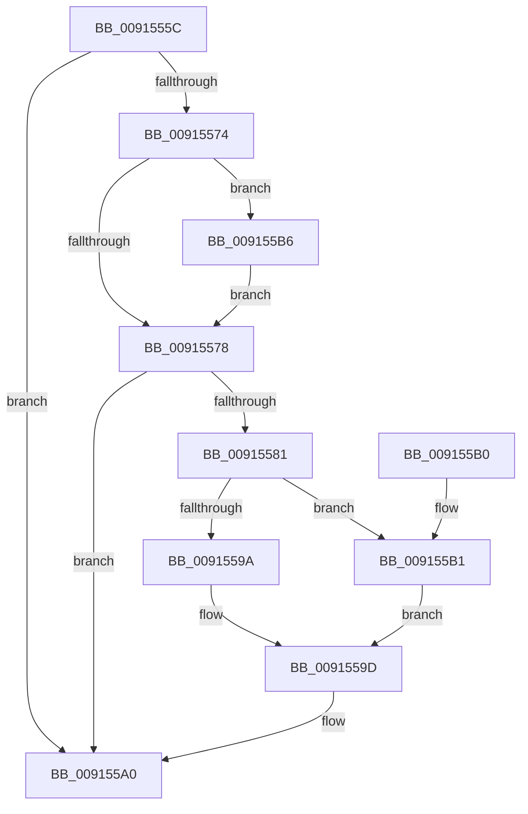

# PopSetGlobalUserStatus

- RVA: `0x0091555C`–`0x009155BF` (길이 `99` bytes)
- VA: `0x000000014091555C`
- 실행 섹션: `PAGE`
- PDB 이름 있음: `예`; PDB Function 태그: `아니요`
- unwind 정보 RVA: `0x0008A6D8`
- 디코드: `32`개 명령, `99/99` bytes 표시
- 미해석 바이트: `0` (있으면 어셈블리에 `.byte`로 보존)

> 이 문서는 커널 이미지의 기계어와 PDB 기호를 분석해 생성했습니다. 4번과 5번은 함수 원형과 자료형을 바이너리 사용 방식에서 추정한 C 해석이며 원본 소스 복구 결과는 아닙니다.

## 1. Dependencies

- 직접 호출 지점: **2**; 고유 호출 대상: **2**
- 직접 호출자로 확인된 함수: **1**
- RIP 상대 이미지 참조: **2**

### Outgoing calls
- `0x009155A0` → [PopEvaluateGlobalUserStatus](PopEvaluateGlobalUserStatus_function_009155C8.md) (function, `0x009155C8`)
- `0x009155B8` → [PopExtendConnectionState](../76/PopExtendConnectionState_function_0076BBB8.md) (function, `0x0076BBB8`)

### Direct callers
- [PopSetSessionUserStatus](PopSetSessionUserStatus_function_00914BB8.md) at `0x00914C53`

### Static image references
- `0x00915566` → RVA `0x00F081D8` (`.data`; read)
- `0x00915581` → RVA `0x00F081E8` (`.data`; read)

## 2. Other-region calls and transfers

- 다른 실행 섹션으로 향하는 call: **0**
- 별도 외부 분기/꼬리 이동을 확인하지 못했습니다.

## 3. Assembly (complete function range)

```asm
0091555C  48 89 5C 24 08                  mov qword ptr [rsp + 8], rbx
00915561  57                              push rdi
00915562  48 83 EC 20                     sub rsp, 0x20
00915566  8B 05 6C 2C 5F 00               mov eax, dword ptr [rip + 0x5f2c6c]
0091556C  8B FA                           mov edi, edx
0091556E  8B D9                           mov ebx, ecx
00915570  85 C0                           test eax, eax
00915572  74 2C                           je 0x1409155a0
00915574  3B D8                           cmp ebx, eax
00915576  73 3E                           jae 0x1409155b6
00915578  83 3D 59 2C 5F 00 00            cmp dword ptr [rip + 0x5f2c59], 0
0091557F  74 1F                           je 0x1409155a0
00915581  48 8B 0D 60 2C 5F 00            mov rcx, qword ptr [rip + 0x5f2c60]
00915588  48 8B D3                        mov rdx, rbx
0091558B  48 C1 EA 03                     shr rdx, 3
0091558F  83 E3 07                        and ebx, 7
00915592  0F BE 04 0A                     movsx eax, byte ptr [rdx + rcx]
00915596  85 FF                           test edi, edi
00915598  75 17                           jne 0x1409155b1
0091559A  0F AB D8                        bts eax, ebx
0091559D  88 04 0A                        mov byte ptr [rdx + rcx], al
009155A0  E8 23 00 00 00                  call 0x1409155c8
009155A5  48 8B 5C 24 30                  mov rbx, qword ptr [rsp + 0x30]
009155AA  48 83 C4 20                     add rsp, 0x20
009155AE  5F                              pop rdi
009155AF  C3                              ret
009155B0  CC                              int3
009155B1  0F B3 D8                        btr eax, ebx
009155B4  EB E7                           jmp 0x14091559d
009155B6  8B CB                           mov ecx, ebx
009155B8  E8 FB 65 E5 FF                  call 0x14076bbb8
009155BD  EB B9                           jmp 0x140915578
```

## 4. C-style interpretation (structured pseudocode)

```c
__int64 __fastcall PopSetGlobalUserStatus(int a1, int a2)
{
    __int64 result;
    __int64 v_rbx;
    __int64 v_rsp;
    unsigned __int64 v_stack_p8;

    v_stack_p8 = v_rbx;
    v_rsp = (v_rsp) - (32);
    if ((unsigned int)((unsigned int)(*(unsigned int *)(v_rip + 6237292))) == 0) goto loc_009155A0;
    if (((unsigned int)((unsigned int)(a1))) >= ((unsigned int)((unsigned int)(*(unsigned int *)(v_rip + 6237292))))) goto loc_009155B6;
loc_00915578:
    if ((*(unsigned int *)(v_rip + 6237273)) == 0) goto loc_009155A0;
    a2 = ((unsigned int)(a1)) >> (3);
    v_rbx = (unsigned int)(((unsigned int)(a1)) & (7));
    if ((unsigned int)((unsigned int)(a2)) != 0) goto loc_009155B1;
loc_0091559D:
    *(unsigned __int8 *)(a2 + *(unsigned __int64 *)(v_rip + 6237280) * 1) = (unsigned __int8)((__int8)(*(unsigned __int8 *)(a2 + *(unsigned __int64 *)(v_rip + 6237280) * 1)));
loc_009155A0:
    result = PopEvaluateGlobalUserStatus(*(unsigned __int64 *)(v_rip + 6237280), a2, a3, a4);
    v_rsp = (v_rsp) + (32);
    return result;
loc_009155B1:
    goto loc_0091559D;
loc_009155B6:
    result = PopExtendConnectionState((unsigned int)((unsigned int)(v_stack_p8)), a2, a3, a4);
    goto loc_00915578;
}
```

## 5. (Beta) C Style

```c
int64_t PopSetGlobalUserStatus(int32_t Arg1, int32_t Arg2)
{
    int64_t result;
    int64_t local_rbx;
    int64_t local_rsp;
    uint64_t v_stack_p8;

    v_stack_p8 = local_rbx;
    local_rsp = (local_rsp) - (32);
    if ((uint32_t)((uint32_t)(*(uint32_t *)(v_rip + 0x5F2C6C))) == 0) goto loc_009155A0;
    if (((uint32_t)((uint32_t)(Arg1))) >= ((uint32_t)((uint32_t)(*(uint32_t *)(v_rip + 0x5F2C6C))))) goto loc_009155B6;
loc_00915578:
    if ((*(uint32_t *)(v_rip + 0x5F2C59)) == 0) goto loc_009155A0;
    Arg2 = ((uint32_t)(Arg1)) >> (3);
    local_rbx = (uint32_t)(((uint32_t)(Arg1)) & (7));
    if ((uint32_t)((uint32_t)(Arg2)) != 0) goto loc_009155B1;
loc_0091559D:
    *(uint8_t *)(Arg2 + *(uint64_t *)(v_rip + 0x5F2C60) * 1) = (uint8_t)((int8_t)(*(uint8_t *)(Arg2 + *(uint64_t *)(v_rip + 0x5F2C60) * 1)));
loc_009155A0:
    result = PopEvaluateGlobalUserStatus(*(uint64_t *)(v_rip + 0x5F2C60), Arg2, a3, a4);
    local_rsp = (local_rsp) + (32);
    return result;
loc_009155B1:
    goto loc_0091559D;
loc_009155B6:
    result = PopExtendConnectionState((uint32_t)((uint32_t)(v_stack_p8)), Arg2, a3, a4);
    goto loc_00915578;
}
```

## 6. Execution-region graph

[열기: 2D/3D 그래프와 함수 탐색 컨트롤 패널](../../../control-panel.html?section=page&rva=0x0091555C&view=graph)

- 2D 그래프는 위에서 아래로 흐르고, 3D 그래프는 빈 공간을 드래그해 회전합니다. Shift+드래그는 이동, 휠은 확대·축소, 함수 노드 선택은 대상 보고서 이동입니다.

### Static fallback


