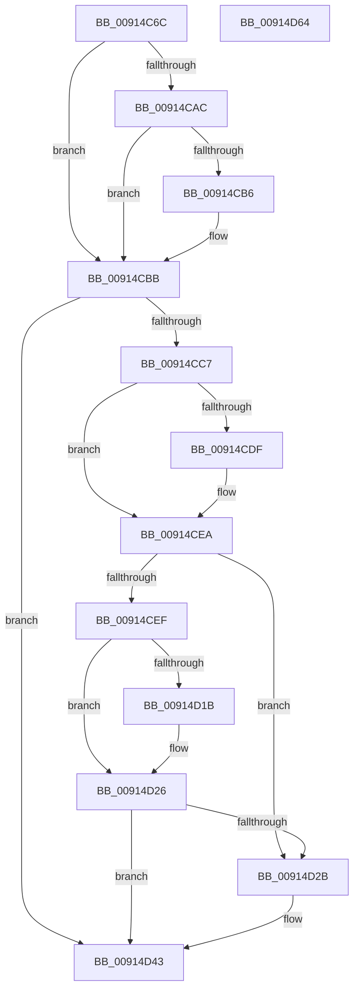

# PopSetNewPolicyValue

- RVA: `0x00914C6C`–`0x00914D65` (길이 `249` bytes)
- VA: `0x0000000140914C6C`
- 실행 섹션: `PAGE`
- PDB 이름 있음: `예`; PDB Function 태그: `아니요`
- unwind 정보 RVA: `0x0008A668`
- 디코드: `71`개 명령, `249/249` bytes 표시
- 미해석 바이트: `0` (있으면 어셈블리에 `.byte`로 보존)

> 이 문서는 커널 이미지의 기계어와 PDB 기호를 분석해 생성했습니다. 4번과 5번은 함수 원형과 자료형을 바이너리 사용 방식에서 추정한 C 해석이며 원본 소스 복구 결과는 아닙니다.

## 1. Dependencies

- 직접 호출 지점: **5**; 고유 호출 대상: **5**
- 직접 호출자로 확인된 함수: **1**
- RIP 상대 이미지 참조: **4**

### Outgoing calls
- `0x00914CA3` → [RtlStringFromGUIDEx](RtlStringFromGUIDEx_function_00915450.md) (function, `0x00915450`)
- `0x00914CB6` → [ExFreePool](../../poolcode/B8/ExFreePool_function_00B82850.md) (function, `0x00B82850`)
- `0x00914CBE` → [PopStateIsSessionSpecific](PopStateIsSessionSpecific_function_0091529C.md) (function, `0x0091529C`)
- `0x00914D01` → [PpmSetProfilePolicySetting](PpmSetProfilePolicySetting_function_00915A44.md) (function, `0x00915A44`)
- `0x00914D3C` → [PopSetPowerSettingValue](PopSetPowerSettingValue_function_00914E54.md) (function, `0x00914E54`)

### Direct callers
- [PopUmpoProcessPowerMessage](../A2/PopUmpoProcessPowerMessage_function_00A2E9B4.md) at `0x00A2E9F5`

### Static image references
- `0x00914CCF` → RVA `0x00011AA8` (`.rdata`; read)
- `0x00914CE3` → RVA `0x00011AB0` (`.rdata`; read)
- `0x00914D12` → RVA `0x000112D0` (`.rdata`; read)
- `0x00914D1F` → RVA `0x000112D8` (`.rdata`; read)

## 2. Other-region calls and transfers

- 다른 실행 섹션으로 향하는 call: **1**
  - `0x00914CB6` → [ExFreePool](../../poolcode/B8/ExFreePool_function_00B82850.md) (`PAGE` → `POOLCODE`)
- 별도 외부 분기/꼬리 이동을 확인하지 못했습니다.

## 3. Assembly (complete function range)

```asm
00914C6C  48 8B C4                        mov rax, rsp
00914C6F  48 89 58 08                     mov qword ptr [rax + 8], rbx
00914C73  48 89 68 10                     mov qword ptr [rax + 0x10], rbp
00914C77  48 89 70 18                     mov qword ptr [rax + 0x18], rsi
00914C7B  48 89 78 20                     mov qword ptr [rax + 0x20], rdi
00914C7F  41 54                           push r12
00914C81  41 56                           push r14
00914C83  41 57                           push r15
00914C85  48 83 EC 40                     sub rsp, 0x40
00914C89  48 8D 71 14                     lea rsi, [rcx + 0x14]
00914C8D  48 8B D9                        mov rbx, rcx
00914C90  0F 57 C0                        xorps xmm0, xmm0
00914C93  48 8D 50 D8                     lea rdx, [rax - 0x28]
00914C97  48 8B CE                        mov rcx, rsi
00914C9A  41 B0 01                        mov r8b, 1
00914C9D  0F 11 40 D8                     movups xmmword ptr [rax - 0x28], xmm0
00914CA1  33 FF                           xor edi, edi
00914CA3  E8 A8 07 00 00                  call 0x140915450
00914CA8  85 C0                           test eax, eax
00914CAA  78 0F                           js 0x140914cbb
00914CAC  48 8B 4C 24 38                  mov rcx, qword ptr [rsp + 0x38]
00914CB1  48 85 C9                        test rcx, rcx
00914CB4  74 05                           je 0x140914cbb
00914CB6  E8 95 DB 26 00                  call 0x140b82850
00914CBB  48 8B CE                        mov rcx, rsi
00914CBE  E8 D9 05 00 00                  call 0x14091529c
00914CC3  84 C0                           test al, al
00914CC5  75 7C                           jne 0x140914d43
00914CC7  48 8B 43 24                     mov rax, qword ptr [rbx + 0x24]
00914CCB  4C 8D 63 3C                     lea r12, [rbx + 0x3c]
00914CCF  48 2B 05 D2 CD 6F FF            sub rax, qword ptr [rip - 0x90322e]
00914CD6  8B 6B 34                        mov ebp, dword ptr [rbx + 0x34]
00914CD9  44 8B 7B 38                     mov r15d, dword ptr [rbx + 0x38]
00914CDD  75 0B                           jne 0x140914cea
00914CDF  48 8B 43 2C                     mov rax, qword ptr [rbx + 0x2c]
00914CE3  48 2B 05 C6 CD 6F FF            sub rax, qword ptr [rip - 0x90323a]
00914CEA  48 85 C0                        test rax, rax
00914CED  75 3C                           jne 0x140914d2b
00914CEF  4D 8B CC                        mov r9, r12
00914CF2  44 89 7C 24 20                  mov dword ptr [rsp + 0x20], r15d
00914CF7  44 8B C5                        mov r8d, ebp
00914CFA  48 8D 4B 04                     lea rcx, [rbx + 4]
00914CFE  48 8B D6                        mov rdx, rsi
00914D01  E8 3E 0D 00 00                  call 0x140915a44
00914D06  3D 25 02 00 C0                  cmp eax, 0xc0000225
00914D0B  0F 45 F8                        cmovne edi, eax
00914D0E  48 8B 43 04                     mov rax, qword ptr [rbx + 4]
00914D12  48 2B 05 B7 C5 6F FF            sub rax, qword ptr [rip - 0x903a49]
00914D19  75 0B                           jne 0x140914d26
00914D1B  48 8B 43 0C                     mov rax, qword ptr [rbx + 0xc]
00914D1F  48 2B 05 B2 C5 6F FF            sub rax, qword ptr [rip - 0x903a4e]
00914D26  48 85 C0                        test rax, rax
00914D29  75 18                           jne 0x140914d43
00914D2B  45 8B CF                        mov r9d, r15d
00914D2E  4C 89 64 24 20                  mov qword ptr [rsp + 0x20], r12
00914D33  44 8B C5                        mov r8d, ebp
00914D36  83 CA FF                        or edx, 0xffffffff
00914D39  48 8B CE                        mov rcx, rsi
00914D3C  E8 13 01 00 00                  call 0x140914e54
00914D41  8B F8                           mov edi, eax
00914D43  48 8B 5C 24 60                  mov rbx, qword ptr [rsp + 0x60]
00914D48  8B C7                           mov eax, edi
00914D4A  48 8B 7C 24 78                  mov rdi, qword ptr [rsp + 0x78]
00914D4F  48 8B 6C 24 68                  mov rbp, qword ptr [rsp + 0x68]
00914D54  48 8B 74 24 70                  mov rsi, qword ptr [rsp + 0x70]
00914D59  48 83 C4 40                     add rsp, 0x40
00914D5D  41 5F                           pop r15
00914D5F  41 5E                           pop r14
00914D61  41 5C                           pop r12
00914D63  C3                              ret
00914D64  CC                              int3
```

## 4. C-style interpretation (structured pseudocode)

```c
__int64 __fastcall PopSetNewPolicyValue(__int64 a1)
{
    __int64 result;
    __int64 v_rdi;
    __int64 v_rsp;
    unsigned __int64 v_stack_m20;
    unsigned int v_stack_m38;
    unsigned __int64 v_stack_p10;
    unsigned __int64 v_stack_p18;
    unsigned __int64 v_stack_p20;
    unsigned __int64 v_stack_p8;

    *(unsigned __int64 *)(v_rsp + 8) = v_rbx;
    *(unsigned __int64 *)(v_rsp + 16) = v_rbp;
    *(unsigned __int64 *)(v_rsp + 24) = v_rsi;
    *(unsigned __int64 *)(v_rsp + 32) = v_rdi;
    v_rsp = (v_rsp) - (64);
    *(unsigned __int64 *)(v_rsp - 40) = v_xmm0;
    v_rdi = 0;
    result = RtlStringFromGUIDEx(a1 + 20, v_rsp - 40, 1, a4);
    if (sign_flag) goto loc_00914CBB;
    if (v_stack_m20 != 0) {
        result = ExFreePool(v_stack_m20, v_rsp - 40, 1, a4);
    }
    result = PopStateIsSessionSpecific(a1 + 20, v_rsp - 40, 1, a4);
    if ((unsigned __int8)(result) != 0) goto loc_00914D43;
    result = (*(unsigned __int64 *)(a1 + 36)) - (*(unsigned __int64 *)(v_rip - 9450030));
    if (!(condition_is_not_equal)) {
        result = *(unsigned __int64 *)(a1 + 44);
        result = (result) - (*(unsigned __int64 *)(v_rip - 9450042));
    }
    if (result != 0) goto loc_00914D2B;
    v_stack_m38 = (unsigned int)((unsigned int)(*(unsigned int *)(a1 + 56)));
    result = PpmSetProfilePolicySetting(a1 + 4, a1 + 20, (unsigned int)((unsigned int)((unsigned int)(*(unsigned int *)(a1 + 52)))), a1 + 60);
    if (((unsigned int)(result)) != 0xC0000225ULL) { v_rdi = (unsigned int)(result); }
    result = (*(unsigned __int64 *)(a1 + 4)) - (*(unsigned __int64 *)(v_rip - 9452105));
    if (!(condition_is_not_equal)) {
        result = *(unsigned __int64 *)(a1 + 12);
        result = (result) - (*(unsigned __int64 *)(v_rip - 9452110));
    }
    if (result == 0) {
        a4 = (unsigned int)((unsigned int)(*(unsigned int *)(a1 + 56)));
        v_stack_m38 = a1 + 60;
        a3 = (unsigned int)((unsigned int)(*(unsigned int *)(a1 + 52)));
        a2 = (unsigned int)((a1 + 20) | (0xFFFFFFFFULL));
        a1 = a1 + 20;
        result = PopSetPowerSettingValue(a1, a2, a3, a4);
        v_rdi = (unsigned int)(result);
    }
    v_rsp = (v_rsp) + (64);
    return (unsigned int)((unsigned int)(v_rdi));
}
```

## 5. (Beta) C Style

```c
int64_t PopSetNewPolicyValue(void *Arg1)
{
    uint8_t *arg1 = (uint8_t *)Arg1;

    int64_t result;
    int64_t local_rdi;
    int64_t local_rsp;
    uint64_t v_stack_m20;
    uint32_t v_stack_m38;
    uint64_t v_stack_p10;
    uint64_t v_stack_p18;
    uint64_t v_stack_p20;
    uint64_t v_stack_p8;

    *(uint64_t *)(local_rsp + 0x8) = local_rbx;
    *(uint64_t *)(local_rsp + 0x10) = local_rbp;
    *(uint64_t *)(local_rsp + 0x18) = local_rsi;
    *(uint64_t *)(local_rsp + 0x20) = local_rdi;
    local_rsp = (local_rsp) - (64);
    *(uint64_t *)(local_rsp - 0x28) = v_xmm0;
    local_rdi = 0;
    result = RtlStringFromGUIDEx(Arg1 + 20, local_rsp - 40, 1, a4);
    if (sign_flag) goto loc_00914CBB;
    if (v_stack_m20 != 0) {
        result = ExFreePool(v_stack_m20, local_rsp - 40, 1, a4);
    }
    result = PopStateIsSessionSpecific(Arg1 + 20, local_rsp - 40, 1, a4);
    if ((uint8_t)(result) != 0) goto loc_00914D43;
    result = (*(uint64_t *)(arg1 + 0x24)) - (*(uint64_t *)(v_rip - 0x90322E));
    if (!(condition_is_not_equal)) {
        result = *(uint64_t *)(arg1 + 0x2C);
        result = (result) - (*(uint64_t *)(v_rip - 0x90323A));
    }
    if (result != 0) goto loc_00914D2B;
    v_stack_m38 = (uint32_t)((uint32_t)(*(uint32_t *)(arg1 + 0x38)));
    result = PpmSetProfilePolicySetting(Arg1 + 4, Arg1 + 20, (uint32_t)((uint32_t)((uint32_t)(*(uint32_t *)(arg1 + 0x34)))), Arg1 + 60);
    if (((uint32_t)(result)) != 0xC0000225ULL) { local_rdi = (uint32_t)(result); }
    result = (*(uint64_t *)(arg1 + 0x4)) - (*(uint64_t *)(v_rip - 0x903A49));
    if (!(condition_is_not_equal)) {
        result = *(uint64_t *)(arg1 + 0xC);
        result = (result) - (*(uint64_t *)(v_rip - 0x903A4E));
    }
    if (result == 0) {
        a4 = (uint32_t)((uint32_t)(*(uint32_t *)(arg1 + 0x38)));
        v_stack_m38 = Arg1 + 60;
        a3 = (uint32_t)((uint32_t)(*(uint32_t *)(arg1 + 0x34)));
        a2 = (uint32_t)((Arg1 + 20) | (0xFFFFFFFFULL));
        Arg1 = Arg1 + 20;
        result = PopSetPowerSettingValue(Arg1, a2, a3, a4);
        local_rdi = (uint32_t)(result);
    }
    local_rsp = (local_rsp) + (64);
    return (uint32_t)((uint32_t)(local_rdi));
}
```

### 관측된 메모리 오프셋

구조체 형식이 확인되지 않은 접근은 인자 기준의 오프셋으로만 기록했습니다.

| 기준 인자 | 오프셋 표현 | 폭 (bit) | 접근 |
|---|---:|---:|---|
| `Arg1` | `+ 0x4` | `64` | `R` |
| `Arg1` | `+ 0xC` | `64` | `R` |
| `Arg1` | `+ 0x14` | `64` | `R` |
| `Arg1` | `+ 0x24` | `64` | `R` |
| `Arg1` | `+ 0x2C` | `64` | `R` |
| `Arg1` | `+ 0x34` | `32` | `R` |
| `Arg1` | `+ 0x38` | `32` | `R` |
| `Arg1` | `+ 0x3C` | `64` | `R` |

## 6. Execution-region graph

[열기: 2D/3D 그래프와 함수 탐색 컨트롤 패널](../../../control-panel.html?section=page&rva=0x00914C6C&view=graph)

- 2D 그래프는 위에서 아래로 흐르고, 3D 그래프는 빈 공간을 드래그해 회전합니다. Shift+드래그는 이동, 휠은 확대·축소, 함수 노드 선택은 대상 보고서 이동입니다.

### Static fallback


