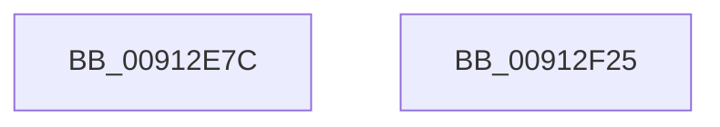

# PopSetSessionDisplayStatus

- RVA: `0x00912E7C`–`0x00912F26` (길이 `170` bytes)
- VA: `0x0000000140912E7C`
- 실행 섹션: `PAGE`
- PDB 이름 있음: `예`; PDB Function 태그: `아니요`
- unwind 정보 RVA: `0x0008A3A8`
- 디코드: `42`개 명령, `170/170` bytes 표시
- 미해석 바이트: `0` (있으면 어셈블리에 `.byte`로 보존)

> 이 문서는 커널 이미지의 기계어와 PDB 기호를 분석해 생성했습니다. 4번과 5번은 함수 원형과 자료형을 바이너리 사용 방식에서 추정한 C 해석이며 원본 소스 복구 결과는 아닙니다.

## 1. Dependencies

- 직접 호출 지점: **4**; 고유 호출 대상: **3**
- 직접 호출자로 확인된 함수: **4**
- RIP 상대 이미지 참조: **5**

### Outgoing calls
- `0x00912EA2` → [PopDiagTraceSessionState](PopDiagTraceSessionState_function_00912C5C.md) (function, `0x00912C5C`)
- `0x00912ECE` → [PopPrintEx](../../text/48/PopPrintEx_function_0048EF24.md) (function, `0x0048EF24`)
- `0x00912EF1` → [PopSetPowerSettingValue](PopSetPowerSettingValue_function_00914E54.md) (function, `0x00914E54`)
- `0x00912F10` → [PopSetPowerSettingValue](PopSetPowerSettingValue_function_00914E54.md) (function, `0x00914E54`)

### Direct callers
- [PopSessionConnected](../76/PopSessionConnected_function_0076BC74.md) at `0x0076BCBF`
- [PopSessionConnectedV2](../76/PopSessionConnectedV2_function_0076BD2C.md) at `0x0076BD7C`
- [PopSetDisplayStatus](PopSetDisplayStatus_function_009129E0.md) at `0x00912A54`
- [PopSessionDisconnected](PopSessionDisconnected_function_00912BD8.md) at `0x00912C2F`

### Static image references
- `0x00912E9B` → RVA `0x00011B48` (`.rdata`; read)
- `0x00912EA7` → RVA `0x00B03100` (` ?? ::NNGAKEGL::`string'`; read)
- `0x00912EB4` → RVA `0x00B03090` (` ?? ::NNGAKEGL::`string'`; read)
- `0x00912EBE` → RVA `0x00B030D0` (` ?? ::NNGAKEGL::`string'`; read)
- `0x00912EE8` → RVA `0x00011B58` (`.rdata`; read)

## 2. Other-region calls and transfers

- 다른 실행 섹션으로 향하는 call: **1**
  - `0x00912ECE` → [PopPrintEx](../../text/48/PopPrintEx_function_0048EF24.md) (`PAGE` → `.text`)
- 별도 외부 분기/꼬리 이동을 확인하지 못했습니다.

## 3. Assembly (complete function range)

```asm
00912E7C  48 89 5C 24 08                  mov qword ptr [rsp + 8], rbx
00912E81  48 89 74 24 18                  mov qword ptr [rsp + 0x18], rsi
00912E86  89 54 24 10                     mov dword ptr [rsp + 0x10], edx
00912E8A  57                              push rdi
00912E8B  48 83 EC 30                     sub rsp, 0x30
00912E8F  41 8A D8                        mov bl, r8b
00912E92  8B FA                           mov edi, edx
00912E94  44 8B C2                        mov r8d, edx
00912E97  8B F1                           mov esi, ecx
00912E99  8B D1                           mov edx, ecx
00912E9B  48 8D 0D A6 EC 6F FF            lea rcx, [rip - 0x90135a]
00912EA2  E8 B5 FD FF FF                  call 0x140912c5c
00912EA7  48 8D 05 52 02 1F 00            lea rax, [rip + 0x1f0252]
00912EAE  89 7C 24 20                     mov dword ptr [rsp + 0x20], edi
00912EB2  84 DB                           test bl, bl
00912EB4  4C 8D 05 D5 01 1F 00            lea r8, [rip + 0x1f01d5]
00912EBB  44 8B CE                        mov r9d, esi
00912EBE  48 8D 15 0B 02 1F 00            lea rdx, [rip + 0x1f020b]
00912EC5  4C 0F 44 C0                     cmove r8, rax
00912EC9  B9 03 00 00 00                  mov ecx, 3
00912ECE  E8 51 C0 B7 FF                  call 0x14048ef24
00912ED3  48 8D 44 24 48                  lea rax, [rsp + 0x48]
00912ED8  BB 04 00 00 00                  mov ebx, 4
00912EDD  44 8B CB                        mov r9d, ebx
00912EE0  48 89 44 24 20                  mov qword ptr [rsp + 0x20], rax
00912EE5  45 33 C0                        xor r8d, r8d
00912EE8  48 8D 0D 69 EC 6F FF            lea rcx, [rip - 0x901397]
00912EEF  8B D6                           mov edx, esi
00912EF1  E8 5E 1F 00 00                  call 0x140914e54
00912EF6  48 8D 44 24 48                  lea rax, [rsp + 0x48]
00912EFB  44 8B CB                        mov r9d, ebx
00912EFE  44 8D 43 FD                     lea r8d, [rbx - 3]
00912F02  48 89 44 24 20                  mov qword ptr [rsp + 0x20], rax
00912F07  8B D6                           mov edx, esi
00912F09  48 8D 0D 48 EC 6F FF            lea rcx, [rip - 0x9013b8]
00912F10  E8 3F 1F 00 00                  call 0x140914e54
00912F15  48 8B 5C 24 40                  mov rbx, qword ptr [rsp + 0x40]
00912F1A  48 8B 74 24 50                  mov rsi, qword ptr [rsp + 0x50]
00912F1F  48 83 C4 30                     add rsp, 0x30
00912F23  5F                              pop rdi
00912F24  C3                              ret
00912F25  CC                              int3
```

## 4. C-style interpretation (structured pseudocode)

```c
__int64 __fastcall PopSetSessionDisplayStatus(int a1, int a2, unsigned __int8 a3)
{
    __int64 result;
    __int64 v_rsp;
    unsigned int v_stack_m18;
    unsigned int v_stack_p10;
    unsigned __int64 v_stack_p18;
    unsigned __int64 v_stack_p8;

    v_stack_p8 = v_rbx;
    v_stack_p18 = v_rsi;
    v_stack_p10 = a2;
    v_rsp = (v_rsp) - (48);
    result = PopDiagTraceSessionState(v_rip - 9442138, (unsigned int)(a1), (unsigned int)(a2), a4);
    v_stack_m18 = (unsigned int)((unsigned int)(a2));
    a3 = v_rip + 2032085;
    if (a3 == 0) { a3 = v_rip + 2032210; }
    result = PopPrintEx(3, v_rip + 2032139, a3, (unsigned int)((unsigned int)((unsigned int)(a1))));
    v_stack_m18 = v_stack_p10;
    a3 = 0;
    result = PopSetPowerSettingValue(v_rip - 9442199, (unsigned int)((unsigned int)((unsigned int)(a1))), a3, 4);
    v_stack_m18 = v_stack_p10;
    result = PopSetPowerSettingValue(v_rip - 9442232, (unsigned int)((unsigned int)((unsigned int)(a1))), 4 - 3, 4);
    v_rsp = (v_rsp) + (48);
    return result;
}
```

## 5. (Beta) C Style

```c
int64_t PopSetSessionDisplayStatus(int32_t Arg1, int32_t Arg2, uint8_t Arg3)
{
    int64_t result;
    int64_t local_rsp;
    uint32_t v_stack_m18;
    uint32_t v_stack_p10;
    uint64_t v_stack_p18;
    uint64_t v_stack_p8;

    v_stack_p8 = local_rbx;
    v_stack_p18 = local_rsi;
    v_stack_p10 = Arg2;
    local_rsp = (local_rsp) - (48);
    result = PopDiagTraceSessionState(v_rip - 9442138, (uint32_t)(Arg1), (uint32_t)(Arg2), a4);
    v_stack_m18 = (uint32_t)((uint32_t)(Arg2));
    Arg3 = v_rip + 2032085;
    if (Arg3 == 0) { Arg3 = v_rip + 2032210; }
    result = PopPrintEx(3, v_rip + 2032139, Arg3, (uint32_t)((uint32_t)((uint32_t)(Arg1))));
    v_stack_m18 = v_stack_p10;
    Arg3 = 0;
    result = PopSetPowerSettingValue(v_rip - 9442199, (uint32_t)((uint32_t)((uint32_t)(Arg1))), Arg3, 4);
    v_stack_m18 = v_stack_p10;
    result = PopSetPowerSettingValue(v_rip - 9442232, (uint32_t)((uint32_t)((uint32_t)(Arg1))), 4 - 3, 4);
    local_rsp = (local_rsp) + (48);
    return result;
}
```

## 6. Execution-region graph

[열기: 2D/3D 그래프와 함수 탐색 컨트롤 패널](../../../control-panel.html?section=page&rva=0x00912E7C&view=graph)

- 2D 그래프는 위에서 아래로 흐르고, 3D 그래프는 빈 공간을 드래그해 회전합니다. Shift+드래그는 이동, 휠은 확대·축소, 함수 노드 선택은 대상 보고서 이동입니다.

### Static fallback


