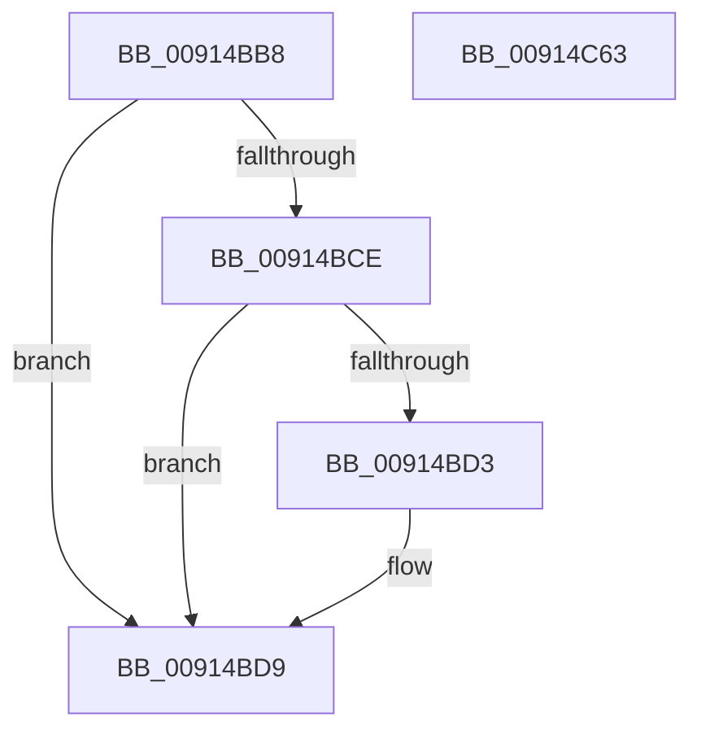

# PopSetSessionUserStatus

- RVA: `0x00914BB8`–`0x00914C64` (길이 `172` bytes)
- VA: `0x0000000140914BB8`
- 실행 섹션: `PAGE`
- PDB 이름 있음: `예`; PDB Function 태그: `아니요`
- unwind 정보 RVA: `0x0008A658`
- 디코드: `44`개 명령, `172/172` bytes 표시
- 미해석 바이트: `0` (있으면 어셈블리에 `.byte`로 보존)

> 이 문서는 커널 이미지의 기계어와 PDB 기호를 분석해 생성했습니다. 4번과 5번은 함수 원형과 자료형을 바이너리 사용 방식에서 추정한 C 해석이며 원본 소스 복구 결과는 아닙니다.

## 1. Dependencies

- 직접 호출 지점: **6**; 고유 호출 대상: **5**
- 직접 호출자로 확인된 함수: **3**
- RIP 상대 이미지 참조: **5**

### Outgoing calls
- `0x00914BDF` → [PopPrintUserActivityPresence](PopPrintUserActivityPresence_function_00915614.md) (function, `0x00915614`)
- `0x00914BF6` → [PopPrintEx](../../text/48/PopPrintEx_function_0048EF24.md) (function, `0x0048EF24`)
- `0x00914C07` → [PopDiagTraceSessionState](PopDiagTraceSessionState_function_00912C5C.md) (function, `0x00912C5C`)
- `0x00914C28` → [PopSetPowerSettingValue](PopSetPowerSettingValue_function_00914E54.md) (function, `0x00914E54`)
- `0x00914C4A` → [PopSetPowerSettingValue](PopSetPowerSettingValue_function_00914E54.md) (function, `0x00914E54`)
- `0x00914C53` → [PopSetGlobalUserStatus](PopSetGlobalUserStatus_function_0091555C.md) (function, `0x0091555C`)

### Direct callers
- [PopSessionDisconnected](PopSessionDisconnected_function_00912BD8.md) at `0x00912C3B`
- [PopAdaptiveGetConsoleSessionState](PopAdaptiveGetConsoleSessionState_function_00913FB4.md) at `0x0091413E`
- [PopAdaptiveGetRemoteSessionState](PopAdaptiveGetRemoteSessionState_function_00915998.md) at `0x00915A2F`

### Static image references
- `0x00914BC2` → RVA `0x00F08238` (`.data`; read)
- `0x00914BD3` → RVA `0x00F0823C` (`.data`; write)
- `0x00914BE7` → RVA `0x00B031E0` (` ?? ::NNGAKEGL::`string'`; read)
- `0x00914BFE` → RVA `0x00011A98` (`.rdata`; read)
- `0x00914C21` → RVA `0x00011A88` (`.rdata`; read)

## 2. Other-region calls and transfers

- 다른 실행 섹션으로 향하는 call: **1**
  - `0x00914BF6` → [PopPrintEx](../../text/48/PopPrintEx_function_0048EF24.md) (`PAGE` → `.text`)
- 별도 외부 분기/꼬리 이동을 확인하지 못했습니다.

## 3. Assembly (complete function range)

```asm
00914BB8  48 89 5C 24 10                  mov qword ptr [rsp + 0x10], rbx
00914BBD  57                              push rdi
00914BBE  48 83 EC 30                     sub rsp, 0x30
00914BC2  39 0D 70 36 5F 00               cmp dword ptr [rip + 0x5f3670], ecx
00914BC8  8B FA                           mov edi, edx
00914BCA  8B D9                           mov ebx, ecx
00914BCC  75 0B                           jne 0x140914bd9
00914BCE  83 F9 FF                        cmp ecx, -1
00914BD1  74 06                           je 0x140914bd9
00914BD3  89 15 63 36 5F 00               mov dword ptr [rip + 0x5f3663], edx
00914BD9  8B CF                           mov ecx, edi
00914BDB  89 7C 24 40                     mov dword ptr [rsp + 0x40], edi
00914BDF  E8 30 0A 00 00                  call 0x140915614
00914BE4  4C 8B C8                        mov r9, rax
00914BE7  48 8D 15 F2 E5 1E 00            lea rdx, [rip + 0x1ee5f2]
00914BEE  B9 03 00 00 00                  mov ecx, 3
00914BF3  44 8B C3                        mov r8d, ebx
00914BF6  E8 29 A3 B7 FF                  call 0x14048ef24
00914BFB  44 8B C7                        mov r8d, edi
00914BFE  48 8D 0D 93 CE 6F FF            lea rcx, [rip - 0x90316d]
00914C05  8B D3                           mov edx, ebx
00914C07  E8 50 E0 FF FF                  call 0x140912c5c
00914C0C  48 8D 44 24 40                  lea rax, [rsp + 0x40]
00914C11  41 B9 04 00 00 00               mov r9d, 4
00914C17  45 33 C0                        xor r8d, r8d
00914C1A  48 89 44 24 20                  mov qword ptr [rsp + 0x20], rax
00914C1F  8B D3                           mov edx, ebx
00914C21  48 8D 0D 60 CE 6F FF            lea rcx, [rip - 0x9031a0]
00914C28  E8 27 02 00 00                  call 0x140914e54
00914C2D  41 B9 04 00 00 00               mov r9d, 4
00914C33  48 8D 44 24 40                  lea rax, [rsp + 0x40]
00914C38  8B D3                           mov edx, ebx
00914C3A  48 89 44 24 20                  mov qword ptr [rsp + 0x20], rax
00914C3F  48 8D 0D 42 CE 6F FF            lea rcx, [rip - 0x9031be]
00914C46  45 8D 41 FD                     lea r8d, [r9 - 3]
00914C4A  E8 05 02 00 00                  call 0x140914e54
00914C4F  8B D7                           mov edx, edi
00914C51  8B CB                           mov ecx, ebx
00914C53  E8 04 09 00 00                  call 0x14091555c
00914C58  48 8B 5C 24 48                  mov rbx, qword ptr [rsp + 0x48]
00914C5D  48 83 C4 30                     add rsp, 0x30
00914C61  5F                              pop rdi
00914C62  C3                              ret
00914C63  CC                              int3
```

## 4. C-style interpretation (structured pseudocode)

```c
__int64 __fastcall PopSetSessionUserStatus(int a1, int a2)
{
    __int64 result;
    __int64 v_rsp;
    unsigned __int64 v_stack_m18;
    unsigned __int64 v_stack_p10;
    unsigned int v_stack_p8;

    v_stack_p10 = v_rbx;
    v_rsp = (v_rsp) - (48);
    if ((*(unsigned int *)(v_rip + 6239856)) != a1) goto loc_00914BD9;
    if (a1 != -1) {
        *(unsigned int *)(v_rip + 6239843) = a2;
    }
    v_stack_p8 = (unsigned int)((unsigned int)(a2));
    result = PopPrintUserActivityPresence((unsigned int)((unsigned int)((unsigned int)(a2))), a2, a3, a4);
    result = PopPrintEx(3, v_rip + 2024946, (unsigned int)((unsigned int)((unsigned int)(a1))), result);
    result = PopDiagTraceSessionState(v_rip - 9449837, (unsigned int)((unsigned int)((unsigned int)(a1))), (unsigned int)((unsigned int)((unsigned int)(a2))), result);
    a3 = 0;
    v_stack_m18 = v_stack_p8;
    result = PopSetPowerSettingValue(v_rip - 9449888, (unsigned int)((unsigned int)((unsigned int)(a1))), a3, 4);
    v_stack_m18 = v_stack_p8;
    result = PopSetPowerSettingValue(v_rip - 9449918, (unsigned int)((unsigned int)((unsigned int)(a1))), 4 - 3, 4);
    result = PopSetGlobalUserStatus((unsigned int)((unsigned int)((unsigned int)(a1))), (unsigned int)((unsigned int)((unsigned int)(a2))), 4 - 3, 4);
    v_rsp = (v_rsp) + (48);
    return result;
}
```

## 5. (Beta) C Style

```c
int64_t PopSetSessionUserStatus(int32_t Arg1, int32_t Arg2)
{
    int64_t result;
    int64_t local_rsp;
    uint64_t v_stack_m18;
    uint64_t v_stack_p10;
    uint32_t v_stack_p8;

    v_stack_p10 = local_rbx;
    local_rsp = (local_rsp) - (48);
    if ((*(uint32_t *)(v_rip + 0x5F3670)) != Arg1) goto loc_00914BD9;
    if (Arg1 != -1) {
        *(uint32_t *)(v_rip + 0x5F3663) = Arg2;
    }
    v_stack_p8 = (uint32_t)((uint32_t)(Arg2));
    result = PopPrintUserActivityPresence((uint32_t)((uint32_t)((uint32_t)(Arg2))), Arg2, a3, a4);
    result = PopPrintEx(3, v_rip + 2024946, (uint32_t)((uint32_t)((uint32_t)(Arg1))), result);
    result = PopDiagTraceSessionState(v_rip - 9449837, (uint32_t)((uint32_t)((uint32_t)(Arg1))), (uint32_t)((uint32_t)((uint32_t)(Arg2))), result);
    a3 = 0;
    v_stack_m18 = v_stack_p8;
    result = PopSetPowerSettingValue(v_rip - 9449888, (uint32_t)((uint32_t)((uint32_t)(Arg1))), a3, 4);
    v_stack_m18 = v_stack_p8;
    result = PopSetPowerSettingValue(v_rip - 9449918, (uint32_t)((uint32_t)((uint32_t)(Arg1))), 4 - 3, 4);
    result = PopSetGlobalUserStatus((uint32_t)((uint32_t)((uint32_t)(Arg1))), (uint32_t)((uint32_t)((uint32_t)(Arg2))), 4 - 3, 4);
    local_rsp = (local_rsp) + (48);
    return result;
}
```

## 6. Execution-region graph

[열기: 2D/3D 그래프와 함수 탐색 컨트롤 패널](../../../control-panel.html?section=page&rva=0x00914BB8&view=graph)

- 2D 그래프는 위에서 아래로 흐르고, 3D 그래프는 빈 공간을 드래그해 회전합니다. Shift+드래그는 이동, 휠은 확대·축소, 함수 노드 선택은 대상 보고서 이동입니다.

### Static fallback


