# PopSleepPowerSettingCallback

- RVA: `0x009103E0`–`0x00910625` (길이 `581` bytes)
- VA: `0x00000001409103E0`
- 실행 섹션: `PAGE`
- PDB 이름 있음: `예`; PDB Function 태그: `아니요`
- unwind 정보 RVA: `0x0008A0D8`
- 디코드: `156`개 명령, `581/581` bytes 표시
- 미해석 바이트: `0` (있으면 어셈블리에 `.byte`로 보존)

> 이 문서는 커널 이미지의 기계어와 PDB 기호를 분석해 생성했습니다. 4번과 5번은 함수 원형과 자료형을 바이너리 사용 방식에서 추정한 C 해석이며 원본 소스 복구 결과는 아닙니다.

## 1. Dependencies

- 직접 호출 지점: **5**; 고유 호출 대상: **4**
- 직접 호출자로 확인된 함수: **0**
- RIP 상대 이미지 참조: **19**

### Outgoing calls
- `0x00910405` → [PopAcquirePolicyLock](../../pagelk/B7/PopAcquirePolicyLock_function_00B783C0.md) (function, `0x00B783C0`)
- `0x0091055B` → [PopApplyPolicy](PopApplyPolicy_function_009107B0.md) (function, `0x009107B0`)
- `0x009105C5` → [PopUpdateSystemIdleContext](PopUpdateSystemIdleContext_function_00911BB4.md) (function, `0x00911BB4`)
- `0x009105FD` → [PopUpdateSystemIdleContext](PopUpdateSystemIdleContext_function_00911BB4.md) (function, `0x00911BB4`)
- `0x00910604` → [PopReleasePolicyLock](../../pagelk/B7/PopReleasePolicyLock_function_00B78410.md) (function, `0x00B78410`)

### Direct callers
- 이 함수 시작 RVA로 연결되는 직접 call은 확인되지 않았습니다. 간접 호출은 완전히 역산할 수 없습니다.

### Static image references
- `0x0091040A` → RVA `0x00F0CE68` (`.data`; read)
- `0x00910462` → RVA `0x00011A68` (`.rdata`; read)
- `0x009104B2` → RVA `0x00011A70` (`.rdata`; read)
- `0x009104CC` → RVA `0x00F0CEC3` (`.data`; read)
- `0x009104DA` → RVA `0x00F0CEC4` (`.data`; read)
- `0x009104E2` → RVA `0x00F0CEC5` (`.data`; read)
- `0x009104FA` → RVA `0x00011A58` (`.rdata`; read)
- `0x00910506` → RVA `0x00011A60` (`.rdata`; read)
- `0x0091052E` → RVA `0x00F0CEC6` (`.data`; read)
- `0x00910536` → RVA `0x00F0CEC7` (`.data`; read)
- `0x00910562` → RVA `0x00011910` (`.rdata`; read)
- `0x0091056E` → RVA `0x00011918` (`.rdata`; read)
- `0x0091058A` → RVA `0x00F0CE1C` (`.data`; write)
- `0x00910593` → RVA `0x00011900` (`.rdata`; read)
- `0x0091059F` → RVA `0x00011908` (`.rdata`; read)
- `0x009105BE` → RVA `0x00F0CE1D` (`.data`; write)
- `0x009105CC` → RVA `0x00011920` (`.rdata`; read)
- `0x009105D8` → RVA `0x00011928` (`.rdata`; read)
- `0x009105F7` → RVA `0x00F0CE20` (`.data`; write)

## 2. Other-region calls and transfers

- 다른 실행 섹션으로 향하는 call: **2**
  - `0x00910405` → [PopAcquirePolicyLock](../../pagelk/B7/PopAcquirePolicyLock_function_00B783C0.md) (`PAGE` → `PAGELK`)
  - `0x00910604` → [PopReleasePolicyLock](../../pagelk/B7/PopReleasePolicyLock_function_00B78410.md) (`PAGE` → `PAGELK`)
- 별도 외부 분기/꼬리 이동을 확인하지 못했습니다.

## 3. Assembly (complete function range)

```asm
009103E0  48 89 5C 24 08                  mov qword ptr [rsp + 8], rbx
009103E5  48 89 6C 24 10                  mov qword ptr [rsp + 0x10], rbp
009103EA  48 89 74 24 18                  mov qword ptr [rsp + 0x18], rsi
009103EF  57                              push rdi
009103F0  48 81 EC 10 01 00 00            sub rsp, 0x110
009103F7  41 8B E8                        mov ebp, r8d
009103FA  48 8B DA                        mov rbx, rdx
009103FD  48 8B F9                        mov rdi, rcx
00910400  BE 0D 00 00 C0                  mov esi, 0xc000000d
00910405  E8 B6 7F 26 00                  call 0x140b783c0
0091040A  48 8B 05 57 CA 5F 00            mov rax, qword ptr [rip + 0x5fca57]
00910411  4C 8D 4C 24 20                  lea r9, [rsp + 0x20]
00910416  B9 80 00 00 00                  mov ecx, 0x80
0091041B  0F 10 00                        movups xmm0, xmmword ptr [rax]
0091041E  0F 10 48 10                     movups xmm1, xmmword ptr [rax + 0x10]
00910422  41 0F 11 01                     movups xmmword ptr [r9], xmm0
00910426  0F 10 40 20                     movups xmm0, xmmword ptr [rax + 0x20]
0091042A  41 0F 11 49 10                  movups xmmword ptr [r9 + 0x10], xmm1
0091042F  0F 10 48 30                     movups xmm1, xmmword ptr [rax + 0x30]
00910433  41 0F 11 41 20                  movups xmmword ptr [r9 + 0x20], xmm0
00910438  0F 10 40 40                     movups xmm0, xmmword ptr [rax + 0x40]
0091043C  41 0F 11 49 30                  movups xmmword ptr [r9 + 0x30], xmm1
00910441  0F 10 48 50                     movups xmm1, xmmword ptr [rax + 0x50]
00910445  41 0F 11 41 40                  movups xmmword ptr [r9 + 0x40], xmm0
0091044A  0F 10 40 60                     movups xmm0, xmmword ptr [rax + 0x60]
0091044E  41 0F 11 49 50                  movups xmmword ptr [r9 + 0x50], xmm1
00910453  41 0F 11 41 60                  movups xmmword ptr [r9 + 0x60], xmm0
00910458  4C 03 C9                        add r9, rcx
0091045B  0F 10 40 70                     movups xmm0, xmmword ptr [rax + 0x70]
0091045F  48 03 C1                        add rax, rcx
00910462  48 8B 0D FF 15 70 FF            mov rcx, qword ptr [rip - 0x8fea01]
00910469  41 0F 11 41 F0                  movups xmmword ptr [r9 - 0x10], xmm0
0091046E  0F 10 08                        movups xmm1, xmmword ptr [rax]
00910471  0F 10 40 10                     movups xmm0, xmmword ptr [rax + 0x10]
00910475  41 0F 11 09                     movups xmmword ptr [r9], xmm1
00910479  0F 10 48 20                     movups xmm1, xmmword ptr [rax + 0x20]
0091047D  41 0F 11 41 10                  movups xmmword ptr [r9 + 0x10], xmm0
00910482  0F 10 40 30                     movups xmm0, xmmword ptr [rax + 0x30]
00910486  41 0F 11 49 20                  movups xmmword ptr [r9 + 0x20], xmm1
0091048B  0F 10 48 40                     movups xmm1, xmmword ptr [rax + 0x40]
0091048F  41 0F 11 41 30                  movups xmmword ptr [r9 + 0x30], xmm0
00910494  0F 10 40 50                     movups xmm0, xmmword ptr [rax + 0x50]
00910498  48 8B 40 60                     mov rax, qword ptr [rax + 0x60]
0091049C  41 0F 11 49 40                  movups xmmword ptr [r9 + 0x40], xmm1
009104A1  41 0F 11 41 50                  movups xmmword ptr [r9 + 0x50], xmm0
009104A6  49 89 41 60                     mov qword ptr [r9 + 0x60], rax
009104AA  48 8B 07                        mov rax, qword ptr [rdi]
009104AD  48 2B C8                        sub rcx, rax
009104B0  75 0B                           jne 0x1409104bd
009104B2  48 8B 0D B7 15 70 FF            mov rcx, qword ptr [rip - 0x8fea49]
009104B9  48 2B 4F 08                     sub rcx, qword ptr [rdi + 8]
009104BD  48 85 C9                        test rcx, rcx
009104C0  75 34                           jne 0x1409104f6
009104C2  83 FD 04                        cmp ebp, 4
009104C5  75 2F                           jne 0x1409104f6
009104C7  48 85 DB                        test rbx, rbx
009104CA  74 2A                           je 0x1409104f6
009104CC  38 0D F1 C9 5F 00               cmp byte ptr [rip + 0x5fc9f1], cl
009104D2  8B 13                           mov edx, dword ptr [rbx]
009104D4  89 54 24 5C                     mov dword ptr [rsp + 0x5c], edx
009104D8  75 10                           jne 0x1409104ea
009104DA  38 0D E4 C9 5F 00               cmp byte ptr [rip + 0x5fc9e4], cl
009104E0  75 08                           jne 0x1409104ea
009104E2  38 0D DD C9 5F 00               cmp byte ptr [rip + 0x5fc9dd], cl
009104E8  74 08                           je 0x1409104f2
009104EA  C7 44 24 50 02 00 00 00         mov dword ptr [rsp + 0x50], 2
009104F2  33 F6                           xor esi, esi
009104F4  EB 04                           jmp 0x1409104fa
009104F6  8B 54 24 5C                     mov edx, dword ptr [rsp + 0x5c]
009104FA  48 8B 0D 57 15 70 FF            mov rcx, qword ptr [rip - 0x8feaa9]
00910501  48 2B C8                        sub rcx, rax
00910504  75 0B                           jne 0x140910511
00910506  48 8B 0D 53 15 70 FF            mov rcx, qword ptr [rip - 0x8feaad]
0091050D  48 2B 4F 08                     sub rcx, qword ptr [rdi + 8]
00910511  48 85 C9                        test rcx, rcx
00910514  75 32                           jne 0x140910548
00910516  83 FD 04                        cmp ebp, 4
00910519  75 2D                           jne 0x140910548
0091051B  48 85 DB                        test rbx, rbx
0091051E  74 28                           je 0x140910548
00910520  8B 03                           mov eax, dword ptr [rbx]
00910522  89 44 24 78                     mov dword ptr [rsp + 0x78], eax
00910526  85 D2                           test edx, edx
00910528  75 22                           jne 0x14091054c
0091052A  85 C0                           test eax, eax
0091052C  74 1E                           je 0x14091054c
0091052E  38 15 92 C9 5F 00               cmp byte ptr [rip + 0x5fc992], dl
00910534  74 16                           je 0x14091054c
00910536  38 15 8B C9 5F 00               cmp byte ptr [rip + 0x5fc98b], dl
0091053C  74 0E                           je 0x14091054c
0091053E  C7 44 24 50 03 00 00 00         mov dword ptr [rsp + 0x50], 3
00910546  EB 04                           jmp 0x14091054c
00910548  85 F6                           test esi, esi
0091054A  78 16                           js 0x140910562
0091054C  41 B9 E8 00 00 00               mov r9d, 0xe8
00910552  4C 8D 44 24 20                  lea r8, [rsp + 0x20]
00910557  33 D2                           xor edx, edx
00910559  B1 01                           mov cl, 1
0091055B  E8 50 02 00 00                  call 0x1409107b0
00910560  8B F0                           mov esi, eax
00910562  48 8B 05 A7 13 70 FF            mov rax, qword ptr [rip - 0x8fec59]
00910569  48 2B 07                        sub rax, qword ptr [rdi]
0091056C  75 0B                           jne 0x140910579
0091056E  48 8B 05 A3 13 70 FF            mov rax, qword ptr [rip - 0x8fec5d]
00910575  48 2B 47 08                     sub rax, qword ptr [rdi + 8]
00910579  48 85 C0                        test rax, rax
0091057C  75 15                           jne 0x140910593
0091057E  83 FD 04                        cmp ebp, 4
00910581  75 10                           jne 0x140910593
00910583  48 85 DB                        test rbx, rbx
00910586  74 0B                           je 0x140910593
00910588  39 03                           cmp dword ptr [rbx], eax
0091058A  0F 94 05 8B C8 5F 00            sete byte ptr [rip + 0x5fc88b]
00910591  33 F6                           xor esi, esi
00910593  48 8B 0D 66 13 70 FF            mov rcx, qword ptr [rip - 0x8fec9a]
0091059A  48 2B 0F                        sub rcx, qword ptr [rdi]
0091059D  75 0B                           jne 0x1409105aa
0091059F  48 8B 0D 62 13 70 FF            mov rcx, qword ptr [rip - 0x8fec9e]
009105A6  48 2B 4F 08                     sub rcx, qword ptr [rdi + 8]
009105AA  48 85 C9                        test rcx, rcx
009105AD  75 1D                           jne 0x1409105cc
009105AF  83 FD 04                        cmp ebp, 4
009105B2  75 18                           jne 0x1409105cc
009105B4  48 85 DB                        test rbx, rbx
009105B7  74 13                           je 0x1409105cc
009105B9  39 0B                           cmp dword ptr [rbx], ecx
009105BB  8D 4D FF                        lea ecx, [rbp - 1]
009105BE  0F 94 05 58 C8 5F 00            sete byte ptr [rip + 0x5fc858]
009105C5  E8 EA 15 00 00                  call 0x140911bb4
009105CA  33 F6                           xor esi, esi
009105CC  48 8B 0D 4D 13 70 FF            mov rcx, qword ptr [rip - 0x8fecb3]
009105D3  48 2B 0F                        sub rcx, qword ptr [rdi]
009105D6  75 0B                           jne 0x1409105e3
009105D8  48 8B 0D 49 13 70 FF            mov rcx, qword ptr [rip - 0x8fecb7]
009105DF  48 2B 4F 08                     sub rcx, qword ptr [rdi + 8]
009105E3  48 85 C9                        test rcx, rcx
009105E6  75 1C                           jne 0x140910604
009105E8  83 FD 04                        cmp ebp, 4
009105EB  75 17                           jne 0x140910604
009105ED  48 85 DB                        test rbx, rbx
009105F0  74 12                           je 0x140910604
009105F2  8B 03                           mov eax, dword ptr [rbx]
009105F4  8D 4D FF                        lea ecx, [rbp - 1]
009105F7  89 05 23 C8 5F 00               mov dword ptr [rip + 0x5fc823], eax
009105FD  E8 B2 15 00 00                  call 0x140911bb4
00910602  33 F6                           xor esi, esi
00910604  E8 07 7E 26 00                  call 0x140b78410
00910609  4C 8D 9C 24 10 01 00 00         lea r11, [rsp + 0x110]
00910611  8B C6                           mov eax, esi
00910613  49 8B 5B 10                     mov rbx, qword ptr [r11 + 0x10]
00910617  49 8B 6B 18                     mov rbp, qword ptr [r11 + 0x18]
0091061B  49 8B 73 20                     mov rsi, qword ptr [r11 + 0x20]
0091061F  49 8B E3                        mov rsp, r11
00910622  5F                              pop rdi
00910623  C3                              ret
00910624  CC                              int3
```

## 4. C-style interpretation (structured pseudocode)

```c
__int64 __fastcall PopSleepPowerSettingCallback(__int64 a1, __int64 a2, int a3)
{
    __int64 result;
    __int64 v_rsi;
    __int64 v_rsp;
    unsigned __int64 v_stack_m8;
    unsigned int v_stack_mA0;
    unsigned int v_stack_mBC;
    unsigned int v_stack_mC8;
    unsigned __int64 v_stack_mF8;
    unsigned __int64 v_stack_p10;
    unsigned __int64 v_stack_p18;
    unsigned __int64 v_stack_p8;

    v_stack_p8 = v_rbx;
    v_stack_p10 = v_rbp;
    v_stack_p18 = v_rsi;
    v_rsp = (v_rsp) - (272);
    result = PopAcquirePolicyLock(a1, a2, a3, a4);
    *(unsigned __int64 *)(v_stack_mF8) = v_xmm0;
    *(unsigned __int64 *)(v_stack_mF8 + 16) = v_xmm1;
    *(unsigned __int64 *)(v_stack_mF8 + 32) = v_xmm0;
    *(unsigned __int64 *)(v_stack_mF8 + 48) = v_xmm1;
    *(unsigned __int64 *)(v_stack_mF8 + 64) = v_xmm0;
    *(unsigned __int64 *)(v_stack_mF8 + 80) = v_xmm1;
    *(unsigned __int64 *)(v_stack_mF8 + 96) = v_xmm0;
    a4 = (v_stack_mF8) + (128);
    result = (*(unsigned __int64 *)(v_rip + 6277719)) + (128);
    *(unsigned __int64 *)(a4 - 16) = v_xmm0;
    *(unsigned __int64 *)(a4) = v_xmm1;
    *(unsigned __int64 *)(a4 + 16) = v_xmm0;
    *(unsigned __int64 *)(a4 + 32) = v_xmm1;
    *(unsigned __int64 *)(a4 + 48) = v_xmm0;
    *(unsigned __int64 *)(a4 + 64) = v_xmm1;
    *(unsigned __int64 *)(a4 + 80) = v_xmm0;
    *(unsigned __int64 *)(a4 + 96) = *(unsigned __int64 *)(result + 96);
    a1 = (*(unsigned __int64 *)(v_rip - 9431553)) - (*(unsigned __int64 *)(a1));
    if (!(condition_is_not_equal)) {
        a1 = *(unsigned __int64 *)(v_rip - 9431625);
        a1 = (a1) - (*(unsigned __int64 *)(a1 + 8));
    }
    if (a1 != 0) goto loc_009104F6;
    if (((unsigned int)((unsigned int)(a3))) != 4) goto loc_009104F6;
    if (a2 == 0) goto loc_009104F6;
    v_stack_mBC = (unsigned int)((unsigned int)(*(unsigned int *)(a2)));
    if ((*(unsigned __int8 *)(v_rip + 6277617)) != ((unsigned __int8)(a1))) goto loc_009104EA;
    if ((*(unsigned __int8 *)(v_rip + 6277604)) != ((unsigned __int8)(a1))) goto loc_009104EA;
    if ((*(unsigned __int8 *)(v_rip + 6277597)) != ((unsigned __int8)(a1))) {
        v_stack_mC8 = 2;
    }
    v_rsi = 0;
    goto loc_009104FA;
loc_009104F6:
loc_009104FA:
    a1 = (*(unsigned __int64 *)(v_rip - 9431721)) - (*(unsigned __int64 *)(a1));
    if (!(condition_is_not_equal)) {
        a1 = *(unsigned __int64 *)(v_rip - 9431725);
        a1 = (a1) - (*(unsigned __int64 *)(a1 + 8));
    }
    if (a1 != 0) goto loc_00910548;
    if (((unsigned int)((unsigned int)(a3))) != 4) goto loc_00910548;
    if (a2 == 0) goto loc_00910548;
    v_stack_mA0 = (unsigned int)((unsigned int)(*(unsigned int *)(a2)));
    if ((unsigned int)((unsigned int)(v_stack_mBC)) != 0) goto loc_0091054C;
    if ((unsigned int)((unsigned int)(*(unsigned int *)(a2))) == 0) goto loc_0091054C;
    if ((*(unsigned __int8 *)(v_rip + 6277522)) == ((unsigned __int8)((unsigned int)(v_stack_mBC)))) goto loc_0091054C;
    if ((*(unsigned __int8 *)(v_rip + 6277515)) == ((unsigned __int8)((unsigned int)(v_stack_mBC)))) goto loc_0091054C;
    v_stack_mC8 = 3;
    goto loc_0091054C;
loc_00910548:
    result = (unsigned int)(*(unsigned int *)(a2));
    if (!(sign_flag)) {
        a4 = 232;
        a3 = v_stack_mF8;
        a2 = 0;
        a1 = 1;
        result = PopApplyPolicy(a1, a2, a3, a4);
        v_rsi = (unsigned int)(result);
    }
    result = (*(unsigned __int64 *)(v_rip - 9432153)) - (*(unsigned __int64 *)(a1));
    if (!(condition_is_not_equal)) {
        result = *(unsigned __int64 *)(v_rip - 9432157);
        result = (result) - (*(unsigned __int64 *)(a1 + 8));
    }
    if (result != 0) goto loc_00910593;
    if (((unsigned int)((unsigned int)(a3))) != 4) goto loc_00910593;
    if (0 != 0) {
        v_rsi = 0;
    }
    a1 = (*(unsigned __int64 *)(v_rip - 9432218)) - (*(unsigned __int64 *)(a1));
    if (!(condition_is_not_equal)) {
        a1 = *(unsigned __int64 *)(v_rip - 9432222);
        a1 = (a1) - (*(unsigned __int64 *)(a1 + 8));
    }
    if (a1 != 0) goto loc_009105CC;
    if (((unsigned int)((unsigned int)(a3))) != 4) goto loc_009105CC;
    if (0 != 0) {
        a1 = (unsigned int)(a3) - 1;
        result = PopUpdateSystemIdleContext(a1, a2, a3, a4);
        v_rsi = 0;
    }
    a1 = (*(unsigned __int64 *)(v_rip - 9432243)) - (*(unsigned __int64 *)(a1));
    if (!(condition_is_not_equal)) {
        a1 = *(unsigned __int64 *)(v_rip - 9432247);
        a1 = (a1) - (*(unsigned __int64 *)(a1 + 8));
    }
    if (a1 != 0) goto loc_00910604;
    if (((unsigned int)((unsigned int)(a3))) != 4) goto loc_00910604;
    if (0 != 0) {
        result = *(unsigned int *)(a2);
        a1 = (unsigned int)(a3) - 1;
        *(unsigned int *)(v_rip + 6277155) = (unsigned int)(result);
        result = PopUpdateSystemIdleContext(a1, a2, a3, a4);
        v_rsi = 0;
    }
    result = PopReleasePolicyLock(a1, a2, a3, a4);
    return 0;
}
```

## 5. (Beta) C Style

```c
int64_t PopSleepPowerSettingCallback(void *Arg1, int64_t Arg2, int32_t Arg3)
{
    uint8_t *arg1 = (uint8_t *)Arg1;

    int64_t result;
    int64_t local_rsi;
    int64_t local_rsp;
    uint64_t v_stack_m8;
    uint32_t v_stack_mA0;
    uint32_t v_stack_mBC;
    uint32_t v_stack_mC8;
    uint64_t v_stack_mF8;
    uint64_t v_stack_p10;
    uint64_t v_stack_p18;
    uint64_t v_stack_p8;

    v_stack_p8 = local_rbx;
    v_stack_p10 = local_rbp;
    v_stack_p18 = local_rsi;
    local_rsp = (local_rsp) - (272);
    result = PopAcquirePolicyLock(Arg1, Arg2, Arg3, a4);
    *(uint64_t *)(v_stack_mF8) = v_xmm0;
    *(uint64_t *)(v_stack_mF8 + 0x10) = v_xmm1;
    *(uint64_t *)(v_stack_mF8 + 0x20) = v_xmm0;
    *(uint64_t *)(v_stack_mF8 + 0x30) = v_xmm1;
    *(uint64_t *)(v_stack_mF8 + 0x40) = v_xmm0;
    *(uint64_t *)(v_stack_mF8 + 0x50) = v_xmm1;
    *(uint64_t *)(v_stack_mF8 + 0x60) = v_xmm0;
    a4 = (v_stack_mF8) + (128);
    result = (*(uint64_t *)(v_rip + 0x5FCA57)) + (128);
    *(uint64_t *)(a4 - 0x10) = v_xmm0;
    *(uint64_t *)(a4) = v_xmm1;
    *(uint64_t *)(a4 + 0x10) = v_xmm0;
    *(uint64_t *)(a4 + 0x20) = v_xmm1;
    *(uint64_t *)(a4 + 0x30) = v_xmm0;
    *(uint64_t *)(a4 + 0x40) = v_xmm1;
    *(uint64_t *)(a4 + 0x50) = v_xmm0;
    *(uint64_t *)(a4 + 0x60) = *(uint64_t *)(result + 0x60);
    Arg1 = (*(uint64_t *)(v_rip - 0x8FEA01)) - (*(uint64_t *)(arg1));
    if (!(condition_is_not_equal)) {
        Arg1 = *(uint64_t *)(v_rip - 0x8FEA49);
        Arg1 = (Arg1) - (*(uint64_t *)(arg1 + 0x8));
    }
    if (Arg1 != NULL) goto loc_009104F6;
    if (((uint32_t)((uint32_t)(Arg3))) != 4) goto loc_009104F6;
    if (Arg2 == 0) goto loc_009104F6;
    v_stack_mBC = (uint32_t)((uint32_t)(*(uint32_t *)(Arg2)));
    if ((*(uint8_t *)(v_rip + 0x5FC9F1)) != ((uint8_t)(Arg1))) goto loc_009104EA;
    if ((*(uint8_t *)(v_rip + 0x5FC9E4)) != ((uint8_t)(Arg1))) goto loc_009104EA;
    if ((*(uint8_t *)(v_rip + 0x5FC9DD)) != ((uint8_t)(Arg1))) {
        v_stack_mC8 = 2;
    }
    local_rsi = 0;
    goto loc_009104FA;
loc_009104F6:
loc_009104FA:
    Arg1 = (*(uint64_t *)(v_rip - 0x8FEAA9)) - (*(uint64_t *)(arg1));
    if (!(condition_is_not_equal)) {
        Arg1 = *(uint64_t *)(v_rip - 0x8FEAAD);
        Arg1 = (Arg1) - (*(uint64_t *)(arg1 + 0x8));
    }
    if (Arg1 != NULL) goto loc_00910548;
    if (((uint32_t)((uint32_t)(Arg3))) != 4) goto loc_00910548;
    if (Arg2 == 0) goto loc_00910548;
    v_stack_mA0 = (uint32_t)((uint32_t)(*(uint32_t *)(Arg2)));
    if ((uint32_t)((uint32_t)(v_stack_mBC)) != 0) goto loc_0091054C;
    if ((uint32_t)((uint32_t)(*(uint32_t *)(Arg2))) == 0) goto loc_0091054C;
    if ((*(uint8_t *)(v_rip + 0x5FC992)) == ((uint8_t)((uint32_t)(v_stack_mBC)))) goto loc_0091054C;
    if ((*(uint8_t *)(v_rip + 0x5FC98B)) == ((uint8_t)((uint32_t)(v_stack_mBC)))) goto loc_0091054C;
    v_stack_mC8 = 3;
    goto loc_0091054C;
loc_00910548:
    result = (uint32_t)(*(uint32_t *)(Arg2));
    if (!(sign_flag)) {
        a4 = 232;
        Arg3 = v_stack_mF8;
        Arg2 = 0;
        Arg1 = 1;
        result = PopApplyPolicy(Arg1, Arg2, Arg3, a4);
        local_rsi = (uint32_t)(result);
    }
    result = (*(uint64_t *)(v_rip - 0x8FEC59)) - (*(uint64_t *)(arg1));
    if (!(condition_is_not_equal)) {
        result = *(uint64_t *)(v_rip - 0x8FEC5D);
        result = (result) - (*(uint64_t *)(arg1 + 0x8));
    }
    if (result != 0) goto loc_00910593;
    if (((uint32_t)((uint32_t)(Arg3))) != 4) goto loc_00910593;
    if (0 != 0) {
        local_rsi = 0;
    }
    Arg1 = (*(uint64_t *)(v_rip - 0x8FEC9A)) - (*(uint64_t *)(arg1));
    if (!(condition_is_not_equal)) {
        Arg1 = *(uint64_t *)(v_rip - 0x8FEC9E);
        Arg1 = (Arg1) - (*(uint64_t *)(arg1 + 0x8));
    }
    if (Arg1 != NULL) goto loc_009105CC;
    if (((uint32_t)((uint32_t)(Arg3))) != 4) goto loc_009105CC;
    if (0 != 0) {
        Arg1 = (uint32_t)(Arg3) - 1;
        result = PopUpdateSystemIdleContext(Arg1, Arg2, Arg3, a4);
        local_rsi = 0;
    }
    Arg1 = (*(uint64_t *)(v_rip - 0x8FECB3)) - (*(uint64_t *)(arg1));
    if (!(condition_is_not_equal)) {
        Arg1 = *(uint64_t *)(v_rip - 0x8FECB7);
        Arg1 = (Arg1) - (*(uint64_t *)(arg1 + 0x8));
    }
    if (Arg1 != NULL) goto loc_00910604;
    if (((uint32_t)((uint32_t)(Arg3))) != 4) goto loc_00910604;
    if (0 != 0) {
        result = *(uint32_t *)(Arg2);
        Arg1 = (uint32_t)(Arg3) - 1;
        *(uint32_t *)(v_rip + 0x5FC823) = (uint32_t)(result);
        result = PopUpdateSystemIdleContext(Arg1, Arg2, Arg3, a4);
        local_rsi = 0;
    }
    result = PopReleasePolicyLock(Arg1, Arg2, Arg3, a4);
    return 0;
}
```

### 관측된 메모리 오프셋

구조체 형식이 확인되지 않은 접근은 인자 기준의 오프셋으로만 기록했습니다.

| 기준 인자 | 오프셋 표현 | 폭 (bit) | 접근 |
|---|---:|---:|---|
| `Arg1` | `+ 0x0` | `64` | `R` |
| `Arg1` | `+ 0x8` | `64` | `R` |

## 6. Execution-region graph

[열기: 2D/3D 그래프와 함수 탐색 컨트롤 패널](../../../control-panel.html?section=page&rva=0x009103E0&view=graph)

- 2D 그래프는 위에서 아래로 흐르고, 3D 그래프는 빈 공간을 드래그해 회전합니다. Shift+드래그는 이동, 휠은 확대·축소, 함수 노드 선택은 대상 보고서 이동입니다.

### Static fallback

```mermaid
flowchart TD
  bb_009103E0[BB_009103E0]
  bb_009104B2[BB_009104B2]
  bb_009104BD[BB_009104BD]
  bb_009104C2[BB_009104C2]
  bb_009104C7[BB_009104C7]
  bb_009104CC[BB_009104CC]
  bb_009104DA[BB_009104DA]
  bb_009104E2[BB_009104E2]
  bb_009104EA[BB_009104EA]
  bb_009104F2[BB_009104F2]
  bb_009104F6[BB_009104F6]
  bb_009104FA[BB_009104FA]
  bb_00910506[BB_00910506]
  bb_00910511[BB_00910511]
  bb_00910516[BB_00910516]
  bb_0091051B[BB_0091051B]
  bb_00910520[BB_00910520]
  bb_0091052A[BB_0091052A]
  bb_0091052E[BB_0091052E]
  bb_00910536[BB_00910536]
  bb_0091053E[BB_0091053E]
  bb_00910548[BB_00910548]
  bb_0091054C[BB_0091054C]
  bb_00910562[BB_00910562]
  bb_0091056E[BB_0091056E]
  bb_00910579[BB_00910579]
  bb_0091057E[BB_0091057E]
  bb_00910583[BB_00910583]
  bb_00910588[BB_00910588]
  bb_00910593[BB_00910593]
  bb_0091059F[BB_0091059F]
  bb_009105AA[BB_009105AA]
  bb_009105AF[BB_009105AF]
  bb_009105B4[BB_009105B4]
  bb_009105B9[BB_009105B9]
  bb_009105CC[BB_009105CC]
  bb_009105D8[BB_009105D8]
  bb_009105E3[BB_009105E3]
  bb_009105E8[BB_009105E8]
  bb_009105ED[BB_009105ED]
  bb_009105F2[BB_009105F2]
  bb_00910604[BB_00910604]
  bb_00910624[BB_00910624]
  bb_009103E0 -->|branch| bb_009104BD
  bb_009103E0 -->|fallthrough| bb_009104B2
  bb_009104B2 -->|flow| bb_009104BD
  bb_009104BD -->|branch| bb_009104F6
  bb_009104BD -->|fallthrough| bb_009104C2
  bb_009104C2 -->|branch| bb_009104F6
  bb_009104C2 -->|fallthrough| bb_009104C7
  bb_009104C7 -->|branch| bb_009104F6
  bb_009104C7 -->|fallthrough| bb_009104CC
  bb_009104CC -->|branch| bb_009104EA
  bb_009104CC -->|fallthrough| bb_009104DA
  bb_009104DA -->|branch| bb_009104EA
  bb_009104DA -->|fallthrough| bb_009104E2
  bb_009104E2 -->|branch| bb_009104F2
  bb_009104E2 -->|fallthrough| bb_009104EA
  bb_009104EA -->|flow| bb_009104F2
  bb_009104F2 -->|branch| bb_009104FA
  bb_009104F6 -->|flow| bb_009104FA
  bb_009104FA -->|branch| bb_00910511
  bb_009104FA -->|fallthrough| bb_00910506
  bb_00910506 -->|flow| bb_00910511
  bb_00910511 -->|branch| bb_00910548
  bb_00910511 -->|fallthrough| bb_00910516
  bb_00910516 -->|branch| bb_00910548
  bb_00910516 -->|fallthrough| bb_0091051B
  bb_0091051B -->|branch| bb_00910548
  bb_0091051B -->|fallthrough| bb_00910520
  bb_00910520 -->|branch| bb_0091054C
  bb_00910520 -->|fallthrough| bb_0091052A
  bb_0091052A -->|branch| bb_0091054C
  bb_0091052A -->|fallthrough| bb_0091052E
  bb_0091052E -->|branch| bb_0091054C
  bb_0091052E -->|fallthrough| bb_00910536
  bb_00910536 -->|branch| bb_0091054C
  bb_00910536 -->|fallthrough| bb_0091053E
  bb_0091053E -->|branch| bb_0091054C
  bb_00910548 -->|branch| bb_00910562
  bb_00910548 -->|fallthrough| bb_0091054C
  bb_0091054C -->|flow| bb_00910562
  bb_00910562 -->|branch| bb_00910579
  bb_00910562 -->|fallthrough| bb_0091056E
  bb_0091056E -->|flow| bb_00910579
  bb_00910579 -->|branch| bb_00910593
  bb_00910579 -->|fallthrough| bb_0091057E
  bb_0091057E -->|branch| bb_00910593
  bb_0091057E -->|fallthrough| bb_00910583
  bb_00910583 -->|branch| bb_00910593
  bb_00910583 -->|fallthrough| bb_00910588
  bb_00910588 -->|flow| bb_00910593
  bb_00910593 -->|branch| bb_009105AA
  bb_00910593 -->|fallthrough| bb_0091059F
  bb_0091059F -->|flow| bb_009105AA
  bb_009105AA -->|branch| bb_009105CC
  bb_009105AA -->|fallthrough| bb_009105AF
  bb_009105AF -->|branch| bb_009105CC
  bb_009105AF -->|fallthrough| bb_009105B4
  bb_009105B4 -->|branch| bb_009105CC
  bb_009105B4 -->|fallthrough| bb_009105B9
  bb_009105B9 -->|flow| bb_009105CC
  bb_009105CC -->|branch| bb_009105E3
  bb_009105CC -->|fallthrough| bb_009105D8
  bb_009105D8 -->|flow| bb_009105E3
  bb_009105E3 -->|branch| bb_00910604
  bb_009105E3 -->|fallthrough| bb_009105E8
  bb_009105E8 -->|branch| bb_00910604
  bb_009105E8 -->|fallthrough| bb_009105ED
  bb_009105ED -->|branch| bb_00910604
  bb_009105ED -->|fallthrough| bb_009105F2
  bb_009105F2 -->|flow| bb_00910604
```


