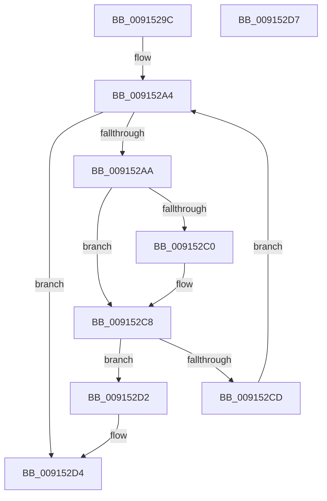

# PopStateIsSessionSpecific

- RVA: `0x0091529C`–`0x009152D8` (길이 `60` bytes)
- VA: `0x000000014091529C`
- 실행 섹션: `PAGE`
- PDB 이름 있음: `예`; PDB Function 태그: `아니요`
- unwind 정보 RVA: `0x000DB714`
- 디코드: `21`개 명령, `60/60` bytes 표시
- 미해석 바이트: `0` (있으면 어셈블리에 `.byte`로 보존)

> 이 문서는 커널 이미지의 기계어와 PDB 기호를 분석해 생성했습니다. 4번과 5번은 함수 원형과 자료형을 바이너리 사용 방식에서 추정한 C 해석이며 원본 소스 복구 결과는 아닙니다.

## 1. Dependencies

- 직접 호출 지점: **0**; 고유 호출 대상: **0**
- 직접 호출자로 확인된 함수: **6**
- RIP 상대 이미지 참조: **1**

### Outgoing calls
- 직접 디코드된 call 명령이 없습니다.

### Direct callers
- [PopGetSettingNotificationName](PopGetSettingNotificationName_function_0091346C.md) at `0x009134EF`
- [PopSetNewPolicyValue](PopSetNewPolicyValue_function_00914C6C.md) at `0x00914CBE`
- [PopGetListHead](PopGetListHead_function_00914DE4.md) at `0x00914DF0`
- [PopSetPowerSettingValue](PopSetPowerSettingValue_function_00914E54.md) at `0x00914EDD`
- [PopFindPowerSettingConfiguration](PopFindPowerSettingConfiguration_function_009152E0.md) at `0x00915302`
- [PoRegisterPowerSettingCallback](../A8/PoRegisterPowerSettingCallback_function_00A82150.md) at `0x00A821C0`

### Static image references
- `0x009152AD` → RVA `0x0000B410` (`.rdata`; read)

## 2. Other-region calls and transfers

- 다른 실행 섹션으로 향하는 call: **0**
- 별도 외부 분기/꼬리 이동을 확인하지 못했습니다.

## 3. Assembly (complete function range)

```asm
0091529C  33 D2                           xor edx, edx
0091529E  4C 8B C9                        mov r9, rcx
009152A1  44 8B C2                        mov r8d, edx
009152A4  41 83 F8 02                     cmp r8d, 2
009152A8  73 2A                           jae 0x1409152d4
009152AA  41 8B C0                        mov eax, r8d
009152AD  4C 8D 15 5C 61 6F FF            lea r10, [rip - 0x909ea4]
009152B4  4D 8B 14 C2                     mov r10, qword ptr [r10 + rax*8]
009152B8  49 8B 0A                        mov rcx, qword ptr [r10]
009152BB  49 2B 09                        sub rcx, qword ptr [r9]
009152BE  75 08                           jne 0x1409152c8
009152C0  49 8B 4A 08                     mov rcx, qword ptr [r10 + 8]
009152C4  49 2B 49 08                     sub rcx, qword ptr [r9 + 8]
009152C8  48 85 C9                        test rcx, rcx
009152CB  74 05                           je 0x1409152d2
009152CD  41 FF C0                        inc r8d
009152D0  EB D2                           jmp 0x1409152a4
009152D2  B2 01                           mov dl, 1
009152D4  8A C2                           mov al, dl
009152D6  C3                              ret
009152D7  CC                              int3
```

## 4. C-style interpretation (structured pseudocode)

```c
__int64 __fastcall PopStateIsSessionSpecific(__int64 a1, int a2)
{
    a2 = 0;
loc_009152A4:
    if (0 >= 2) goto loc_009152D4;
    a1 = (*(unsigned __int64 *)(*(unsigned __int64 *)(v_rip - 9477796 + 0 * 8))) - (*(unsigned __int64 *)(a1));
    if (!(condition_is_not_equal)) {
        a1 = *(unsigned __int64 *)(*(unsigned __int64 *)(v_rip - 9477796 + 0 * 8) + 8);
        a1 = (a1) - (*(unsigned __int64 *)(a1 + 8));
    }
    if (a1 == 0) goto loc_009152D2;
    a3 = (unsigned int)((0) + 1);
    goto loc_009152A4;
loc_009152D2:
loc_009152D4:
    return 1;
}
```

## 5. (Beta) C Style

```c
int64_t PopStateIsSessionSpecific(void *Arg1, int32_t Arg2)
{
    uint8_t *arg1 = (uint8_t *)Arg1;

    Arg2 = 0;
loc_009152A4:
    if (0 >= 2) goto loc_009152D4;
    Arg1 = (*(uint64_t *)(*(uint64_t *)(v_rip - 0x909EA4 + 0x0 * 8))) - (*(uint64_t *)(arg1));
    if (!(condition_is_not_equal)) {
        Arg1 = *(uint64_t *)(*(uint64_t *)(v_rip - 0x909EA4 + 0x0 * 8) + 0x8);
        Arg1 = (Arg1) - (*(uint64_t *)(arg1 + 0x8));
    }
    if (Arg1 == NULL) goto loc_009152D2;
    a3 = (uint32_t)((0) + 1);
    goto loc_009152A4;
loc_009152D2:
loc_009152D4:
    return 1;
}
```

### 관측된 메모리 오프셋

구조체 형식이 확인되지 않은 접근은 인자 기준의 오프셋으로만 기록했습니다.

| 기준 인자 | 오프셋 표현 | 폭 (bit) | 접근 |
|---|---:|---:|---|
| `Arg1` | `+ 0x0` | `64` | `R` |
| `Arg1` | `+ 0x8` | `64` | `R` |

## 6. Execution-region graph

[열기: 2D/3D 그래프와 함수 탐색 컨트롤 패널](../../../control-panel.html?section=page&rva=0x0091529C&view=graph)

- 2D 그래프는 위에서 아래로 흐르고, 3D 그래프는 빈 공간을 드래그해 회전합니다. Shift+드래그는 이동, 휠은 확대·축소, 함수 노드 선택은 대상 보고서 이동입니다.

### Static fallback


