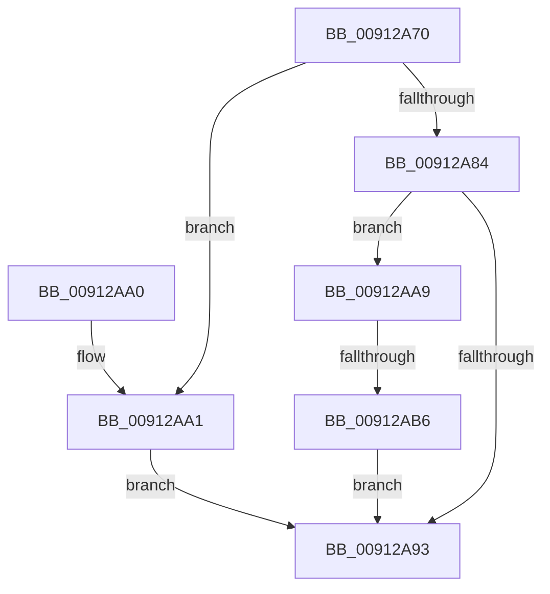

# PopSystemIdleEventHandler

- RVA: `0x00912A70`–`0x00912AC1` (길이 `81` bytes)
- VA: `0x0000000140912A70`
- 실행 섹션: `PAGE`
- PDB 이름 있음: `예`; PDB Function 태그: `예`
- unwind 정보 RVA: `0x0005D368`
- 디코드: `26`개 명령, `81/81` bytes 표시
- 미해석 바이트: `0` (있으면 어셈블리에 `.byte`로 보존)

> 이 문서는 커널 이미지의 기계어와 PDB 기호를 분석해 생성했습니다. 4번과 5번은 함수 원형과 자료형을 바이너리 사용 방식에서 추정한 C 해석이며 원본 소스 복구 결과는 아닙니다.

## 1. Dependencies

- 직접 호출 지점: **2**; 고유 호출 대상: **2**
- 직접 호출자로 확인된 함수: **0**
- RIP 상대 이미지 참조: **0**

### Outgoing calls
- `0x00912A8A` → [PopAdaptiveGetBootTargetSystemState](PopAdaptiveGetBootTargetSystemState_function_00912AC8.md) (function, `0x00912AC8`)
- `0x00912AA9` → [PopIsPlatformAoAcCapable](../../text/49/PopIsPlatformAoAcCapable_function_0049BF40.md) (function, `0x0049BF40`)

### Direct callers
- 이 함수 시작 RVA로 연결되는 직접 call은 확인되지 않았습니다. 간접 호출은 완전히 역산할 수 없습니다.

### Static image references
- 디코드된 RIP-relative 메모리 참조가 없습니다.

## 2. Other-region calls and transfers

- 다른 실행 섹션으로 향하는 call: **1**
  - `0x00912AA9` → [PopIsPlatformAoAcCapable](../../text/49/PopIsPlatformAoAcCapable_function_0049BF40.md) (`PAGE` → `.text`)
- call이 아닌 외부 분기/꼬리 이동: **1**
  - `0x00912AB0` → [sub_00B217A0](../B2/Unknown_function_00B217A0.md) (`tail-transfer`)

## 3. Assembly (complete function range)

```asm
00912A70  48 89 5C 24 08                  mov qword ptr [rsp + 8], rbx
00912A75  57                              push rdi
00912A76  48 83 EC 20                     sub rsp, 0x20
00912A7A  49 8B F8                        mov rdi, r8
00912A7D  48 8B DA                        mov rbx, rdx
00912A80  84 C9                           test cl, cl
00912A82  75 1D                           jne 0x140912aa1
00912A84  49 8B D0                        mov rdx, r8
00912A87  48 8B CB                        mov rcx, rbx
00912A8A  E8 39 00 00 00                  call 0x140912ac8
00912A8F  85 C0                           test eax, eax
00912A91  78 16                           js 0x140912aa9
00912A93  48 8B 5C 24 30                  mov rbx, qword ptr [rsp + 0x30]
00912A98  33 C0                           xor eax, eax
00912A9A  48 83 C4 20                     add rsp, 0x20
00912A9E  5F                              pop rdi
00912A9F  C3                              ret
00912AA0  CC                              int3
00912AA1  C7 02 01 00 00 00               mov dword ptr [rdx], 1
00912AA7  EB EA                           jmp 0x140912a93
00912AA9  E8 92 94 B8 FF                  call 0x14049bf40
00912AAE  84 C0                           test al, al
00912AB0  0F 85 EA EC 20 00               jne 0x140b217a0
00912AB6  C7 03 0A 00 00 00               mov dword ptr [rbx], 0xa
00912ABC  83 27 00                        and dword ptr [rdi], 0
00912ABF  EB D2                           jmp 0x140912a93
```

## 4. C-style interpretation (structured pseudocode)

```c
__int64 __fastcall PopSystemIdleEventHandler(unsigned __int8 a1, __int64 a2, __int64 a3)
{
    __int64 result;
    __int64 v_rsp;
    unsigned __int64 v_stack_p8;

    v_stack_p8 = v_rbx;
    v_rsp = (v_rsp) - (32);
    if (a1 != 0) goto loc_00912AA1;
    result = PopAdaptiveGetBootTargetSystemState(a2, a3, a3, a4);
    if (sign_flag) goto loc_00912AA9;
loc_00912A93:
    result = 0;
    v_rsp = (v_rsp) + (32);
    return result;
loc_00912AA1:
    *(unsigned int *)(a3) = 1;
    goto loc_00912A93;
loc_00912AA9:
    result = PopIsPlatformAoAcCapable(a2, a3, a3, a4);
    *(unsigned int *)(v_stack_p8) = 10;
    goto loc_00912A93;
}
```

## 5. (Beta) C Style

```c
int64_t PopSystemIdleEventHandler(uint8_t Arg1, void *Arg2, void *Arg3)
{
    uint8_t *arg2 = (uint8_t *)Arg2;
    uint8_t *arg3 = (uint8_t *)Arg3;

    int64_t result;
    int64_t local_rsp;
    uint64_t v_stack_p8;

    v_stack_p8 = local_rbx;
    local_rsp = (local_rsp) - (32);
    if (Arg1 != 0) goto loc_00912AA1;
    result = PopAdaptiveGetBootTargetSystemState(Arg2, Arg3, Arg3, a4);
    if (sign_flag) goto loc_00912AA9;
loc_00912A93:
    result = 0;
    local_rsp = (local_rsp) + (32);
    return result;
loc_00912AA1:
    *(uint32_t *)(arg3) = 1;
    goto loc_00912A93;
loc_00912AA9:
    result = PopIsPlatformAoAcCapable(Arg2, Arg3, Arg3, a4);
    *(uint32_t *)(v_stack_p8) = 10;
    goto loc_00912A93;
}
```

### 관측된 메모리 오프셋

구조체 형식이 확인되지 않은 접근은 인자 기준의 오프셋으로만 기록했습니다.

| 기준 인자 | 오프셋 표현 | 폭 (bit) | 접근 |
|---|---:|---:|---|
| `Arg2` | `+ 0x0` | `32` | `W` |
| `Arg3` | `+ 0x0` | `32` | `R/W` |

## 6. Execution-region graph

[열기: 2D/3D 그래프와 함수 탐색 컨트롤 패널](../../../control-panel.html?section=page&rva=0x00912A70&view=graph)

- 2D 그래프는 위에서 아래로 흐르고, 3D 그래프는 빈 공간을 드래그해 회전합니다. Shift+드래그는 이동, 휠은 확대·축소, 함수 노드 선택은 대상 보고서 이동입니다.

### Static fallback


