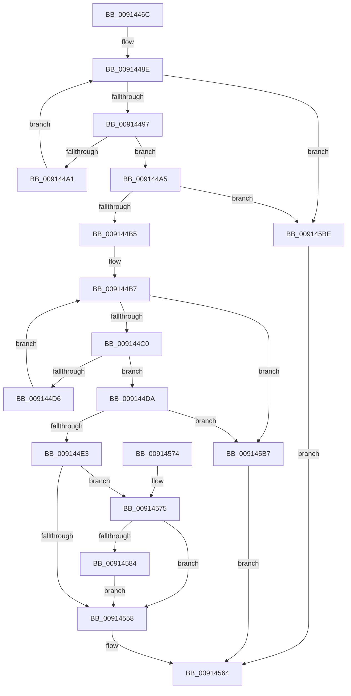

# PopTriggerMonitorPowerEvent

- RVA: `0x0091446C`–`0x009145C5` (길이 `345` bytes)
- VA: `0x000000014091446C`
- 실행 섹션: `PAGE`
- PDB 이름 있음: `예`; PDB Function 태그: `아니요`
- unwind 정보 RVA: `0x0008A5B0`
- 디코드: `88`개 명령, `345/345` bytes 표시
- 미해석 바이트: `0` (있으면 어셈블리에 `.byte`로 보존)

> 이 문서는 커널 이미지의 기계어와 PDB 기호를 분석해 생성했습니다. 4번과 5번은 함수 원형과 자료형을 바이너리 사용 방식에서 추정한 C 해석이며 원본 소스 복구 결과는 아닙니다.

## 1. Dependencies

- 직접 호출 지점: **7**; 고유 호출 대상: **5**
- 직접 호출자로 확인된 함수: **2**
- RIP 상대 이미지 참조: **5**

### Outgoing calls
- `0x009144EA` → [PopAcquireRwLockExclusive](../../text/43/PopAcquireRwLockExclusive_function_00430B44.md) (function, `0x00430B44`)
- `0x009144FF` → [guard_dispatch_icall](../../text/6B/guard_dispatch_icall_function_006BAAD0.md) (function, `0x006BAAD0`)
- `0x0091455F` → [PopReleaseRwLock](../../text/2D/PopReleaseRwLock_function_002DFBBC.md) (function, `0x002DFBBC`)
- `0x00914577` → [PopDiagTracePowerStateEvent](PopDiagTracePowerStateEvent_function_009145CC.md) (function, `0x009145CC`)
- `0x00914590` → [PopAcquireRwLockExclusive](../../text/43/PopAcquireRwLockExclusive_function_00430B44.md) (function, `0x00430B44`)
- `0x009145A2` → [PopPowerAggregatorHandleIntentUnsafe](PopPowerAggregatorHandleIntentUnsafe_function_009146D8.md) (function, `0x009146D8`)
- `0x009145B0` → [PopReleaseRwLock](../../text/2D/PopReleaseRwLock_function_002DFBBC.md) (function, `0x002DFBBC`)

### Direct callers
- [PoTtmInitiatePowerStateTransition](../76/PoTtmInitiatePowerStateTransition_function_007695E8.md) at `0x0076963B`
- [PopProcessSessionDisplayStateChange](PopProcessSessionDisplayStateChange_function_00914380.md) at `0x009143AD`

### Static image references
- `0x0091447E` → RVA `0x00000000` (`image boundary/outside`; read)
- `0x009144E3` → RVA `0x00F09700` (`.data`; read)
- `0x00914513` → RVA `0x00F093F0` (`.data`; read)
- `0x00914532` → RVA `0x00F093F0` (`.data`; write)
- `0x00914586` → RVA `0x00F09710` (`.data`; read)

## 2. Other-region calls and transfers

- 다른 실행 섹션으로 향하는 call: **5**
  - `0x009144EA` → [PopAcquireRwLockExclusive](../../text/43/PopAcquireRwLockExclusive_function_00430B44.md) (`PAGE` → `.text`)
  - `0x009144FF` → [guard_dispatch_icall](../../text/6B/guard_dispatch_icall_function_006BAAD0.md) (`PAGE` → `.text`)
  - `0x0091455F` → [PopReleaseRwLock](../../text/2D/PopReleaseRwLock_function_002DFBBC.md) (`PAGE` → `.text`)
  - `0x00914590` → [PopAcquireRwLockExclusive](../../text/43/PopAcquireRwLockExclusive_function_00430B44.md) (`PAGE` → `.text`)
  - `0x009145B0` → [PopReleaseRwLock](../../text/2D/PopReleaseRwLock_function_002DFBBC.md) (`PAGE` → `.text`)
- 별도 외부 분기/꼬리 이동을 확인하지 못했습니다.

## 3. Assembly (complete function range)

```asm
0091446C  48 89 5C 24 08                  mov qword ptr [rsp + 8], rbx
00914471  56                              push rsi
00914472  57                              push rdi
00914473  41 56                           push r14
00914475  48 83 EC 20                     sub rsp, 0x20
00914479  83 64 24 50 00                  and dword ptr [rsp + 0x50], 0
0091447E  4C 8D 35 7B BB 6E FF            lea r14, [rip - 0x914485]
00914485  83 64 24 58 00                  and dword ptr [rsp + 0x58], 0
0091448A  8A D9                           mov bl, cl
0091448C  33 C0                           xor eax, eax
0091448E  83 F8 3A                        cmp eax, 0x3a
00914491  0F 83 27 01 00 00               jae 0x1409145be
00914497  41 39 94 C6 00 5A FC 00         cmp dword ptr [r14 + rax*8 + 0xfc5a00], edx
0091449F  74 04                           je 0x1409144a5
009144A1  FF C0                           inc eax
009144A3  EB E9                           jmp 0x14091448e
009144A5  41 8B B4 C6 04 5A FC 00         mov esi, dword ptr [r14 + rax*8 + 0xfc5a04]
009144AD  85 F6                           test esi, esi
009144AF  0F 84 09 01 00 00               je 0x1409145be
009144B5  33 D2                           xor edx, edx
009144B7  83 FA 38                        cmp edx, 0x38
009144BA  0F 83 F7 00 00 00               jae 0x1409145b7
009144C0  48 8D 0C 52                     lea rcx, [rdx + rdx*2]
009144C4  48 C1 E1 04                     shl rcx, 4
009144C8  49 8D BE D0 8F FD 00            lea rdi, [r14 + 0xfd8fd0]
009144CF  48 03 F9                        add rdi, rcx
009144D2  39 37                           cmp dword ptr [rdi], esi
009144D4  74 04                           je 0x1409144da
009144D6  FF C2                           inc edx
009144D8  EB DD                           jmp 0x1409144b7
009144DA  48 85 FF                        test rdi, rdi
009144DD  0F 84 D4 00 00 00               je 0x1409145b7
009144E3  48 8D 0D 16 52 5F 00            lea rcx, [rip + 0x5f5216]
009144EA  E8 55 C6 B1 FF                  call 0x140430b44
009144EF  48 8B 47 18                     mov rax, qword ptr [rdi + 0x18]
009144F3  4C 8D 44 24 58                  lea r8, [rsp + 0x58]
009144F8  48 8D 54 24 50                  lea rdx, [rsp + 0x50]
009144FD  8A CB                           mov cl, bl
009144FF  E8 CC 65 DA FF                  call 0x1406baad0
00914504  49 B9 08 00 00 00 80 F7 FF FF   movabs r9, 0xfffff78000000008
0091450E  8B D8                           mov ebx, eax
00914510  4D 8B 09                        mov r9, qword ptr [r9]
00914513  8B 15 D7 4E 5F 00               mov edx, dword ptr [rip + 0x5f4ed7]
00914519  48 FF 47 20                     inc qword ptr [rdi + 0x20]
0091451D  4C 89 4F 28                     mov qword ptr [rdi + 0x28], r9
00914521  4C 8D 04 52                     lea r8, [rdx + rdx*2]
00914525  FF C2                           inc edx
00914527  83 E2 1F                        and edx, 0x1f
0091452A  43 89 B4 C6 00 94 F0 00         mov dword ptr [r14 + r8*8 + 0xf09400], esi
00914532  89 15 B8 4E 5F 00               mov dword ptr [rip + 0x5f4eb8], edx
00914538  8B 54 24 50                     mov edx, dword ptr [rsp + 0x50]
0091453C  43 89 94 C6 08 94 F0 00         mov dword ptr [r14 + r8*8 + 0xf09408], edx
00914544  43 89 84 C6 04 94 F0 00         mov dword ptr [r14 + r8*8 + 0xf09404], eax
0091454C  4F 89 8C C6 10 94 F0 00         mov qword ptr [r14 + r8*8 + 0xf09410], r9
00914554  85 C0                           test eax, eax
00914556  79 1D                           jns 0x140914575
00914558  48 8D 0D A1 51 5F 00            lea rcx, [rip + 0x5f51a1]
0091455F  E8 58 B6 9C FF                  call 0x1402dfbbc
00914564  8B C3                           mov eax, ebx
00914566  48 8B 5C 24 40                  mov rbx, qword ptr [rsp + 0x40]
0091456B  48 83 C4 20                     add rsp, 0x20
0091456F  41 5E                           pop r14
00914571  5F                              pop rdi
00914572  5E                              pop rsi
00914573  C3                              ret
00914574  CC                              int3
00914575  8B CE                           mov ecx, esi
00914577  E8 50 00 00 00                  call 0x1409145cc
0091457C  8B 74 24 50                     mov esi, dword ptr [rsp + 0x50]
00914580  85 F6                           test esi, esi
00914582  74 D4                           je 0x140914558
00914584  8B 1F                           mov ebx, dword ptr [rdi]
00914586  48 8D 0D 83 51 5F 00            lea rcx, [rip + 0x5f5183]
0091458D  8B 7F 10                        mov edi, dword ptr [rdi + 0x10]
00914590  E8 AF C5 B1 FF                  call 0x140430b44
00914595  44 8B CB                        mov r9d, ebx
00914598  48 8D 54 24 58                  lea rdx, [rsp + 0x58]
0091459D  44 8B C7                        mov r8d, edi
009145A0  8B CE                           mov ecx, esi
009145A2  E8 31 01 00 00                  call 0x1409146d8
009145A7  48 8D 0D 62 51 5F 00            lea rcx, [rip + 0x5f5162]
009145AE  8B D8                           mov ebx, eax
009145B0  E8 07 B6 9C FF                  call 0x1402dfbbc
009145B5  EB A1                           jmp 0x140914558
009145B7  BB 01 00 00 C0                  mov ebx, 0xc0000001
009145BC  EB A6                           jmp 0x140914564
009145BE  BB 0D 00 00 C0                  mov ebx, 0xc000000d
009145C3  EB 9F                           jmp 0x140914564
```

## 4. C-style interpretation (structured pseudocode)

```c
__int64 __fastcall PopTriggerMonitorPowerEvent(unsigned __int8 a1, int a2)
{
    __int64 result;
    __int64 v_rdi;
    __int64 v_rsp;
    unsigned int v_stack_p18;
    unsigned int v_stack_p20;
    unsigned int v_stack_p50;
    unsigned __int64 v_stack_p58;
    unsigned __int64 v_stack_p8;

    v_stack_p8 = v_rbx;
    v_rsp = (v_rsp) - (32);
    result = 0;
loc_0091448E:
    if (0 >= 58) goto loc_009145BE;
    if ((*(unsigned int *)(v_rip - 9520261 + result * 8 + 16538112)) == a2) goto loc_009144A5;
    result = (unsigned int)((result) + 1);
    goto loc_0091448E;
loc_009144A5:
    if ((unsigned int)((unsigned int)(*(unsigned int *)(v_rip - 9520261 + result * 8 + 16538116))) == 0) goto loc_009145BE;
    a2 = 0;
loc_009144B7:
    if (0 >= 56) goto loc_009145B7;
    a1 = (a2 + a2 * 2) << (4);
    v_rdi = (v_rip - 9520261 + 16617424) + (a1);
    if ((*(unsigned int *)(v_rdi)) == ((unsigned int)((unsigned int)(*(unsigned int *)(v_rip - 9520261 + result * 8 + 16538116))))) goto loc_009144DA;
    a2 = (unsigned int)((a2) + 1);
    goto loc_009144B7;
loc_009144DA:
    if (v_rdi == 0) goto loc_009145B7;
    result = PopAcquireRwLockExclusive(v_rip + 6246934, a2, a3, a4);
    result = guard_dispatch_icall(a1, v_stack_p18, v_stack_p20, a4);
    *(unsigned __int64 *)(v_rdi + 40) = *(unsigned __int64 *)(a4);
    a2 = (unsigned int)(((unsigned int)(*(unsigned int *)(v_rip + 6246103))) + 1);
    a2 = (unsigned int)((a2) & (31));
    *(unsigned int *)(v_rip - 9520261 + (unsigned int)(*(unsigned int *)(v_rip + 6246103)) + (unsigned int)(*(unsigned int *)(v_rip + 6246103)) * 2 * 8 + 15766528) = (unsigned int)((unsigned int)(*(unsigned int *)(v_rip - 9520261 + result * 8 + 16538116)));
    *(unsigned int *)(v_rip + 6246072) = a2;
    *(unsigned int *)(v_rip - 9520261 + (unsigned int)(*(unsigned int *)(v_rip + 6246103)) + (unsigned int)(*(unsigned int *)(v_rip + 6246103)) * 2 * 8 + 15766536) = (unsigned int)((unsigned int)(v_stack_p18));
    *(unsigned int *)(v_rip - 9520261 + (unsigned int)(*(unsigned int *)(v_rip + 6246103)) + (unsigned int)(*(unsigned int *)(v_rip + 6246103)) * 2 * 8 + 15766532) = (unsigned int)(result);
    *(unsigned __int64 *)(v_rip - 9520261 + (unsigned int)(*(unsigned int *)(v_rip + 6246103)) + (unsigned int)(*(unsigned int *)(v_rip + 6246103)) * 2 * 8 + 15766544) = *(unsigned __int64 *)(a4);
    if (!sign_flag) goto loc_00914575;
loc_00914558:
    result = PopReleaseRwLock(v_rip + 6246817, (unsigned int)(v_stack_p18), (unsigned int)(*(unsigned int *)(v_rip + 6246103)) + (unsigned int)(*(unsigned int *)(v_rip + 6246103)) * 2, *(unsigned __int64 *)(a4));
loc_00914564:
    v_rsp = (v_rsp) + (32);
    return (unsigned int)((unsigned int)((unsigned int)((unsigned int)(result))));
loc_00914575:
    result = PopDiagTracePowerStateEvent((unsigned int)((unsigned int)((unsigned int)(*(unsigned int *)(v_rip - 9520261 + result * 8 + 16538116)))), (unsigned int)(v_stack_p18), (unsigned int)(*(unsigned int *)(v_rip + 6246103)) + (unsigned int)(*(unsigned int *)(v_rip + 6246103)) * 2, *(unsigned __int64 *)(a4));
    if ((unsigned int)((unsigned int)(v_stack_p50)) == 0) goto loc_00914558;
    result = PopAcquireRwLockExclusive(v_rip + 6246787, (unsigned int)(v_stack_p18), (unsigned int)(*(unsigned int *)(v_rip + 6246103)) + (unsigned int)(*(unsigned int *)(v_rip + 6246103)) * 2, *(unsigned __int64 *)(a4));
    result = PopPowerAggregatorHandleIntentUnsafe((unsigned int)((unsigned int)((unsigned int)(v_stack_p50))), v_stack_p58, (unsigned int)((unsigned int)((unsigned int)(*(unsigned int *)(v_rdi + 16)))), (unsigned int)((unsigned int)((unsigned int)(*(unsigned int *)(v_rdi)))));
    result = PopReleaseRwLock(v_rip + 6246754, v_stack_p58, (unsigned int)((unsigned int)((unsigned int)(*(unsigned int *)(v_rdi + 16)))), (unsigned int)((unsigned int)((unsigned int)(*(unsigned int *)(v_rdi)))));
    goto loc_00914558;
loc_009145B7:
    goto loc_00914564;
loc_009145BE:
    goto loc_00914564;
}
```

## 5. (Beta) C Style

```c
int64_t PopTriggerMonitorPowerEvent(uint8_t Arg1, int32_t Arg2)
{
    int64_t result;
    int64_t local_rdi;
    int64_t local_rsp;
    uint32_t v_stack_p18;
    uint32_t v_stack_p20;
    uint32_t v_stack_p50;
    uint64_t v_stack_p58;
    uint64_t v_stack_p8;

    v_stack_p8 = local_rbx;
    local_rsp = (local_rsp) - (32);
    result = 0;
loc_0091448E:
    if (0 >= 58) goto loc_009145BE;
    if ((*(uint32_t *)(v_rip - 0x914485 + result * 8 + 0xFC5A00)) == Arg2) goto loc_009144A5;
    result = (uint32_t)((result) + 1);
    goto loc_0091448E;
loc_009144A5:
    if ((uint32_t)((uint32_t)(*(uint32_t *)(v_rip - 0x914485 + result * 8 + 0xFC5A04))) == 0) goto loc_009145BE;
    Arg2 = 0;
loc_009144B7:
    if (0 >= 56) goto loc_009145B7;
    Arg1 = (Arg2 + Arg2 * 2) << (4);
    local_rdi = (v_rip - 9520261 + 16617424) + (Arg1);
    if ((*(uint32_t *)(local_rdi)) == ((uint32_t)((uint32_t)(*(uint32_t *)(v_rip - 0x914485 + result * 8 + 0xFC5A04))))) goto loc_009144DA;
    Arg2 = (uint32_t)((Arg2) + 1);
    goto loc_009144B7;
loc_009144DA:
    if (local_rdi == 0) goto loc_009145B7;
    result = PopAcquireRwLockExclusive(v_rip + 6246934, Arg2, a3, a4);
    result = guard_dispatch_icall(Arg1, v_stack_p18, v_stack_p20, a4);
    *(uint64_t *)(local_rdi + 0x28) = *(uint64_t *)(a4);
    Arg2 = (uint32_t)(((uint32_t)(*(uint32_t *)(v_rip + 0x5F4ED7))) + 1);
    Arg2 = (uint32_t)((Arg2) & (31));
    *(uint32_t *)(v_rip - 0x914485 + (uint32_t)(*(uint32_t *)(v_rip + 0x5F4ED7)) + (uint32_t)(*(uint32_t *)(v_rip + 0x5F4ED7)) * 2 * 8 + 0xF09400) = (uint32_t)((uint32_t)(*(uint32_t *)(v_rip - 0x914485 + result * 8 + 0xFC5A04)));
    *(uint32_t *)(v_rip + 0x5F4EB8) = Arg2;
    *(uint32_t *)(v_rip - 0x914485 + (uint32_t)(*(uint32_t *)(v_rip + 0x5F4ED7)) + (uint32_t)(*(uint32_t *)(v_rip + 0x5F4ED7)) * 2 * 8 + 0xF09408) = (uint32_t)((uint32_t)(v_stack_p18));
    *(uint32_t *)(v_rip - 0x914485 + (uint32_t)(*(uint32_t *)(v_rip + 0x5F4ED7)) + (uint32_t)(*(uint32_t *)(v_rip + 0x5F4ED7)) * 2 * 8 + 0xF09404) = (uint32_t)(result);
    *(uint64_t *)(v_rip - 0x914485 + (uint32_t)(*(uint32_t *)(v_rip + 0x5F4ED7)) + (uint32_t)(*(uint32_t *)(v_rip + 0x5F4ED7)) * 2 * 8 + 0xF09410) = *(uint64_t *)(a4);
    if (!sign_flag) goto loc_00914575;
loc_00914558:
    result = PopReleaseRwLock(v_rip + 6246817, (uint32_t)(v_stack_p18), (uint32_t)(*(uint32_t *)(v_rip + 0x5F4ED7)) + (uint32_t)(*(uint32_t *)(v_rip + 0x5F4ED7)) * 2, *(uint64_t *)(a4));
loc_00914564:
    local_rsp = (local_rsp) + (32);
    return (uint32_t)((uint32_t)((uint32_t)((uint32_t)(result))));
loc_00914575:
    result = PopDiagTracePowerStateEvent((uint32_t)((uint32_t)((uint32_t)(*(uint32_t *)(v_rip - 0x914485 + result * 8 + 0xFC5A04)))), (uint32_t)(v_stack_p18), (uint32_t)(*(uint32_t *)(v_rip + 0x5F4ED7)) + (uint32_t)(*(uint32_t *)(v_rip + 0x5F4ED7)) * 2, *(uint64_t *)(a4));
    if ((uint32_t)((uint32_t)(v_stack_p50)) == 0) goto loc_00914558;
    result = PopAcquireRwLockExclusive(v_rip + 6246787, (uint32_t)(v_stack_p18), (uint32_t)(*(uint32_t *)(v_rip + 0x5F4ED7)) + (uint32_t)(*(uint32_t *)(v_rip + 0x5F4ED7)) * 2, *(uint64_t *)(a4));
    result = PopPowerAggregatorHandleIntentUnsafe((uint32_t)((uint32_t)((uint32_t)(v_stack_p50))), v_stack_p58, (uint32_t)((uint32_t)((uint32_t)(*(uint32_t *)(local_rdi + 0x10)))), (uint32_t)((uint32_t)((uint32_t)(*(uint32_t *)(local_rdi)))));
    result = PopReleaseRwLock(v_rip + 6246754, v_stack_p58, (uint32_t)((uint32_t)((uint32_t)(*(uint32_t *)(local_rdi + 0x10)))), (uint32_t)((uint32_t)((uint32_t)(*(uint32_t *)(local_rdi)))));
    goto loc_00914558;
loc_009145B7:
    goto loc_00914564;
loc_009145BE:
    goto loc_00914564;
}
```

## 6. Execution-region graph

[열기: 2D/3D 그래프와 함수 탐색 컨트롤 패널](../../../control-panel.html?section=page&rva=0x0091446C&view=graph)

- 2D 그래프는 위에서 아래로 흐르고, 3D 그래프는 빈 공간을 드래그해 회전합니다. Shift+드래그는 이동, 휠은 확대·축소, 함수 노드 선택은 대상 보고서 이동입니다.

### Static fallback


