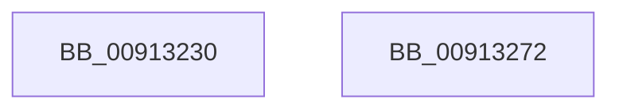

# PopUmpoSendPowerRequestOverrideCleanup

- RVA: `0x00913230`–`0x00913273` (길이 `67` bytes)
- VA: `0x0000000140913230`
- 실행 섹션: `PAGE`
- PDB 이름 있음: `예`; PDB Function 태그: `아니요`
- unwind 정보 RVA: `0x0008A3E0`
- 디코드: `19`개 명령, `67/67` bytes 표시
- 미해석 바이트: `0` (있으면 어셈블리에 `.byte`로 보존)

> 이 문서는 커널 이미지의 기계어와 PDB 기호를 분석해 생성했습니다. 4번과 5번은 함수 원형과 자료형을 바이너리 사용 방식에서 추정한 C 해석이며 원본 소스 복구 결과는 아닙니다.

## 1. Dependencies

- 직접 호출 지점: **2**; 고유 호출 대상: **2**
- 직접 호출자로 확인된 함수: **1**
- RIP 상대 이미지 참조: **0**

### Outgoing calls
- `0x00913244` → [memset](../../text/6C/memset_function_006C6C40.md) (function, `0x006C6C40`)
- `0x00913267` → [PopUmpoSendPowerMessage](../../text/23/PopUmpoSendPowerMessage_function_00230730.md) (function, `0x00230730`)

### Direct callers
- [PopPowerRequestDelete](PopPowerRequestDelete_function_00913030.md) at `0x009130F8`

### Static image references
- 디코드된 RIP-relative 메모리 참조가 없습니다.

## 2. Other-region calls and transfers

- 다른 실행 섹션으로 향하는 call: **2**
  - `0x00913244` → [memset](../../text/6C/memset_function_006C6C40.md) (`PAGE` → `.text`)
  - `0x00913267` → [PopUmpoSendPowerMessage](../../text/23/PopUmpoSendPowerMessage_function_00230730.md) (`PAGE` → `.text`)
- 별도 외부 분기/꼬리 이동을 확인하지 못했습니다.

## 3. Assembly (complete function range)

```asm
00913230  40 53                           push rbx
00913232  48 83 EC 70                     sub rsp, 0x70
00913236  33 D2                           xor edx, edx
00913238  48 8B D9                        mov rbx, rcx
0091323B  48 8D 4C 24 20                  lea rcx, [rsp + 0x20]
00913240  44 8D 42 48                     lea r8d, [rdx + 0x48]
00913244  E8 F7 39 DB FF                  call 0x1406c6c40
00913249  8B 43 24                        mov eax, dword ptr [rbx + 0x24]
0091324C  48 8D 4C 24 20                  lea rcx, [rsp + 0x20]
00913251  45 33 C9                        xor r9d, r9d
00913254  C7 44 24 20 09 00 00 00         mov dword ptr [rsp + 0x20], 9
0091325C  45 33 C0                        xor r8d, r8d
0091325F  89 44 24 28                     mov dword ptr [rsp + 0x28], eax
00913263  41 8D 51 48                     lea edx, [r9 + 0x48]
00913267  E8 C4 D4 91 FF                  call 0x140230730
0091326C  48 83 C4 70                     add rsp, 0x70
00913270  5B                              pop rbx
00913271  C3                              ret
00913272  CC                              int3
```

## 4. C-style interpretation (structured pseudocode)

```c
__int64 __fastcall PopUmpoSendPowerRequestOverrideCleanup(__int64 a1, int a2, __int64 a3, int a4)
{
    __int64 result;
    __int64 v_rsp;
    unsigned int v_stack_m50;
    unsigned __int64 v_stack_m58;

    v_rsp = (v_rsp) - (112);
    a2 = 0;
    result = memset(v_stack_m58, a2, a2 + 72, a4);
    a4 = 0;
    v_stack_m58 = 9;
    a3 = 0;
    v_stack_m50 = (unsigned int)((unsigned int)(*(unsigned int *)(a1 + 36)));
    result = PopUmpoSendPowerMessage(v_stack_m58, a4 + 72, a3, a4);
    v_rsp = (v_rsp) + (112);
    return result;
}
```

## 5. (Beta) C Style

```c
int64_t PopUmpoSendPowerRequestOverrideCleanup(void *Arg1, int32_t Arg2, int64_t Arg3, int32_t Arg4)
{
    uint8_t *arg1 = (uint8_t *)Arg1;

    int64_t result;
    int64_t local_rsp;
    uint32_t v_stack_m50;
    uint64_t v_stack_m58;

    local_rsp = (local_rsp) - (112);
    Arg2 = 0;
    result = memset(v_stack_m58, Arg2, Arg2 + 72, Arg4);
    Arg4 = 0;
    v_stack_m58 = 9;
    Arg3 = 0;
    v_stack_m50 = (uint32_t)((uint32_t)(*(uint32_t *)(arg1 + 0x24)));
    result = PopUmpoSendPowerMessage(v_stack_m58, Arg4 + 72, Arg3, Arg4);
    local_rsp = (local_rsp) + (112);
    return result;
}
```

### 관측된 메모리 오프셋

구조체 형식이 확인되지 않은 접근은 인자 기준의 오프셋으로만 기록했습니다.

| 기준 인자 | 오프셋 표현 | 폭 (bit) | 접근 |
|---|---:|---:|---|
| `Arg1` | `+ 0x24` | `32` | `R` |

## 6. Execution-region graph

[열기: 2D/3D 그래프와 함수 탐색 컨트롤 패널](../../../control-panel.html?section=page&rva=0x00913230&view=graph)

- 2D 그래프는 위에서 아래로 흐르고, 3D 그래프는 빈 공간을 드래그해 회전합니다. Shift+드래그는 이동, 휠은 확대·축소, 함수 노드 선택은 대상 보고서 이동입니다.

### Static fallback


