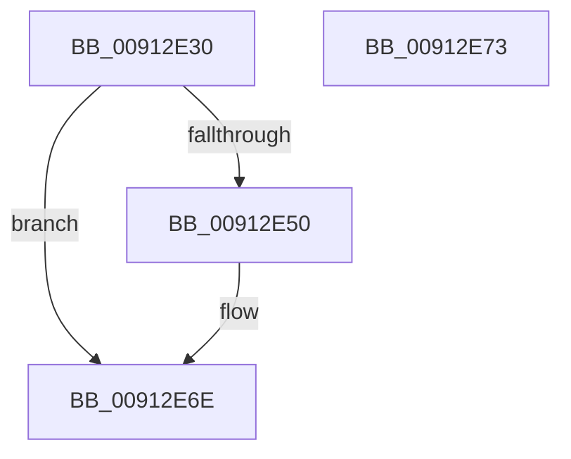

# PopUpdateDiskIdleTimeoutSetting

- RVA: `0x00912E30`–`0x00912E74` (길이 `68` bytes)
- VA: `0x0000000140912E30`
- 실행 섹션: `PAGE`
- PDB 이름 있음: `예`; PDB Function 태그: `아니요`
- unwind 정보 RVA: `0x0005C788`
- 디코드: `14`개 명령, `68/68` bytes 표시
- 미해석 바이트: `0` (있으면 어셈블리에 `.byte`로 보존)

> 이 문서는 커널 이미지의 기계어와 PDB 기호를 분석해 생성했습니다. 4번과 5번은 함수 원형과 자료형을 바이너리 사용 방식에서 추정한 C 해석이며 원본 소스 복구 결과는 아닙니다.

## 1. Dependencies

- 직접 호출 지점: **1**; 고유 호출 대상: **1**
- 직접 호출자로 확인된 함수: **4**
- RIP 상대 이미지 참조: **6**

### Outgoing calls
- `0x00912E69` → [PopSetPowerSettingValueAcDc](PopSetPowerSettingValueAcDc_function_00914D6C.md) (function, `0x00914D6C`)

### Direct callers
- [PopCoalescingSetActiveState](../../text/4B/PopCoalescingSetActiveState_function_004B7E18.md) at `0x004B7E42`
- [PopCoalescingSetActiveState](../../text/4B/PopCoalescingSetActiveState_function_004B7E18.md) at `0x004B7E8C`
- [PopCoalescingPowerSettingCallback](../75/PopCoalescingPowerSettingCallback_function_0075C170.md) at `0x0075C1DB`
- [PopHardDiskPowerSettingCallback](../AB/PopHardDiskPowerSettingCallback_function_00AB6F60.md) at `0x00AB7089`
- [PopCoalescingInitialize](../../init/C3/PopCoalescingInitialize_function_00C3EDB4.md) at `0x00C3EE5F`

### Static image references
- `0x00912E34` → RVA `0x00F0E068` (`.data`; read)
- `0x00912E3B` → RVA `0x00E0B53C` (`.data`; read)
- `0x00912E41` → RVA `0x00E0B540` (`.data`; read)
- `0x00912E48` → RVA `0x00E0B538` (`.data`; read)
- `0x00912E50` → RVA `0x00E0B538` (`.data`; write)
- `0x00912E5D` → RVA `0x00011A28` (`.rdata`; read)

## 2. Other-region calls and transfers

- 다른 실행 섹션으로 향하는 call: **0**
- 별도 외부 분기/꼬리 이동을 확인하지 못했습니다.

## 3. Assembly (complete function range)

```asm
00912E30  48 83 EC 28                     sub rsp, 0x28
00912E34  F6 05 2D B2 5F 00 01            test byte ptr [rip + 0x5fb22d], 1
00912E3B  8B 0D FB 86 4F 00               mov ecx, dword ptr [rip + 0x4f86fb]
00912E41  0F 45 0D F8 86 4F 00            cmovne ecx, dword ptr [rip + 0x4f86f8]
00912E48  3B 0D EA 86 4F 00               cmp ecx, dword ptr [rip + 0x4f86ea]
00912E4E  74 1E                           je 0x140912e6e
00912E50  89 0D E2 86 4F 00               mov dword ptr [rip + 0x4f86e2], ecx
00912E56  4C 8D 05 DB 86 4F 00            lea r8, [rip + 0x4f86db]
00912E5D  48 8D 0D C4 EB 6F FF            lea rcx, [rip - 0x90143c]
00912E64  BA 04 00 00 00                  mov edx, 4
00912E69  E8 FE 1E 00 00                  call 0x140914d6c
00912E6E  48 83 C4 28                     add rsp, 0x28
00912E72  C3                              ret
00912E73  CC                              int3
```

## 4. C-style interpretation (structured pseudocode)

```c
__int64 __fastcall PopUpdateDiskIdleTimeoutSetting(void)
{
    __int64 result;
    __int64 v_rsp;

    v_rsp = (v_rsp) - (40);
    a1 = (unsigned int)(*(unsigned int *)(v_rip + 5211899));
    if (((*(unsigned __int8 *)(v_rip + 6271533)) & (1)) != 0) { a1 = *(unsigned int *)(v_rip + 5211896); }
    if (((unsigned int)(a1)) != (*(unsigned int *)(v_rip + 5211882))) {
        *(unsigned int *)(v_rip + 5211874) = (unsigned int)(a1);
        a3 = v_rip + 5211867;
        a1 = v_rip - 9442364;
        a2 = 4;
        result = PopSetPowerSettingValueAcDc(a1, a2, a3, a4);
    }
    v_rsp = (v_rsp) + (40);
    return result;
}
```

## 5. (Beta) C Style

```c
void PopUpdateDiskIdleTimeoutSetting(void)
{
    int64_t result;
    int64_t local_rsp;

    local_rsp = (local_rsp) - (40);
    a1 = (uint32_t)(*(uint32_t *)(v_rip + 0x4F86FB));
    if (((*(uint8_t *)(v_rip + 0x5FB22D)) & (1)) != 0) { a1 = *(uint32_t *)(v_rip + 0x4F86F8); }
    if (((uint32_t)(a1)) != (*(uint32_t *)(v_rip + 0x4F86EA))) {
        *(uint32_t *)(v_rip + 0x4F86E2) = (uint32_t)(a1);
        a3 = v_rip + 5211867;
        a1 = v_rip - 9442364;
        a2 = 4;
        result = PopSetPowerSettingValueAcDc(a1, a2, a3, a4);
    }
    local_rsp = (local_rsp) + (40);
    return result;
}
```

## 6. Execution-region graph

[열기: 2D/3D 그래프와 함수 탐색 컨트롤 패널](../../../control-panel.html?section=page&rva=0x00912E30&view=graph)

- 2D 그래프는 위에서 아래로 흐르고, 3D 그래프는 빈 공간을 드래그해 회전합니다. Shift+드래그는 이동, 휠은 확대·축소, 함수 노드 선택은 대상 보고서 이동입니다.

### Static fallback


