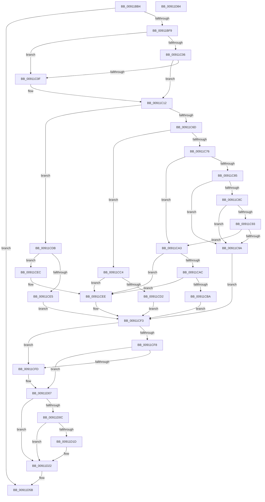

# PopUpdateSystemIdleContext

- RVA: `0x00911BB4`–`0x00911D85` (길이 `465` bytes)
- VA: `0x0000000140911BB4`
- 실행 섹션: `PAGE`
- PDB 이름 있음: `예`; PDB Function 태그: `아니요`
- unwind 정보 RVA: `0x0008A26C`
- 디코드: `120`개 명령, `465/465` bytes 표시
- 미해석 바이트: `0` (있으면 어셈블리에 `.byte`로 보존)

> 이 문서는 커널 이미지의 기계어와 PDB 기호를 분석해 생성했습니다. 4번과 5번은 함수 원형과 자료형을 바이너리 사용 방식에서 추정한 C 해석이며 원본 소스 복구 결과는 아닙니다.

## 1. Dependencies

- 직접 호출 지점: **11**; 고유 호출 대상: **11**
- 직접 호출자로 확인된 함수: **6**
- RIP 상대 이미지 참조: **16**

### Outgoing calls
- `0x00911BDB` → [memset](../../text/6C/memset_function_006C6C40.md) (function, `0x006C6C40`)
- `0x00911BE7` → [PopAcquireRwLockExclusive](../../text/43/PopAcquireRwLockExclusive_function_00430B44.md) (function, `0x00430B44`)
- `0x00911C06` → [PopAdaptiveGetBootIsUnattended](PopAdaptiveGetBootIsUnattended_function_00911EC8.md) (function, `0x00911EC8`)
- `0x00911C64` → [PopFilterCapabilities](PopFilterCapabilities_function_0091141C.md) (function, `0x0091141C`)
- `0x00911C6D` → [PopIsPlatformAoAcCapable](../../text/49/PopIsPlatformAoAcCapable_function_0049BF40.md) (function, `0x0049BF40`)
- `0x00911CB1` → [PopIsDozeSupported](../AA/PopIsDozeSupported_function_00AA3DC0.md) (function, `0x00AA3DC0`)
- `0x00911D02` → [PopPulseSystemIdleEvent](../A3/PopPulseSystemIdleEvent_function_00A31B8C.md) (function, `0x00A31B8C`)
- `0x00911D0F` → [PopIdleCancelAoAcDozeS4Timer](../../text/4B/PopIdleCancelAoAcDozeS4Timer_function_004BC9C4.md) (function, `0x004BC9C4`)
- `0x00911D1D` → [PopIdleArmAoAcDozeS4Timer](../../text/4E/PopIdleArmAoAcDozeS4Timer_function_004E03A8.md) (function, `0x004E03A8`)
- `0x00911D56` → [PopDiagTraceSystemIdleContextUpdate](PopDiagTraceSystemIdleContextUpdate_function_00911D8C.md) (function, `0x00911D8C`)
- `0x00911D62` → [PopReleaseRwLock](../../text/2D/PopReleaseRwLock_function_002DFBBC.md) (function, `0x002DFBBC`)

### Direct callers
- [PopUserPresentSetWorker](../../text/49/PopUserPresentSetWorker_function_0049D4F0.md) at `0x0049D5F3`
- [PopAdaptiveUpdateIdleContextWorker](../76/PopAdaptiveUpdateIdleContextWorker_function_0076BA80.md) at `0x0076BA8E`
- [PopSleepPowerSettingCallback](PopSleepPowerSettingCallback_function_009103E0.md) at `0x009105C5`
- [PopSleepPowerSettingCallback](PopSleepPowerSettingCallback_function_009103E0.md) at `0x009105FD`
- [PopApplyPolicy](PopApplyPolicy_function_009107B0.md) at `0x009109C3`
- [PopBatteryApplyCompositeState](../AE/PopBatteryApplyCompositeState_function_00AE0CD0.md) at `0x00AE0D4D`
- [PopTransitionSystemPowerStateEx](../../pagelk/B7/PopTransitionSystemPowerStateEx_function_00B7E8C0.md) at `0x00B7F98B`

### Static image references
- `0x00911BE0` → RVA `0x00F093E0` (`.data`; read)
- `0x00911BEC` → RVA `0x00E0B6B0` (`.data`; read)
- `0x00911BF9` → RVA `0x00F0CCE8` (`.data`; read)
- `0x00911C12` → RVA `0x00F0CF0C` (`.data`; read)
- `0x00911C26` → RVA `0x00E0B6B4` (`.data`; read)
- `0x00911C31` → RVA `0x00E0B6B8` (`.data`; read)
- `0x00911C51` → RVA `0x00F0CEC0` (`.data`; read)
- `0x00911C76` → RVA `0x00F0CE68` (`.data`; read)
- `0x00911CDB` → RVA `0x00F0CE20` (`.data`; read)
- `0x00911D14` → RVA `0x00F0BCA0` (`.data`; read)
- `0x00911D25` → RVA `0x00E0B6B4` (`.data`; write)
- `0x00911D2E` → RVA `0x00E0B6B8` (`.data`; write)
- `0x00911D36` → RVA `0x00E0B7E0` (`.data`; write)
- `0x00911D3F` → RVA `0x00E0B7E8` (`.data`; write)
- `0x00911D45` → RVA `0x00E0B7EC` (`.data`; write)
- `0x00911D4B` → RVA `0x00E0B7F0` (`.data`; write)

## 2. Other-region calls and transfers

- 다른 실행 섹션으로 향하는 call: **6**
  - `0x00911BDB` → [memset](../../text/6C/memset_function_006C6C40.md) (`PAGE` → `.text`)
  - `0x00911BE7` → [PopAcquireRwLockExclusive](../../text/43/PopAcquireRwLockExclusive_function_00430B44.md) (`PAGE` → `.text`)
  - `0x00911C6D` → [PopIsPlatformAoAcCapable](../../text/49/PopIsPlatformAoAcCapable_function_0049BF40.md) (`PAGE` → `.text`)
  - `0x00911D0F` → [PopIdleCancelAoAcDozeS4Timer](../../text/4B/PopIdleCancelAoAcDozeS4Timer_function_004BC9C4.md) (`PAGE` → `.text`)
  - `0x00911D1D` → [PopIdleArmAoAcDozeS4Timer](../../text/4E/PopIdleArmAoAcDozeS4Timer_function_004E03A8.md) (`PAGE` → `.text`)
  - `0x00911D62` → [PopReleaseRwLock](../../text/2D/PopReleaseRwLock_function_002DFBBC.md) (`PAGE` → `.text`)
- 별도 외부 분기/꼬리 이동을 확인하지 못했습니다.

## 3. Assembly (complete function range)

```asm
00911BB4  48 8B C4                        mov rax, rsp
00911BB7  48 89 58 08                     mov qword ptr [rax + 8], rbx
00911BBB  48 89 68 10                     mov qword ptr [rax + 0x10], rbp
00911BBF  48 89 70 18                     mov qword ptr [rax + 0x18], rsi
00911BC3  57                              push rdi
00911BC4  41 56                           push r14
00911BC6  41 57                           push r15
00911BC8  48 81 EC 80 00 00 00            sub rsp, 0x80
00911BCF  33 D2                           xor edx, edx
00911BD1  8B F1                           mov esi, ecx
00911BD3  48 8D 48 98                     lea rcx, [rax - 0x68]
00911BD7  44 8D 42 4C                     lea r8d, [rdx + 0x4c]
00911BDB  E8 60 50 DB FF                  call 0x1406c6c40
00911BE0  48 8D 0D F9 77 5F 00            lea rcx, [rip + 0x5f77f9]
00911BE7  E8 58 EF B1 FF                  call 0x140430b44
00911BEC  80 3D BD 9A 4F 00 00            cmp byte ptr [rip + 0x4f9abd], 0
00911BF3  0F 84 62 01 00 00               je 0x140911d5b
00911BF9  8B 05 E9 B0 5F 00               mov eax, dword ptr [rip + 0x5fb0e9]
00911BFF  40 32 FF                        xor dil, dil
00911C02  A8 03                           test al, 3
00911C04  74 09                           je 0x140911c0f
00911C06  E8 BD 02 00 00                  call 0x140911ec8
00911C0B  84 C0                           test al, al
00911C0D  74 03                           je 0x140911c12
00911C0F  40 B7 01                        mov dil, 1
00911C12  F7 05 F0 B2 5F 00 00 00 00 01   test dword ptr [rip + 0x5fb2f0], 0x1000000
00911C1C  48 B9 08 00 00 00 80 F7 FF FF   movabs rcx, 0xfffff78000000008
00911C26  8B 2D 88 9A 4F 00               mov ebp, dword ptr [rip + 0x4f9a88]
00911C2C  BB 00 00 00 00                  mov ebx, 0
00911C31  44 8B 35 80 9A 4F 00            mov r14d, dword ptr [rip + 0x4f9a80]
00911C38  40 0F B6 C7                     movzx eax, dil
00911C3C  48 8B 09                        mov rcx, qword ptr [rcx]
00911C3F  0F 44 D8                        cmove ebx, eax
00911C42  48 B8 BD 42 7A E5 D5 94 BF D6   movabs rax, 0xd6bf94d5e57a42bd
00911C4C  33 FF                           xor edi, edi
00911C4E  48 F7 E1                        mul rcx
00911C51  48 8D 0D 68 B2 5F 00            lea rcx, [rip + 0x5fb268]
00911C58  4C 8B FA                        mov r15, rdx
00911C5B  48 8D 54 24 30                  lea rdx, [rsp + 0x30]
00911C60  49 C1 EF 17                     shr r15, 0x17
00911C64  E8 B3 F7 FF FF                  call 0x14091141c
00911C69  84 DB                           test bl, bl
00911C6B  75 6E                           jne 0x140911cdb
00911C6D  E8 CE A2 B8 FF                  call 0x14049bf40
00911C72  84 C0                           test al, al
00911C74  75 4E                           jne 0x140911cc4
00911C76  4C 8B 0D EB B1 5F 00            mov r9, qword ptr [rip + 0x5fb1eb]
00911C7D  41 8B 41 3C                     mov eax, dword ptr [r9 + 0x3c]
00911C81  85 C0                           test eax, eax
00911C83  74 1E                           je 0x140911ca3
00911C85  40 38 7C 24 33                  cmp byte ptr [rsp + 0x33], dil
00911C8A  75 0E                           jne 0x140911c9a
00911C8C  40 38 7C 24 34                  cmp byte ptr [rsp + 0x34], dil
00911C91  75 07                           jne 0x140911c9a
00911C93  40 38 7C 24 35                  cmp byte ptr [rsp + 0x35], dil
00911C98  74 09                           je 0x140911ca3
00911C9A  8B F8                           mov edi, eax
00911C9C  BB 02 00 00 00                  mov ebx, 2
00911CA1  EB 50                           jmp 0x140911cf3
00911CA3  45 8B 49 58                     mov r9d, dword ptr [r9 + 0x58]
00911CA7  45 85 C9                        test r9d, r9d
00911CAA  74 42                           je 0x140911cee
00911CAC  48 8D 4C 24 30                  lea rcx, [rsp + 0x30]
00911CB1  E8 0A 21 19 00                  call 0x140aa3dc0
00911CB6  84 C0                           test al, al
00911CB8  74 34                           je 0x140911cee
00911CBA  41 8B F9                        mov edi, r9d
00911CBD  BB 03 00 00 00                  mov ebx, 3
00911CC2  EB 2F                           jmp 0x140911cf3
00911CC4  48 8B 05 9D B1 5F 00            mov rax, qword ptr [rip + 0x5fb19d]
00911CCB  8B 48 3C                        mov ecx, dword ptr [rax + 0x3c]
00911CCE  85 C9                           test ecx, ecx
00911CD0  74 1C                           je 0x140911cee
00911CD2  8B F9                           mov edi, ecx
00911CD4  BB 01 00 00 00                  mov ebx, 1
00911CD9  EB 18                           jmp 0x140911cf3
00911CDB  8B 3D 3F B1 5F 00               mov edi, dword ptr [rip + 0x5fb13f]
00911CE1  85 FF                           test edi, edi
00911CE3  74 07                           je 0x140911cec
00911CE5  BB 04 00 00 00                  mov ebx, 4
00911CEA  EB 07                           jmp 0x140911cf3
00911CEC  33 FF                           xor edi, edi
00911CEE  BB 05 00 00 00                  mov ebx, 5
00911CF3  83 FE 01                        cmp esi, 1
00911CF6  74 05                           je 0x140911cfd
00911CF8  83 FE 04                        cmp esi, 4
00911CFB  75 0A                           jne 0x140911d07
00911CFD  B9 03 00 00 00                  mov ecx, 3
00911D02  E8 85 FE 11 00                  call 0x140a31b8c
00911D07  83 FE 03                        cmp esi, 3
00911D0A  75 16                           jne 0x140911d22
00911D0C  8D 4E 03                        lea ecx, [rsi + 3]
00911D0F  E8 B0 AC BA FF                  call 0x1404bc9c4
00911D14  80 3D 85 9F 5F 00 00            cmp byte ptr [rip + 0x5f9f85], 0
00911D1B  74 05                           je 0x140911d22
00911D1D  E8 86 E6 BC FF                  call 0x1404e03a8
00911D22  44 8B CB                        mov r9d, ebx
00911D25  89 1D 89 99 4F 00               mov dword ptr [rip + 0x4f9989], ebx
00911D2B  45 8B C6                        mov r8d, r14d
00911D2E  89 3D 84 99 4F 00               mov dword ptr [rip + 0x4f9984], edi
00911D34  8B D5                           mov edx, ebp
00911D36  4C 89 3D A3 9A 4F 00            mov qword ptr [rip + 0x4f9aa3], r15
00911D3D  8B CE                           mov ecx, esi
00911D3F  89 35 A3 9A 4F 00               mov dword ptr [rip + 0x4f9aa3], esi
00911D45  89 2D A1 9A 4F 00               mov dword ptr [rip + 0x4f9aa1], ebp
00911D4B  44 89 35 9E 9A 4F 00            mov dword ptr [rip + 0x4f9a9e], r14d
00911D52  89 7C 24 20                     mov dword ptr [rsp + 0x20], edi
00911D56  E8 31 00 00 00                  call 0x140911d8c
00911D5B  48 8D 0D 7E 76 5F 00            lea rcx, [rip + 0x5f767e]
00911D62  E8 55 DE 9C FF                  call 0x1402dfbbc
00911D67  4C 8D 9C 24 80 00 00 00         lea r11, [rsp + 0x80]
00911D6F  49 8B 5B 20                     mov rbx, qword ptr [r11 + 0x20]
00911D73  49 8B 6B 28                     mov rbp, qword ptr [r11 + 0x28]
00911D77  49 8B 73 30                     mov rsi, qword ptr [r11 + 0x30]
00911D7B  49 8B E3                        mov rsp, r11
00911D7E  41 5F                           pop r15
00911D80  41 5E                           pop r14
00911D82  5F                              pop rdi
00911D83  C3                              ret
00911D84  CC                              int3
```

## 4. C-style interpretation (structured pseudocode)

```c
__int64 __fastcall PopUpdateSystemIdleContext(int a1, int a2)
{
    __int64 result;
    __int64 v_r15;
    __int64 v_rbx;
    __int64 v_rdi;
    __int64 v_rsp;
    unsigned __int64 v_stack_m18;
    unsigned __int8 v_stack_m63;
    unsigned __int8 v_stack_m64;
    unsigned __int8 v_stack_m65;
    unsigned __int64 v_stack_m68;
    unsigned int v_stack_m78;

    *(unsigned __int64 *)(v_rsp + 8) = v_rbx;
    *(unsigned __int64 *)(v_rsp + 16) = v_rbp;
    *(unsigned __int64 *)(v_rsp + 24) = v_rsi;
    v_rsp = (v_rsp) - (128);
    a2 = 0;
    result = memset(v_rsp - 104, a2, a2 + 76, a4);
    result = PopAcquireRwLockExclusive(v_rip + 6256633, a2, a2 + 76, a4);
    if ((*(unsigned __int8 *)(v_rip + 5216957)) == 0) goto loc_00911D5B;
    v_rdi = 0;
    if ((((unsigned __int8)((unsigned int)(*(unsigned int *)(v_rip + 6271209)))) & (3)) == 0) goto loc_00911C0F;
    result = PopAdaptiveGetBootIsUnattended(v_rip + 6256633, a2, a2 + 76, a4);
    if ((unsigned __int8)(result) != 0) {
        v_rdi = 1;
    }
    v_rbx = 0;
    if (((*(unsigned int *)(v_rip + 6271728)) & (0x1000000ULL)) == 0) { v_rbx = (unsigned int)((unsigned __int8)(v_rdi)); }
    v_rdi = 0;
    v_r15 = (0) >> (23);
    result = PopFilterCapabilities(v_rip + 6271592, v_stack_m68, a2 + 76, a4);
    if ((unsigned __int8)(v_rbx) != 0) goto loc_00911CDB;
    result = PopIsPlatformAoAcCapable(v_rip + 6271592, v_stack_m68, a2 + 76, a4);
    if ((unsigned __int8)(result) != 0) goto loc_00911CC4;
    if ((unsigned int)((unsigned int)(*(unsigned int *)(*(unsigned __int64 *)(v_rip + 6271467) + 60))) == 0) goto loc_00911CA3;
    if (v_stack_m65 != 0) goto loc_00911C9A;
    if (v_stack_m64 != 0) goto loc_00911C9A;
    if (v_stack_m63 == 0) goto loc_00911CA3;
loc_00911C9A:
    goto loc_00911CF3;
loc_00911CA3:
    if ((unsigned int)((unsigned int)(*(unsigned int *)(*(unsigned __int64 *)(v_rip + 6271467) + 88))) == 0) goto loc_00911CEE;
    result = PopIsDozeSupported(v_stack_m68, v_stack_m68, a2 + 76, (unsigned int)(*(unsigned int *)(*(unsigned __int64 *)(v_rip + 6271467) + 88)));
    if ((unsigned __int8)(result) == 0) goto loc_00911CEE;
    goto loc_00911CF3;
loc_00911CC4:
    if ((unsigned int)((unsigned int)(*(unsigned int *)(*(unsigned __int64 *)(v_rip + 6271389) + 60))) == 0) goto loc_00911CEE;
    goto loc_00911CF3;
loc_00911CDB:
    if ((unsigned int)((unsigned int)(*(unsigned int *)(v_rip + 6271295))) == 0) goto loc_00911CEC;
    goto loc_00911CF3;
loc_00911CEC:
    v_rdi = 0;
loc_00911CEE:
loc_00911CF3:
    if (((unsigned int)((unsigned int)(a1))) == 1) goto loc_00911CFD;
    result = *(unsigned __int64 *)(v_rip + 6271389);
    if (((unsigned int)((unsigned int)(a1))) == 4) {
        a1 = 3;
        result = PopPulseSystemIdleEvent(a1, v_stack_m68, a2 + 76, (unsigned int)(*(unsigned int *)(*(unsigned __int64 *)(v_rip + 6271467) + 88)));
    }
    if (((unsigned int)((unsigned int)(a1))) != 3) goto loc_00911D22;
    result = PopIdleCancelAoAcDozeS4Timer((unsigned int)(a1) + 3, v_stack_m68, a2 + 76, (unsigned int)(*(unsigned int *)(*(unsigned __int64 *)(v_rip + 6271467) + 88)));
    if ((*(unsigned __int8 *)(v_rip + 6266757)) != 0) {
        result = PopIdleArmAoAcDozeS4Timer((unsigned int)(a1) + 3, v_stack_m68, a2 + 76, (unsigned int)(*(unsigned int *)(*(unsigned __int64 *)(v_rip + 6271467) + 88)));
    }
    *(unsigned int *)(v_rip + 5216649) = 5;
    *(unsigned int *)(v_rip + 5216644) = 0;
    *(unsigned __int64 *)(v_rip + 5216931) = v_r15;
    *(unsigned int *)(v_rip + 5216931) = (unsigned int)((unsigned int)(a1));
    *(unsigned int *)(v_rip + 5216929) = (unsigned int)((unsigned int)(*(unsigned int *)(v_rip + 5216904)));
    *(unsigned int *)(v_rip + 5216926) = (unsigned int)((unsigned int)(*(unsigned int *)(v_rip + 5216896)));
    v_stack_m78 = 0;
    result = PopDiagTraceSystemIdleContextUpdate((unsigned int)((unsigned int)((unsigned int)(a1))), (unsigned int)((unsigned int)((unsigned int)(*(unsigned int *)(v_rip + 5216904)))), (unsigned int)((unsigned int)((unsigned int)(*(unsigned int *)(v_rip + 5216896)))), 5);
loc_00911D5B:
    result = PopReleaseRwLock(v_rip + 6256254, (unsigned int)((unsigned int)((unsigned int)(*(unsigned int *)(v_rip + 5216904)))), (unsigned int)((unsigned int)((unsigned int)(*(unsigned int *)(v_rip + 5216896)))), 5);
    return result;
}
```

## 5. (Beta) C Style

```c
int64_t PopUpdateSystemIdleContext(int32_t Arg1, int32_t Arg2)
{
    int64_t result;
    int64_t local_r15;
    int64_t local_rbx;
    int64_t local_rdi;
    int64_t local_rsp;
    uint64_t v_stack_m18;
    uint8_t v_stack_m63;
    uint8_t v_stack_m64;
    uint8_t v_stack_m65;
    uint64_t v_stack_m68;
    uint32_t v_stack_m78;

    *(uint64_t *)(local_rsp + 0x8) = local_rbx;
    *(uint64_t *)(local_rsp + 0x10) = local_rbp;
    *(uint64_t *)(local_rsp + 0x18) = local_rsi;
    local_rsp = (local_rsp) - (128);
    Arg2 = 0;
    result = memset(local_rsp - 104, Arg2, Arg2 + 76, a4);
    result = PopAcquireRwLockExclusive(v_rip + 6256633, Arg2, Arg2 + 76, a4);
    if ((*(uint8_t *)(v_rip + 0x4F9ABD)) == 0) goto loc_00911D5B;
    local_rdi = 0;
    if ((((uint8_t)((uint32_t)(*(uint32_t *)(v_rip + 0x5FB0E9)))) & (3)) == 0) goto loc_00911C0F;
    result = PopAdaptiveGetBootIsUnattended(v_rip + 6256633, Arg2, Arg2 + 76, a4);
    if ((uint8_t)(result) != 0) {
        local_rdi = 1;
    }
    local_rbx = 0;
    if (((*(uint32_t *)(v_rip + 0x5FB2F0)) & (0x1000000ULL)) == 0) { local_rbx = (uint32_t)((uint8_t)(local_rdi)); }
    local_rdi = 0;
    local_r15 = (0) >> (23);
    result = PopFilterCapabilities(v_rip + 6271592, v_stack_m68, Arg2 + 76, a4);
    if ((uint8_t)(local_rbx) != 0) goto loc_00911CDB;
    result = PopIsPlatformAoAcCapable(v_rip + 6271592, v_stack_m68, Arg2 + 76, a4);
    if ((uint8_t)(result) != 0) goto loc_00911CC4;
    if ((uint32_t)((uint32_t)(*(uint32_t *)(*(uint64_t *)(v_rip + 0x5FB1EB) + 0x3C))) == 0) goto loc_00911CA3;
    if (v_stack_m65 != 0) goto loc_00911C9A;
    if (v_stack_m64 != 0) goto loc_00911C9A;
    if (v_stack_m63 == 0) goto loc_00911CA3;
loc_00911C9A:
    goto loc_00911CF3;
loc_00911CA3:
    if ((uint32_t)((uint32_t)(*(uint32_t *)(*(uint64_t *)(v_rip + 0x5FB1EB) + 0x58))) == 0) goto loc_00911CEE;
    result = PopIsDozeSupported(v_stack_m68, v_stack_m68, Arg2 + 76, (uint32_t)(*(uint32_t *)(*(uint64_t *)(v_rip + 0x5FB1EB) + 0x58)));
    if ((uint8_t)(result) == 0) goto loc_00911CEE;
    goto loc_00911CF3;
loc_00911CC4:
    if ((uint32_t)((uint32_t)(*(uint32_t *)(*(uint64_t *)(v_rip + 0x5FB19D) + 0x3C))) == 0) goto loc_00911CEE;
    goto loc_00911CF3;
loc_00911CDB:
    if ((uint32_t)((uint32_t)(*(uint32_t *)(v_rip + 0x5FB13F))) == 0) goto loc_00911CEC;
    goto loc_00911CF3;
loc_00911CEC:
    local_rdi = 0;
loc_00911CEE:
loc_00911CF3:
    if (((uint32_t)((uint32_t)(Arg1))) == 1) goto loc_00911CFD;
    result = *(uint64_t *)(v_rip + 0x5FB19D);
    if (((uint32_t)((uint32_t)(Arg1))) == 4) {
        Arg1 = 3;
        result = PopPulseSystemIdleEvent(Arg1, v_stack_m68, Arg2 + 76, (uint32_t)(*(uint32_t *)(*(uint64_t *)(v_rip + 0x5FB1EB) + 0x58)));
    }
    if (((uint32_t)((uint32_t)(Arg1))) != 3) goto loc_00911D22;
    result = PopIdleCancelAoAcDozeS4Timer((uint32_t)(Arg1) + 3, v_stack_m68, Arg2 + 76, (uint32_t)(*(uint32_t *)(*(uint64_t *)(v_rip + 0x5FB1EB) + 0x58)));
    if ((*(uint8_t *)(v_rip + 0x5F9F85)) != 0) {
        result = PopIdleArmAoAcDozeS4Timer((uint32_t)(Arg1) + 3, v_stack_m68, Arg2 + 76, (uint32_t)(*(uint32_t *)(*(uint64_t *)(v_rip + 0x5FB1EB) + 0x58)));
    }
    *(uint32_t *)(v_rip + 0x4F9989) = 5;
    *(uint32_t *)(v_rip + 0x4F9984) = 0;
    *(uint64_t *)(v_rip + 0x4F9AA3) = local_r15;
    *(uint32_t *)(v_rip + 0x4F9AA3) = (uint32_t)((uint32_t)(Arg1));
    *(uint32_t *)(v_rip + 0x4F9AA1) = (uint32_t)((uint32_t)(*(uint32_t *)(v_rip + 0x4F9A88)));
    *(uint32_t *)(v_rip + 0x4F9A9E) = (uint32_t)((uint32_t)(*(uint32_t *)(v_rip + 0x4F9A80)));
    v_stack_m78 = 0;
    result = PopDiagTraceSystemIdleContextUpdate((uint32_t)((uint32_t)((uint32_t)(Arg1))), (uint32_t)((uint32_t)((uint32_t)(*(uint32_t *)(v_rip + 0x4F9A88)))), (uint32_t)((uint32_t)((uint32_t)(*(uint32_t *)(v_rip + 0x4F9A80)))), 5);
loc_00911D5B:
    result = PopReleaseRwLock(v_rip + 6256254, (uint32_t)((uint32_t)((uint32_t)(*(uint32_t *)(v_rip + 0x4F9A88)))), (uint32_t)((uint32_t)((uint32_t)(*(uint32_t *)(v_rip + 0x4F9A80)))), 5);
    return result;
}
```

## 6. Execution-region graph

[열기: 2D/3D 그래프와 함수 탐색 컨트롤 패널](../../../control-panel.html?section=page&rva=0x00911BB4&view=graph)

- 2D 그래프는 위에서 아래로 흐르고, 3D 그래프는 빈 공간을 드래그해 회전합니다. Shift+드래그는 이동, 휠은 확대·축소, 함수 노드 선택은 대상 보고서 이동입니다.

### Static fallback


