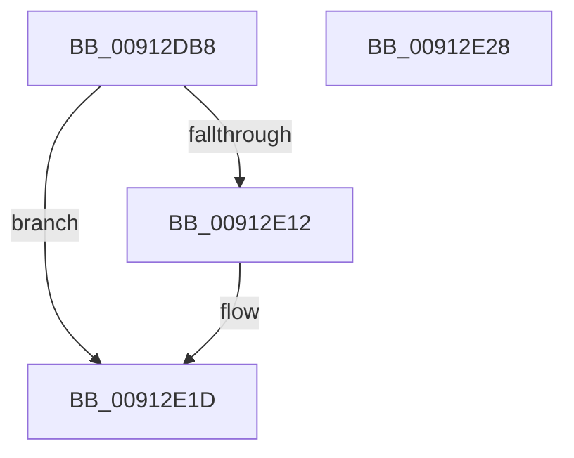

# PopUserPresenceHostStateChange

- RVA: `0x00912DB8`–`0x00912E29` (길이 `113` bytes)
- VA: `0x0000000140912DB8`
- 실행 섹션: `PAGE`
- PDB 이름 있음: `예`; PDB Function 태그: `아니요`
- unwind 정보 RVA: `0x00071A74`
- 디코드: `26`개 명령, `113/113` bytes 표시
- 미해석 바이트: `0` (있으면 어셈블리에 `.byte`로 보존)

> 이 문서는 커널 이미지의 기계어와 PDB 기호를 분석해 생성했습니다. 4번과 5번은 함수 원형과 자료형을 바이너리 사용 방식에서 추정한 C 해석이며 원본 소스 복구 결과는 아닙니다.

## 1. Dependencies

- 직접 호출 지점: **3**; 고유 호출 대상: **3**
- 직접 호출자로 확인된 함수: **1**
- RIP 상대 이미지 참조: **5**

### Outgoing calls
- `0x00912DEE` → [ExAcquireResourceExclusiveLite](../../text/21/ExAcquireResourceExclusiveLite_function_00214E20.md) (function, `0x00214E20`)
- `0x00912E18` → [PopEvaluateGlobalUserStatus](PopEvaluateGlobalUserStatus_function_009155C8.md) (function, `0x009155C8`)
- `0x00912E1D` → [PopReleaseAdaptiveLock](PopReleaseAdaptiveLock_function_009137DC.md) (function, `0x009137DC`)

### Direct callers
- [PopPowerInformationInternal](../A8/PopPowerInformationInternal_function_00A8B7C0.md) at `0x00A8CC1D`

### Static image references
- `0x00912DDD` → RVA `0x00F08140` (`.data`; read)
- `0x00912DFC` → RVA `0x00E0C39C` (`.data`; read)
- `0x00912E02` → RVA `0x00FD82A0` (`PAGEDATA`; write)
- `0x00912E09` → RVA `0x00F08220` (`.data`; write)
- `0x00912E12` → RVA `0x00E0C39C` (`.data`; write)

## 2. Other-region calls and transfers

- 다른 실행 섹션으로 향하는 call: **1**
  - `0x00912DEE` → [ExAcquireResourceExclusiveLite](../../text/21/ExAcquireResourceExclusiveLite_function_00214E20.md) (`PAGE` → `.text`)
- 별도 외부 분기/꼬리 이동을 확인하지 못했습니다.

## 3. Assembly (complete function range)

```asm
00912DB8  40 53                           push rbx
00912DBA  48 83 EC 50                     sub rsp, 0x50
00912DBE  0F 57 C0                        xorps xmm0, xmm0
00912DC1  33 C0                           xor eax, eax
00912DC3  0F 11 44 24 20                  movups xmmword ptr [rsp + 0x20], xmm0
00912DC8  48 89 44 24 40                  mov qword ptr [rsp + 0x40], rax
00912DCD  8B D9                           mov ebx, ecx
00912DCF  0F 11 44 24 30                  movups xmmword ptr [rsp + 0x30], xmm0
00912DD4  65 48 8B 04 25 88 01 00 00      mov rax, qword ptr gs:[0x188]
00912DDD  48 8D 0D 5C 53 5F 00            lea rcx, [rip + 0x5f535c]
00912DE4  B2 01                           mov dl, 1
00912DE6  66 FF 88 E4 01 00 00            dec word ptr [rax + 0x1e4]
00912DED  90                              nop
00912DEE  E8 2D 20 90 FF                  call 0x140214e20
00912DF3  65 48 8B 04 25 88 01 00 00      mov rax, qword ptr gs:[0x188]
00912DFC  39 1D 9A 95 4F 00               cmp dword ptr [rip + 0x4f959a], ebx
00912E02  48 89 05 97 54 6C 00            mov qword ptr [rip + 0x6c5497], rax
00912E09  C6 05 10 54 5F 00 00            mov byte ptr [rip + 0x5f5410], 0
00912E10  74 0B                           je 0x140912e1d
00912E12  89 1D 84 95 4F 00               mov dword ptr [rip + 0x4f9584], ebx
00912E18  E8 AB 27 00 00                  call 0x1409155c8
00912E1D  E8 BA 09 00 00                  call 0x1409137dc
00912E22  48 83 C4 50                     add rsp, 0x50
00912E26  5B                              pop rbx
00912E27  C3                              ret
00912E28  CC                              int3
```

## 4. C-style interpretation (structured pseudocode)

```c
__int64 __fastcall PopUserPresenceHostStateChange(int a1)
{
    __int64 result;
    __int64 v_rsp;
    unsigned __int64 v_stack_m18;
    unsigned __int64 v_stack_m28;
    unsigned __int64 v_stack_m38;

    v_rsp = (v_rsp) - (80);
    result = 0;
    v_stack_m38 = v_xmm0;
    v_stack_m18 = 0;
    v_stack_m28 = v_xmm0;
    result = ExAcquireResourceExclusiveLite(v_rip + 6247260, 1, a3, a4);
    *(unsigned __int64 *)(v_rip + 7099543) = *(unsigned __int64 *)(gs_base + (0 + 392));
    *(unsigned __int8 *)(v_rip + 6247440) = 0;
    result = *(unsigned __int64 *)(gs_base + (0 + 392));
    if ((*(unsigned int *)(v_rip + 5215642)) != ((unsigned int)((unsigned int)(a1)))) {
        *(unsigned int *)(v_rip + 5215620) = (unsigned int)((unsigned int)(a1));
        result = PopEvaluateGlobalUserStatus(v_rip + 6247260, 1, a3, a4);
    }
    result = PopReleaseAdaptiveLock(v_rip + 6247260, 1, a3, a4);
    v_rsp = (v_rsp) + (80);
    return result;
}
```

## 5. (Beta) C Style

```c
int64_t PopUserPresenceHostStateChange(int32_t Arg1)
{
    int64_t result;
    int64_t local_rsp;
    uint64_t v_stack_m18;
    uint64_t v_stack_m28;
    uint64_t v_stack_m38;

    local_rsp = (local_rsp) - (80);
    result = 0;
    v_stack_m38 = v_xmm0;
    v_stack_m18 = 0;
    v_stack_m28 = v_xmm0;
    result = ExAcquireResourceExclusiveLite(v_rip + 6247260, 1, a3, a4);
    *(uint64_t *)(v_rip + 0x6C5497) = *(uint64_t *)(gs_base + (0 + 0x188));
    *(uint8_t *)(v_rip + 0x5F5410) = 0;
    result = *(uint64_t *)(gs_base + (0 + 0x188));
    if ((*(uint32_t *)(v_rip + 0x4F959A)) != ((uint32_t)((uint32_t)(Arg1)))) {
        *(uint32_t *)(v_rip + 0x4F9584) = (uint32_t)((uint32_t)(Arg1));
        result = PopEvaluateGlobalUserStatus(v_rip + 6247260, 1, a3, a4);
    }
    result = PopReleaseAdaptiveLock(v_rip + 6247260, 1, a3, a4);
    local_rsp = (local_rsp) + (80);
    return result;
}
```

## 6. Execution-region graph

[열기: 2D/3D 그래프와 함수 탐색 컨트롤 패널](../../../control-panel.html?section=page&rva=0x00912DB8&view=graph)

- 2D 그래프는 위에서 아래로 흐르고, 3D 그래프는 빈 공간을 드래그해 회전합니다. Shift+드래그는 이동, 휠은 확대·축소, 함수 노드 선택은 대상 보고서 이동입니다.

### Static fallback


