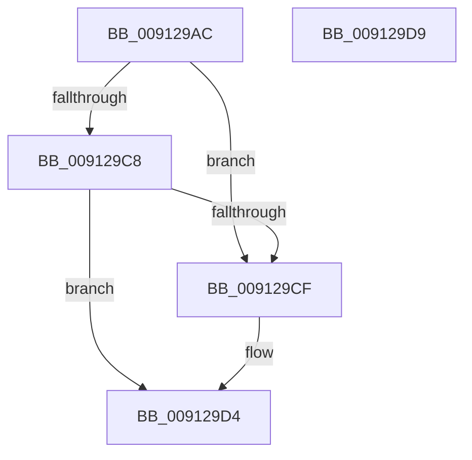

# PopValidateContextMembership

- RVA: `0x009129AC`–`0x009129DA` (길이 `46` bytes)
- VA: `0x00000001409129AC`
- 실행 섹션: `PAGE`
- PDB 이름 있음: `예`; PDB Function 태그: `아니요`
- unwind 정보 RVA: `0x0005C788`
- 디코드: `14`개 명령, `46/46` bytes 표시
- 미해석 바이트: `0` (있으면 어셈블리에 `.byte`로 보존)

> 이 문서는 커널 이미지의 기계어와 PDB 기호를 분석해 생성했습니다. 4번과 5번은 함수 원형과 자료형을 바이너리 사용 방식에서 추정한 C 해석이며 원본 소스 복구 결과는 아닙니다.

## 1. Dependencies

- 직접 호출 지점: **1**; 고유 호출 대상: **1**
- 직접 호출자로 확인된 함수: **1**
- RIP 상대 이미지 참조: **0**

### Outgoing calls
- `0x009129BF` → [RtlCheckTokenMembership](../../text/3A/RtlCheckTokenMembership_function_003A5A10.md) (function, `0x003A5A10`)

### Direct callers
- [PopGetSettingNotificationName](PopGetSettingNotificationName_function_0091346C.md) at `0x00913673`
- [PopGetSettingNotificationName](PopGetSettingNotificationName_function_0091346C.md) at `0x009136AE`

### Static image references
- 디코드된 RIP-relative 메모리 참조가 없습니다.

## 2. Other-region calls and transfers

- 다른 실행 섹션으로 향하는 call: **1**
  - `0x009129BF` → [RtlCheckTokenMembership](../../text/3A/RtlCheckTokenMembership_function_003A5A10.md) (`PAGE` → `.text`)
- 별도 외부 분기/꼬리 이동을 확인하지 못했습니다.

## 3. Assembly (complete function range)

```asm
009129AC  48 83 EC 28                     sub rsp, 0x28
009129B0  48 8B D1                        mov rdx, rcx
009129B3  C6 44 24 38 00                  mov byte ptr [rsp + 0x38], 0
009129B8  33 C9                           xor ecx, ecx
009129BA  4C 8D 44 24 38                  lea r8, [rsp + 0x38]
009129BF  E8 4C 30 A9 FF                  call 0x1403a5a10
009129C4  85 C0                           test eax, eax
009129C6  78 07                           js 0x1409129cf
009129C8  80 7C 24 38 00                  cmp byte ptr [rsp + 0x38], 0
009129CD  75 05                           jne 0x1409129d4
009129CF  B8 22 00 00 C0                  mov eax, 0xc0000022
009129D4  48 83 C4 28                     add rsp, 0x28
009129D8  C3                              ret
009129D9  CC                              int3
```

## 4. C-style interpretation (structured pseudocode)

```c
__int64 __fastcall PopValidateContextMembership(__int64 a1)
{
    __int64 result;
    __int64 v_rsp;
    unsigned __int8 v_stack_p10;

    v_rsp = (v_rsp) - (40);
    v_stack_p10 = 0;
    a1 = 0;
    result = RtlCheckTokenMembership(a1, a1, v_stack_p10, a4);
    if (sign_flag) goto loc_009129CF;
    if (v_stack_p10 == 0) {
        result = 0xC0000022ULL;
    }
    v_rsp = (v_rsp) + (40);
    return result;
}
```

## 5. (Beta) C Style

```c
int64_t PopValidateContextMembership(int64_t Arg1)
{
    int64_t result;
    int64_t local_rsp;
    uint8_t v_stack_p10;

    local_rsp = (local_rsp) - (40);
    v_stack_p10 = 0;
    Arg1 = 0;
    result = RtlCheckTokenMembership(Arg1, Arg1, v_stack_p10, a4);
    if (sign_flag) goto loc_009129CF;
    if (v_stack_p10 == 0) {
        result = 0xC0000022ULL;
    }
    local_rsp = (local_rsp) + (40);
    return result;
}
```

## 6. Execution-region graph

[열기: 2D/3D 그래프와 함수 탐색 컨트롤 패널](../../../control-panel.html?section=page&rva=0x009129AC&view=graph)

- 2D 그래프는 위에서 아래로 흐르고, 3D 그래프는 빈 공간을 드래그해 회전합니다. Shift+드래그는 이동, 휠은 확대·축소, 함수 노드 선택은 대상 보고서 이동입니다.

### Static fallback


