# PopValidatePowerSettingData

- RVA: `0x00915368`–`0x00915444` (길이 `220` bytes)
- VA: `0x0000000140915368`
- 실행 섹션: `PAGE`
- PDB 이름 있음: `예`; PDB Function 태그: `아니요`
- unwind 정보 RVA: `0x0008A6B0`
- 디코드: `64`개 명령, `220/220` bytes 표시
- 미해석 바이트: `0` (있으면 어셈블리에 `.byte`로 보존)

> 이 문서는 커널 이미지의 기계어와 PDB 기호를 분석해 생성했습니다. 4번과 5번은 함수 원형과 자료형을 바이너리 사용 방식에서 추정한 C 해석이며 원본 소스 복구 결과는 아닙니다.

## 1. Dependencies

- 직접 호출 지점: **1**; 고유 호출 대상: **1**
- 직접 호출자로 확인된 함수: **1**
- RIP 상대 이미지 참조: **6**

### Outgoing calls
- `0x009153E2` → [PopIsPlatformAoAcCapable](../../text/49/PopIsPlatformAoAcCapable_function_0049BF40.md) (function, `0x0049BF40`)

### Direct callers
- [PopSetPowerSettingValue](PopSetPowerSettingValue_function_00914E54.md) at `0x00914ED5`

### Static image references
- `0x0091536C` → RVA `0x00011A78` (`.rdata`; read)
- `0x00915381` → RVA `0x00011A80` (`.rdata`; read)
- `0x00915391` → RVA `0x00011A68` (`.rdata`; read)
- `0x0091539D` → RVA `0x00011A70` (`.rdata`; read)
- `0x009153AD` → RVA `0x00011A58` (`.rdata`; read)
- `0x009153B9` → RVA `0x00011A60` (`.rdata`; read)

## 2. Other-region calls and transfers

- 다른 실행 섹션으로 향하는 call: **1**
  - `0x009153E2` → [PopIsPlatformAoAcCapable](../../text/49/PopIsPlatformAoAcCapable_function_0049BF40.md) (`PAGE` → `.text`)
- 별도 외부 분기/꼬리 이동을 확인하지 못했습니다.

## 3. Assembly (complete function range)

```asm
00915368  48 83 EC 28                     sub rsp, 0x28
0091536C  4C 8B 0D 05 C7 6F FF            mov r9, qword ptr [rip - 0x9038fb]
00915373  4C 8B D9                        mov r11, rcx
00915376  41 BA 25 02 00 C0               mov r10d, 0xc0000225
0091537C  4C 2B 09                        sub r9, qword ptr [rcx]
0091537F  75 0B                           jne 0x14091538c
00915381  4C 8B 0D F8 C6 6F FF            mov r9, qword ptr [rip - 0x903908]
00915388  4C 2B 49 08                     sub r9, qword ptr [rcx + 8]
0091538C  4D 85 C9                        test r9, r9
0091538F  74 41                           je 0x1409153d2
00915391  48 8B 0D D0 C6 6F FF            mov rcx, qword ptr [rip - 0x903930]
00915398  49 2B 0B                        sub rcx, qword ptr [r11]
0091539B  75 0B                           jne 0x1409153a8
0091539D  48 8B 0D CC C6 6F FF            mov rcx, qword ptr [rip - 0x903934]
009153A4  49 2B 4B 08                     sub rcx, qword ptr [r11 + 8]
009153A8  48 85 C9                        test rcx, rcx
009153AB  74 70                           je 0x14091541d
009153AD  48 8B 0D A4 C6 6F FF            mov rcx, qword ptr [rip - 0x90395c]
009153B4  49 2B 0B                        sub rcx, qword ptr [r11]
009153B7  75 0B                           jne 0x1409153c4
009153B9  48 8B 0D A0 C6 6F FF            mov rcx, qword ptr [rip - 0x903960]
009153C0  49 2B 4B 08                     sub rcx, qword ptr [r11 + 8]
009153C4  48 85 C9                        test rcx, rcx
009153C7  74 34                           je 0x1409153fd
009153C9  41 8B C2                        mov eax, r10d
009153CC  48 83 C4 28                     add rsp, 0x28
009153D0  C3                              ret
009153D1  CC                              int3
009153D2  83 FA 04                        cmp edx, 4
009153D5  75 BA                           jne 0x140915391
009153D7  4D 85 C0                        test r8, r8
009153DA  74 B5                           je 0x140915391
009153DC  41 83 38 00                     cmp dword ptr [r8], 0
009153E0  74 AF                           je 0x140915391
009153E2  E8 59 6B B8 FF                  call 0x14049bf40
009153E7  84 C0                           test al, al
009153E9  75 A6                           jne 0x140915391
009153EB  41 83 38 0F                     cmp dword ptr [r8], 0xf
009153EF  73 A0                           jae 0x140915391
009153F1  41 C7 00 0F 00 00 00            mov dword ptr [r8], 0xf
009153F8  45 33 D2                        xor r10d, r10d
009153FB  EB 94                           jmp 0x140915391
009153FD  83 FA 04                        cmp edx, 4
00915400  75 C7                           jne 0x1409153c9
00915402  4D 85 C0                        test r8, r8
00915405  74 C2                           je 0x1409153c9
00915407  41 8B 00                        mov eax, dword ptr [r8]
0091540A  FF C8                           dec eax
0091540C  83 F8 3A                        cmp eax, 0x3a
0091540F  77 B8                           ja 0x1409153c9
00915411  41 C7 00 3C 00 00 00            mov dword ptr [r8], 0x3c
00915418  45 33 D2                        xor r10d, r10d
0091541B  EB AC                           jmp 0x1409153c9
0091541D  83 FA 04                        cmp edx, 4
00915420  75 8B                           jne 0x1409153ad
00915422  4D 85 C0                        test r8, r8
00915425  74 86                           je 0x1409153ad
00915427  41 8B 00                        mov eax, dword ptr [r8]
0091542A  FF C8                           dec eax
0091542C  83 F8 1C                        cmp eax, 0x1c
0091542F  0F 87 78 FF FF FF               ja 0x1409153ad
00915435  41 C7 00 1E 00 00 00            mov dword ptr [r8], 0x1e
0091543C  45 33 D2                        xor r10d, r10d
0091543F  E9 69 FF FF FF                  jmp 0x1409153ad
```

## 4. C-style interpretation (structured pseudocode)

```c
__int64 __fastcall PopValidatePowerSettingData(__int64 a1, int a2, __int64 a3)
{
    __int64 result;
    __int64 v_r10;
    __int64 v_rsp;

    v_rsp = (v_rsp) - (40);
    a4 = (*(unsigned __int64 *)(v_rip - 9451771)) - (*(unsigned __int64 *)(a1));
    if (!(condition_is_not_equal)) {
        a4 = *(unsigned __int64 *)(v_rip - 9451784);
        a4 = (a4) - (*(unsigned __int64 *)(a1 + 8));
    }
    if (a4 == 0) goto loc_009153D2;
loc_00915391:
    a1 = (*(unsigned __int64 *)(v_rip - 9451824)) - (*(unsigned __int64 *)(a1));
    if (!(condition_is_not_equal)) {
        a1 = *(unsigned __int64 *)(v_rip - 9451828);
        a1 = (a1) - (*(unsigned __int64 *)(a1 + 8));
    }
    if (a1 == 0) goto loc_0091541D;
loc_009153AD:
    a1 = (*(unsigned __int64 *)(v_rip - 9451868)) - (*(unsigned __int64 *)(a1));
    if (!(condition_is_not_equal)) {
        a1 = *(unsigned __int64 *)(v_rip - 9451872);
        a1 = (a1) - (*(unsigned __int64 *)(a1 + 8));
    }
    if (a1 == 0) goto loc_009153FD;
loc_009153C9:
    v_rsp = (v_rsp) + (40);
    return (unsigned int)((unsigned int)((unsigned int)(0xC0000225ULL)));
loc_009153D2:
    if (a2 != 4) goto loc_00915391;
    if (a3 == 0) goto loc_00915391;
    if ((*(unsigned int *)(a3)) == 0) goto loc_00915391;
    result = PopIsPlatformAoAcCapable(a1, a2, a3, a4);
    if ((unsigned __int8)(result) != 0) goto loc_00915391;
    if ((*(unsigned int *)(a3)) >= 15) goto loc_00915391;
    *(unsigned int *)(a3) = 15;
    v_r10 = 0;
    goto loc_00915391;
loc_009153FD:
    if (a2 != 4) goto loc_009153C9;
    if (a3 == 0) goto loc_009153C9;
    result = (unsigned int)(((unsigned int)(*(unsigned int *)(a3))) - 1);
    if (((unsigned int)(result)) > 58) goto loc_009153C9;
    *(unsigned int *)(a3) = 60;
    v_r10 = 0;
    goto loc_009153C9;
loc_0091541D:
    if (a2 != 4) goto loc_009153AD;
    if (a3 == 0) goto loc_009153AD;
    result = (unsigned int)(((unsigned int)(*(unsigned int *)(a3))) - 1);
    if (((unsigned int)(result)) > 28) goto loc_009153AD;
    *(unsigned int *)(a3) = 30;
    v_r10 = 0;
    goto loc_009153AD;
}
```

## 5. (Beta) C Style

```c
int64_t PopValidatePowerSettingData(void *Arg1, int32_t Arg2, int64_t Arg3)
{
    uint8_t *arg1 = (uint8_t *)Arg1;

    int64_t result;
    int64_t local_r10;
    int64_t local_rsp;

    local_rsp = (local_rsp) - (40);
    a4 = (*(uint64_t *)(v_rip - 0x9038FB)) - (*(uint64_t *)(arg1));
    if (!(condition_is_not_equal)) {
        a4 = *(uint64_t *)(v_rip - 0x903908);
        a4 = (a4) - (*(uint64_t *)(arg1 + 0x8));
    }
    if (a4 == 0) goto loc_009153D2;
loc_00915391:
    Arg1 = (*(uint64_t *)(v_rip - 0x903930)) - (*(uint64_t *)(arg1));
    if (!(condition_is_not_equal)) {
        Arg1 = *(uint64_t *)(v_rip - 0x903934);
        Arg1 = (Arg1) - (*(uint64_t *)(arg1 + 0x8));
    }
    if (Arg1 == NULL) goto loc_0091541D;
loc_009153AD:
    Arg1 = (*(uint64_t *)(v_rip - 0x90395C)) - (*(uint64_t *)(arg1));
    if (!(condition_is_not_equal)) {
        Arg1 = *(uint64_t *)(v_rip - 0x903960);
        Arg1 = (Arg1) - (*(uint64_t *)(arg1 + 0x8));
    }
    if (Arg1 == NULL) goto loc_009153FD;
loc_009153C9:
    local_rsp = (local_rsp) + (40);
    return (uint32_t)((uint32_t)((uint32_t)(0xC0000225ULL)));
loc_009153D2:
    if (Arg2 != 4) goto loc_00915391;
    if (Arg3 == 0) goto loc_00915391;
    if ((*(uint32_t *)(Arg3)) == 0) goto loc_00915391;
    result = PopIsPlatformAoAcCapable(Arg1, Arg2, Arg3, a4);
    if ((uint8_t)(result) != 0) goto loc_00915391;
    if ((*(uint32_t *)(Arg3)) >= 15) goto loc_00915391;
    *(uint32_t *)(Arg3) = 15;
    local_r10 = 0;
    goto loc_00915391;
loc_009153FD:
    if (Arg2 != 4) goto loc_009153C9;
    if (Arg3 == 0) goto loc_009153C9;
    result = (uint32_t)(((uint32_t)(*(uint32_t *)(Arg3))) - 1);
    if (((uint32_t)(result)) > 58) goto loc_009153C9;
    *(uint32_t *)(Arg3) = 60;
    local_r10 = 0;
    goto loc_009153C9;
loc_0091541D:
    if (Arg2 != 4) goto loc_009153AD;
    if (Arg3 == 0) goto loc_009153AD;
    result = (uint32_t)(((uint32_t)(*(uint32_t *)(Arg3))) - 1);
    if (((uint32_t)(result)) > 28) goto loc_009153AD;
    *(uint32_t *)(Arg3) = 30;
    local_r10 = 0;
    goto loc_009153AD;
}
```

### 관측된 메모리 오프셋

구조체 형식이 확인되지 않은 접근은 인자 기준의 오프셋으로만 기록했습니다.

| 기준 인자 | 오프셋 표현 | 폭 (bit) | 접근 |
|---|---:|---:|---|
| `Arg1` | `+ 0x0` | `64` | `R` |
| `Arg1` | `+ 0x8` | `64` | `R` |

## 6. Execution-region graph

[열기: 2D/3D 그래프와 함수 탐색 컨트롤 패널](../../../control-panel.html?section=page&rva=0x00915368&view=graph)

- 2D 그래프는 위에서 아래로 흐르고, 3D 그래프는 빈 공간을 드래그해 회전합니다. Shift+드래그는 이동, 휠은 확대·축소, 함수 노드 선택은 대상 보고서 이동입니다.

### Static fallback

```mermaid
flowchart TD
  bb_00915368[BB_00915368]
  bb_00915381[BB_00915381]
  bb_0091538C[BB_0091538C]
  bb_00915391[BB_00915391]
  bb_0091539D[BB_0091539D]
  bb_009153A8[BB_009153A8]
  bb_009153AD[BB_009153AD]
  bb_009153B9[BB_009153B9]
  bb_009153C4[BB_009153C4]
  bb_009153C9[BB_009153C9]
  bb_009153D1[BB_009153D1]
  bb_009153D2[BB_009153D2]
  bb_009153D7[BB_009153D7]
  bb_009153DC[BB_009153DC]
  bb_009153E2[BB_009153E2]
  bb_009153EB[BB_009153EB]
  bb_009153F1[BB_009153F1]
  bb_009153FD[BB_009153FD]
  bb_00915402[BB_00915402]
  bb_00915407[BB_00915407]
  bb_00915411[BB_00915411]
  bb_0091541D[BB_0091541D]
  bb_00915422[BB_00915422]
  bb_00915427[BB_00915427]
  bb_00915435[BB_00915435]
  bb_00915368 -->|branch| bb_0091538C
  bb_00915368 -->|fallthrough| bb_00915381
  bb_00915381 -->|flow| bb_0091538C
  bb_0091538C -->|branch| bb_009153D2
  bb_0091538C -->|fallthrough| bb_00915391
  bb_00915391 -->|branch| bb_009153A8
  bb_00915391 -->|fallthrough| bb_0091539D
  bb_0091539D -->|flow| bb_009153A8
  bb_009153A8 -->|branch| bb_0091541D
  bb_009153A8 -->|fallthrough| bb_009153AD
  bb_009153AD -->|branch| bb_009153C4
  bb_009153AD -->|fallthrough| bb_009153B9
  bb_009153B9 -->|flow| bb_009153C4
  bb_009153C4 -->|branch| bb_009153FD
  bb_009153C4 -->|fallthrough| bb_009153C9
  bb_009153D1 -->|flow| bb_009153D2
  bb_009153D2 -->|branch| bb_00915391
  bb_009153D2 -->|fallthrough| bb_009153D7
  bb_009153D7 -->|branch| bb_00915391
  bb_009153D7 -->|fallthrough| bb_009153DC
  bb_009153DC -->|branch| bb_00915391
  bb_009153DC -->|fallthrough| bb_009153E2
  bb_009153E2 -->|branch| bb_00915391
  bb_009153E2 -->|fallthrough| bb_009153EB
  bb_009153EB -->|branch| bb_00915391
  bb_009153EB -->|fallthrough| bb_009153F1
  bb_009153F1 -->|branch| bb_00915391
  bb_009153FD -->|branch| bb_009153C9
  bb_009153FD -->|fallthrough| bb_00915402
  bb_00915402 -->|branch| bb_009153C9
  bb_00915402 -->|fallthrough| bb_00915407
  bb_00915407 -->|branch| bb_009153C9
  bb_00915407 -->|fallthrough| bb_00915411
  bb_00915411 -->|branch| bb_009153C9
  bb_0091541D -->|branch| bb_009153AD
  bb_0091541D -->|fallthrough| bb_00915422
  bb_00915422 -->|branch| bb_009153AD
  bb_00915422 -->|fallthrough| bb_00915427
  bb_00915427 -->|branch| bb_009153AD
  bb_00915427 -->|fallthrough| bb_00915435
  bb_00915435 -->|branch| bb_009153AD
```


