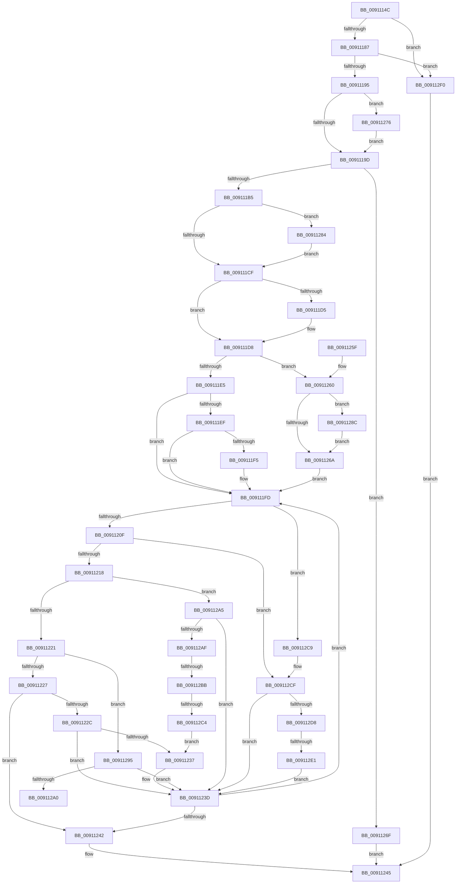

# PopVerifyPowerActionPolicy

- RVA: `0x0091114C`–`0x009112F7` (길이 `427` bytes)
- VA: `0x000000014091114C`
- 실행 섹션: `PAGE`
- PDB 이름 있음: `예`; PDB Function 태그: `예`
- unwind 정보 RVA: `0x0008A188`
- 디코드: `116`개 명령, `427/427` bytes 표시
- 미해석 바이트: `0` (있으면 어셈블리에 `.byte`로 보존)

> 이 문서는 커널 이미지의 기계어와 PDB 기호를 분석해 생성했습니다. 4번과 5번은 함수 원형과 자료형을 바이너리 사용 방식에서 추정한 C 해석이며 원본 소스 복구 결과는 아닙니다.

## 1. Dependencies

- 직접 호출 지점: **2**; 고유 호출 대상: **2**
- 직접 호출자로 확인된 함수: **3**
- RIP 상대 이미지 참조: **2**

### Outgoing calls
- `0x00911179` → [memset](../../text/6C/memset_function_006C6C40.md) (function, `0x006C6C40`)
- `0x009111A8` → [PopFilterCapabilities](PopFilterCapabilities_function_0091141C.md) (function, `0x0091141C`)

### Direct callers
- [PopExecutePowerAction](../75/PopExecutePowerAction_function_0075E6B4.md) at `0x0075E77B`
- [PdcPoVerifyActionPolicy](../76/PdcPoVerifyActionPolicy_function_00769580.md) at `0x00769591`
- [PopVerifySystemPowerPolicy](PopVerifySystemPowerPolicy_function_00910A8C.md) at `0x00910BF4`
- [PopVerifySystemPowerPolicy](PopVerifySystemPowerPolicy_function_00910A8C.md) at `0x00910BFD`
- [PopVerifySystemPowerPolicy](PopVerifySystemPowerPolicy_function_00910A8C.md) at `0x00910C06`
- [PopVerifySystemPowerPolicy](PopVerifySystemPowerPolicy_function_00910A8C.md) at `0x00910C0F`
- [PopVerifySystemPowerPolicy](PopVerifySystemPowerPolicy_function_00910A8C.md) at `0x00910D1D`
- [PopVerifySystemPowerPolicy](PopVerifySystemPowerPolicy_function_00910A8C.md) at `0x00910DB0`
- [PopVerifySystemPowerPolicy](PopVerifySystemPowerPolicy_function_00910A8C.md) at `0x00911075`

### Static image references
- `0x009111A1` → RVA `0x00F0CEC0` (`.data`; read)
- `0x009112AF` → RVA `0x00FC6D44` (`ALMOSTRO`; read)

## 2. Other-region calls and transfers

- 다른 실행 섹션으로 향하는 call: **1**
  - `0x00911179` → [memset](../../text/6C/memset_function_006C6C40.md) (`PAGE` → `.text`)
- call이 아닌 외부 분기/꼬리 이동: **4**
  - `0x009112A0` → [sub_00B21646](../B2/Unknown_function_00B21646.md) (`tail-transfer`)
  - `0x009112B5` → [sub_00B21646](../B2/Unknown_function_00B21646.md) (`tail-transfer`)
  - `0x009112BE` → [sub_00B21646 + 0x10](../B2/Unknown_function_00B21646.md) (`tail-transfer`)
  - `0x009112DB` → [sub_00B21646 + 0x10](../B2/Unknown_function_00B21646.md) (`tail-transfer`)

## 3. Assembly (complete function range)

```asm
0091114C  48 8B C4                        mov rax, rsp
0091114F  48 89 58 08                     mov qword ptr [rax + 8], rbx
00911153  48 89 70 10                     mov qword ptr [rax + 0x10], rsi
00911157  48 89 78 18                     mov qword ptr [rax + 0x18], rdi
0091115B  4C 89 70 20                     mov qword ptr [rax + 0x20], r14
0091115F  55                              push rbp
00911160  48 8B EC                        mov rbp, rsp
00911163  48 83 EC 70                     sub rsp, 0x70
00911167  33 F6                           xor esi, esi
00911169  48 8B D9                        mov rbx, rcx
0091116C  33 D2                           xor edx, edx
0091116E  48 8D 4D B0                     lea rcx, [rbp - 0x50]
00911172  40 8A FE                        mov dil, sil
00911175  44 8D 46 4C                     lea r8d, [rsi + 0x4c]
00911179  E8 C2 5A DB FF                  call 0x1406c6c40
0091117E  48 85 DB                        test rbx, rbx
00911181  0F 84 69 01 00 00               je 0x1409112f0
00911187  8B 43 04                        mov eax, dword ptr [rbx + 4]
0091118A  A9 C0 FF FF 0C                  test eax, 0xcffffc0
0091118F  0F 85 5B 01 00 00               jne 0x1409112f0
00911195  85 C0                           test eax, eax
00911197  0F 88 D9 00 00 00               js 0x140911276
0091119D  48 8D 55 B0                     lea rdx, [rbp - 0x50]
009111A1  48 8D 0D 18 BD 5F 00            lea rcx, [rip + 0x5fbd18]
009111A8  E8 6F 02 00 00                  call 0x14091141c
009111AD  85 C0                           test eax, eax
009111AF  0F 88 BA 00 00 00               js 0x14091126f
009111B5  40 38 75 B3                     cmp byte ptr [rbp - 0x4d], sil
009111B9  44 8B CE                        mov r9d, esi
009111BC  BA 01 00 00 00                  mov edx, 1
009111C1  44 0F 45 CA                     cmovne r9d, edx
009111C5  40 38 75 B4                     cmp byte ptr [rbp - 0x4c], sil
009111C9  0F 85 B5 00 00 00               jne 0x140911284
009111CF  40 38 75 B5                     cmp byte ptr [rbp - 0x4b], sil
009111D3  74 03                           je 0x1409111d8
009111D5  44 03 CA                        add r9d, edx
009111D8  8B 43 04                        mov eax, dword ptr [rbx + 4]
009111DB  41 BE 02 00 00 00               mov r14d, 2
009111E1  A8 08                           test al, 8
009111E3  75 7B                           jne 0x140911260
009111E5  44 0F B6 D6                     movzx r10d, sil
009111E9  40 38 75 B6                     cmp byte ptr [rbp - 0x4a], sil
009111ED  74 0E                           je 0x1409111fd
009111EF  40 38 75 B8                     cmp byte ptr [rbp - 0x48], sil
009111F3  74 08                           je 0x1409111fd
009111F5  44 38 75 C6                     cmp byte ptr [rbp - 0x3a], r14b
009111F9  44 0F 44 D2                     cmove r10d, edx
009111FD  44 8B 1B                        mov r11d, dword ptr [rbx]
00911200  45 8B C3                        mov r8d, r11d
00911203  41 8B CB                        mov ecx, r11d
00911206  44 2B C2                        sub r8d, edx
00911209  0F 84 BA 00 00 00               je 0x1409112c9
0091120F  44 2B C2                        sub r8d, edx
00911212  0F 84 B7 00 00 00               je 0x1409112cf
00911218  44 2B C2                        sub r8d, edx
0091121B  0F 84 84 00 00 00               je 0x1409112a5
00911221  41 83 E8 03                     sub r8d, 3
00911225  74 6E                           je 0x140911295
00911227  45 3B C6                        cmp r8d, r14d
0091122A  75 16                           jne 0x140911242
0091122C  B9 08 00 00 00                  mov ecx, 8
00911231  40 38 75 C4                     cmp byte ptr [rbp - 0x3c], sil
00911235  74 06                           je 0x14091123d
00911237  44 89 33                        mov dword ptr [rbx], r14d
0091123A  41 8B CE                        mov ecx, r14d
0091123D  44 3B D9                        cmp r11d, ecx
00911240  75 BB                           jne 0x1409111fd
00911242  40 8A C7                        mov al, dil
00911245  4C 8D 5C 24 70                  lea r11, [rsp + 0x70]
0091124A  49 8B 5B 10                     mov rbx, qword ptr [r11 + 0x10]
0091124E  49 8B 73 18                     mov rsi, qword ptr [r11 + 0x18]
00911252  49 8B 7B 20                     mov rdi, qword ptr [r11 + 0x20]
00911256  4D 8B 73 28                     mov r14, qword ptr [r11 + 0x28]
0091125A  49 8B E3                        mov rsp, r11
0091125D  5D                              pop rbp
0091125E  C3                              ret
0091125F  CC                              int3
00911260  40 0F B6 C6                     movzx eax, sil
00911264  40 38 75 B6                     cmp byte ptr [rbp - 0x4a], sil
00911268  75 22                           jne 0x14091128c
0091126A  44 8A D0                        mov r10b, al
0091126D  EB 8E                           jmp 0x1409111fd
0091126F  B8 01 00 00 00                  mov eax, 1
00911274  EB CF                           jmp 0x140911245
00911276  83 E0 FC                        and eax, 0xfffffffc
00911279  83 C8 04                        or eax, 4
0091127C  89 43 04                        mov dword ptr [rbx + 4], eax
0091127F  E9 19 FF FF FF                  jmp 0x14091119d
00911284  44 03 CA                        add r9d, edx
00911287  E9 43 FF FF FF                  jmp 0x1409111cf
0091128C  40 38 75 B8                     cmp byte ptr [rbp - 0x48], sil
00911290  0F 45 C2                        cmovne eax, edx
00911293  EB D5                           jmp 0x14091126a
00911295  B9 06 00 00 00                  mov ecx, 6
0091129A  40 38 75 B7                     cmp byte ptr [rbp - 0x49], sil
0091129E  75 9D                           jne 0x14091123d
009112A0  E9 A1 03 21 00                  jmp 0x140b21646
009112A5  B9 03 00 00 00                  mov ecx, 3
009112AA  45 84 D2                        test r10b, r10b
009112AD  75 8E                           jne 0x14091123d
009112AF  39 35 8F 5A 6B 00               cmp dword ptr [rip + 0x6b5a8f], esi
009112B5  0F 85 8B 03 21 00               jne 0x140b21646
009112BB  45 85 C9                        test r9d, r9d
009112BE  0F 84 92 03 21 00               je 0x140b21656
009112C4  E9 6E FF FF FF                  jmp 0x140911237
009112C9  44 89 33                        mov dword ptr [rbx], r14d
009112CC  41 8B CE                        mov ecx, r14d
009112CF  45 85 C9                        test r9d, r9d
009112D2  0F 85 65 FF FF FF               jne 0x14091123d
009112D8  45 84 D2                        test r10b, r10b
009112DB  0F 84 75 03 21 00               je 0x140b21656
009112E1  C7 03 03 00 00 00               mov dword ptr [rbx], 3
009112E7  41 8D 49 03                     lea ecx, [r9 + 3]
009112EB  E9 4D FF FF FF                  jmp 0x14091123d
009112F0  32 C0                           xor al, al
009112F2  E9 4E FF FF FF                  jmp 0x140911245
```

## 4. C-style interpretation (structured pseudocode)

```c
__int64 __fastcall PopVerifyPowerActionPolicy(__int64 a1, int a2)
{
    __int64 result;
    __int64 v_r10;
    __int64 v_rsi;
    __int64 v_rsp;
    unsigned __int8 v_stack_m42;
    unsigned __int8 v_stack_m44;
    unsigned __int8 v_stack_m50;
    unsigned __int8 v_stack_m51;
    unsigned __int8 v_stack_m52;
    unsigned __int8 v_stack_m53;
    unsigned __int8 v_stack_m54;
    unsigned __int8 v_stack_m55;
    unsigned __int64 v_stack_m58;
    unsigned __int64 v_stack_m8;

    *(unsigned __int64 *)(v_rsp + 8) = v_rbx;
    *(unsigned __int64 *)(v_rsp + 16) = v_rsi;
    *(unsigned __int64 *)(v_rsp + 24) = v_rdi;
    *(unsigned __int64 *)(v_rsp + 32) = v_r14;
    v_rsp = (v_rsp) - (112);
    v_rsi = 0;
    a2 = 0;
    result = memset(v_stack_m58, a2, v_rsi + 76, a4);
    if (a1 == 0) goto loc_009112F0;
    if ((((unsigned int)((unsigned int)(*(unsigned int *)(a1 + 4)))) & (0xCFFFFC0ULL)) != 0) goto loc_009112F0;
    if (sign_flag) goto loc_00911276;
loc_0091119D:
    result = PopFilterCapabilities(v_rip + 6274328, v_stack_m58, v_rsi + 76, a4);
    if (sign_flag) goto loc_0091126F;
    a4 = 0;
    if (v_stack_m55 != 0) { a4 = 1; }
    if (v_stack_m54 != 0) goto loc_00911284;
loc_009111CF:
    if (v_stack_m53 != 0) {
        a4 = (unsigned int)((a4) + (1));
    }
    if ((((unsigned __int8)((unsigned int)(*(unsigned int *)(a1 + 4)))) & (8)) != 0) goto loc_00911260;
    if (v_stack_m52 == 0) goto loc_009111FD;
    v_r10 = 0;
    if (v_stack_m50 != 0) {
        v_r10 = 0;
        if (v_stack_m42 == 2) { v_r10 = 1; }
    }
    a3 = (unsigned int)(((unsigned int)((unsigned int)((unsigned int)(*(unsigned int *)(a1))))) - (1));
    if (condition_is_equal) goto loc_009112C9;
    a3 = (unsigned int)((a3) - (1));
    if (condition_is_equal) goto loc_009112CF;
    a3 = (unsigned int)((a3) - (1));
    if (condition_is_equal) goto loc_009112A5;
    a3 = (unsigned int)((a3) - (3));
    if (condition_is_equal) goto loc_00911295;
    if (((unsigned int)(a3)) != 2) goto loc_00911242;
    if (v_stack_m44 != 0) {
        *(unsigned int *)(a1) = 2;
        a1 = 2;
    }
    if (((unsigned int)((unsigned int)(*(unsigned int *)(a1)))) != ((unsigned int)(a1))) goto loc_009111FD;
loc_00911242:
loc_00911245:
    return 0;
loc_00911260:
    if (v_stack_m52 != ((unsigned __int8)(*(unsigned __int64 *)(v_stack_m8 + 24)))) goto loc_0091128C;
loc_0091126A:
    goto loc_009111FD;
loc_0091126F:
    goto loc_00911245;
loc_00911276:
    result = (unsigned int)((1) & (0xFFFFFFFCULL));
    result = (unsigned int)((result) | (4));
    *(unsigned int *)(*(unsigned __int64 *)(v_stack_m8 + 16) + 4) = (unsigned int)(result);
    goto loc_0091119D;
loc_00911284:
    a4 = (unsigned int)((a4) + (1));
    goto loc_009111CF;
loc_0091128C:
    if (v_stack_m50 != ((unsigned __int8)(*(unsigned __int64 *)(v_stack_m8 + 24)))) { result = 1; }
    goto loc_0091126A;
loc_00911295:
    if (v_stack_m51 != ((unsigned __int8)(*(unsigned __int64 *)(v_stack_m8 + 24)))) goto loc_0091123D;
loc_009112A5:
    if ((unsigned __int8)((unsigned __int8)((unsigned __int8)(*(unsigned __int64 *)(v_stack_m8 + 24)))) != 0) goto loc_0091123D;
    goto loc_00911237;
loc_009112C9:
    *(unsigned int *)(*(unsigned __int64 *)(v_stack_m8 + 16)) = (unsigned int)(*(unsigned __int64 *)(v_stack_m8 + 40));
loc_009112CF:
    if ((unsigned int)(a4) != 0) goto loc_0091123D;
    *(unsigned int *)(*(unsigned __int64 *)(v_stack_m8 + 16)) = 3;
    goto loc_0091123D;
loc_009112F0:
    result = 0;
    goto loc_00911245;
}
```

## 5. (Beta) C Style

```c
int64_t PopVerifyPowerActionPolicy(int64_t Arg1, int32_t Arg2)
{
    int64_t result;
    int64_t local_r10;
    int64_t local_rsi;
    int64_t local_rsp;
    uint8_t v_stack_m42;
    uint8_t v_stack_m44;
    uint8_t v_stack_m50;
    uint8_t v_stack_m51;
    uint8_t v_stack_m52;
    uint8_t v_stack_m53;
    uint8_t v_stack_m54;
    uint8_t v_stack_m55;
    uint64_t v_stack_m58;
    uint64_t v_stack_m8;

    *(uint64_t *)(local_rsp + 0x8) = local_rbx;
    *(uint64_t *)(local_rsp + 0x10) = local_rsi;
    *(uint64_t *)(local_rsp + 0x18) = local_rdi;
    *(uint64_t *)(local_rsp + 0x20) = local_r14;
    local_rsp = (local_rsp) - (112);
    local_rsi = 0;
    Arg2 = 0;
    result = memset(v_stack_m58, Arg2, local_rsi + 76, a4);
    if (Arg1 == 0) goto loc_009112F0;
    if ((((uint32_t)((uint32_t)(*(uint32_t *)(Arg1 + 0x4)))) & (0xCFFFFC0ULL)) != 0) goto loc_009112F0;
    if (sign_flag) goto loc_00911276;
loc_0091119D:
    result = PopFilterCapabilities(v_rip + 6274328, v_stack_m58, local_rsi + 76, a4);
    if (sign_flag) goto loc_0091126F;
    a4 = 0;
    if (v_stack_m55 != 0) { a4 = 1; }
    if (v_stack_m54 != 0) goto loc_00911284;
loc_009111CF:
    if (v_stack_m53 != 0) {
        a4 = (uint32_t)((a4) + (1));
    }
    if ((((uint8_t)((uint32_t)(*(uint32_t *)(Arg1 + 0x4)))) & (8)) != 0) goto loc_00911260;
    if (v_stack_m52 == 0) goto loc_009111FD;
    local_r10 = 0;
    if (v_stack_m50 != 0) {
        local_r10 = 0;
        if (v_stack_m42 == 2) { local_r10 = 1; }
    }
    a3 = (uint32_t)(((uint32_t)((uint32_t)((uint32_t)(*(uint32_t *)(Arg1))))) - (1));
    if (condition_is_equal) goto loc_009112C9;
    a3 = (uint32_t)((a3) - (1));
    if (condition_is_equal) goto loc_009112CF;
    a3 = (uint32_t)((a3) - (1));
    if (condition_is_equal) goto loc_009112A5;
    a3 = (uint32_t)((a3) - (3));
    if (condition_is_equal) goto loc_00911295;
    if (((uint32_t)(a3)) != 2) goto loc_00911242;
    if (v_stack_m44 != 0) {
        *(uint32_t *)(Arg1) = 2;
        Arg1 = 2;
    }
    if (((uint32_t)((uint32_t)(*(uint32_t *)(Arg1)))) != ((uint32_t)(Arg1))) goto loc_009111FD;
loc_00911242:
loc_00911245:
    return 0;
loc_00911260:
    if (v_stack_m52 != ((uint8_t)(*(uint64_t *)(v_stack_m8 + 0x18)))) goto loc_0091128C;
loc_0091126A:
    goto loc_009111FD;
loc_0091126F:
    goto loc_00911245;
loc_00911276:
    result = (uint32_t)((1) & (0xFFFFFFFCULL));
    result = (uint32_t)((result) | (4));
    *(uint32_t *)(*(uint64_t *)(v_stack_m8 + 0x10) + 0x4) = (uint32_t)(result);
    goto loc_0091119D;
loc_00911284:
    a4 = (uint32_t)((a4) + (1));
    goto loc_009111CF;
loc_0091128C:
    if (v_stack_m50 != ((uint8_t)(*(uint64_t *)(v_stack_m8 + 0x18)))) { result = 1; }
    goto loc_0091126A;
loc_00911295:
    if (v_stack_m51 != ((uint8_t)(*(uint64_t *)(v_stack_m8 + 0x18)))) goto loc_0091123D;
loc_009112A5:
    if ((uint8_t)((uint8_t)((uint8_t)(*(uint64_t *)(v_stack_m8 + 0x18)))) != 0) goto loc_0091123D;
    goto loc_00911237;
loc_009112C9:
    *(uint32_t *)(*(uint64_t *)(v_stack_m8 + 0x10)) = (uint32_t)(*(uint64_t *)(v_stack_m8 + 0x28));
loc_009112CF:
    if ((uint32_t)(a4) != 0) goto loc_0091123D;
    *(uint32_t *)(*(uint64_t *)(v_stack_m8 + 0x10)) = 3;
    goto loc_0091123D;
loc_009112F0:
    result = 0;
    goto loc_00911245;
}
```

## 6. Execution-region graph

[열기: 2D/3D 그래프와 함수 탐색 컨트롤 패널](../../../control-panel.html?section=page&rva=0x0091114C&view=graph)

- 2D 그래프는 위에서 아래로 흐르고, 3D 그래프는 빈 공간을 드래그해 회전합니다. Shift+드래그는 이동, 휠은 확대·축소, 함수 노드 선택은 대상 보고서 이동입니다.

### Static fallback


