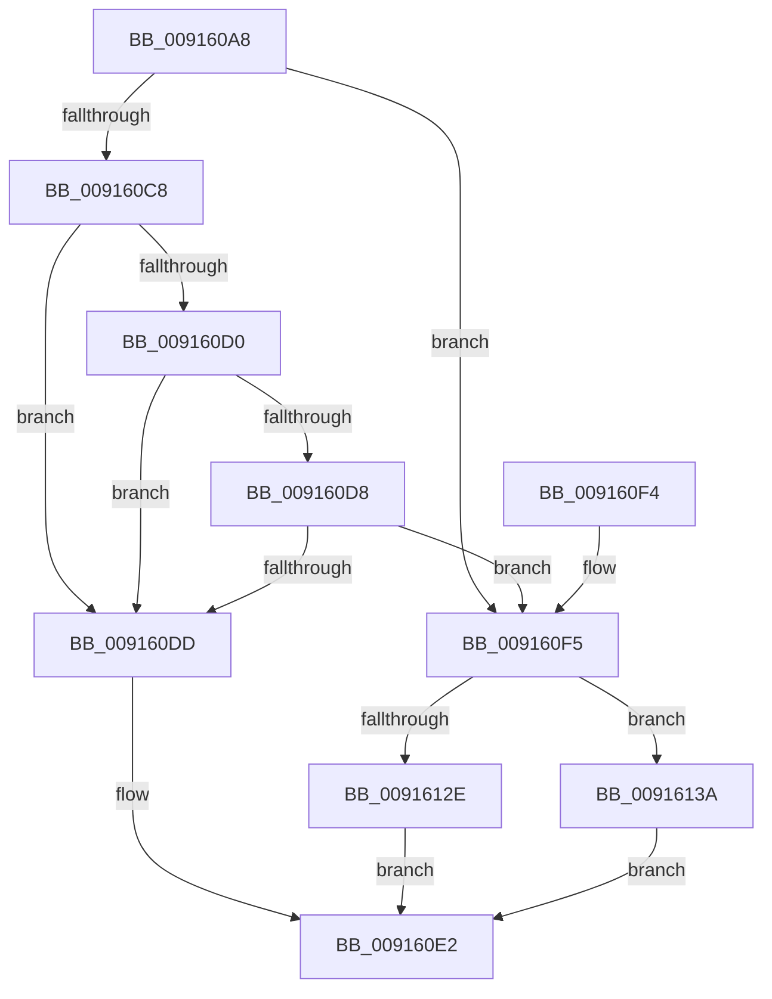

# PpmInfoApplySettingUpdate

- RVA: `0x009160A8`–`0x0091614D` (길이 `165` bytes)
- VA: `0x00000001409160A8`
- 실행 섹션: `PAGE`
- PDB 이름 있음: `예`; PDB Function 태그: `아니요`
- unwind 정보 RVA: `0x0008A760`
- 디코드: `43`개 명령, `165/165` bytes 표시
- 미해석 바이트: `0` (있으면 어셈블리에 `.byte`로 보존)

> 이 문서는 커널 이미지의 기계어와 PDB 기호를 분석해 생성했습니다. 4번과 5번은 함수 원형과 자료형을 바이너리 사용 방식에서 추정한 C 해석이며 원본 소스 복구 결과는 아닙니다.

## 1. Dependencies

- 직접 호출 지점: **6**; 고유 호출 대상: **6**
- 직접 호출자로 확인된 함수: **1**
- RIP 상대 이미지 참조: **4**

### Outgoing calls
- `0x009160DD` → [PpmInfoReleaseLocks](PpmInfoReleaseLocks_function_00916154.md) (function, `0x00916154`)
- `0x009160EA` → [_security_check_cookie](../../text/6A/_security_check_cookie_function_006AC640.md) (function, `0x006AC640`)
- `0x00916122` → [PpmGetPolicyAction](../A8/PpmGetPolicyAction_function_00A87C44.md) (function, `0x00A87C44`)
- `0x00916133` → [PpmReapplyPerfPolicy](../A5/PpmReapplyPerfPolicy_function_00A53148.md) (function, `0x00A53148`)
- `0x0091613A` → [PpmReapplyIdlePolicy](../AA/PpmReapplyIdlePolicy_function_00AAFA90.md) (function, `0x00AAFA90`)
- `0x00916146` → [PopReleaseRwLock](../../text/2D/PopReleaseRwLock_function_002DFBBC.md) (function, `0x002DFBBC`)

### Direct callers
- [PpmSetProfilePolicySetting](PpmSetProfilePolicySetting_function_00915A44.md) at `0x00915C1C`

### Static image references
- `0x009160AC` → RVA `0x00E0A740` (`.data`; read)
- `0x009160C8` → RVA `0x00FC6ADC` (`ALMOSTRO`; read)
- `0x009160D0` → RVA `0x00FC6B40` (`ALMOSTRO`; read)
- `0x0091613F` → RVA `0x00F0CA70` (`.data`; read)

## 2. Other-region calls and transfers

- 다른 실행 섹션으로 향하는 call: **2**
  - `0x009160EA` → [_security_check_cookie](../../text/6A/_security_check_cookie_function_006AC640.md) (`PAGE` → `.text`)
  - `0x00916146` → [PopReleaseRwLock](../../text/2D/PopReleaseRwLock_function_002DFBBC.md) (`PAGE` → `.text`)
- 별도 외부 분기/꼬리 이동을 확인하지 못했습니다.

## 3. Assembly (complete function range)

```asm
009160A8  48 83 EC 48                     sub rsp, 0x48
009160AC  48 8B 05 8D 46 4F 00            mov rax, qword ptr [rip + 0x4f468d]
009160B3  48 33 C4                        xor rax, rsp
009160B6  48 89 44 24 38                  mov qword ptr [rsp + 0x38], rax
009160BB  33 C0                           xor eax, eax
009160BD  4C 8B D9                        mov r11, rcx
009160C0  89 44 24 20                     mov dword ptr [rsp + 0x20], eax
009160C4  84 D2                           test dl, dl
009160C6  75 2D                           jne 0x1409160f5
009160C8  38 05 0E 0A 6B 00               cmp byte ptr [rip + 0x6b0a0e], al
009160CE  74 0D                           je 0x1409160dd
009160D0  39 05 6A 0A 6B 00               cmp dword ptr [rip + 0x6b0a6a], eax
009160D6  74 05                           je 0x1409160dd
009160D8  45 84 C0                        test r8b, r8b
009160DB  75 18                           jne 0x1409160f5
009160DD  E8 72 00 00 00                  call 0x140916154
009160E2  48 8B 4C 24 38                  mov rcx, qword ptr [rsp + 0x38]
009160E7  48 33 CC                        xor rcx, rsp
009160EA  E8 51 65 D9 FF                  call 0x1406ac640
009160EF  48 83 C4 48                     add rsp, 0x48
009160F3  C3                              ret
009160F4  CC                              int3
009160F5  0F B6 51 24                     movzx edx, byte ptr [rcx + 0x24]
009160F9  0F 57 C0                        xorps xmm0, xmm0
009160FC  8B CA                           mov ecx, edx
009160FE  83 E2 3F                        and edx, 0x3f
00916101  48 C1 E9 06                     shr rcx, 6
00916105  0F 11 44 24 28                  movups xmmword ptr [rsp + 0x28], xmm0
0091610A  48 8B 44 CC 28                  mov rax, qword ptr [rsp + rcx*8 + 0x28]
0091610F  48 0F AB D0                     bts rax, rdx
00916113  48 89 44 CC 28                  mov qword ptr [rsp + rcx*8 + 0x28], rax
00916118  48 8D 54 24 20                  lea rdx, [rsp + 0x20]
0091611D  48 8D 4C 24 28                  lea rcx, [rsp + 0x28]
00916122  E8 1D 1B 17 00                  call 0x140a87c44
00916127  41 F6 43 25 01                  test byte ptr [r11 + 0x25], 1
0091612C  74 0C                           je 0x14091613a
0091612E  48 8D 4C 24 20                  lea rcx, [rsp + 0x20]
00916133  E8 10 D0 13 00                  call 0x140a53148
00916138  EB A8                           jmp 0x1409160e2
0091613A  E8 51 99 19 00                  call 0x140aafa90
0091613F  48 8D 0D 2A 69 5F 00            lea rcx, [rip + 0x5f692a]
00916146  E8 71 9A 9C FF                  call 0x1402dfbbc
0091614B  EB 95                           jmp 0x1409160e2
```

## 4. C-style interpretation (structured pseudocode)

```c
__int64 __fastcall PpmInfoApplySettingUpdate(__int64 a1, unsigned __int8 a2, unsigned __int8 a3)
{
    __int64 result;
    __int64 v_rsp;
    unsigned __int64 v_stack_m10;
    unsigned int v_stack_m28;
    unsigned __int64 v_stack_p20;
    unsigned __int64 v_stack_p28;

    v_rsp = (v_rsp) - (72);
    result = (*(unsigned __int64 *)(v_rip + 5195405)) ^ (v_rsp);
    v_stack_m10 = result;
    result = 0;
    v_stack_m28 = 0;
    if (a2 != 0) goto loc_009160F5;
    if ((*(unsigned __int8 *)(v_rip + 7014926)) == 0) goto loc_009160DD;
    if ((*(unsigned int *)(v_rip + 7015018)) == 0) goto loc_009160DD;
    if (a3 != 0) goto loc_009160F5;
loc_009160DD:
    result = PpmInfoReleaseLocks(a1, a2, a3, a4);
loc_009160E2:
    a1 = (v_stack_m10) ^ (v_rsp);
    result = _security_check_cookie(a1, a2, a3, a4);
    v_rsp = (v_rsp) + (72);
    return result;
loc_009160F5:
    a2 = (unsigned int)((*(unsigned __int8 *)(a1 + 36)) & (63));
    a1 = ((unsigned int)((unsigned int)(*(unsigned __int8 *)(a1 + 36)))) >> (6);
    v_stack_p28 = v_xmm0;
    *(unsigned __int64 *)(v_rsp + a1 * 8 + 40) = *(unsigned __int64 *)(v_rsp + a1 * 8 + 40);
    result = PpmGetPolicyAction(v_stack_p28, v_stack_p20, a3, a4);
    if (((*(unsigned __int8 *)(a1 + 37)) & (1)) == 0) goto loc_0091613A;
    result = PpmReapplyPerfPolicy(v_stack_p20, v_stack_p20, a3, a4);
    goto loc_009160E2;
loc_0091613A:
    result = PpmReapplyIdlePolicy(v_stack_p20, v_stack_p20, a3, a4);
    result = PopReleaseRwLock(v_rip + 6252842, v_stack_p20, a3, a4);
    goto loc_009160E2;
}
```

## 5. (Beta) C Style

```c
int64_t PpmInfoApplySettingUpdate(void *Arg1, uint8_t Arg2, uint8_t Arg3)
{
    uint8_t *arg1 = (uint8_t *)Arg1;

    int64_t result;
    int64_t local_rsp;
    uint64_t v_stack_m10;
    uint32_t v_stack_m28;
    uint64_t v_stack_p20;
    uint64_t v_stack_p28;

    local_rsp = (local_rsp) - (72);
    result = (*(uint64_t *)(v_rip + 0x4F468D)) ^ (local_rsp);
    v_stack_m10 = result;
    result = 0;
    v_stack_m28 = 0;
    if (Arg2 != 0) goto loc_009160F5;
    if ((*(uint8_t *)(v_rip + 0x6B0A0E)) == 0) goto loc_009160DD;
    if ((*(uint32_t *)(v_rip + 0x6B0A6A)) == 0) goto loc_009160DD;
    if (Arg3 != 0) goto loc_009160F5;
loc_009160DD:
    result = PpmInfoReleaseLocks(Arg1, Arg2, Arg3, a4);
loc_009160E2:
    Arg1 = (v_stack_m10) ^ (local_rsp);
    result = _security_check_cookie(Arg1, Arg2, Arg3, a4);
    local_rsp = (local_rsp) + (72);
    return result;
loc_009160F5:
    Arg2 = (uint32_t)((*(uint8_t *)(arg1 + 0x24)) & (63));
    Arg1 = ((uint32_t)((uint32_t)(*(uint8_t *)(arg1 + 0x24)))) >> (6);
    v_stack_p28 = v_xmm0;
    *(uint64_t *)(local_rsp + arg1 * 8 + 0x28) = *(uint64_t *)(local_rsp + arg1 * 8 + 0x28);
    result = PpmGetPolicyAction(v_stack_p28, v_stack_p20, Arg3, a4);
    if (((*(uint8_t *)(arg1 + 0x25)) & (1)) == 0) goto loc_0091613A;
    result = PpmReapplyPerfPolicy(v_stack_p20, v_stack_p20, Arg3, a4);
    goto loc_009160E2;
loc_0091613A:
    result = PpmReapplyIdlePolicy(v_stack_p20, v_stack_p20, Arg3, a4);
    result = PopReleaseRwLock(v_rip + 6252842, v_stack_p20, Arg3, a4);
    goto loc_009160E2;
}
```

### 관측된 메모리 오프셋

구조체 형식이 확인되지 않은 접근은 인자 기준의 오프셋으로만 기록했습니다.

| 기준 인자 | 오프셋 표현 | 폭 (bit) | 접근 |
|---|---:|---:|---|
| `Arg1` | `+ 0x24` | `8` | `R` |

## 6. Execution-region graph

[열기: 2D/3D 그래프와 함수 탐색 컨트롤 패널](../../../control-panel.html?section=page&rva=0x009160A8&view=graph)

- 2D 그래프는 위에서 아래로 흐르고, 3D 그래프는 빈 공간을 드래그해 회전합니다. Shift+드래그는 이동, 휠은 확대·축소, 함수 노드 선택은 대상 보고서 이동입니다.

### Static fallback


