# PpmSetProfilePolicySetting

- RVA: `0x00915A44`–`0x00915F73` (길이 `1,327` bytes)
- VA: `0x0000000140915A44`
- 실행 섹션: `PAGE`
- PDB 이름 있음: `예`; PDB Function 태그: `예`
- unwind 정보 RVA: `0x0008A724`
- 디코드: `322`개 명령, `1,327/1,327` bytes 표시
- 미해석 바이트: `0` (있으면 어셈블리에 `.byte`로 보존)

> 이 문서는 커널 이미지의 기계어와 PDB 기호를 분석해 생성했습니다. 4번과 5번은 함수 원형과 자료형을 바이너리 사용 방식에서 추정한 C 해석이며 원본 소스 복구 결과는 아닙니다.

## 1. Dependencies

- 직접 호출 지점: **10**; 고유 호출 대상: **7**
- 직접 호출자로 확인된 함수: **1**
- RIP 상대 이미지 참조: **14**

### Outgoing calls
- `0x00915B2B` → [PpmAcquireLock](../../text/2D/PpmAcquireLock_function_002D9AA4.md) (function, `0x002D9AA4`)
- `0x00915BC6` → [PpmInfoAdjustSetting](../A4/PpmInfoAdjustSetting_function_00A432A8.md) (function, `0x00A432A8`)
- `0x00915C1C` → [PpmInfoApplySettingUpdate](PpmInfoApplySettingUpdate_function_009160A8.md) (function, `0x009160A8`)
- `0x00915C46` → [_security_check_cookie](../../text/6A/_security_check_cookie_function_006AC640.md) (function, `0x006AC640`)
- `0x00915D34` → [PpmInfoAdjustSetting](../A4/PpmInfoAdjustSetting_function_00A432A8.md) (function, `0x00A432A8`)
- `0x00915D8F` → [PpmEventTraceProfileSetting](../A6/PpmEventTraceProfileSetting_function_00A6E1FC.md) (function, `0x00A6E1FC`)
- `0x00915E1C` → [PopAcquireRwLockExclusive](../../text/43/PopAcquireRwLockExclusive_function_00430B44.md) (function, `0x00430B44`)
- `0x00915E5E` → [PpmEventTraceProfileSetting](../A6/PpmEventTraceProfileSetting_function_00A6E1FC.md) (function, `0x00A6E1FC`)
- `0x00915EFF` → [PpmInfoAdjustSetting](../A4/PpmInfoAdjustSetting_function_00A432A8.md) (function, `0x00A432A8`)
- `0x00915F30` → [PpmInfoReleaseLocks](PpmInfoReleaseLocks_function_00916154.md) (function, `0x00916154`)

### Direct callers
- [PopSetNewPolicyValue](PopSetNewPolicyValue_function_00914C6C.md) at `0x00914D01`

### Static image references
- `0x00915A63` → RVA `0x00E0A740` (`.data`; read)
- `0x00915AB9` → RVA `0x00FC5F58` (`ALMOSTRO`; read)
- `0x00915B24` → RVA `0x00F0CC00` (`.data`; read)
- `0x00915B30` → RVA `0x00E08380` (`.data`; read)
- `0x00915B3C` → RVA `0x00F0CE0C` (`.data`; read)
- `0x00915B4A` → RVA `0x000112D0` (`.rdata`; read)
- `0x00915B58` → RVA `0x000112D8` (`.rdata`; read)
- `0x00915B6F` → RVA `0x00F077C0` (`.data`; read)
- `0x00915C80` → RVA `0x00F07BE8` (`.data`; read)
- `0x00915CA2` → RVA `0x00F07BE0` (`.data`; read)
- `0x00915DF3` → RVA `0x00011B28` (`.rdata`; read)
- `0x00915E00` → RVA `0x00011B30` (`.rdata`; read)
- `0x00915E15` → RVA `0x00F0CA70` (`.data`; read)
- `0x00915E46` → RVA `0x00F077C8` (`.data`; read)

## 2. Other-region calls and transfers

- 다른 실행 섹션으로 향하는 call: **3**
  - `0x00915B2B` → [PpmAcquireLock](../../text/2D/PpmAcquireLock_function_002D9AA4.md) (`PAGE` → `.text`)
  - `0x00915C46` → [_security_check_cookie](../../text/6A/_security_check_cookie_function_006AC640.md) (`PAGE` → `.text`)
  - `0x00915E1C` → [PopAcquireRwLockExclusive](../../text/43/PopAcquireRwLockExclusive_function_00430B44.md) (`PAGE` → `.text`)
- call이 아닌 외부 분기/꼬리 이동: **3**
  - `0x00915DA6` → [sub_00B219C6 + 0xE](../B2/Unknown_function_00B219C6.md) (`tail-transfer`)
  - `0x00915DB5` → [sub_00B219C6 + 0xE](../B2/Unknown_function_00B219C6.md) (`tail-transfer`)
  - `0x00915F56` → [sub_00B219C6](../B2/Unknown_function_00B219C6.md) (`tail-transfer`)

## 3. Assembly (complete function range)

```asm
00915A44  48 89 5C 24 08                  mov qword ptr [rsp + 8], rbx
00915A49  48 89 6C 24 10                  mov qword ptr [rsp + 0x10], rbp
00915A4E  48 89 74 24 20                  mov qword ptr [rsp + 0x20], rsi
00915A53  57                              push rdi
00915A54  41 54                           push r12
00915A56  41 55                           push r13
00915A58  41 56                           push r14
00915A5A  41 57                           push r15
00915A5C  48 81 EC 90 00 00 00            sub rsp, 0x90
00915A63  48 8B 05 D6 4C 4F 00            mov rax, qword ptr [rip + 0x4f4cd6]
00915A6A  48 33 C4                        xor rax, rsp
00915A6D  48 89 84 24 88 00 00 00         mov qword ptr [rsp + 0x88], rax
00915A75  33 DB                           xor ebx, ebx
00915A77  4D 63 F8                        movsxd r15, r8d
00915A7A  40 8A FB                        mov dil, bl
00915A7D  49 8B C1                        mov rax, r9
00915A80  4C 8B D2                        mov r10, rdx
00915A83  89 7C 24 44                     mov dword ptr [rsp + 0x44], edi
00915A87  4C 8B E1                        mov r12, rcx
00915A8A  48 89 44 24 58                  mov qword ptr [rsp + 0x58], rax
00915A8F  88 5C 24 40                     mov byte ptr [rsp + 0x40], bl
00915A93  88 5C 24 48                     mov byte ptr [rsp + 0x48], bl
00915A97  39 9C 24 E0 00 00 00            cmp dword ptr [rsp + 0xe0], ebx
00915A9E  0F 84 8A 03 00 00               je 0x140915e2e
00915AA4  48 85 C0                        test rax, rax
00915AA7  0F 84 81 03 00 00               je 0x140915e2e
00915AAD  45 85 C0                        test r8d, r8d
00915AB0  0F 84 3A 03 00 00               je 0x140915df0
00915AB6  44 8B C3                        mov r8d, ebx
00915AB9  4C 8D 2D 98 04 6B 00            lea r13, [rip + 0x6b0498]
00915AC0  41 BB 01 00 00 00               mov r11d, 1
00915AC6  41 8A 45 1D                     mov al, byte ptr [r13 + 0x1d]
00915ACA  49 8D 75 F8                     lea rsi, [r13 - 8]
00915ACE  24 04                           and al, 4
00915AD0  8B EB                           mov ebp, ebx
00915AD2  F6 D8                           neg al
00915AD4  49 8B 45 00                     mov rax, qword ptr [r13]
00915AD8  1B D2                           sbb edx, edx
00915ADA  F7 DA                           neg edx
00915ADC  41 03 D3                        add edx, r11d
00915ADF  0F 10 00                        movups xmm0, xmmword ptr [rax]
00915AE2  F3 0F 7F 44 24 78               movdqu xmmword ptr [rsp + 0x78], xmm0
00915AE8  44 8A 8C 24 87 00 00 00         mov r9b, byte ptr [rsp + 0x87]
00915AF0  3B EA                           cmp ebp, edx
00915AF2  0F 83 2B 01 00 00               jae 0x140915c23
00915AF8  48 8B 4C 24 78                  mov rcx, qword ptr [rsp + 0x78]
00915AFD  49 2B 0A                        sub rcx, qword ptr [r10]
00915B00  75 0C                           jne 0x140915b0e
00915B02  48 8B 8C 24 80 00 00 00         mov rcx, qword ptr [rsp + 0x80]
00915B0A  49 2B 4A 08                     sub rcx, qword ptr [r10 + 8]
00915B0E  48 85 C9                        test rcx, rcx
00915B11  0F 85 56 01 00 00               jne 0x140915c6d
00915B17  44 8B F5                        mov r14d, ebp
00915B1A  44 84 5E 25                     test byte ptr [rsi + 0x25], r11b
00915B1E  0F 84 F1 02 00 00               je 0x140915e15
00915B24  48 8D 0D D5 70 5F 00            lea rcx, [rip + 0x5f70d5]
00915B2B  E8 74 3F 9C FF                  call 0x1402d9aa4
00915B30  48 8B 05 49 28 4F 00            mov rax, qword ptr [rip + 0x4f2849]
00915B37  48 89 44 24 60                  mov qword ptr [rsp + 0x60], rax
00915B3C  8B 05 CA 72 5F 00               mov eax, dword ptr [rip + 0x5f72ca]
00915B42  89 44 24 4C                     mov dword ptr [rsp + 0x4c], eax
00915B46  49 8B 04 24                     mov rax, qword ptr [r12]
00915B4A  48 2B 05 7F B7 6F FF            sub rax, qword ptr [rip - 0x904881]
00915B51  75 0C                           jne 0x140915b5f
00915B53  49 8B 44 24 08                  mov rax, qword ptr [r12 + 8]
00915B58  48 2B 05 79 B7 6F FF            sub rax, qword ptr [rip - 0x904887]
00915B5F  48 85 C0                        test rax, rax
00915B62  0F 85 18 01 00 00               jne 0x140915c80
00915B68  49 69 C7 E8 01 00 00            imul rax, r15, 0x1e8
00915B6F  4C 8D 15 4A 1C 5F 00            lea r10, [rip + 0x5f1c4a]
00915B76  4C 89 7C 24 78                  mov qword ptr [rsp + 0x78], r15
00915B7B  49 83 C2 28                     add r10, 0x28
00915B7F  48 89 44 24 68                  mov qword ptr [rsp + 0x68], rax
00915B84  4C 03 D0                        add r10, rax
00915B87  8B 46 20                        mov eax, dword ptr [rsi + 0x20]
00915B8A  89 44 24 50                     mov dword ptr [rsp + 0x50], eax
00915B8E  0F AF C5                        imul eax, ebp
00915B91  44 8B E0                        mov r12d, eax
00915B94  4C 03 66 18                     add r12, qword ptr [rsi + 0x18]
00915B98  4D 03 E2                        add r12, r10
00915B9B  F6 46 25 04                     test byte ptr [rsi + 0x25], 4
00915B9F  0F 85 15 02 00 00               jne 0x140915dba
00915BA5  8B 84 24 E0 00 00 00            mov eax, dword ptr [rsp + 0xe0]
00915BAC  45 8B CE                        mov r9d, r14d
00915BAF  89 44 24 28                     mov dword ptr [rsp + 0x28], eax
00915BB3  44 8B C5                        mov r8d, ebp
00915BB6  48 8B 44 24 58                  mov rax, qword ptr [rsp + 0x58]
00915BBB  49 8B D2                        mov rdx, r10
00915BBE  48 8B CE                        mov rcx, rsi
00915BC1  48 89 44 24 20                  mov qword ptr [rsp + 0x20], rax
00915BC6  E8 DD D6 12 00                  call 0x140a432a8
00915BCB  0F B6 56 24                     movzx edx, byte ptr [rsi + 0x24]
00915BCF  4C 8D 15 EA 1B 5F 00            lea r10, [rip + 0x5f1bea]
00915BD6  4C 8B 44 24 68                  mov r8, qword ptr [rsp + 0x68]
00915BDB  44 8A C8                        mov r9b, al
00915BDE  4D 03 C2                        add r8, r10
00915BE1  8B C5                           mov eax, ebp
00915BE3  48 03 C0                        add rax, rax
00915BE6  8B CA                           mov ecx, edx
00915BE8  48 C1 E9 06                     shr rcx, 6
00915BEC  83 E2 3F                        and edx, 0x3f
00915BEF  48 03 C8                        add rcx, rax
00915BF2  48 89 44 24 70                  mov qword ptr [rsp + 0x70], rax
00915BF7  49 8B 44 C8 28                  mov rax, qword ptr [r8 + rcx*8 + 0x28]
00915BFC  48 0F AB D0                     bts rax, rdx
00915C00  49 89 44 C8 28                  mov qword ptr [r8 + rcx*8 + 0x28], rax
00915C05  45 84 C9                        test r9b, r9b
00915C08  0F 85 2A 02 00 00               jne 0x140915e38
00915C0E  8B 44 24 44                     mov eax, dword ptr [rsp + 0x44]
00915C12  44 8B 44 24 48                  mov r8d, dword ptr [rsp + 0x48]
00915C17  8A D0                           mov dl, al
00915C19  48 8B CE                        mov rcx, rsi
00915C1C  E8 87 04 00 00                  call 0x1409160a8
00915C21  EB 16                           jmp 0x140915c39
00915C23  45 03 C3                        add r8d, r11d
00915C26  49 83 C5 28                     add r13, 0x28
00915C2A  41 83 F8 46                     cmp r8d, 0x46
00915C2E  0F 82 92 FE FF FF               jb 0x140915ac6
00915C34  BB 25 02 00 C0                  mov ebx, 0xc0000225
00915C39  8B C3                           mov eax, ebx
00915C3B  48 8B 8C 24 88 00 00 00         mov rcx, qword ptr [rsp + 0x88]
00915C43  48 33 CC                        xor rcx, rsp
00915C46  E8 F5 69 D9 FF                  call 0x1406ac640
00915C4B  4C 8D 9C 24 90 00 00 00         lea r11, [rsp + 0x90]
00915C53  49 8B 5B 30                     mov rbx, qword ptr [r11 + 0x30]
00915C57  49 8B 6B 38                     mov rbp, qword ptr [r11 + 0x38]
00915C5B  49 8B 73 48                     mov rsi, qword ptr [r11 + 0x48]
00915C5F  49 8B E3                        mov rsp, r11
00915C62  41 5F                           pop r15
00915C64  41 5E                           pop r14
00915C66  41 5D                           pop r13
00915C68  41 5C                           pop r12
00915C6A  5F                              pop rdi
00915C6B  C3                              ret
00915C6C  CC                              int3
00915C6D  41 03 EB                        add ebp, r11d
00915C70  45 02 CB                        add r9b, r11b
00915C73  44 88 8C 24 87 00 00 00         mov byte ptr [rsp + 0x87], r9b
00915C7B  E9 70 FE FF FF                  jmp 0x140915af0
00915C80  44 0F B6 05 60 1F 5F 00         movzx r8d, byte ptr [rip + 0x5f1f60]
00915C88  8B D3                           mov edx, ebx
00915C8A  41 B9 01 00 00 00               mov r9d, 1
00915C90  41 3B D0                        cmp edx, r8d
00915C93  0F 83 94 02 00 00               jae 0x140915f2d
00915C99  8B C2                           mov eax, edx
00915C9B  48 69 F8 20 04 00 00            imul rdi, rax, 0x420
00915CA2  48 03 3D 37 1F 5F 00            add rdi, qword ptr [rip + 0x5f1f37]
00915CA9  48 8B 4F 0C                     mov rcx, qword ptr [rdi + 0xc]
00915CAD  49 2B 0C 24                     sub rcx, qword ptr [r12]
00915CB1  75 09                           jne 0x140915cbc
00915CB3  48 8B 4F 14                     mov rcx, qword ptr [rdi + 0x14]
00915CB7  49 2B 4C 24 08                  sub rcx, qword ptr [r12 + 8]
00915CBC  48 85 C9                        test rcx, rcx
00915CBF  0F 85 61 01 00 00               jne 0x140915e26
00915CC5  8B 46 20                        mov eax, dword ptr [rsi + 0x20]
00915CC8  4D 69 D7 E8 01 00 00            imul r10, r15, 0x1e8
00915CCF  89 44 24 50                     mov dword ptr [rsp + 0x50], eax
00915CD3  0F AF C5                        imul eax, ebp
00915CD6  49 83 C2 28                     add r10, 0x28
00915CDA  4C 03 D7                        add r10, rdi
00915CDD  4C 89 54 24 78                  mov qword ptr [rsp + 0x78], r10
00915CE2  44 8B E0                        mov r12d, eax
00915CE5  4C 03 66 18                     add r12, qword ptr [rsi + 0x18]
00915CE9  4D 03 E2                        add r12, r10
00915CEC  F6 46 25 04                     test byte ptr [rsi + 0x25], 4
00915CF0  74 21                           je 0x140915d13
00915CF2  85 ED                           test ebp, ebp
00915CF4  75 1D                           jne 0x140915d13
00915CF6  0F B6 56 24                     movzx edx, byte ptr [rsi + 0x24]
00915CFA  8B C2                           mov eax, edx
00915CFC  48 C1 EA 06                     shr rdx, 6
00915D00  83 E0 3F                        and eax, 0x3f
00915D03  0F B6 C8                        movzx ecx, al
00915D06  49 8B 44 D2 10                  mov rax, qword ptr [r10 + rdx*8 + 0x10]
00915D0B  48 0F A3 C8                     bt rax, rcx
00915D0F  45 0F 43 F1                     cmovae r14d, r9d
00915D13  8B 84 24 E0 00 00 00            mov eax, dword ptr [rsp + 0xe0]
00915D1A  45 8B CE                        mov r9d, r14d
00915D1D  89 44 24 28                     mov dword ptr [rsp + 0x28], eax
00915D21  44 8B C5                        mov r8d, ebp
00915D24  48 8B 44 24 58                  mov rax, qword ptr [rsp + 0x58]
00915D29  49 8B D2                        mov rdx, r10
00915D2C  48 8B CE                        mov rcx, rsi
00915D2F  48 89 44 24 20                  mov qword ptr [rsp + 0x20], rax
00915D34  E8 6F D5 12 00                  call 0x140a432a8
00915D39  44 0F B6 46 24                  movzx r8d, byte ptr [rsi + 0x24]
00915D3E  44 8A D0                        mov r10b, al
00915D41  41 8B C8                        mov ecx, r8d
00915D44  8B C5                           mov eax, ebp
00915D46  48 C1 E9 06                     shr rcx, 6
00915D4A  41 83 E0 3F                     and r8d, 0x3f
00915D4E  48 8D 14 41                     lea rdx, [rcx + rax*2]
00915D52  48 8B 4C 24 78                  mov rcx, qword ptr [rsp + 0x78]
00915D57  48 8B 04 D1                     mov rax, qword ptr [rcx + rdx*8]
00915D5B  4C 0F AB C0                     bts rax, r8
00915D5F  48 89 04 D1                     mov qword ptr [rcx + rdx*8], rax
00915D63  45 84 D2                        test r10b, r10b
00915D66  0F 84 A2 FE FF FF               je 0x140915c0e
00915D6C  8B 44 24 50                     mov eax, dword ptr [rsp + 0x50]
00915D70  44 8A CD                        mov r9b, bpl
00915D73  4D 8B 45 00                     mov r8, qword ptr [r13]
00915D77  48 8B 16                        mov rdx, qword ptr [rsi]
00915D7A  8A 4F 08                        mov cl, byte ptr [rdi + 8]
00915D7D  88 5C 24 38                     mov byte ptr [rsp + 0x38], bl
00915D81  44 89 7C 24 30                  mov dword ptr [rsp + 0x30], r15d
00915D86  89 44 24 28                     mov dword ptr [rsp + 0x28], eax
00915D8A  4C 89 64 24 20                  mov qword ptr [rsp + 0x20], r12
00915D8F  E8 68 84 15 00                  call 0x140a6e1fc
00915D94  BA 01 00 00 00                  mov edx, 1
00915D99  8B 44 24 44                     mov eax, dword ptr [rsp + 0x44]
00915D9D  8B 4C 24 4C                     mov ecx, dword ptr [rsp + 0x4c]
00915DA1  48 39 7C 24 60                  cmp qword ptr [rsp + 0x60], rdi
00915DA6  0F 85 28 BC 20 00               jne 0x140b219d4
00915DAC  41 3B CF                        cmp ecx, r15d
00915DAF  0F B6 C0                        movzx eax, al
00915DB2  0F 44 C2                        cmove eax, edx
00915DB5  E9 1A BC 20 00                  jmp 0x140b219d4
00915DBA  85 ED                           test ebp, ebp
00915DBC  0F 85 E3 FD FF FF               jne 0x140915ba5
00915DC2  0F B6 56 24                     movzx edx, byte ptr [rsi + 0x24]
00915DC6  8B C2                           mov eax, edx
00915DC8  48 C1 EA 06                     shr rdx, 6
00915DCC  83 E0 3F                        and eax, 0x3f
00915DCF  0F B6 C8                        movzx ecx, al
00915DD2  49 8B 44 D2 10                  mov rax, qword ptr [r10 + rdx*8 + 0x10]
00915DD7  48 0F A3 C8                     bt rax, rcx
00915DDB  0F 82 C4 FD FF FF               jb 0x140915ba5
00915DE1  8D 45 01                        lea eax, [rbp + 1]
00915DE4  88 44 24 40                     mov byte ptr [rsp + 0x40], al
00915DE8  44 8B F0                        mov r14d, eax
00915DEB  E9 B5 FD FF FF                  jmp 0x140915ba5
00915DF0  48 8B 01                        mov rax, qword ptr [rcx]
00915DF3  48 2B 05 2E BD 6F FF            sub rax, qword ptr [rip - 0x9042d2]
00915DFA  75 0B                           jne 0x140915e07
00915DFC  48 8B 41 08                     mov rax, qword ptr [rcx + 8]
00915E00  48 2B 05 29 BD 6F FF            sub rax, qword ptr [rip - 0x9042d7]
00915E07  48 85 C0                        test rax, rax
00915E0A  0F 84 29 FE FF FF               je 0x140915c39
00915E10  E9 A1 FC FF FF                  jmp 0x140915ab6
00915E15  48 8D 0D 54 6C 5F 00            lea rcx, [rip + 0x5f6c54]
00915E1C  E8 23 AD B1 FF                  call 0x140430b44
00915E21  E9 0A FD FF FF                  jmp 0x140915b30
00915E26  41 03 D1                        add edx, r9d
00915E29  E9 62 FE FF FF                  jmp 0x140915c90
00915E2E  BB 0D 00 00 C0                  mov ebx, 0xc000000d
00915E33  E9 01 FE FF FF                  jmp 0x140915c39
00915E38  8B 44 24 50                     mov eax, dword ptr [rsp + 0x50]
00915E3C  44 8A CD                        mov r9b, bpl
00915E3F  4D 8B 45 00                     mov r8, qword ptr [r13]
00915E43  48 8B 16                        mov rdx, qword ptr [rsi]
00915E46  8A 0D 7C 19 5F 00               mov cl, byte ptr [rip + 0x5f197c]
00915E4C  88 5C 24 38                     mov byte ptr [rsp + 0x38], bl
00915E50  44 89 7C 24 30                  mov dword ptr [rsp + 0x30], r15d
00915E55  89 44 24 28                     mov dword ptr [rsp + 0x28], eax
00915E59  4C 89 64 24 20                  mov qword ptr [rsp + 0x20], r12
00915E5E  E8 99 83 15 00                  call 0x140a6e1fc
00915E63  8B 4C 24 4C                     mov ecx, dword ptr [rsp + 0x4c]
00915E67  48 8D 05 52 19 5F 00            lea rax, [rip + 0x5f1952]
00915E6E  41 B9 01 00 00 00               mov r9d, 1
00915E74  48 39 44 24 60                  cmp qword ptr [rsp + 0x60], rax
00915E79  0F 84 BB 00 00 00               je 0x140915f3a
00915E7F  38 1D 63 1D 5F 00               cmp byte ptr [rip + 0x5f1d63], bl
00915E85  44 8B FB                        mov r15d, ebx
00915E88  0F 84 80 FD FF FF               je 0x140915c0e
00915E8E  4C 63 E9                        movsxd r13, ecx
00915E91  0F B6 4E 24                     movzx ecx, byte ptr [rsi + 0x24]
00915E95  4D 8B C1                        mov r8, r9
00915E98  4C 8B 54 24 68                  mov r10, qword ptr [rsp + 0x68]
00915E9D  8B D1                           mov edx, ecx
00915E9F  41 8B C7                        mov eax, r15d
00915EA2  83 E1 3F                        and ecx, 0x3f
00915EA5  4C 69 E0 20 04 00 00            imul r12, rax, 0x420
00915EAC  48 8B 44 24 70                  mov rax, qword ptr [rsp + 0x70]
00915EB1  4C 03 25 28 1D 5F 00            add r12, qword ptr [rip + 0x5f1d28]
00915EB8  48 C1 EA 06                     shr rdx, 6
00915EBC  4D 03 D4                        add r10, r12
00915EBF  48 03 C2                        add rax, rdx
00915EC2  49 D3 E0                        shl r8, cl
00915EC5  4D 85 44 C2 28                  test qword ptr [r10 + rax*8 + 0x28], r8
00915ECA  75 45                           jne 0x140915f11
00915ECC  85 ED                           test ebp, ebp
00915ECE  74 07                           je 0x140915ed7
00915ED0  4D 85 44 D2 28                  test qword ptr [r10 + rdx*8 + 0x28], r8
00915ED5  75 3A                           jne 0x140915f11
00915ED7  F6 46 25 04                     test byte ptr [rsi + 0x25], 4
00915EDB  75 71                           jne 0x140915f4e
00915EDD  8B 84 24 E0 00 00 00            mov eax, dword ptr [rsp + 0xe0]
00915EE4  49 8D 52 28                     lea rdx, [r10 + 0x28]
00915EE8  89 44 24 28                     mov dword ptr [rsp + 0x28], eax
00915EEC  45 8B CE                        mov r9d, r14d
00915EEF  48 8B 44 24 58                  mov rax, qword ptr [rsp + 0x58]
00915EF4  44 8B C5                        mov r8d, ebp
00915EF7  48 8B CE                        mov rcx, rsi
00915EFA  48 89 44 24 20                  mov qword ptr [rsp + 0x20], rax
00915EFF  E8 A4 D3 12 00                  call 0x140a432a8
00915F04  41 B9 01 00 00 00               mov r9d, 1
00915F0A  4C 39 64 24 60                  cmp qword ptr [rsp + 0x60], r12
00915F0F  74 53                           je 0x140915f64
00915F11  0F B6 05 D0 1C 5F 00            movzx eax, byte ptr [rip + 0x5f1cd0]
00915F18  45 03 F9                        add r15d, r9d
00915F1B  44 3B F8                        cmp r15d, eax
00915F1E  0F 82 6D FF FF FF               jb 0x140915e91
00915F24  89 7C 24 44                     mov dword ptr [rsp + 0x44], edi
00915F28  E9 E1 FC FF FF                  jmp 0x140915c0e
00915F2D  48 8B CE                        mov rcx, rsi
00915F30  E8 1F 02 00 00                  call 0x140916154
00915F35  E9 FA FC FF FF                  jmp 0x140915c34
00915F3A  41 3B CF                        cmp ecx, r15d
00915F3D  40 0F B6 FF                     movzx edi, dil
00915F41  41 0F 44 F9                     cmove edi, r9d
00915F45  89 7C 24 44                     mov dword ptr [rsp + 0x44], edi
00915F49  E9 31 FF FF FF                  jmp 0x140915e7f
00915F4E  85 ED                           test ebp, ebp
00915F50  75 8B                           jne 0x140915edd
00915F52  38 5C 24 40                     cmp byte ptr [rsp + 0x40], bl
00915F56  0F 85 6A BA 20 00               jne 0x140b219c6
00915F5C  44 8B F3                        mov r14d, ebx
00915F5F  E9 79 FF FF FF                  jmp 0x140915edd
00915F64  4C 3B 6C 24 78                  cmp r13, qword ptr [rsp + 0x78]
00915F69  40 0F B6 FF                     movzx edi, dil
00915F6D  41 0F 44 F9                     cmove edi, r9d
00915F71  EB 9E                           jmp 0x140915f11
```

## 4. C-style interpretation (structured pseudocode)

```c
__int64 __fastcall PpmSetProfilePolicySetting(__int64 a1, __int64 a2, int a3, __int64 a4, unsigned int a5)
{
    __int64 result;
    __int64 v_r10;
    __int64 v_r12;
    __int64 v_r13;
    __int64 v_r14;
    __int64 v_r15;
    __int64 v_rbp;
    __int64 v_rbx;
    __int64 v_rdi;
    __int64 v_rsp;
    unsigned __int64 v_stack_m18;
    unsigned __int64 v_stack_m20;
    unsigned __int64 v_stack_m28;
    unsigned __int64 v_stack_m30;
    unsigned __int8 v_stack_m31;
    unsigned __int64 v_stack_m38;
    unsigned __int64 v_stack_m40;
    unsigned int v_stack_m44;
    unsigned __int64 v_stack_m48;
    unsigned int v_stack_m4C;
    unsigned __int64 v_stack_m50;
    unsigned __int64 v_stack_m58;
    unsigned __int64 v_stack_m60;
    unsigned int v_stack_m68;
    unsigned int v_stack_m6C;
    unsigned __int8 v_stack_m70;
    unsigned int v_stack_m74;
    unsigned __int8 v_stack_m78;
    unsigned __int8 v_stack_m9;
    unsigned int v_stack_m90;
    unsigned __int64 v_stack_m98;
    unsigned __int64 v_stack_p10;
    unsigned __int64 v_stack_p20;
    unsigned __int64 v_stack_p8;

    v_stack_p8 = v_rbx;
    v_stack_p10 = v_rbp;
    v_stack_p20 = v_rsi;
    v_rsp = (v_rsp) - (144);
    result = (*(unsigned __int64 *)(v_rip + 5197014)) ^ (v_rsp);
    v_stack_m30 = result;
    v_rbx = 0;
    v_stack_m74 = 0;
    v_stack_m60 = a4;
    v_stack_m78 = 0;
    v_stack_m70 = 0;
    if (a5 == 0) goto loc_00915E2E;
    if (a4 == 0) goto loc_00915E2E;
    if (a3 == 0) goto loc_00915DF0;
loc_00915AB6:
loc_00915AC6:
    result = (unsigned __int8)((*(unsigned __int8 *)(v_rip + 7013528 + 29)) & (4));
    result = (unsigned __int8)(-(result));
    a2 = (unsigned int)(-(a2));
    a2 = (unsigned int)((a2) + (1));
    v_stack_m40 = v_xmm0;
loc_00915AF0:
    if (0 >= ((unsigned int)(a2))) goto loc_00915C23;
    a1 = (v_stack_m40) - (*(unsigned __int64 *)(a2));
    if (!(condition_is_not_equal)) {
        a1 = v_stack_m38;
        a1 = (a1) - (*(unsigned __int64 *)(a2 + 8));
    }
    if (a1 != 0) goto loc_00915C6D;
    if (((*(unsigned __int8 *)(v_rip + 7013528 - 8 + 37)) & (1)) == 0) goto loc_00915E15;
    result = PpmAcquireLock(v_rip + 6254805, a2, 0, v_stack_m31);
loc_00915B30:
    v_stack_m58 = *(unsigned __int64 *)(v_rip + 5187657);
    v_stack_m6C = (unsigned int)((unsigned int)(*(unsigned int *)(v_rip + 6255306)));
    result = (*(unsigned __int64 *)(a1)) - (*(unsigned __int64 *)(v_rip - 9455745));
    if (!(condition_is_not_equal)) {
        result = *(unsigned __int64 *)(a1 + 8);
        result = (result) - (*(unsigned __int64 *)(v_rip - 9455751));
    }
    if (result != 0) goto loc_00915C80;
    result = (result) * ((int)(a3));
    v_stack_m40 = (int)(a3);
    v_r10 = (v_rip + 6233162) + (40);
    v_stack_m50 = result;
    v_r10 = (v_r10) + (result);
    v_stack_m68 = (unsigned int)((unsigned int)(*(unsigned int *)(v_rip + 7013528 - 8 + 32)));
    result = (unsigned int)(((unsigned int)(*(unsigned int *)(v_rip + 7013528 - 8 + 32))) * (0));
    v_r12 = ((unsigned int)((unsigned int)(result))) + (*(unsigned __int64 *)(v_rip + 7013528 - 8 + 24));
    v_r12 = (v_r12) + (v_r10);
    if (((*(unsigned __int8 *)(v_rip + 7013528 - 8 + 37)) & (4)) != 0) goto loc_00915DBA;
loc_00915BA5:
    v_stack_m90 = (unsigned int)((unsigned int)(a5));
    v_stack_m98 = v_stack_m60;
    result = PpmInfoAdjustSetting(v_rip + 7013528 - 8, v_r10, 0, 0);
    a3 = (v_stack_m50) + (v_rip + 6233066);
    result = (0) + (0);
    a1 = ((unsigned int)((unsigned int)(*(unsigned __int8 *)(v_rip + 7013528 - 8 + 36)))) >> (6);
    a2 = (unsigned int)((*(unsigned __int8 *)(v_rip + 7013528 - 8 + 36)) & (63));
    a1 = (a1) + (result);
    v_stack_m48 = result;
    *(unsigned __int64 *)(a3 + a1 * 8 + 40) = *(unsigned __int64 *)(a3 + a1 * 8 + 40);
    if ((unsigned __int8)((unsigned __int8)(result)) != 0) goto loc_00915E38;
loc_00915C0E:
    result = PpmInfoApplySettingUpdate(v_rip + 7013528 - 8, (unsigned __int8)((unsigned int)(v_stack_m74)), (unsigned int)(v_stack_m70), (unsigned __int8)(result));
    goto loc_00915C39;
loc_00915C23:
    a3 = (unsigned int)(((unsigned int)(v_stack_m70)) + (1));
    v_r13 = (v_rip + 7013528) + (40);
    if (a3 < 70) goto loc_00915AC6;
loc_00915C34:
loc_00915C39:
    a1 = (v_stack_m30) ^ (v_rsp);
    result = _security_check_cookie(a1, (unsigned __int8)((unsigned int)(v_stack_m74)), a3, (unsigned __int8)(result));
    return result;
loc_00915C6D:
    v_rbp = (unsigned int)((*(unsigned __int64 *)(v_stack_m28 + 56)) + ((unsigned int)(v_stack_m28)));
    a4 = (unsigned __int8)(((unsigned __int8)(result)) + ((unsigned __int8)(v_stack_m28)));
    v_stack_m9 = (unsigned __int8)(a4);
    goto loc_00915AF0;
loc_00915C80:
loc_00915C90:
    if (((unsigned int)((unsigned int)((unsigned int)(*(unsigned __int64 *)(v_stack_m28 + 48))))) >= ((unsigned int)(*(unsigned __int8 *)(v_rip + 6233952)))) goto loc_00915F2D;
    v_rdi = (0) * ((unsigned int)((unsigned int)((unsigned int)((unsigned int)(*(unsigned __int64 *)(v_stack_m28 + 48))))));
    v_rdi = (v_rdi) + (*(unsigned __int64 *)(v_rip + 6233911));
    a1 = (*(unsigned __int64 *)(v_rdi + 12)) - (*(unsigned __int64 *)(v_r12));
    if (!(condition_is_not_equal)) {
        a1 = *(unsigned __int64 *)(v_rdi + 20);
        a1 = (a1) - (*(unsigned __int64 *)(v_r12 + 8));
    }
    if (a1 != 0) goto loc_00915E26;
    v_r10 = (v_rip + 6233066) * ((int)(a3));
    v_stack_m40 = (unsigned int)((unsigned int)(*(unsigned int *)(*(unsigned __int64 *)(v_stack_m28 + 72) + 32)));
    result = (unsigned int)(((unsigned int)(*(unsigned int *)(*(unsigned __int64 *)(v_stack_m28 + 72) + 32))) * ((unsigned int)(v_rbp)));
    v_r10 = (v_r10) + (40);
    v_r10 = (v_r10) + (v_rdi);
    v_stack_m18 = v_r10;
    v_r12 = ((unsigned int)((unsigned int)(result))) + (*(unsigned __int64 *)(*(unsigned __int64 *)(v_stack_m28 + 72) + 24));
    v_r12 = (v_r12) + (v_r10);
    if (((*(unsigned __int8 *)(*(unsigned __int64 *)(v_stack_m28 + 72) + 37)) & (4)) == 0) goto loc_00915D13;
    v_r14 = 0;
    if ((unsigned int)(v_rbp) == 0) {
        a2 = *(unsigned __int8 *)(*(unsigned __int64 *)(v_stack_m28 + 72) + 36);
        result = (unsigned int)(a2);
        a2 = (a2) >> (6);
        result = (unsigned int)((result) & (63));
        a1 = (unsigned __int8)(result);
        result = *(unsigned __int64 *)(v_r10 + a2 * 8 + 16);
        v_r14 = 0;
        if (condition_is_above_or_equal) { v_r14 = 1; }
    }
    v_stack_m68 = (unsigned int)((unsigned int)(a5));
    v_stack_m70 = v_stack_m38;
    result = PpmInfoAdjustSetting(*(unsigned __int64 *)(v_stack_m28 + 72), v_r10, (unsigned int)((unsigned int)(v_rbp)), (unsigned int)((unsigned int)(v_r14)));
    a1 = ((unsigned int)((unsigned int)(*(unsigned __int8 *)(*(unsigned __int64 *)(v_stack_m28 + 72) + 36)))) >> (6);
    a3 = (unsigned int)((*(unsigned __int8 *)(*(unsigned __int64 *)(v_stack_m28 + 72) + 36)) & (63));
    *(unsigned __int64 *)(v_stack_m18 + a1 + (unsigned int)((unsigned int)(v_rbp)) * 2 * 8) = *(unsigned __int64 *)(v_stack_m18 + a1 + (unsigned int)((unsigned int)(v_rbp)) * 2 * 8);
    if ((unsigned __int8)((unsigned __int8)(result)) == 0) goto loc_00915C0E;
    v_stack_m58 = (unsigned __int8)(*(unsigned __int64 *)(v_stack_m28 + 48));
    v_stack_m60 = (unsigned int)((int)(a3));
    v_stack_m68 = (unsigned int)((unsigned int)(v_stack_m40));
    v_stack_m70 = v_r12;
    result = PpmEventTraceProfileSetting(*(unsigned __int8 *)(v_rdi + 8), *(unsigned __int64 *)(*(unsigned __int64 *)(v_stack_m28 + 72)), *(unsigned __int64 *)(v_r13), (unsigned __int8)(v_rbp));
    result = (unsigned __int8)((unsigned int)(v_stack_m4C));
    if (((unsigned int)((unsigned int)(v_stack_m44))) == ((unsigned int)((int)(a3)))) { result = 1; }
loc_00915DBA:
    if ((unsigned int)(v_rbp) != 0) goto loc_00915BA5;
    a2 = (*(unsigned __int8 *)(*(unsigned __int64 *)(v_stack_m28 + 72) + 36)) >> (6);
    result = (unsigned int)(((unsigned int)((unsigned int)(*(unsigned __int8 *)(*(unsigned __int64 *)(v_stack_m28 + 72) + 36)))) & (63));
    if (condition_is_below) goto loc_00915BA5;
    v_stack_m50 = (unsigned __int8)(v_rbp + 1);
    goto loc_00915BA5;
loc_00915DF0:
    result = (*(unsigned __int64 *)((unsigned __int8)(result))) - (*(unsigned __int64 *)(v_rip - 9454290));
    if (!(condition_is_not_equal)) {
        result = *(unsigned __int64 *)((unsigned __int8)(result) + 8);
        result = (result) - (*(unsigned __int64 *)(v_rip - 9454295));
    }
    if (result == 0) goto loc_00915C39;
    goto loc_00915AB6;
loc_00915E15:
    result = PopAcquireRwLockExclusive(v_rip + 6253652, a2, *(unsigned __int64 *)(v_r13), (unsigned __int8)(v_rbp));
    goto loc_00915B30;
loc_00915E26:
    a2 = (unsigned int)((a2) + ((unsigned int)((unsigned __int8)(v_rbp))));
    goto loc_00915C90;
loc_00915E2E:
    goto loc_00915C39;
loc_00915E38:
    v_stack_m58 = (unsigned __int8)((unsigned int)(0xC000000DULL));
    v_stack_m60 = (unsigned int)((int)(a3));
    v_stack_m68 = (unsigned int)((unsigned int)(v_stack_m40));
    v_stack_m70 = v_r12;
    result = PpmEventTraceProfileSetting(*(unsigned __int8 *)(v_rip + 6232444), *(unsigned __int64 *)(*(unsigned __int64 *)(v_stack_m28 + 72)), *(unsigned __int64 *)(v_r13), (unsigned __int8)(v_rbp));
    if (v_stack_m30 == (v_rip + 6232402)) goto loc_00915F3A;
loc_00915E7F:
    if ((*(unsigned __int8 *)(v_rip + 6233443)) == ((unsigned __int8)((unsigned int)(0xC000000DULL)))) goto loc_00915C0E;
loc_00915E91:
    a1 = (unsigned int)((*(unsigned __int8 *)(*(unsigned __int64 *)(v_stack_m28 + 72) + 36)) & (63));
    v_r12 = (v_r12) * ((unsigned int)((unsigned int)((unsigned int)((unsigned int)((unsigned int)(0xC000000DULL))))));
    v_r12 = (v_r12) + (*(unsigned __int64 *)(v_rip + 6233384));
    a2 = ((unsigned int)((unsigned int)(*(unsigned __int8 *)(*(unsigned __int64 *)(v_stack_m28 + 72) + 36)))) >> (6);
    v_r10 = (v_stack_m28) + (v_r12);
    result = (v_stack_m20) + (a2);
    a3 = (1) << ((unsigned __int8)(a1));
    if (((*(unsigned __int64 *)(v_r10 + result * 8 + 40)) & (a3)) != 0) goto loc_00915F11;
    if ((unsigned int)(v_rbp) == 0) goto loc_00915ED7;
    if (((*(unsigned __int64 *)(v_r10 + a2 * 8 + 40)) & (a3)) != 0) goto loc_00915F11;
loc_00915ED7:
    if (((*(unsigned __int8 *)(*(unsigned __int64 *)(v_stack_m28 + 72) + 37)) & (4)) != 0) goto loc_00915F4E;
loc_00915EDD:
    v_stack_m68 = (unsigned int)((unsigned int)(a5));
    v_stack_m70 = v_stack_m38;
    result = PpmInfoAdjustSetting(*(unsigned __int64 *)(v_stack_m28 + 72), v_r10 + 40, (unsigned int)((unsigned int)(v_rbp)), (unsigned int)((unsigned int)((unsigned int)((unsigned int)(v_rbp + 1)))));
    if (v_stack_m30 == v_r12) goto loc_00915F64;
loc_00915F11:
    v_r15 = (unsigned int)(((unsigned int)((unsigned int)((unsigned int)(0xC000000DULL)))) + (1));
    if (((unsigned int)(v_r15)) < ((unsigned int)(*(unsigned __int8 *)(v_rip + 6233296)))) goto loc_00915E91;
    v_stack_m4C = (unsigned int)(v_rdi);
    goto loc_00915C0E;
loc_00915F2D:
    result = PpmInfoReleaseLocks(*(unsigned __int64 *)(v_stack_m28 + 72), v_r10 + 40, (unsigned int)((unsigned int)(v_rbp)), 1);
    goto loc_00915C34;
loc_00915F3A:
    v_rdi = (unsigned __int8)(v_rdi);
    if (((unsigned int)(*(unsigned __int64 *)(v_stack_m28 + 72))) == ((unsigned int)(v_r15))) { v_rdi = 1; }
    v_stack_m4C = (unsigned int)(v_rdi);
    goto loc_00915E7F;
loc_00915F4E:
    if ((unsigned int)(v_rbp) != 0) goto loc_00915EDD;
    goto loc_00915EDD;
loc_00915F64:
    v_rdi = (unsigned __int8)(v_rdi);
    if (((int)((unsigned int)((unsigned int)(v_stack_m44)))) == v_stack_m18) { v_rdi = 1; }
    goto loc_00915F11;
}
```

## 5. (Beta) C Style

```c
int64_t PpmSetProfilePolicySetting(void *Arg1, void *Arg2, int32_t Arg3, int64_t Arg4, uint32_t Arg5)
{
    uint8_t *arg1 = (uint8_t *)Arg1;
    uint8_t *arg2 = (uint8_t *)Arg2;

    int64_t result;
    int64_t local_r10;
    int64_t local_r12;
    int64_t local_r13;
    int64_t local_r14;
    int64_t local_r15;
    int64_t local_rbp;
    int64_t local_rbx;
    int64_t local_rdi;
    int64_t local_rsp;
    uint64_t v_stack_m18;
    uint64_t v_stack_m20;
    uint64_t v_stack_m28;
    uint64_t v_stack_m30;
    uint8_t v_stack_m31;
    uint64_t v_stack_m38;
    uint64_t v_stack_m40;
    uint32_t v_stack_m44;
    uint64_t v_stack_m48;
    uint32_t v_stack_m4C;
    uint64_t v_stack_m50;
    uint64_t v_stack_m58;
    uint64_t v_stack_m60;
    uint32_t v_stack_m68;
    uint32_t v_stack_m6C;
    uint8_t v_stack_m70;
    uint32_t v_stack_m74;
    uint8_t v_stack_m78;
    uint8_t v_stack_m9;
    uint32_t v_stack_m90;
    uint64_t v_stack_m98;
    uint64_t v_stack_p10;
    uint64_t v_stack_p20;
    uint64_t v_stack_p8;

    v_stack_p8 = local_rbx;
    v_stack_p10 = local_rbp;
    v_stack_p20 = local_rsi;
    local_rsp = (local_rsp) - (144);
    result = (*(uint64_t *)(v_rip + 0x4F4CD6)) ^ (local_rsp);
    v_stack_m30 = result;
    local_rbx = 0;
    v_stack_m74 = 0;
    v_stack_m60 = Arg4;
    v_stack_m78 = 0;
    v_stack_m70 = 0;
    if (Arg5 == 0) goto loc_00915E2E;
    if (Arg4 == 0) goto loc_00915E2E;
    if (Arg3 == 0) goto loc_00915DF0;
loc_00915AB6:
loc_00915AC6:
    result = (uint8_t)((*(uint8_t *)(v_rip + 0x6B0498 + 0x1D)) & (4));
    result = (uint8_t)(-(result));
    Arg2 = (uint32_t)(-(Arg2));
    Arg2 = (uint32_t)((Arg2) + (1));
    v_stack_m40 = v_xmm0;
loc_00915AF0:
    if (0 >= ((uint32_t)(Arg2))) goto loc_00915C23;
    Arg1 = (v_stack_m40) - (*(uint64_t *)(arg2));
    if (!(condition_is_not_equal)) {
        Arg1 = v_stack_m38;
        Arg1 = (Arg1) - (*(uint64_t *)(arg2 + 0x8));
    }
    if (Arg1 != NULL) goto loc_00915C6D;
    if (((*(uint8_t *)(v_rip + 0x6B0498 - 0x8 + 0x25)) & (1)) == 0) goto loc_00915E15;
    result = PpmAcquireLock(v_rip + 6254805, Arg2, 0, v_stack_m31);
loc_00915B30:
    v_stack_m58 = *(uint64_t *)(v_rip + 0x4F2849);
    v_stack_m6C = (uint32_t)((uint32_t)(*(uint32_t *)(v_rip + 0x5F72CA)));
    result = (*(uint64_t *)(arg1)) - (*(uint64_t *)(v_rip - 0x904881));
    if (!(condition_is_not_equal)) {
        result = *(uint64_t *)(arg1 + 0x8);
        result = (result) - (*(uint64_t *)(v_rip - 0x904887));
    }
    if (result != 0) goto loc_00915C80;
    result = (result) * ((int32_t)(Arg3));
    v_stack_m40 = (int32_t)(Arg3);
    local_r10 = (v_rip + 6233162) + (40);
    v_stack_m50 = result;
    local_r10 = (local_r10) + (result);
    v_stack_m68 = (uint32_t)((uint32_t)(*(uint32_t *)(v_rip + 0x6B0498 - 0x8 + 0x20)));
    result = (uint32_t)(((uint32_t)(*(uint32_t *)(v_rip + 0x6B0498 - 0x8 + 0x20))) * (0));
    local_r12 = ((uint32_t)((uint32_t)(result))) + (*(uint64_t *)(v_rip + 0x6B0498 - 0x8 + 0x18));
    local_r12 = (local_r12) + (local_r10);
    if (((*(uint8_t *)(v_rip + 0x6B0498 - 0x8 + 0x25)) & (4)) != 0) goto loc_00915DBA;
loc_00915BA5:
    v_stack_m90 = (uint32_t)((uint32_t)(Arg5));
    v_stack_m98 = v_stack_m60;
    result = PpmInfoAdjustSetting(v_rip + 7013528 - 8, local_r10, 0, 0);
    Arg3 = (v_stack_m50) + (v_rip + 6233066);
    result = (0) + (0);
    Arg1 = ((uint32_t)((uint32_t)(*(uint8_t *)(v_rip + 0x6B0498 - 0x8 + 0x24)))) >> (6);
    Arg2 = (uint32_t)((*(uint8_t *)(v_rip + 0x6B0498 - 0x8 + 0x24)) & (63));
    Arg1 = (Arg1) + (result);
    v_stack_m48 = result;
    *(uint64_t *)(Arg3 + arg1 * 8 + 0x28) = *(uint64_t *)(Arg3 + arg1 * 8 + 0x28);
    if ((uint8_t)((uint8_t)(result)) != 0) goto loc_00915E38;
loc_00915C0E:
    result = PpmInfoApplySettingUpdate(v_rip + 7013528 - 8, (uint8_t)((uint32_t)(v_stack_m74)), (uint32_t)(v_stack_m70), (uint8_t)(result));
    goto loc_00915C39;
loc_00915C23:
    Arg3 = (uint32_t)(((uint32_t)(v_stack_m70)) + (1));
    local_r13 = (v_rip + 7013528) + (40);
    if (Arg3 < 70) goto loc_00915AC6;
loc_00915C34:
loc_00915C39:
    Arg1 = (v_stack_m30) ^ (local_rsp);
    result = _security_check_cookie(Arg1, (uint8_t)((uint32_t)(v_stack_m74)), Arg3, (uint8_t)(result));
    return result;
loc_00915C6D:
    local_rbp = (uint32_t)((*(uint64_t *)(v_stack_m28 + 0x38)) + ((uint32_t)(v_stack_m28)));
    Arg4 = (uint8_t)(((uint8_t)(result)) + ((uint8_t)(v_stack_m28)));
    v_stack_m9 = (uint8_t)(Arg4);
    goto loc_00915AF0;
loc_00915C80:
loc_00915C90:
    if (((uint32_t)((uint32_t)((uint32_t)(*(uint64_t *)(v_stack_m28 + 0x30))))) >= ((uint32_t)(*(uint8_t *)(v_rip + 0x5F1F60)))) goto loc_00915F2D;
    local_rdi = (0) * ((uint32_t)((uint32_t)((uint32_t)((uint32_t)(*(uint64_t *)(v_stack_m28 + 0x30))))));
    local_rdi = (local_rdi) + (*(uint64_t *)(v_rip + 0x5F1F37));
    Arg1 = (*(uint64_t *)(local_rdi + 0xC)) - (*(uint64_t *)(local_r12));
    if (!(condition_is_not_equal)) {
        Arg1 = *(uint64_t *)(local_rdi + 0x14);
        Arg1 = (Arg1) - (*(uint64_t *)(local_r12 + 0x8));
    }
    if (Arg1 != NULL) goto loc_00915E26;
    local_r10 = (v_rip + 6233066) * ((int32_t)(Arg3));
    v_stack_m40 = (uint32_t)((uint32_t)(*(uint32_t *)(*(uint64_t *)(v_stack_m28 + 0x48) + 0x20)));
    result = (uint32_t)(((uint32_t)(*(uint32_t *)(*(uint64_t *)(v_stack_m28 + 0x48) + 0x20))) * ((uint32_t)(local_rbp)));
    local_r10 = (local_r10) + (40);
    local_r10 = (local_r10) + (local_rdi);
    v_stack_m18 = local_r10;
    local_r12 = ((uint32_t)((uint32_t)(result))) + (*(uint64_t *)(*(uint64_t *)(v_stack_m28 + 0x48) + 0x18));
    local_r12 = (local_r12) + (local_r10);
    if (((*(uint8_t *)(*(uint64_t *)(v_stack_m28 + 0x48) + 0x25)) & (4)) == 0) goto loc_00915D13;
    local_r14 = 0;
    if ((uint32_t)(local_rbp) == 0) {
        Arg2 = *(uint8_t *)(*(uint64_t *)(v_stack_m28 + 0x48) + 0x24);
        result = (uint32_t)(Arg2);
        Arg2 = (Arg2) >> (6);
        result = (uint32_t)((result) & (63));
        Arg1 = (uint8_t)(result);
        result = *(uint64_t *)(local_r10 + arg2 * 8 + 0x10);
        local_r14 = 0;
        if (condition_is_above_or_equal) { local_r14 = 1; }
    }
    v_stack_m68 = (uint32_t)((uint32_t)(Arg5));
    v_stack_m70 = v_stack_m38;
    result = PpmInfoAdjustSetting(*(uint64_t *)(v_stack_m28 + 0x48), local_r10, (uint32_t)((uint32_t)(local_rbp)), (uint32_t)((uint32_t)(local_r14)));
    Arg1 = ((uint32_t)((uint32_t)(*(uint8_t *)(*(uint64_t *)(v_stack_m28 + 0x48) + 0x24)))) >> (6);
    Arg3 = (uint32_t)((*(uint8_t *)(*(uint64_t *)(v_stack_m28 + 0x48) + 0x24)) & (63));
    *(uint64_t *)(v_stack_m18 + arg1 + (uint32_t)((uint32_t)(local_rbp)) * 2 * 8) = *(uint64_t *)(v_stack_m18 + arg1 + (uint32_t)((uint32_t)(local_rbp)) * 2 * 8);
    if ((uint8_t)((uint8_t)(result)) == 0) goto loc_00915C0E;
    v_stack_m58 = (uint8_t)(*(uint64_t *)(v_stack_m28 + 0x30));
    v_stack_m60 = (uint32_t)((int32_t)(Arg3));
    v_stack_m68 = (uint32_t)((uint32_t)(v_stack_m40));
    v_stack_m70 = local_r12;
    result = PpmEventTraceProfileSetting(*(uint8_t *)(local_rdi + 0x8), *(uint64_t *)(*(uint64_t *)(v_stack_m28 + 0x48)), *(uint64_t *)(local_r13), (uint8_t)(local_rbp));
    result = (uint8_t)((uint32_t)(v_stack_m4C));
    if (((uint32_t)((uint32_t)(v_stack_m44))) == ((uint32_t)((int32_t)(Arg3)))) { result = 1; }
loc_00915DBA:
    if ((uint32_t)(local_rbp) != 0) goto loc_00915BA5;
    Arg2 = (*(uint8_t *)(*(uint64_t *)(v_stack_m28 + 0x48) + 0x24)) >> (6);
    result = (uint32_t)(((uint32_t)((uint32_t)(*(uint8_t *)(*(uint64_t *)(v_stack_m28 + 0x48) + 0x24)))) & (63));
    if (condition_is_below) goto loc_00915BA5;
    v_stack_m50 = (uint8_t)(local_rbp + 1);
    goto loc_00915BA5;
loc_00915DF0:
    result = (*(uint64_t *)((uint8_t)(result))) - (*(uint64_t *)(v_rip - 0x9042D2));
    if (!(condition_is_not_equal)) {
        result = *(uint64_t *)((uint8_t)(result) + 0x8);
        result = (result) - (*(uint64_t *)(v_rip - 0x9042D7));
    }
    if (result == 0) goto loc_00915C39;
    goto loc_00915AB6;
loc_00915E15:
    result = PopAcquireRwLockExclusive(v_rip + 6253652, Arg2, *(uint64_t *)(local_r13), (uint8_t)(local_rbp));
    goto loc_00915B30;
loc_00915E26:
    Arg2 = (uint32_t)((Arg2) + ((uint32_t)((uint8_t)(local_rbp))));
    goto loc_00915C90;
loc_00915E2E:
    goto loc_00915C39;
loc_00915E38:
    v_stack_m58 = (uint8_t)((uint32_t)(0xC000000DULL));
    v_stack_m60 = (uint32_t)((int32_t)(Arg3));
    v_stack_m68 = (uint32_t)((uint32_t)(v_stack_m40));
    v_stack_m70 = local_r12;
    result = PpmEventTraceProfileSetting(*(uint8_t *)(v_rip + 0x5F197C), *(uint64_t *)(*(uint64_t *)(v_stack_m28 + 0x48)), *(uint64_t *)(local_r13), (uint8_t)(local_rbp));
    if (v_stack_m30 == (v_rip + 6232402)) goto loc_00915F3A;
loc_00915E7F:
    if ((*(uint8_t *)(v_rip + 0x5F1D63)) == ((uint8_t)((uint32_t)(0xC000000DULL)))) goto loc_00915C0E;
loc_00915E91:
    Arg1 = (uint32_t)((*(uint8_t *)(*(uint64_t *)(v_stack_m28 + 0x48) + 0x24)) & (63));
    local_r12 = (local_r12) * ((uint32_t)((uint32_t)((uint32_t)((uint32_t)((uint32_t)(0xC000000DULL))))));
    local_r12 = (local_r12) + (*(uint64_t *)(v_rip + 0x5F1D28));
    Arg2 = ((uint32_t)((uint32_t)(*(uint8_t *)(*(uint64_t *)(v_stack_m28 + 0x48) + 0x24)))) >> (6);
    local_r10 = (v_stack_m28) + (local_r12);
    result = (v_stack_m20) + (Arg2);
    Arg3 = (1) << ((uint8_t)(Arg1));
    if (((*(uint64_t *)(local_r10 + result * 8 + 0x28)) & (Arg3)) != 0) goto loc_00915F11;
    if ((uint32_t)(local_rbp) == 0) goto loc_00915ED7;
    if (((*(uint64_t *)(local_r10 + arg2 * 8 + 0x28)) & (Arg3)) != 0) goto loc_00915F11;
loc_00915ED7:
    if (((*(uint8_t *)(*(uint64_t *)(v_stack_m28 + 0x48) + 0x25)) & (4)) != 0) goto loc_00915F4E;
loc_00915EDD:
    v_stack_m68 = (uint32_t)((uint32_t)(Arg5));
    v_stack_m70 = v_stack_m38;
    result = PpmInfoAdjustSetting(*(uint64_t *)(v_stack_m28 + 0x48), local_r10 + 40, (uint32_t)((uint32_t)(local_rbp)), (uint32_t)((uint32_t)((uint32_t)((uint32_t)(local_rbp + 1)))));
    if (v_stack_m30 == local_r12) goto loc_00915F64;
loc_00915F11:
    local_r15 = (uint32_t)(((uint32_t)((uint32_t)((uint32_t)(0xC000000DULL)))) + (1));
    if (((uint32_t)(local_r15)) < ((uint32_t)(*(uint8_t *)(v_rip + 0x5F1CD0)))) goto loc_00915E91;
    v_stack_m4C = (uint32_t)(local_rdi);
    goto loc_00915C0E;
loc_00915F2D:
    result = PpmInfoReleaseLocks(*(uint64_t *)(v_stack_m28 + 0x48), local_r10 + 40, (uint32_t)((uint32_t)(local_rbp)), 1);
    goto loc_00915C34;
loc_00915F3A:
    local_rdi = (uint8_t)(local_rdi);
    if (((uint32_t)(*(uint64_t *)(v_stack_m28 + 0x48))) == ((uint32_t)(local_r15))) { local_rdi = 1; }
    v_stack_m4C = (uint32_t)(local_rdi);
    goto loc_00915E7F;
loc_00915F4E:
    if ((uint32_t)(local_rbp) != 0) goto loc_00915EDD;
    goto loc_00915EDD;
loc_00915F64:
    local_rdi = (uint8_t)(local_rdi);
    if (((int32_t)((uint32_t)((uint32_t)(v_stack_m44)))) == v_stack_m18) { local_rdi = 1; }
    goto loc_00915F11;
}
```

### 관측된 메모리 오프셋

구조체 형식이 확인되지 않은 접근은 인자 기준의 오프셋으로만 기록했습니다.

| 기준 인자 | 오프셋 표현 | 폭 (bit) | 접근 |
|---|---:|---:|---|
| `Arg1` | `+ 0x0` | `64` | `R` |
| `Arg1` | `+ 0x8` | `64` | `R` |
| `Arg2` | `+ 0x0` | `64` | `R` |
| `Arg2` | `+ 0x8` | `64` | `R` |

## 6. Execution-region graph

[열기: 2D/3D 그래프와 함수 탐색 컨트롤 패널](../../../control-panel.html?section=page&rva=0x00915A44&view=graph)

- 2D 그래프는 위에서 아래로 흐르고, 3D 그래프는 빈 공간을 드래그해 회전합니다. Shift+드래그는 이동, 휠은 확대·축소, 함수 노드 선택은 대상 보고서 이동입니다.

### Static fallback

```mermaid
flowchart TD
  bb_00915A44[BB_00915A44]
  bb_00915AA4[BB_00915AA4]
  bb_00915AAD[BB_00915AAD]
  bb_00915AB6[BB_00915AB6]
  bb_00915AC6[BB_00915AC6]
  bb_00915AF0[BB_00915AF0]
  bb_00915AF8[BB_00915AF8]
  bb_00915B02[BB_00915B02]
  bb_00915B0E[BB_00915B0E]
  bb_00915B17[BB_00915B17]
  bb_00915B24[BB_00915B24]
  bb_00915B30[BB_00915B30]
  bb_00915B53[BB_00915B53]
  bb_00915B5F[BB_00915B5F]
  bb_00915B68[BB_00915B68]
  bb_00915BA5[BB_00915BA5]
  bb_00915C0E[BB_00915C0E]
  bb_00915C23[BB_00915C23]
  bb_00915C34[BB_00915C34]
  bb_00915C39[BB_00915C39]
  bb_00915C6C[BB_00915C6C]
  bb_00915C6D[BB_00915C6D]
  bb_00915C80[BB_00915C80]
  bb_00915C90[BB_00915C90]
  bb_00915C99[BB_00915C99]
  bb_00915CB3[BB_00915CB3]
  bb_00915CBC[BB_00915CBC]
  bb_00915CC5[BB_00915CC5]
  bb_00915CF2[BB_00915CF2]
  bb_00915CF6[BB_00915CF6]
  bb_00915D13[BB_00915D13]
  bb_00915D6C[BB_00915D6C]
  bb_00915DAC[BB_00915DAC]
  bb_00915DBA[BB_00915DBA]
  bb_00915DC2[BB_00915DC2]
  bb_00915DE1[BB_00915DE1]
  bb_00915DF0[BB_00915DF0]
  bb_00915DFC[BB_00915DFC]
  bb_00915E07[BB_00915E07]
  bb_00915E10[BB_00915E10]
  bb_00915E15[BB_00915E15]
  bb_00915E26[BB_00915E26]
  bb_00915E2E[BB_00915E2E]
  bb_00915E38[BB_00915E38]
  bb_00915E7F[BB_00915E7F]
  bb_00915E8E[BB_00915E8E]
  bb_00915E91[BB_00915E91]
  bb_00915ECC[BB_00915ECC]
  bb_00915ED0[BB_00915ED0]
  bb_00915ED7[BB_00915ED7]
  bb_00915EDD[BB_00915EDD]
  bb_00915F11[BB_00915F11]
  bb_00915F24[BB_00915F24]
  bb_00915F2D[BB_00915F2D]
  bb_00915F3A[BB_00915F3A]
  bb_00915F4E[BB_00915F4E]
  bb_00915F52[BB_00915F52]
  bb_00915F5C[BB_00915F5C]
  bb_00915F64[BB_00915F64]
  bb_00915A44 -->|branch| bb_00915E2E
  bb_00915A44 -->|fallthrough| bb_00915AA4
  bb_00915AA4 -->|branch| bb_00915E2E
  bb_00915AA4 -->|fallthrough| bb_00915AAD
  bb_00915AAD -->|branch| bb_00915DF0
  bb_00915AAD -->|fallthrough| bb_00915AB6
  bb_00915AB6 -->|flow| bb_00915AC6
  bb_00915AC6 -->|flow| bb_00915AF0
  bb_00915AF0 -->|branch| bb_00915C23
  bb_00915AF0 -->|fallthrough| bb_00915AF8
  bb_00915AF8 -->|branch| bb_00915B0E
  bb_00915AF8 -->|fallthrough| bb_00915B02
  bb_00915B02 -->|flow| bb_00915B0E
  bb_00915B0E -->|branch| bb_00915C6D
  bb_00915B0E -->|fallthrough| bb_00915B17
  bb_00915B17 -->|branch| bb_00915E15
  bb_00915B17 -->|fallthrough| bb_00915B24
  bb_00915B24 -->|flow| bb_00915B30
  bb_00915B30 -->|branch| bb_00915B5F
  bb_00915B30 -->|fallthrough| bb_00915B53
  bb_00915B53 -->|flow| bb_00915B5F
  bb_00915B5F -->|branch| bb_00915C80
  bb_00915B5F -->|fallthrough| bb_00915B68
  bb_00915B68 -->|branch| bb_00915DBA
  bb_00915B68 -->|fallthrough| bb_00915BA5
  bb_00915BA5 -->|branch| bb_00915E38
  bb_00915BA5 -->|fallthrough| bb_00915C0E
  bb_00915C0E -->|branch| bb_00915C39
  bb_00915C23 -->|branch| bb_00915AC6
  bb_00915C23 -->|fallthrough| bb_00915C34
  bb_00915C34 -->|flow| bb_00915C39
  bb_00915C6C -->|flow| bb_00915C6D
  bb_00915C6D -->|branch| bb_00915AF0
  bb_00915C80 -->|flow| bb_00915C90
  bb_00915C90 -->|branch| bb_00915F2D
  bb_00915C90 -->|fallthrough| bb_00915C99
  bb_00915C99 -->|branch| bb_00915CBC
  bb_00915C99 -->|fallthrough| bb_00915CB3
  bb_00915CB3 -->|flow| bb_00915CBC
  bb_00915CBC -->|branch| bb_00915E26
  bb_00915CBC -->|fallthrough| bb_00915CC5
  bb_00915CC5 -->|branch| bb_00915D13
  bb_00915CC5 -->|fallthrough| bb_00915CF2
  bb_00915CF2 -->|branch| bb_00915D13
  bb_00915CF2 -->|fallthrough| bb_00915CF6
  bb_00915CF6 -->|flow| bb_00915D13
  bb_00915D13 -->|branch| bb_00915C0E
  bb_00915D13 -->|fallthrough| bb_00915D6C
  bb_00915D6C -->|fallthrough| bb_00915DAC
  bb_00915DBA -->|branch| bb_00915BA5
  bb_00915DBA -->|fallthrough| bb_00915DC2
  bb_00915DC2 -->|branch| bb_00915BA5
  bb_00915DC2 -->|fallthrough| bb_00915DE1
  bb_00915DE1 -->|branch| bb_00915BA5
  bb_00915DF0 -->|branch| bb_00915E07
  bb_00915DF0 -->|fallthrough| bb_00915DFC
  bb_00915DFC -->|flow| bb_00915E07
  bb_00915E07 -->|branch| bb_00915C39
  bb_00915E07 -->|fallthrough| bb_00915E10
  bb_00915E10 -->|branch| bb_00915AB6
  bb_00915E15 -->|branch| bb_00915B30
  bb_00915E26 -->|branch| bb_00915C90
  bb_00915E2E -->|branch| bb_00915C39
  bb_00915E38 -->|branch| bb_00915F3A
  bb_00915E38 -->|fallthrough| bb_00915E7F
  bb_00915E7F -->|branch| bb_00915C0E
  bb_00915E7F -->|fallthrough| bb_00915E8E
  bb_00915E8E -->|flow| bb_00915E91
  bb_00915E91 -->|branch| bb_00915F11
  bb_00915E91 -->|fallthrough| bb_00915ECC
  bb_00915ECC -->|branch| bb_00915ED7
  bb_00915ECC -->|fallthrough| bb_00915ED0
  bb_00915ED0 -->|branch| bb_00915F11
  bb_00915ED0 -->|fallthrough| bb_00915ED7
  bb_00915ED7 -->|branch| bb_00915F4E
  bb_00915ED7 -->|fallthrough| bb_00915EDD
  bb_00915EDD -->|branch| bb_00915F64
  bb_00915EDD -->|fallthrough| bb_00915F11
  bb_00915F11 -->|branch| bb_00915E91
  bb_00915F11 -->|fallthrough| bb_00915F24
  bb_00915F24 -->|branch| bb_00915C0E
  bb_00915F2D -->|branch| bb_00915C34
  bb_00915F3A -->|branch| bb_00915E7F
  bb_00915F4E -->|branch| bb_00915EDD
  bb_00915F4E -->|fallthrough| bb_00915F52
  bb_00915F52 -->|fallthrough| bb_00915F5C
  bb_00915F5C -->|branch| bb_00915EDD
  bb_00915F64 -->|branch| bb_00915F11
```


