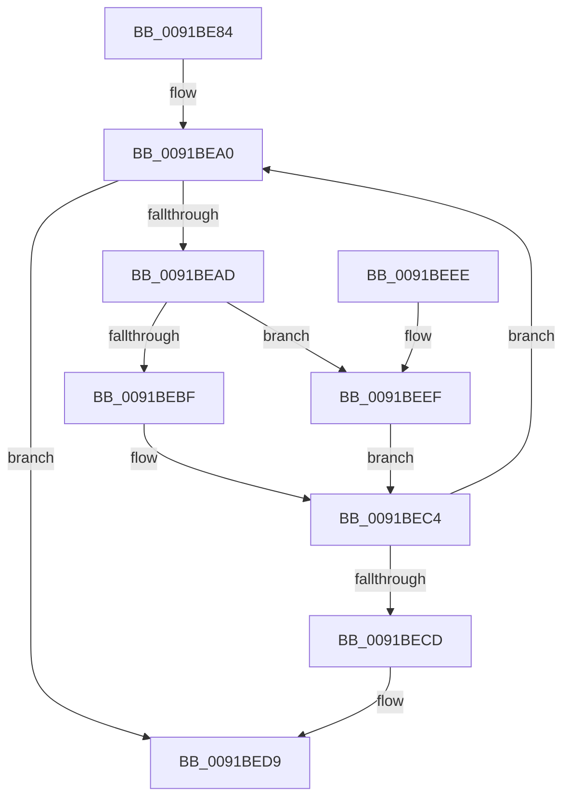

# PsEnumProcesses

- RVA: `0x0091BE84`–`0x0091BEF9` (길이 `117` bytes)
- VA: `0x000000014091BE84`
- 실행 섹션: `PAGE`
- PDB 이름 있음: `예`; PDB Function 태그: `아니요`
- unwind 정보 RVA: `0x00073808`
- 디코드: `35`개 명령, `117/117` bytes 표시
- 미해석 바이트: `0` (있으면 어셈블리에 `.byte`로 보존)

> 이 문서는 커널 이미지의 기계어와 PDB 기호를 분석해 생성했습니다. 4번과 5번은 함수 원형과 자료형을 바이너리 사용 방식에서 추정한 C 해석이며 원본 소스 복구 결과는 아닙니다.

## 1. Dependencies

- 직접 호출 지점: **4**; 고유 호출 대상: **4**
- 직접 호출자로 확인된 함수: **9**
- RIP 상대 이미지 참조: **1**

### Outgoing calls
- `0x0091BEA0` → [PsGetNextProcess](PsGetNextProcess_function_0091C900.md) (function, `0x0091C900`)
- `0x0091BEBF` → [PopEtProcessEnumSnapshotCallback](PopEtProcessEnumSnapshotCallback_function_0091CCA0.md) (function, `0x0091CCA0`)
- `0x0091BED2` → [ObfDereferenceObjectWithTag](../../text/2F/ObfDereferenceObjectWithTag_function_002F78E0.md) (function, `0x002F78E0`)
- `0x0091BEF2` → [guard_dispatch_icall](../../text/6B/guard_dispatch_icall_function_006BAAD0.md) (function, `0x006BAAD0`)

### Direct callers
- [PsRefreshUserPresencePpmPolicies](../../text/4F/PsRefreshUserPresencePpmPolicies_function_004F4FC0.md) at `0x004F4FEF`
- [PfTStart](../75/PfTStart_function_007517AC.md) at `0x00751AE3`
- [PopEtEnergyTrackerCreate](../76/PopEtEnergyTrackerCreate_function_00769EE0.md) at `0x0076A117`
- [PsShutdownSystem](../78/PsShutdownSystem_function_00785E94.md) at `0x00785F40`
- [EtwpDisablePerProcessTracing](../7B/EtwpDisablePerProcessTracing_function_007B8D60.md) at `0x007B8D7E`
- [EtwpPsProvCaptureState](../7C/EtwpPsProvCaptureState_function_007C0AD4.md) at `0x007C0B2B`
- [EtwpCoverageSamplerStart](../7C/EtwpCoverageSamplerStart_function_007C2248.md) at `0x007C2442`
- [PopEtEnergyTrackerQuery](../98/PopEtEnergyTrackerQuery_function_0098B668.md) at `0x0098B76D`
- [EtwpProcessThreadImageRundown](../9E/EtwpProcessThreadImageRundown_function_009E4568.md) at `0x009E461C`

### Static image references
- `0x0091BEAD` → RVA `0x0091CCA0` (`PopEtProcessEnumSnapshotCallback`; read)

## 2. Other-region calls and transfers

- 다른 실행 섹션으로 향하는 call: **2**
  - `0x0091BED2` → [ObfDereferenceObjectWithTag](../../text/2F/ObfDereferenceObjectWithTag_function_002F78E0.md) (`PAGE` → `.text`)
  - `0x0091BEF2` → [guard_dispatch_icall](../../text/6B/guard_dispatch_icall_function_006BAAD0.md) (`PAGE` → `.text`)
- 별도 외부 분기/꼬리 이동을 확인하지 못했습니다.

## 3. Assembly (complete function range)

```asm
0091BE84  48 89 5C 24 08                  mov qword ptr [rsp + 8], rbx
0091BE89  48 89 6C 24 10                  mov qword ptr [rsp + 0x10], rbp
0091BE8E  48 89 74 24 18                  mov qword ptr [rsp + 0x18], rsi
0091BE93  57                              push rdi
0091BE94  48 83 EC 20                     sub rsp, 0x20
0091BE98  48 8B F1                        mov rsi, rcx
0091BE9B  48 8B EA                        mov rbp, rdx
0091BE9E  33 C9                           xor ecx, ecx
0091BEA0  E8 5B 0A 00 00                  call 0x14091c900
0091BEA5  48 8B D8                        mov rbx, rax
0091BEA8  48 85 C0                        test rax, rax
0091BEAB  74 2C                           je 0x14091bed9
0091BEAD  48 8D 05 EC 0D 00 00            lea rax, [rip + 0xdec]
0091BEB4  48 8B D5                        mov rdx, rbp
0091BEB7  48 8B CB                        mov rcx, rbx
0091BEBA  48 3B F0                        cmp rsi, rax
0091BEBD  75 30                           jne 0x14091beef
0091BEBF  E8 DC 0D 00 00                  call 0x14091cca0
0091BEC4  8B F8                           mov edi, eax
0091BEC6  48 8B CB                        mov rcx, rbx
0091BEC9  85 C0                           test eax, eax
0091BECB  79 D3                           jns 0x14091bea0
0091BECD  BA 50 73 45 6E                  mov edx, 0x6e457350
0091BED2  E8 09 BA 9D FF                  call 0x1402f78e0
0091BED7  8B C7                           mov eax, edi
0091BED9  48 8B 5C 24 30                  mov rbx, qword ptr [rsp + 0x30]
0091BEDE  48 8B 6C 24 38                  mov rbp, qword ptr [rsp + 0x38]
0091BEE3  48 8B 74 24 40                  mov rsi, qword ptr [rsp + 0x40]
0091BEE8  48 83 C4 20                     add rsp, 0x20
0091BEEC  5F                              pop rdi
0091BEED  C3                              ret
0091BEEE  CC                              int3
0091BEEF  48 8B C6                        mov rax, rsi
0091BEF2  E8 D9 EB D9 FF                  call 0x1406baad0
0091BEF7  EB CB                           jmp 0x14091bec4
```

## 4. C-style interpretation (structured pseudocode)

```c
__int64 __fastcall PsEnumProcesses(__int64 a1, __int64 a2)
{
    __int64 result;
    __int64 v_rsp;
    unsigned __int64 v_stack_p10;
    unsigned __int64 v_stack_p18;
    unsigned __int64 v_stack_p8;

    v_stack_p8 = v_rbx;
    v_stack_p10 = v_rbp;
    v_stack_p18 = v_rsi;
    v_rsp = (v_rsp) - (32);
    a1 = 0;
loc_0091BEA0:
    result = PsGetNextProcess(a1, a2, a3, a4);
    if (result == 0) goto loc_0091BED9;
    if (0 != (v_rip + 3564)) goto loc_0091BEEF;
    result = PopEtProcessEnumSnapshotCallback(result, a2, a3, a4);
loc_0091BEC4:
    if (!sign_flag) goto loc_0091BEA0;
    result = ObfDereferenceObjectWithTag(result, (unsigned int)(0x6E457350ULL), a3, a4);
loc_0091BED9:
    v_rsp = (v_rsp) + (32);
    return (unsigned int)((unsigned int)((unsigned int)((unsigned int)(result))));
loc_0091BEEF:
    result = guard_dispatch_icall(result, (unsigned int)(0x6E457350ULL), a3, a4);
    goto loc_0091BEC4;
}
```

## 5. (Beta) C Style

```c
int64_t PsEnumProcesses(int64_t Arg1, int64_t Arg2)
{
    int64_t result;
    int64_t local_rsp;
    uint64_t v_stack_p10;
    uint64_t v_stack_p18;
    uint64_t v_stack_p8;

    v_stack_p8 = local_rbx;
    v_stack_p10 = local_rbp;
    v_stack_p18 = local_rsi;
    local_rsp = (local_rsp) - (32);
    Arg1 = 0;
loc_0091BEA0:
    result = PsGetNextProcess(Arg1, Arg2, a3, a4);
    if (result == 0) goto loc_0091BED9;
    if (0 != (v_rip + 3564)) goto loc_0091BEEF;
    result = PopEtProcessEnumSnapshotCallback(result, Arg2, a3, a4);
loc_0091BEC4:
    if (!sign_flag) goto loc_0091BEA0;
    result = ObfDereferenceObjectWithTag(result, (uint32_t)(0x6E457350ULL), a3, a4);
loc_0091BED9:
    local_rsp = (local_rsp) + (32);
    return (uint32_t)((uint32_t)((uint32_t)((uint32_t)(result))));
loc_0091BEEF:
    result = guard_dispatch_icall(result, (uint32_t)(0x6E457350ULL), a3, a4);
    goto loc_0091BEC4;
}
```

## 6. Execution-region graph

[열기: 2D/3D 그래프와 함수 탐색 컨트롤 패널](../../../control-panel.html?section=page&rva=0x0091BE84&view=graph)

- 2D 그래프는 위에서 아래로 흐르고, 3D 그래프는 빈 공간을 드래그해 회전합니다. Shift+드래그는 이동, 휠은 확대·축소, 함수 노드 선택은 대상 보고서 이동입니다.

### Static fallback


