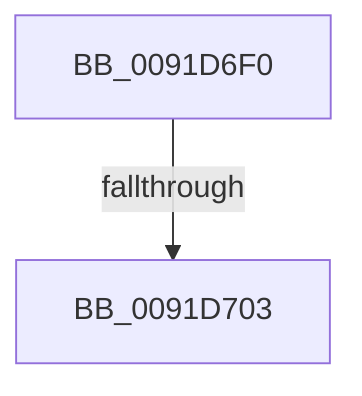

# PsGetAllocatedFullProcessImageNameEx

- RVA: `0x0091D6F0`–`0x0091D70F` (길이 `31` bytes)
- VA: `0x000000014091D6F0`
- 실행 섹션: `PAGE`
- PDB 이름 있음: `예`; PDB Function 태그: `아니요`
- unwind 정보 RVA: `0x0008B26C`
- 디코드: `8`개 명령, `31/31` bytes 표시
- 미해석 바이트: `0` (있으면 어셈블리에 `.byte`로 보존)

> 이 문서는 커널 이미지의 기계어와 PDB 기호를 분석해 생성했습니다. 4번과 5번은 함수 원형과 자료형을 바이너리 사용 방식에서 추정한 C 해석이며 원본 소스 복구 결과는 아닙니다.

## 1. Dependencies

- 직접 호출 지점: **0**; 고유 호출 대상: **0**
- 직접 호출자로 확인된 함수: **19**
- RIP 상대 이미지 참조: **1**

### Outgoing calls
- 직접 디코드된 call 명령이 없습니다.

### Direct callers
- [SeAdtRegistryValueChangedAuditAlarm](../79/SeAdtRegistryValueChangedAuditAlarm_function_0079DDD4.md) at `0x0079E111`
- [SeAuditFipsCryptoSelftests](../79/SeAuditFipsCryptoSelftests_function_0079E820.md) at `0x0079E907`
- [SeAuditProcessExit](../79/SeAuditProcessExit_function_0079EA08.md) at `0x0079EA5C`
- [SeAuditSystemTimeChange](../79/SeAuditSystemTimeChange_function_0079EB8C.md) at `0x0079EC21`
- [SeAuditTransactionStateChange](../79/SeAuditTransactionStateChange_function_0079ED50.md) at `0x0079EE56`
- [SepAuditAssignPrimaryToken](../79/SepAuditAssignPrimaryToken_function_0079F828.md) at `0x0079F8E9`
- [SepAuditAssignPrimaryToken](../79/SepAuditAssignPrimaryToken_function_0079F828.md) at `0x0079F907`
- [CmpReportAuditVirtualizationEvent](../7E/CmpReportAuditVirtualizationEvent_function_007ED758.md) at `0x007ED923`
- [SepAdtCloseObjectAuditAlarm](../86/SepAdtCloseObjectAuditAlarm_function_0086B4E8.md) at `0x0086B5AC`
- [SepAdtPrivilegeObjectAuditAlarm](../86/SepAdtPrivilegeObjectAuditAlarm_function_0086E3F0.md) at `0x0086E562`
- [SepAdtPrivilegedServiceAuditAlarm](../87/SepAdtPrivilegedServiceAuditAlarm_function_008714F0.md) at `0x0087163A`
- [SepQueryNameString](../8F/SepQueryNameString_function_008F5DE8.md) at `0x008F5EDC`
- [SepAdtTokenRightAdjusted](../90/SepAdtTokenRightAdjusted_function_0090445C.md) at `0x009045D7`
- [ExProcessCounterSetCallback](ExProcessCounterSetCallback_function_0091CDF0.md) at `0x0091D287`
- [SepAdtSecurityDescriptorChangedAuditAlarm](SepAdtSecurityDescriptorChangedAuditAlarm_function_0091E3E8.md) at `0x0091E45D`
- [SepAdtDeleteObjectAuditAlarm](SepAdtDeleteObjectAuditAlarm_function_0091E824.md) at `0x0091E8C0`
- [SeOperationAuditAlarm](SeOperationAuditAlarm_function_0091EA78.md) at `0x0091EB18`
- [SepAdtOpenObjectAuditAlarm](SepAdtOpenObjectAuditAlarm_function_0091F23C.md) at `0x0091F38B`
- [SeAuditProcessCreation](../94/SeAuditProcessCreation_function_00947624.md) at `0x009476C1`
- [SeAuditProcessCreation](../94/SeAuditProcessCreation_function_00947624.md) at `0x009479A4`
- [sub_00B21E9E](../B2/Unknown_function_00B21E9E.md) at `0x00B21EAB`

### Static image references
- `0x0091D703` → RVA `0x00F06560` (`.data`; read)

## 2. Other-region calls and transfers

- 다른 실행 섹션으로 향하는 call: **0**
- call이 아닌 외부 분기/꼬리 이동: **2**
  - `0x0091D701` → [sub_0091D70F](Unknown_function_0091D70F.md) (`tail-transfer`)
  - `0x0091D70D` → [sub_0091D78C](Unknown_function_0091D78C.md) (`tail-transfer`)

## 3. Assembly (complete function range)

```asm
0091D6F0  40 56                           push rsi
0091D6F2  48 83 EC 20                     sub rsp, 0x20
0091D6F6  48 83 B9 40 06 00 00 00         cmp qword ptr [rcx + 0x640], 0
0091D6FE  48 8B F2                        mov rsi, rdx
0091D701  74 0C                           je 0x14091d70f
0091D703  48 8B 05 56 8E 5E 00            mov rax, qword ptr [rip + 0x5e8e56]
0091D70A  48 85 C0                        test rax, rax
0091D70D  75 7D                           jne 0x14091d78c
```

## 4. C-style interpretation (structured pseudocode)

```c
__int64 __fastcall PsGetAllocatedFullProcessImageNameEx(__int64 a1, __int64 a2)
{
    __int64 v_rsp;

    v_rsp = (v_rsp) - (32);
}
```

## 5. (Beta) C Style

```c
int64_t PsGetAllocatedFullProcessImageNameEx(void *Arg1, int64_t Arg2)
{
    uint8_t *arg1 = (uint8_t *)Arg1;

    int64_t local_rsp;

    local_rsp = (local_rsp) - (32);
}
```

### 관측된 메모리 오프셋

구조체 형식이 확인되지 않은 접근은 인자 기준의 오프셋으로만 기록했습니다.

| 기준 인자 | 오프셋 표현 | 폭 (bit) | 접근 |
|---|---:|---:|---|
| `Arg1` | `+ 0x640` | `64` | `R` |

## 6. Execution-region graph

[열기: 2D/3D 그래프와 함수 탐색 컨트롤 패널](../../../control-panel.html?section=page&rva=0x0091D6F0&view=graph)

- 2D 그래프는 위에서 아래로 흐르고, 3D 그래프는 빈 공간을 드래그해 회전합니다. Shift+드래그는 이동, 휠은 확대·축소, 함수 노드 선택은 대상 보고서 이동입니다.

### Static fallback


