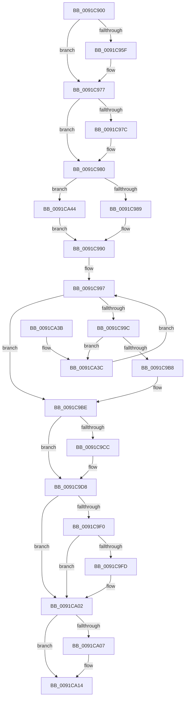

# PsGetNextProcess

- RVA: `0x0091C900`–`0x0091CA50` (길이 `336` bytes)
- VA: `0x000000014091C900`
- 실행 섹션: `PAGE`
- PDB 이름 있음: `예`; PDB Function 태그: `아니요`
- unwind 정보 RVA: `0x0008B134`
- 디코드: `84`개 명령, `336/336` bytes 표시
- 미해석 바이트: `0` (있으면 어셈블리에 `.byte`로 보존)

> 이 문서는 커널 이미지의 기계어와 PDB 기호를 분석해 생성했습니다. 4번과 5번은 함수 원형과 자료형을 바이너리 사용 방식에서 추정한 C 해석이며 원본 소스 복구 결과는 아닙니다.

## 1. Dependencies

- 직접 호출 지점: **7**; 고유 호출 대상: **7**
- 직접 호출자로 확인된 함수: **28**
- RIP 상대 이미지 참조: **2**

### Outgoing calls
- `0x0091C944` → [KeAbPreAcquire](../../text/21/KeAbPreAcquire_function_00210230.md) (function, `0x00210230`)
- `0x0091C972` → [ExfAcquirePushLockSharedEx](../../text/21/ExfAcquirePushLockSharedEx_function_0021044C.md) (function, `0x0021044C`)
- `0x0091C9AB` → [ObReferenceObjectSafeWithTag](../../text/21/ObReferenceObjectSafeWithTag_function_00210EE0.md) (function, `0x00210EE0`)
- `0x0091C9D3` → [ExfReleasePushLockShared](../../text/26/ExfReleasePushLockShared_function_00263440.md) (function, `0x00263440`)
- `0x0091C9DF` → [KeAbPostRelease](../../text/2E/KeAbPostRelease_function_002E1600.md) (function, `0x002E1600`)
- `0x0091C9FD` → [KiCheckForKernelApcDelivery](../../text/2E/KiCheckForKernelApcDelivery_function_002E2C80.md) (function, `0x002E2C80`)
- `0x0091CA0F` → [ObfDereferenceObjectWithTag](../../text/2F/ObfDereferenceObjectWithTag_function_002F78E0.md) (function, `0x002F78E0`)

### Direct callers
- [KiUpdateProcessConcurrencyCounts](../../text/24/KiUpdateProcessConcurrencyCounts_function_00249C40.md) at `0x00249C5A`
- [sub_00249C6B](../../text/24/Unknown_function_00249C6B.md) at `0x00249E5D`
- [IopLiveDumpAllocAndInitProcessFilters](../../text/59/IopLiveDumpAllocAndInitProcessFilters_function_00599310.md) at `0x0059932F`
- [IopLiveDumpAllocAndInitProcessFilters](../../text/59/IopLiveDumpAllocAndInitProcessFilters_function_00599310.md) at `0x00599373`
- [KeTraceHgsPlusRundown](../../text/5C/KeTraceHgsPlusRundown_function_005C3728.md) at `0x005C377D`
- [KeTraceThreadAffinityRundown](../../text/5C/KeTraceThreadAffinityRundown_function_005C379C.md) at `0x005C37F9`
- [KeTraceSchedulingGroupRundown](../../text/5C/KeTraceSchedulingGroupRundown_function_005C8D20.md) at `0x005C8D99`
- [KeTraceSchedulingGroupRundown](../../text/5C/KeTraceSchedulingGroupRundown_function_005C8D20.md) at `0x005C8DDF`
- [MiEmptyAccessLogs](../../text/68/MiEmptyAccessLogs_function_00689FF0.md) at `0x0068A0B9`
- [PsUpdateActiveProcessAffinity](../78/PsUpdateActiveProcessAffinity_function_00781DA8.md) at `0x00781E9C`
- [PsShutdownSystem](../78/PsShutdownSystem_function_00785E94.md) at `0x00785F4B`
- [PsShutdownSystem](../78/PsShutdownSystem_function_00785E94.md) at `0x00785FB8`
- [PsWaitForAllProcesses](../78/PsWaitForAllProcesses_function_00786318.md) at `0x0078633F`
- [EtwpCoverageSamplerStop](../7C/EtwpCoverageSamplerStop_function_007C2564.md) at `0x007C27D7`
- [MiHotPatchAllProcesses](../80/MiHotPatchAllProcesses_function_00803AC4.md) at `0x00803B42`
- [MiLogHotPatchRundown](../80/MiLogHotPatchRundown_function_008057A4.md) at `0x00805E13`
- [MiLogHotPatchRundown](../80/MiLogHotPatchRundown_function_008057A4.md) at `0x008062B2`
- [MiReferenceNonPagedMemoryProcessList](../80/MiReferenceNonPagedMemoryProcessList_function_0080EAF8.md) at `0x0080EB46`
- [PsEnumProcesses](PsEnumProcesses_function_0091BE84.md) at `0x0091BEA0`
- [PfpPrivSourceEnum](PfpPrivSourceEnum_function_0091BF00.md) at `0x0091C04E`
- [EtwpLogMemInfoWs](EtwpLogMemInfoWs_function_0091C594.md) at `0x0091C6F3`
- [DbgkpCloseObject](DbgkpCloseObject_function_0091D5F0.md) at `0x0091D64F`
- [DbgkpCloseObject](DbgkpCloseObject_function_0091D5F0.md) at `0x0091D66F`
- [IopQueryProcessIdsUsingFile](IopQueryProcessIdsUsingFile_function_0091D7A0.md) at `0x0091D7ED`
- [NtGetNextProcess](NtGetNextProcess_function_0091DF50.md) at `0x0091E06E`
- [NtGetNextProcess](NtGetNextProcess_function_0091DF50.md) at `0x0091E1CD`
- [VmpTracingEnabledCallback](../A9/VmpTracingEnabledCallback_function_00A9BB90.md) at `0x00A9BC0E`
- [PnpHandleEnumerateHandlesAgainstDeviceObject](../A9/PnpHandleEnumerateHandlesAgainstDeviceObject_function_00A9D7A8.md) at `0x00A9D7D9`
- [PfpRpControlRequestReset](../AB/PfpRpControlRequestReset_function_00AB4D2C.md) at `0x00AB4D54`
- [PspProcessRundownWorker](../AC/PspProcessRundownWorker_function_00AC31D0.md) at `0x00AC3210`
- [EtwQueryPerformanceTraceInformation](../AF/EtwQueryPerformanceTraceInformation_function_00AF28A4.md) at `0x00AF2E8F`
- [sub_00B484E6](../B4/Unknown_function_00B484E6.md) at `0x00B48894`
- [ExpDebuggerWorker](../../pagekd/B8/ExpDebuggerWorker_function_00B89F70.md) at `0x00B8A020`
- [PopEtInit](../../init/C4/PopEtInit_function_00C43018.md) at `0x00C43246`

### Static image references
- `0x0091C92A` → RVA `0x00FD9AF8` (`PAGEDATA`; read)
- `0x0091C990` → RVA `0x00F067C0` (`.data`; read)

## 2. Other-region calls and transfers

- 다른 실행 섹션으로 향하는 call: **7**
  - `0x0091C944` → [KeAbPreAcquire](../../text/21/KeAbPreAcquire_function_00210230.md) (`PAGE` → `.text`)
  - `0x0091C972` → [ExfAcquirePushLockSharedEx](../../text/21/ExfAcquirePushLockSharedEx_function_0021044C.md) (`PAGE` → `.text`)
  - `0x0091C9AB` → [ObReferenceObjectSafeWithTag](../../text/21/ObReferenceObjectSafeWithTag_function_00210EE0.md) (`PAGE` → `.text`)
  - `0x0091C9D3` → [ExfReleasePushLockShared](../../text/26/ExfReleasePushLockShared_function_00263440.md) (`PAGE` → `.text`)
  - `0x0091C9DF` → [KeAbPostRelease](../../text/2E/KeAbPostRelease_function_002E1600.md) (`PAGE` → `.text`)
  - `0x0091C9FD` → [KiCheckForKernelApcDelivery](../../text/2E/KiCheckForKernelApcDelivery_function_002E2C80.md) (`PAGE` → `.text`)
  - `0x0091CA0F` → [ObfDereferenceObjectWithTag](../../text/2F/ObfDereferenceObjectWithTag_function_002F78E0.md) (`PAGE` → `.text`)
- 별도 외부 분기/꼬리 이동을 확인하지 못했습니다.

## 3. Assembly (complete function range)

```asm
0091C900  48 89 5C 24 08                  mov qword ptr [rsp + 8], rbx
0091C905  48 89 6C 24 18                  mov qword ptr [rsp + 0x18], rbp
0091C90A  48 89 74 24 20                  mov qword ptr [rsp + 0x20], rsi
0091C90F  57                              push rdi
0091C910  41 54                           push r12
0091C912  41 55                           push r13
0091C914  41 56                           push r14
0091C916  41 57                           push r15
0091C918  48 83 EC 20                     sub rsp, 0x20
0091C91C  65 4C 8B 34 25 88 01 00 00      mov r14, qword ptr gs:[0x188]
0091C925  48 8B F1                        mov rsi, rcx
0091C928  33 ED                           xor ebp, ebp
0091C92A  48 8D 0D C7 D1 6B 00            lea rcx, [rip + 0x6bd1c7]
0091C931  45 33 C0                        xor r8d, r8d
0091C934  33 D2                           xor edx, edx
0091C936  8B FD                           mov edi, ebp
0091C938  44 8B FD                        mov r15d, ebp
0091C93B  66 41 FF 8E E6 01 00 00         dec word ptr [r14 + 0x1e6]
0091C943  90                              nop
0091C944  E8 E7 38 8F FF                  call 0x140210230
0091C949  48 8B D8                        mov rbx, rax
0091C94C  41 BD 11 00 00 00               mov r13d, 0x11
0091C952  33 C0                           xor eax, eax
0091C954  F0 4C 0F B1 2D 9B D1 6B 00      lock cmpxchg qword ptr [rip + 0x6bd19b], r13
0091C95D  74 18                           je 0x14091c977
0091C95F  4C 8D 0D 92 D1 6B 00            lea r9, [rip + 0x6bd192]
0091C966  4C 8B C3                        mov r8, rbx
0091C969  33 D2                           xor edx, edx
0091C96B  48 8D 0D 86 D1 6B 00            lea rcx, [rip + 0x6bd186]
0091C972  E8 D5 3A 8F FF                  call 0x14021044c
0091C977  48 85 DB                        test rbx, rbx
0091C97A  74 04                           je 0x14091c980
0091C97C  C6 43 0A 01                     mov byte ptr [rbx + 0xa], 1
0091C980  48 85 F6                        test rsi, rsi
0091C983  0F 84 BB 00 00 00               je 0x14091ca44
0091C989  48 8B 9E D8 01 00 00            mov rbx, qword ptr [rsi + 0x1d8]
0091C990  4C 8D 25 29 9E 5E 00            lea r12, [rip + 0x5e9e29]
0091C997  49 3B DC                        cmp rbx, r12
0091C99A  74 22                           je 0x14091c9be
0091C99C  48 8D BB 28 FE FF FF            lea rdi, [rbx - 0x1d8]
0091C9A3  BA 50 73 45 6E                  mov edx, 0x6e457350
0091C9A8  48 8B CF                        mov rcx, rdi
0091C9AB  E8 30 45 8F FF                  call 0x140210ee0
0091C9B0  84 C0                           test al, al
0091C9B2  0F 84 84 00 00 00               je 0x14091ca3c
0091C9B8  41 BF 01 00 00 00               mov r15d, 1
0091C9BE  49 8B C5                        mov rax, r13
0091C9C1  F0 48 0F B1 2D 2E D1 6B 00      lock cmpxchg qword ptr [rip + 0x6bd12e], rbp
0091C9CA  74 0C                           je 0x14091c9d8
0091C9CC  48 8D 0D 25 D1 6B 00            lea rcx, [rip + 0x6bd125]
0091C9D3  E8 68 6A 94 FF                  call 0x140263440
0091C9D8  48 8D 0D 19 D1 6B 00            lea rcx, [rip + 0x6bd119]
0091C9DF  E8 1C 4C 9C FF                  call 0x1402e1600
0091C9E4  90                              nop
0091C9E5  66 41 83 86 E6 01 00 00 01      add word ptr [r14 + 0x1e6], 1
0091C9EE  75 12                           jne 0x14091ca02
0091C9F0  49 8D 86 98 00 00 00            lea rax, [r14 + 0x98]
0091C9F7  90                              nop
0091C9F8  48 39 00                        cmp qword ptr [rax], rax
0091C9FB  74 05                           je 0x14091ca02
0091C9FD  E8 7E 62 9C FF                  call 0x1402e2c80
0091CA02  48 85 F6                        test rsi, rsi
0091CA05  74 0D                           je 0x14091ca14
0091CA07  BA 50 73 45 6E                  mov edx, 0x6e457350
0091CA0C  48 8B CE                        mov rcx, rsi
0091CA0F  E8 CC AE 9D FF                  call 0x1402f78e0
0091CA14  48 8B 5C 24 50                  mov rbx, qword ptr [rsp + 0x50]
0091CA19  45 85 FF                        test r15d, r15d
0091CA1C  48 8B 74 24 68                  mov rsi, qword ptr [rsp + 0x68]
0091CA21  48 0F 45 EF                     cmovne rbp, rdi
0091CA25  48 8B C5                        mov rax, rbp
0091CA28  48 8B 6C 24 60                  mov rbp, qword ptr [rsp + 0x60]
0091CA2D  48 83 C4 20                     add rsp, 0x20
0091CA31  41 5F                           pop r15
0091CA33  41 5E                           pop r14
0091CA35  41 5D                           pop r13
0091CA37  41 5C                           pop r12
0091CA39  5F                              pop rdi
0091CA3A  C3                              ret
0091CA3B  CC                              int3
0091CA3C  48 8B 1B                        mov rbx, qword ptr [rbx]
0091CA3F  E9 53 FF FF FF                  jmp 0x14091c997
0091CA44  48 8B 1D 75 9D 5E 00            mov rbx, qword ptr [rip + 0x5e9d75]
0091CA4B  E9 40 FF FF FF                  jmp 0x14091c990
```

## 4. C-style interpretation (structured pseudocode)

```c
__int64 __fastcall PsGetNextProcess(__int64 a1, int a2, int a3)
{
    __int64 result;
    __int64 v_rbp;
    __int64 v_rsp;
    unsigned __int64 v_stack_p18;
    unsigned __int64 v_stack_p20;
    unsigned __int64 v_stack_p8;

    v_stack_p8 = v_rbx;
    v_stack_p18 = v_rbp;
    v_stack_p20 = v_rsi;
    v_rsp = (v_rsp) - (32);
    v_rbp = 0;
    a3 = 0;
    a2 = 0;
    result = KeAbPreAcquire(v_rip + 7066055, a2, a3, a4);
    result = 0;
    if (!(condition_is_equal)) {
        a4 = v_rip + 7066002;
        a3 = 0;
        a2 = 0;
        a1 = v_rip + 7065990;
        result = ExfAcquirePushLockSharedEx(a1, a2, a3, a4);
    }
    if (result != 0) {
        *(unsigned __int8 *)(result + 10) = 1;
    }
    if (a1 == 0) goto loc_0091CA44;
loc_0091C990:
loc_0091C997:
    if ((*(unsigned __int64 *)(a1 + 472)) == (v_rip + 6200873)) goto loc_0091C9BE;
    result = ObReferenceObjectSafeWithTag(*(unsigned __int64 *)(a1 + 472) - 472, (unsigned int)(0x6E457350ULL), a3, a4);
    if ((unsigned __int8)(result) == 0) goto loc_0091CA3C;
loc_0091C9BE:
    result = 17;
    if ((unsigned __int8)(result) != 0) {
        a1 = v_rip + 7065893;
        result = ExfReleasePushLockShared(a1, (unsigned int)(0x6E457350ULL), a3, a4);
    }
    result = KeAbPostRelease(v_rip + 7065881, (unsigned int)(0x6E457350ULL), a3, a4);
    if ((unsigned __int8)(result) != 0) goto loc_0091CA02;
    result = *(unsigned __int64 *)(gs_base + (0 + 392)) + 152;
    if ((*(unsigned __int64 *)(*(unsigned __int64 *)(gs_base + (0 + 392)) + 152)) != (*(unsigned __int64 *)(gs_base + (0 + 392)) + 152)) {
        result = KiCheckForKernelApcDelivery(v_rip + 7065881, (unsigned int)(0x6E457350ULL), a3, a4);
    }
    if (a1 != 0) {
        a2 = 0x6E457350ULL;
        a1 = a1;
        result = ObfDereferenceObjectWithTag(a1, a2, a3, a4);
    }
    if (1 != 0) { v_rbp = *(unsigned __int64 *)(a1 + 472) - 472; }
    v_rsp = (v_rsp) + (32);
    return v_rbp;
loc_0091CA3C:
    goto loc_0091C997;
loc_0091CA44:
    goto loc_0091C990;
}
```

## 5. (Beta) C Style

```c
int64_t PsGetNextProcess(int64_t Arg1, int32_t Arg2, int32_t Arg3)
{
    int64_t result;
    int64_t local_rbp;
    int64_t local_rsp;
    uint64_t v_stack_p18;
    uint64_t v_stack_p20;
    uint64_t v_stack_p8;

    v_stack_p8 = local_rbx;
    v_stack_p18 = local_rbp;
    v_stack_p20 = local_rsi;
    local_rsp = (local_rsp) - (32);
    local_rbp = 0;
    Arg3 = 0;
    Arg2 = 0;
    result = KeAbPreAcquire(v_rip + 7066055, Arg2, Arg3, a4);
    result = 0;
    if (!(condition_is_equal)) {
        a4 = v_rip + 7066002;
        Arg3 = 0;
        Arg2 = 0;
        Arg1 = v_rip + 7065990;
        result = ExfAcquirePushLockSharedEx(Arg1, Arg2, Arg3, a4);
    }
    if (result != 0) {
        *(uint8_t *)(result + 0xA) = 1;
    }
    if (Arg1 == 0) goto loc_0091CA44;
loc_0091C990:
loc_0091C997:
    if ((*(uint64_t *)(Arg1 + 0x1D8)) == (v_rip + 6200873)) goto loc_0091C9BE;
    result = ObReferenceObjectSafeWithTag(*(uint64_t *)(Arg1 + 0x1D8) - 472, (uint32_t)(0x6E457350ULL), Arg3, a4);
    if ((uint8_t)(result) == 0) goto loc_0091CA3C;
loc_0091C9BE:
    result = 17;
    if ((uint8_t)(result) != 0) {
        Arg1 = v_rip + 7065893;
        result = ExfReleasePushLockShared(Arg1, (uint32_t)(0x6E457350ULL), Arg3, a4);
    }
    result = KeAbPostRelease(v_rip + 7065881, (uint32_t)(0x6E457350ULL), Arg3, a4);
    if ((uint8_t)(result) != 0) goto loc_0091CA02;
    result = *(uint64_t *)(gs_base + (0 + 0x188)) + 152;
    if ((*(uint64_t *)(*(uint64_t *)(gs_base + (0 + 0x188)) + 0x98)) != (*(uint64_t *)(gs_base + (0 + 0x188)) + 152)) {
        result = KiCheckForKernelApcDelivery(v_rip + 7065881, (uint32_t)(0x6E457350ULL), Arg3, a4);
    }
    if (Arg1 != 0) {
        Arg2 = 0x6E457350ULL;
        Arg1 = Arg1;
        result = ObfDereferenceObjectWithTag(Arg1, Arg2, Arg3, a4);
    }
    if (1 != 0) { local_rbp = *(uint64_t *)(Arg1 + 0x1D8) - 472; }
    local_rsp = (local_rsp) + (32);
    return local_rbp;
loc_0091CA3C:
    goto loc_0091C997;
loc_0091CA44:
    goto loc_0091C990;
}
```

## 6. Execution-region graph

[열기: 2D/3D 그래프와 함수 탐색 컨트롤 패널](../../../control-panel.html?section=page&rva=0x0091C900&view=graph)

- 2D 그래프는 위에서 아래로 흐르고, 3D 그래프는 빈 공간을 드래그해 회전합니다. Shift+드래그는 이동, 휠은 확대·축소, 함수 노드 선택은 대상 보고서 이동입니다.

### Static fallback


