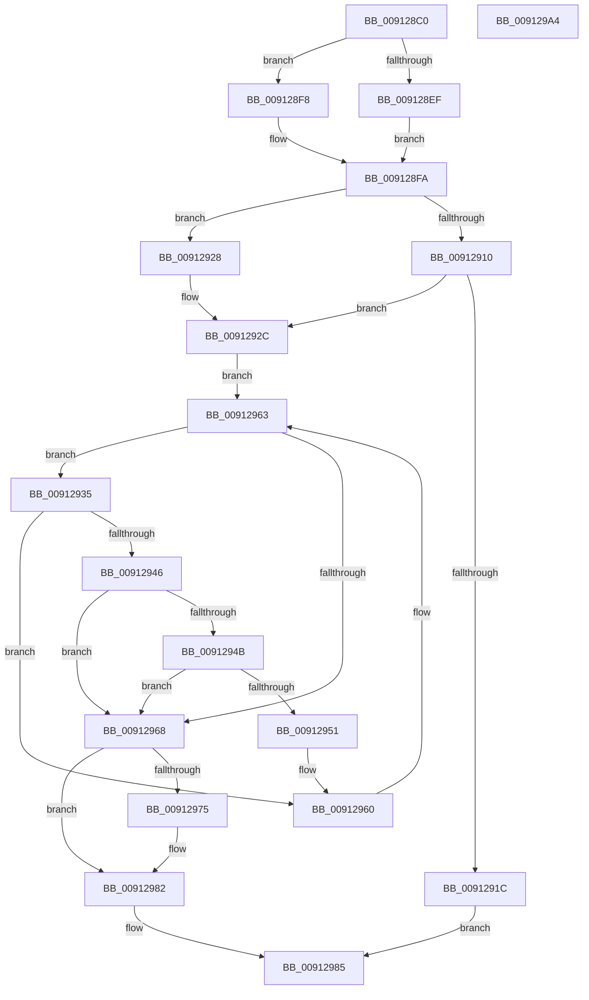

# PsGetNextSession

- RVA: `0x009128C0`–`0x009129A5` (길이 `229` bytes)
- VA: `0x00000001409128C0`
- 실행 섹션: `PAGE`
- PDB 이름 있음: `예`; PDB Function 태그: `아니요`
- unwind 정보 RVA: `0x0008A350`
- 디코드: `67`개 명령, `229/229` bytes 표시
- 미해석 바이트: `0` (있으면 어셈블리에 `.byte`로 보존)

> 이 문서는 커널 이미지의 기계어와 PDB 기호를 분석해 생성했습니다. 4번과 5번은 함수 원형과 자료형을 바이너리 사용 방식에서 추정한 C 해석이며 원본 소스 복구 결과는 아닙니다.

## 1. Dependencies

- 직접 호출 지점: **7**; 고유 호출 대상: **5**
- 직접 호출자로 확인된 함수: **6**
- RIP 상대 이미지 참조: **1**

### Outgoing calls
- `0x009128E0` → [PsGetCurrentServerSilo](../../text/22/PsGetCurrentServerSilo_function_00225710.md) (function, `0x00225710`)
- `0x00912906` → [PspLockProcessListExclusive](../../text/22/PspLockProcessListExclusive_function_0022578C.md) (function, `0x0022578C`)
- `0x0091291F` → [PspUnlockProcessListExclusive](../../text/2D/PspUnlockProcessListExclusive_function_002DFD18.md) (function, `0x002DFD18`)
- `0x00912939` → [PspSelectSessionAttachProcess](../A2/PspSelectSessionAttachProcess_function_00A25CA0.md) (function, `0x00A25CA0`)
- `0x00912959` → [ObfDereferenceObjectWithTag](../../text/2F/ObfDereferenceObjectWithTag_function_002F78E0.md) (function, `0x002F78E0`)
- `0x0091296B` → [PspUnlockProcessListExclusive](../../text/2D/PspUnlockProcessListExclusive_function_002DFD18.md) (function, `0x002DFD18`)
- `0x0091297D` → [ObfDereferenceObjectWithTag](../../text/2F/ObfDereferenceObjectWithTag_function_002F78E0.md) (function, `0x002F78E0`)

### Direct callers
- [PsQueryCpuQuotaInformation](../../text/5E/PsQueryCpuQuotaInformation_function_005E27C0.md) at `0x005E2864`
- [PopDirectedDripsSendSuspendResumeNotification](../75/PopDirectedDripsSendSuspendResumeNotification_function_00757CCC.md) at `0x00757DBE`
- [PopSendSuspendResumeApplicationNotification](../75/PopSendSuspendResumeApplicationNotification_function_0075EC74.md) at `0x0075ED52`
- [PsPerfLogSessionRundown](../78/PsPerfLogSessionRundown_function_00788DB0.md) at `0x00788E39`
- [PopInvokeWin32Callout](PopInvokeWin32Callout_function_009125F4.md) at `0x00912749`
- [PopInvokeWin32Callout](PopInvokeWin32Callout_function_009125F4.md) at `0x00912771`
- [sub_00B47AE6](../B4/Unknown_function_00B47AE6.md) at `0x00B47BF9`

### Static image references
- `0x00912910` → RVA `0x00F066C0` (`.data`; read)

## 2. Other-region calls and transfers

- 다른 실행 섹션으로 향하는 call: **6**
  - `0x009128E0` → [PsGetCurrentServerSilo](../../text/22/PsGetCurrentServerSilo_function_00225710.md) (`PAGE` → `.text`)
  - `0x00912906` → [PspLockProcessListExclusive](../../text/22/PspLockProcessListExclusive_function_0022578C.md) (`PAGE` → `.text`)
  - `0x0091291F` → [PspUnlockProcessListExclusive](../../text/2D/PspUnlockProcessListExclusive_function_002DFD18.md) (`PAGE` → `.text`)
  - `0x00912959` → [ObfDereferenceObjectWithTag](../../text/2F/ObfDereferenceObjectWithTag_function_002F78E0.md) (`PAGE` → `.text`)
  - `0x0091296B` → [PspUnlockProcessListExclusive](../../text/2D/PspUnlockProcessListExclusive_function_002DFD18.md) (`PAGE` → `.text`)
  - `0x0091297D` → [ObfDereferenceObjectWithTag](../../text/2F/ObfDereferenceObjectWithTag_function_002F78E0.md) (`PAGE` → `.text`)
- 별도 외부 분기/꼬리 이동을 확인하지 못했습니다.

## 3. Assembly (complete function range)

```asm
009128C0  48 8B C4                        mov rax, rsp
009128C3  48 89 58 08                     mov qword ptr [rax + 8], rbx
009128C7  48 89 68 10                     mov qword ptr [rax + 0x10], rbp
009128CB  48 89 70 18                     mov qword ptr [rax + 0x18], rsi
009128CF  48 89 78 20                     mov qword ptr [rax + 0x20], rdi
009128D3  41 55                           push r13
009128D5  41 56                           push r14
009128D7  41 57                           push r15
009128D9  48 83 EC 20                     sub rsp, 0x20
009128DD  48 8B F9                        mov rdi, rcx
009128E0  E8 2B 2E 91 FF                  call 0x140225710
009128E5  33 ED                           xor ebp, ebp
009128E7  4C 8B F8                        mov r15, rax
009128EA  48 85 FF                        test rdi, rdi
009128ED  74 09                           je 0x1409128f8
009128EF  48 8B 9F E8 02 00 00            mov rbx, qword ptr [rdi + 0x2e8]
009128F6  EB 02                           jmp 0x1409128fa
009128F8  33 DB                           xor ebx, ebx
009128FA  65 48 8B 34 25 88 01 00 00      mov rsi, qword ptr gs:[0x188]
00912903  48 8B CE                        mov rcx, rsi
00912906  E8 81 2E 91 FF                  call 0x14022578c
0091290B  48 85 DB                        test rbx, rbx
0091290E  75 18                           jne 0x140912928
00912910  48 8B 1D A9 3D 5F 00            mov rbx, qword ptr [rip + 0x5f3da9]
00912917  48 85 DB                        test rbx, rbx
0091291A  75 10                           jne 0x14091292c
0091291C  48 8B CE                        mov rcx, rsi
0091291F  E8 F4 D3 9C FF                  call 0x1402dfd18
00912924  33 C0                           xor eax, eax
00912926  EB 5D                           jmp 0x140912985
00912928  48 8B 5B 50                     mov rbx, qword ptr [rbx + 0x50]
0091292C  4C 8D 2D 8D 3D 5F 00            lea r13, [rip + 0x5f3d8d]
00912933  EB 2E                           jmp 0x140912963
00912935  48 8D 4B B0                     lea rcx, [rbx - 0x50]
00912939  E8 62 33 11 00                  call 0x140a25ca0
0091293E  48 8B E8                        mov rbp, rax
00912941  48 85 C0                        test rax, rax
00912944  74 1A                           je 0x140912960
00912946  4D 85 FF                        test r15, r15
00912949  74 1D                           je 0x140912968
0091294B  4C 39 7B 50                     cmp qword ptr [rbx + 0x50], r15
0091294F  74 17                           je 0x140912968
00912951  BA 50 73 51 79                  mov edx, 0x79517350
00912956  48 8B C8                        mov rcx, rax
00912959  E8 82 4F 9E FF                  call 0x1402f78e0
0091295E  33 ED                           xor ebp, ebp
00912960  48 8B 1B                        mov rbx, qword ptr [rbx]
00912963  49 3B DD                        cmp rbx, r13
00912966  75 CD                           jne 0x140912935
00912968  48 8B CE                        mov rcx, rsi
0091296B  E8 A8 D3 9C FF                  call 0x1402dfd18
00912970  48 85 FF                        test rdi, rdi
00912973  74 0D                           je 0x140912982
00912975  BA 50 73 51 79                  mov edx, 0x79517350
0091297A  48 8B CF                        mov rcx, rdi
0091297D  E8 5E 4F 9E FF                  call 0x1402f78e0
00912982  48 8B C5                        mov rax, rbp
00912985  48 8B 5C 24 40                  mov rbx, qword ptr [rsp + 0x40]
0091298A  48 8B 6C 24 48                  mov rbp, qword ptr [rsp + 0x48]
0091298F  48 8B 74 24 50                  mov rsi, qword ptr [rsp + 0x50]
00912994  48 8B 7C 24 58                  mov rdi, qword ptr [rsp + 0x58]
00912999  48 83 C4 20                     add rsp, 0x20
0091299D  41 5F                           pop r15
0091299F  41 5E                           pop r14
009129A1  41 5D                           pop r13
009129A3  C3                              ret
009129A4  CC                              int3
```

## 4. C-style interpretation (structured pseudocode)

```c
__int64 __fastcall PsGetNextSession(__int64 a1)
{
    __int64 result;
    __int64 v_rbp;
    __int64 v_rbx;
    __int64 v_rsp;
    unsigned __int64 v_stack_p10;
    unsigned __int64 v_stack_p18;
    unsigned __int64 v_stack_p20;
    unsigned __int64 v_stack_p8;

    *(unsigned __int64 *)(v_rsp + 8) = v_rbx;
    *(unsigned __int64 *)(v_rsp + 16) = v_rbp;
    *(unsigned __int64 *)(v_rsp + 24) = v_rsi;
    *(unsigned __int64 *)(v_rsp + 32) = v_rdi;
    v_rsp = (v_rsp) - (32);
    result = PsGetCurrentServerSilo(a1, a2, a3, a4);
    v_rbp = 0;
    if (a1 == 0) goto loc_009128F8;
    goto loc_009128FA;
loc_009128F8:
    v_rbx = 0;
loc_009128FA:
    result = PspLockProcessListExclusive(*(unsigned __int64 *)(gs_base + (0 + 392)), a2, a3, a4);
    if (0 != 0) goto loc_00912928;
    if (*(unsigned __int64 *)(v_rip + 6241705) != 0) goto loc_0091292C;
    result = PspUnlockProcessListExclusive(*(unsigned __int64 *)(gs_base + (0 + 392)), a2, a3, a4);
    result = 0;
    goto loc_00912985;
loc_00912928:
loc_0091292C:
    goto loc_00912963;
loc_00912935:
    result = PspSelectSessionAttachProcess(*(unsigned __int64 *)(*(unsigned __int64 *)(v_rip + 6241705) + 80) - 80, a2, a3, a4);
    if (result == 0) goto loc_00912960;
    if (result == 0) goto loc_00912968;
    if ((*(unsigned __int64 *)(*(unsigned __int64 *)(*(unsigned __int64 *)(v_rip + 6241705) + 80) + 80)) == result) goto loc_00912968;
    result = ObfDereferenceObjectWithTag(result, (unsigned int)(0x79517350ULL), a3, a4);
    v_rbp = 0;
loc_00912960:
loc_00912963:
    if ((*(unsigned __int64 *)(*(unsigned __int64 *)(*(unsigned __int64 *)(v_rip + 6241705) + 80))) != (v_rip + 6241677)) goto loc_00912935;
loc_00912968:
    result = PspUnlockProcessListExclusive(*(unsigned __int64 *)(gs_base + (0 + 392)), (unsigned int)(0x79517350ULL), a3, a4);
    if (a1 != 0) {
        a2 = 0x79517350ULL;
        a1 = a1;
        result = ObfDereferenceObjectWithTag(a1, a2, a3, a4);
    }
loc_00912985:
    v_rsp = (v_rsp) + (32);
    return 0;
}
```

## 5. (Beta) C Style

```c
int64_t PsGetNextSession(int64_t Arg1)
{
    int64_t result;
    int64_t local_rbp;
    int64_t local_rbx;
    int64_t local_rsp;
    uint64_t v_stack_p10;
    uint64_t v_stack_p18;
    uint64_t v_stack_p20;
    uint64_t v_stack_p8;

    *(uint64_t *)(local_rsp + 0x8) = local_rbx;
    *(uint64_t *)(local_rsp + 0x10) = local_rbp;
    *(uint64_t *)(local_rsp + 0x18) = local_rsi;
    *(uint64_t *)(local_rsp + 0x20) = local_rdi;
    local_rsp = (local_rsp) - (32);
    result = PsGetCurrentServerSilo(Arg1, a2, a3, a4);
    local_rbp = 0;
    if (Arg1 == 0) goto loc_009128F8;
    goto loc_009128FA;
loc_009128F8:
    local_rbx = 0;
loc_009128FA:
    result = PspLockProcessListExclusive(*(uint64_t *)(gs_base + (0 + 0x188)), a2, a3, a4);
    if (0 != 0) goto loc_00912928;
    if (*(uint64_t *)(v_rip + 0x5F3DA9) != 0) goto loc_0091292C;
    result = PspUnlockProcessListExclusive(*(uint64_t *)(gs_base + (0 + 0x188)), a2, a3, a4);
    result = 0;
    goto loc_00912985;
loc_00912928:
loc_0091292C:
    goto loc_00912963;
loc_00912935:
    result = PspSelectSessionAttachProcess(*(uint64_t *)(*(uint64_t *)(v_rip + 0x5F3DA9) + 0x50) - 80, a2, a3, a4);
    if (result == 0) goto loc_00912960;
    if (result == 0) goto loc_00912968;
    if ((*(uint64_t *)(*(uint64_t *)(*(uint64_t *)(v_rip + 0x5F3DA9) + 0x50) + 0x50)) == result) goto loc_00912968;
    result = ObfDereferenceObjectWithTag(result, (uint32_t)(0x79517350ULL), a3, a4);
    local_rbp = 0;
loc_00912960:
loc_00912963:
    if ((*(uint64_t *)(*(uint64_t *)(*(uint64_t *)(v_rip + 0x5F3DA9) + 0x50))) != (v_rip + 6241677)) goto loc_00912935;
loc_00912968:
    result = PspUnlockProcessListExclusive(*(uint64_t *)(gs_base + (0 + 0x188)), (uint32_t)(0x79517350ULL), a3, a4);
    if (Arg1 != 0) {
        a2 = 0x79517350ULL;
        Arg1 = Arg1;
        result = ObfDereferenceObjectWithTag(Arg1, a2, a3, a4);
    }
loc_00912985:
    local_rsp = (local_rsp) + (32);
    return 0;
}
```

## 6. Execution-region graph

[열기: 2D/3D 그래프와 함수 탐색 컨트롤 패널](../../../control-panel.html?section=page&rva=0x009128C0&view=graph)

- 2D 그래프는 위에서 아래로 흐르고, 3D 그래프는 빈 공간을 드래그해 회전합니다. Shift+드래그는 이동, 휠은 확대·축소, 함수 노드 선택은 대상 보고서 이동입니다.

### Static fallback


