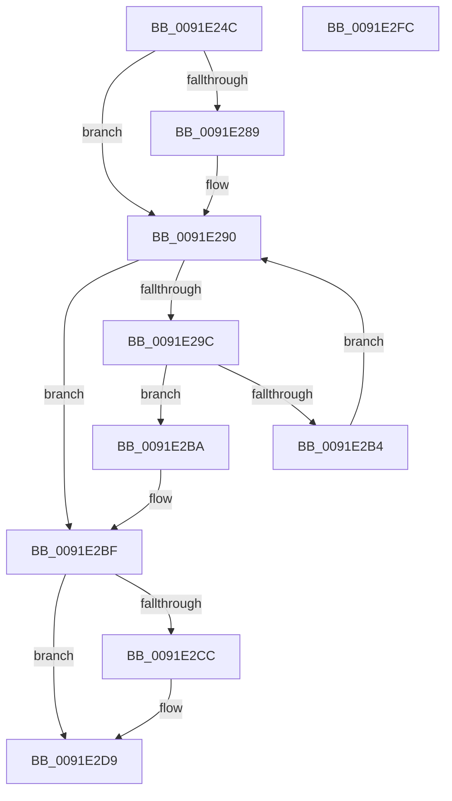

# PsGetPreviousProcess

- RVA: `0x0091E24C`–`0x0091E2FD` (길이 `177` bytes)
- VA: `0x000000014091E24C`
- 실행 섹션: `PAGE`
- PDB 이름 있음: `예`; PDB Function 태그: `아니요`
- unwind 정보 RVA: `0x0005E6B4`
- 디코드: `47`개 명령, `177/177` bytes 표시
- 미해석 바이트: `0` (있으면 어셈블리에 `.byte`로 보존)

> 이 문서는 커널 이미지의 기계어와 PDB 기호를 분석해 생성했습니다. 4번과 5번은 함수 원형과 자료형을 바이너리 사용 방식에서 추정한 C 해석이며 원본 소스 복구 결과는 아닙니다.

## 1. Dependencies

- 직접 호출 지점: **4**; 고유 호출 대상: **4**
- 직접 호출자로 확인된 함수: **1**
- RIP 상대 이미지 참조: **2**

### Outgoing calls
- `0x0091E278` → [PspLockProcessListShared](../../text/41/PspLockProcessListShared_function_0041BAB0.md) (function, `0x0041BAB0`)
- `0x0091E2AB` → [ObReferenceObjectSafeWithTag](../../text/21/ObReferenceObjectSafeWithTag_function_00210EE0.md) (function, `0x00210EE0`)
- `0x0091E2C2` → [PspUnlockProcessListShared](../../text/2E/PspUnlockProcessListShared_function_002E2920.md) (function, `0x002E2920`)
- `0x0091E2D4` → [ObfDereferenceObjectWithTag](../../text/2F/ObfDereferenceObjectWithTag_function_002F78E0.md) (function, `0x002F78E0`)

### Direct callers
- [NtGetNextProcess](NtGetNextProcess_function_0091DF50.md) at `0x0091E1EF`
- [NtGetNextProcess](NtGetNextProcess_function_0091DF50.md) at `0x0091E1F6`

### Static image references
- `0x0091E27D` → RVA `0x00F067C8` (`.data`; read)
- `0x0091E290` → RVA `0x00F067C0` (`.data`; read)

## 2. Other-region calls and transfers

- 다른 실행 섹션으로 향하는 call: **4**
  - `0x0091E278` → [PspLockProcessListShared](../../text/41/PspLockProcessListShared_function_0041BAB0.md) (`PAGE` → `.text`)
  - `0x0091E2AB` → [ObReferenceObjectSafeWithTag](../../text/21/ObReferenceObjectSafeWithTag_function_00210EE0.md) (`PAGE` → `.text`)
  - `0x0091E2C2` → [PspUnlockProcessListShared](../../text/2E/PspUnlockProcessListShared_function_002E2920.md) (`PAGE` → `.text`)
  - `0x0091E2D4` → [ObfDereferenceObjectWithTag](../../text/2F/ObfDereferenceObjectWithTag_function_002F78E0.md) (`PAGE` → `.text`)
- 별도 외부 분기/꼬리 이동을 확인하지 못했습니다.

## 3. Assembly (complete function range)

```asm
0091E24C  48 8B C4                        mov rax, rsp
0091E24F  48 89 58 08                     mov qword ptr [rax + 8], rbx
0091E253  48 89 68 10                     mov qword ptr [rax + 0x10], rbp
0091E257  48 89 70 18                     mov qword ptr [rax + 0x18], rsi
0091E25B  48 89 78 20                     mov qword ptr [rax + 0x20], rdi
0091E25F  41 56                           push r14
0091E261  48 83 EC 20                     sub rsp, 0x20
0091E265  65 4C 8B 34 25 88 01 00 00      mov r14, qword ptr gs:[0x188]
0091E26E  48 8B F9                        mov rdi, rcx
0091E271  49 8B CE                        mov rcx, r14
0091E274  33 ED                           xor ebp, ebp
0091E276  33 F6                           xor esi, esi
0091E278  E8 33 D8 AF FF                  call 0x14041bab0
0091E27D  48 8B 1D 44 85 5E 00            mov rbx, qword ptr [rip + 0x5e8544]
0091E284  48 85 FF                        test rdi, rdi
0091E287  74 07                           je 0x14091e290
0091E289  48 8B 9F E0 01 00 00            mov rbx, qword ptr [rdi + 0x1e0]
0091E290  48 8D 05 29 85 5E 00            lea rax, [rip + 0x5e8529]
0091E297  48 3B D8                        cmp rbx, rax
0091E29A  74 23                           je 0x14091e2bf
0091E29C  48 8D AB 28 FE FF FF            lea rbp, [rbx - 0x1d8]
0091E2A3  BA 50 73 45 6E                  mov edx, 0x6e457350
0091E2A8  48 8B CD                        mov rcx, rbp
0091E2AB  E8 30 2C 8F FF                  call 0x140210ee0
0091E2B0  84 C0                           test al, al
0091E2B2  75 06                           jne 0x14091e2ba
0091E2B4  48 8B 5B 08                     mov rbx, qword ptr [rbx + 8]
0091E2B8  EB D6                           jmp 0x14091e290
0091E2BA  BE 01 00 00 00                  mov esi, 1
0091E2BF  49 8B CE                        mov rcx, r14
0091E2C2  E8 59 46 9C FF                  call 0x1402e2920
0091E2C7  48 85 FF                        test rdi, rdi
0091E2CA  74 0D                           je 0x14091e2d9
0091E2CC  BA 50 73 45 6E                  mov edx, 0x6e457350
0091E2D1  48 8B CF                        mov rcx, rdi
0091E2D4  E8 07 96 9D FF                  call 0x1402f78e0
0091E2D9  48 8B 5C 24 30                  mov rbx, qword ptr [rsp + 0x30]
0091E2DE  F7 DE                           neg esi
0091E2E0  48 8B 74 24 40                  mov rsi, qword ptr [rsp + 0x40]
0091E2E5  48 8B 7C 24 48                  mov rdi, qword ptr [rsp + 0x48]
0091E2EA  48 1B C0                        sbb rax, rax
0091E2ED  48 23 C5                        and rax, rbp
0091E2F0  48 8B 6C 24 38                  mov rbp, qword ptr [rsp + 0x38]
0091E2F5  48 83 C4 20                     add rsp, 0x20
0091E2F9  41 5E                           pop r14
0091E2FB  C3                              ret
0091E2FC  CC                              int3
```

## 4. C-style interpretation (structured pseudocode)

```c
__int64 __fastcall PsGetPreviousProcess(__int64 a1)
{
    __int64 result;
    __int64 v_rbp;
    __int64 v_rbx;
    __int64 v_rsi;
    __int64 v_rsp;
    unsigned __int64 v_stack_p10;
    unsigned __int64 v_stack_p18;
    unsigned __int64 v_stack_p20;
    unsigned __int64 v_stack_p8;

    *(unsigned __int64 *)(v_rsp + 8) = v_rbx;
    *(unsigned __int64 *)(v_rsp + 16) = v_rbp;
    *(unsigned __int64 *)(v_rsp + 24) = v_rsi;
    *(unsigned __int64 *)(v_rsp + 32) = v_rdi;
    v_rsp = (v_rsp) - (32);
    v_rbp = 0;
    v_rsi = 0;
    result = PspLockProcessListShared(*(unsigned __int64 *)(gs_base + (0 + 392)), a2, a3, a4);
    v_rbx = *(unsigned __int64 *)(v_rip + 6194500);
    if (a1 != 0) {
        v_rbx = *(unsigned __int64 *)(a1 + 480);
    }
    if (v_rbx == (v_rip + 6194473)) goto loc_0091E2BF;
    result = ObReferenceObjectSafeWithTag(v_rbx - 472, (unsigned int)(0x6E457350ULL), a3, a4);
    if ((unsigned __int8)(result) != 0) goto loc_0091E2BA;
    goto loc_0091E290;
loc_0091E2BA:
loc_0091E2BF:
    result = PspUnlockProcessListShared(*(unsigned __int64 *)(gs_base + (0 + 392)), (unsigned int)(0x6E457350ULL), a3, a4);
    if (a1 != 0) {
        a2 = 0x6E457350ULL;
        a1 = a1;
        result = ObfDereferenceObjectWithTag(a1, a2, a3, a4);
    }
    v_rsi = (unsigned int)(-(1));
    result = (result) & (v_rbx - 472);
    v_rsp = (v_rsp) + (32);
    return result;
}
```

## 5. (Beta) C Style

```c
int64_t PsGetPreviousProcess(int64_t Arg1)
{
    int64_t result;
    int64_t local_rbp;
    int64_t local_rbx;
    int64_t local_rsi;
    int64_t local_rsp;
    uint64_t v_stack_p10;
    uint64_t v_stack_p18;
    uint64_t v_stack_p20;
    uint64_t v_stack_p8;

    *(uint64_t *)(local_rsp + 0x8) = local_rbx;
    *(uint64_t *)(local_rsp + 0x10) = local_rbp;
    *(uint64_t *)(local_rsp + 0x18) = local_rsi;
    *(uint64_t *)(local_rsp + 0x20) = local_rdi;
    local_rsp = (local_rsp) - (32);
    local_rbp = 0;
    local_rsi = 0;
    result = PspLockProcessListShared(*(uint64_t *)(gs_base + (0 + 0x188)), a2, a3, a4);
    local_rbx = *(uint64_t *)(v_rip + 0x5E8544);
    if (Arg1 != 0) {
        local_rbx = *(uint64_t *)(Arg1 + 0x1E0);
    }
    if (local_rbx == (v_rip + 6194473)) goto loc_0091E2BF;
    result = ObReferenceObjectSafeWithTag(local_rbx - 472, (uint32_t)(0x6E457350ULL), a3, a4);
    if ((uint8_t)(result) != 0) goto loc_0091E2BA;
    goto loc_0091E290;
loc_0091E2BA:
loc_0091E2BF:
    result = PspUnlockProcessListShared(*(uint64_t *)(gs_base + (0 + 0x188)), (uint32_t)(0x6E457350ULL), a3, a4);
    if (Arg1 != 0) {
        a2 = 0x6E457350ULL;
        Arg1 = Arg1;
        result = ObfDereferenceObjectWithTag(Arg1, a2, a3, a4);
    }
    local_rsi = (uint32_t)(-(1));
    result = (result) & (local_rbx - 472);
    local_rsp = (local_rsp) + (32);
    return result;
}
```

## 6. Execution-region graph

[열기: 2D/3D 그래프와 함수 탐색 컨트롤 패널](../../../control-panel.html?section=page&rva=0x0091E24C&view=graph)

- 2D 그래프는 위에서 아래로 흐르고, 3D 그래프는 빈 공간을 드래그해 회전합니다. Shift+드래그는 이동, 휠은 확대·축소, 함수 노드 선택은 대상 보고서 이동입니다.

### Static fallback


