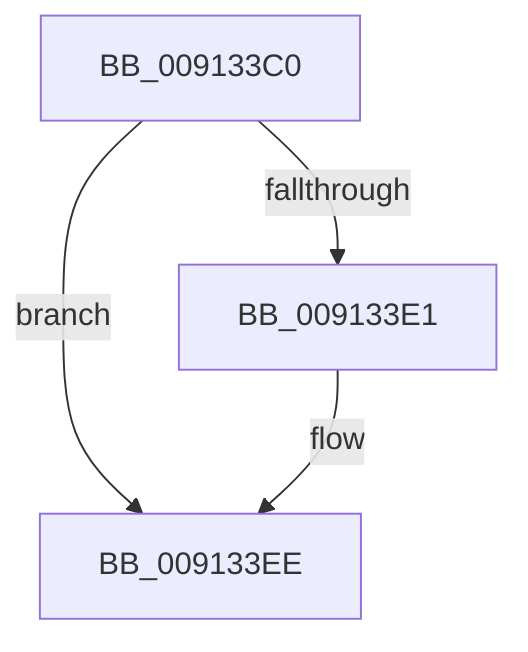

# PsInvokeWin32Callout

- RVA: `0x009133C0`–`0x009133FC` (길이 `60` bytes)
- VA: `0x00000001409133C0`
- 실행 섹션: `PAGE`
- PDB 이름 있음: `예`; PDB Function 태그: `아니요`
- unwind 정보 RVA: `0x0008A418`
- 디코드: `18`개 명령, `60/60` bytes 표시
- 미해석 바이트: `0` (있으면 어셈블리에 `.byte`로 보존)

> 이 문서는 커널 이미지의 기계어와 PDB 기호를 분석해 생성했습니다. 4번과 5번은 함수 원형과 자료형을 바이너리 사용 방식에서 추정한 C 해석이며 원본 소스 복구 결과는 아닙니다.

## 1. Dependencies

- 직접 호출 지점: **1**; 고유 호출 대상: **1**
- 직접 호출자로 확인된 함수: **15**
- RIP 상대 이미지 참조: **0**

### Outgoing calls
- `0x009133F3` → [PspUpdateCalloutParameters](../../text/49/PspUpdateCalloutParameters_function_0049BBA4.md) (function, `0x0049BBA4`)

### Direct callers
- [SeCaptureAtomTableCallout](../../text/4E/SeCaptureAtomTableCallout_function_004E9BD0.md) at `0x004E9C6F`
- [PspSetProcessTimerDelayForWin32](../../text/5E/PspSetProcessTimerDelayForWin32_function_005E3DB8.md) at `0x005E3E96`
- [KiSystemCall64](../../text/6C/KiSystemCall64_function_006C4A40.md) at `0x006C4E53`
- [PspEnsureGuiThreadAndBatchFlush](../77/PspEnsureGuiThreadAndBatchFlush_function_0077E528.md) at `0x0077E57D`
- [PspShutdownCsrProcess](../78/PspShutdownCsrProcess_function_00780214.md) at `0x00780379`
- [PspQueryProcessInterferenceCountCallback](../78/PspQueryProcessInterferenceCountCallback_function_007851C0.md) at `0x00785251`
- [ExpWin32OpenProcedure](../90/ExpWin32OpenProcedure_function_009052D0.md) at `0x009053EA`
- [PopInvokeWin32CalloutWithWatchdog](PopInvokeWin32CalloutWithWatchdog_function_00913920.md) at `0x00913978`
- [PsRemoveDeepFreezeOptimizations](../AB/PsRemoveDeepFreezeOptimizations_function_00AB5FA4.md) at `0x00AB5FF5`
- [NtSetSystemInformation](../AF/NtSetSystemInformation_function_00AF4A60.md) at `0x00AF6332`
- [NtSetSystemInformation](../AF/NtSetSystemInformation_function_00AF4A60.md) at `0x00AF638F`
- [NtAddAtomEx](../AF/NtAddAtomEx_function_00AF7320.md) at `0x00AF7383`
- [NtDeleteAtom](../AF/NtDeleteAtom_function_00AF74E0.md) at `0x00AF750A`
- [NtFindAtom](../AF/NtFindAtom_function_00AF7560.md) at `0x00AF75B1`
- [NtQueryInformationAtom](../AF/NtQueryInformationAtom_function_00AF7720.md) at `0x00AF776E`
- [sub_00B20D64](../B2/Unknown_function_00B20D64.md) at `0x00B20D72`

### Static image references
- 디코드된 RIP-relative 메모리 참조가 없습니다.

## 2. Other-region calls and transfers

- 다른 실행 섹션으로 향하는 call: **1**
  - `0x009133F3` → [PspUpdateCalloutParameters](../../text/49/PspUpdateCalloutParameters_function_0049BBA4.md) (`PAGE` → `.text`)
- call이 아닌 외부 분기/꼬리 이동: **1**
  - `0x009133FA` → [sub_0091345D](Unknown_function_0091345D.md) (`tail-transfer`)

## 3. Assembly (complete function range)

```asm
009133C0  48 89 5C 24 18                  mov qword ptr [rsp + 0x18], rbx
009133C5  55                              push rbp
009133C6  48 83 EC 30                     sub rsp, 0x30
009133CA  33 C0                           xor eax, eax
009133CC  48 63 E9                        movsxd rbp, ecx
009133CF  48 89 44 24 24                  mov qword ptr [rsp + 0x24], rax
009133D4  48 8B DA                        mov rbx, rdx
009133D7  48 89 44 24 20                  mov qword ptr [rsp + 0x20], rax
009133DC  48 85 D2                        test rdx, rdx
009133DF  75 0D                           jne 0x1409133ee
009133E1  0F 57 C0                        xorps xmm0, xmm0
009133E4  48 8D 5C 24 20                  lea rbx, [rsp + 0x20]
009133E9  0F 11 44 24 20                  movups xmmword ptr [rsp + 0x20], xmm0
009133EE  48 8B D3                        mov rdx, rbx
009133F1  8B CD                           mov ecx, ebp
009133F3  E8 AC 87 B8 FF                  call 0x14049bba4
009133F8  85 C0                           test eax, eax
009133FA  74 61                           je 0x14091345d
```

## 4. C-style interpretation (structured pseudocode)

```c
__int64 __fastcall PsInvokeWin32Callout(int a1, __int64 a2)
{
    __int64 result;
    __int64 v_rbx;
    __int64 v_rsp;
    unsigned __int64 v_stack_m14;
    unsigned __int64 v_stack_m18;
    unsigned __int64 v_stack_p18;

    v_stack_p18 = v_rbx;
    v_rsp = (v_rsp) - (48);
    result = 0;
    v_stack_m14 = 0;
    v_stack_m18 = 0;
    v_rbx = a2;
    if (a2 == 0) {
        v_rbx = v_stack_m18;
        v_stack_m18 = v_xmm0;
    }
    result = PspUpdateCalloutParameters((unsigned int)((unsigned int)((int)(a1))), v_rbx, a3, a4);
}
```

## 5. (Beta) C Style

```c
int64_t PsInvokeWin32Callout(int32_t Arg1, int64_t Arg2)
{
    int64_t result;
    int64_t local_rbx;
    int64_t local_rsp;
    uint64_t v_stack_m14;
    uint64_t v_stack_m18;
    uint64_t v_stack_p18;

    v_stack_p18 = local_rbx;
    local_rsp = (local_rsp) - (48);
    result = 0;
    v_stack_m14 = 0;
    v_stack_m18 = 0;
    local_rbx = Arg2;
    if (Arg2 == 0) {
        local_rbx = v_stack_m18;
        v_stack_m18 = v_xmm0;
    }
    result = PspUpdateCalloutParameters((uint32_t)((uint32_t)((int32_t)(Arg1))), local_rbx, a3, a4);
}
```

## 6. Execution-region graph

[열기: 2D/3D 그래프와 함수 탐색 컨트롤 패널](../../../control-panel.html?section=page&rva=0x009133C0&view=graph)

- 2D 그래프는 위에서 아래로 흐르고, 3D 그래프는 빈 공간을 드래그해 회전합니다. Shift+드래그는 이동, 휠은 확대·축소, 함수 노드 선택은 대상 보고서 이동입니다.

### Static fallback


