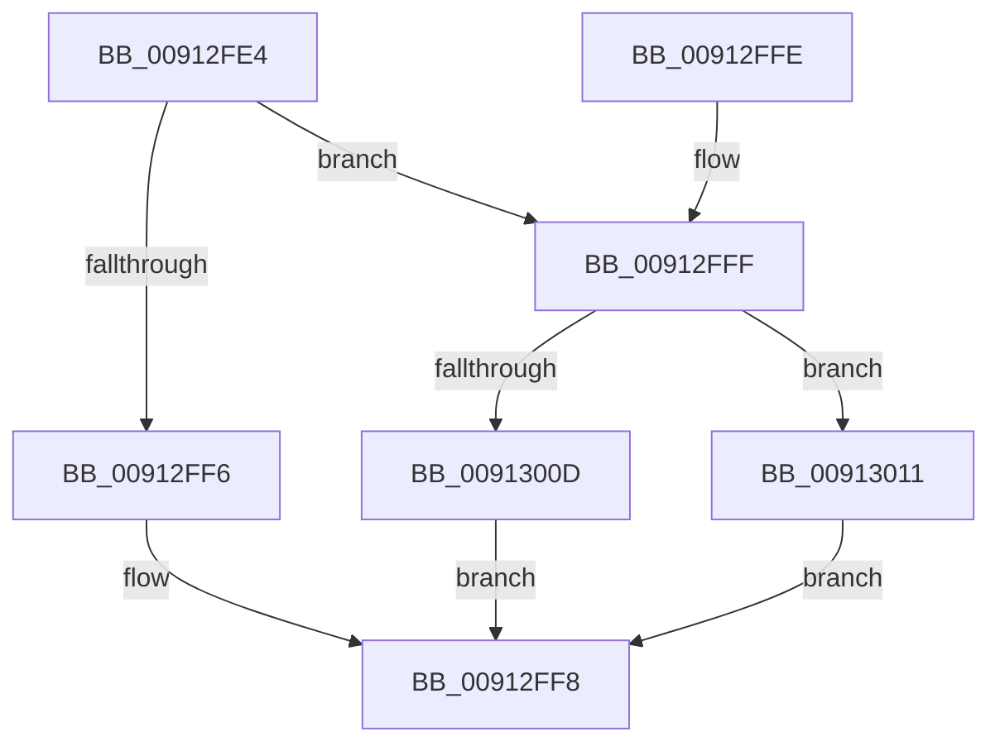

# PsIsServiceSession

- RVA: `0x00912FE4`–`0x00913022` (길이 `62` bytes)
- VA: `0x0000000140912FE4`
- 실행 섹션: `PAGE`
- PDB 이름 있음: `예`; PDB Function 태그: `아니요`
- unwind 정보 RVA: `0x000795DC`
- 디코드: `22`개 명령, `62/62` bytes 표시
- 미해석 바이트: `0` (있으면 어셈블리에 `.byte`로 보존)

> 이 문서는 커널 이미지의 기계어와 PDB 기호를 분석해 생성했습니다. 4번과 5번은 함수 원형과 자료형을 바이너리 사용 방식에서 추정한 C 해석이며 원본 소스 복구 결과는 아닙니다.

## 1. Dependencies

- 직접 호출 지점: **2**; 고유 호출 대상: **2**
- 직접 호출자로 확인된 함수: **1**
- RIP 상대 이미지 참조: **0**

### Outgoing calls
- `0x00913004` → [PsGetSiloBySessionId](PsGetSiloBySessionId_function_00912F94.md) (function, `0x00912F94`)
- `0x00913016` → [PsGetServerSiloServiceSessionId](../../text/45/PsGetServerSiloServiceSessionId_function_0045ED00.md) (function, `0x0045ED00`)

### Direct callers
- [PopGetSettingNotificationName](PopGetSettingNotificationName_function_0091346C.md) at `0x00913649`
- [PopGetSettingNotificationName](PopGetSettingNotificationName_function_0091346C.md) at `0x00913684`

### Static image references
- 디코드된 RIP-relative 메모리 참조가 없습니다.

## 2. Other-region calls and transfers

- 다른 실행 섹션으로 향하는 call: **1**
  - `0x00913016` → [PsGetServerSiloServiceSessionId](../../text/45/PsGetServerSiloServiceSessionId_function_0045ED00.md) (`PAGE` → `.text`)
- 별도 외부 분기/꼬리 이동을 확인하지 못했습니다.

## 3. Assembly (complete function range)

```asm
00912FE4  40 53                           push rbx
00912FE6  48 83 EC 20                     sub rsp, 0x20
00912FEA  48 83 64 24 38 00               and qword ptr [rsp + 0x38], 0
00912FF0  8B D9                           mov ebx, ecx
00912FF2  85 C9                           test ecx, ecx
00912FF4  75 09                           jne 0x140912fff
00912FF6  B0 01                           mov al, 1
00912FF8  48 83 C4 20                     add rsp, 0x20
00912FFC  5B                              pop rbx
00912FFD  C3                              ret
00912FFE  CC                              int3
00912FFF  48 8D 54 24 38                  lea rdx, [rsp + 0x38]
00913004  E8 8B FF FF FF                  call 0x140912f94
00913009  85 C0                           test eax, eax
0091300B  79 04                           jns 0x140913011
0091300D  32 C0                           xor al, al
0091300F  EB E7                           jmp 0x140912ff8
00913011  48 8B 4C 24 38                  mov rcx, qword ptr [rsp + 0x38]
00913016  E8 E5 BC B4 FF                  call 0x14045ed00
0091301B  3B C3                           cmp eax, ebx
0091301D  0F 94 C0                        sete al
00913020  EB D6                           jmp 0x140912ff8
```

## 4. C-style interpretation (structured pseudocode)

```c
__int64 __fastcall PsIsServiceSession(int a1)
{
    __int64 result;
    __int64 v_rsp;
    unsigned __int64 v_stack_p10;
    unsigned __int64 v_stack_p38;

    v_rsp = (v_rsp) - (32);
    if (a1 != 0) goto loc_00912FFF;
loc_00912FF8:
    v_rsp = (v_rsp) + (32);
    return 1;
loc_00912FFF:
    result = PsGetSiloBySessionId(a1, v_stack_p38, a3, a4);
    if (!sign_flag) goto loc_00913011;
    result = 0;
    goto loc_00912FF8;
loc_00913011:
    result = PsGetServerSiloServiceSessionId(v_stack_p38, v_stack_p38, a3, a4);
    result = (((unsigned int)(result)) == ((unsigned int)((unsigned int)(a1)))) ? 1 : 0;
    goto loc_00912FF8;
}
```

## 5. (Beta) C Style

```c
int64_t PsIsServiceSession(int32_t Arg1)
{
    int64_t result;
    int64_t local_rsp;
    uint64_t v_stack_p10;
    uint64_t v_stack_p38;

    local_rsp = (local_rsp) - (32);
    if (Arg1 != 0) goto loc_00912FFF;
loc_00912FF8:
    local_rsp = (local_rsp) + (32);
    return 1;
loc_00912FFF:
    result = PsGetSiloBySessionId(Arg1, v_stack_p38, a3, a4);
    if (!sign_flag) goto loc_00913011;
    result = 0;
    goto loc_00912FF8;
loc_00913011:
    result = PsGetServerSiloServiceSessionId(v_stack_p38, v_stack_p38, a3, a4);
    result = (((uint32_t)(result)) == ((uint32_t)((uint32_t)(Arg1)))) ? 1 : 0;
    goto loc_00912FF8;
}
```

## 6. Execution-region graph

[열기: 2D/3D 그래프와 함수 탐색 컨트롤 패널](../../../control-panel.html?section=page&rva=0x00912FE4&view=graph)

- 2D 그래프는 위에서 아래로 흐르고, 3D 그래프는 빈 공간을 드래그해 회전합니다. Shift+드래그는 이동, 휠은 확대·축소, 함수 노드 선택은 대상 보고서 이동입니다.

### Static fallback


