# PsQueryProcessEnergyValues

- RVA: `0x0091A4E0`–`0x0091A872` (길이 `914` bytes)
- VA: `0x000000014091A4E0`
- 실행 섹션: `PAGE`
- PDB 이름 있음: `예`; PDB Function 태그: `아니요`
- unwind 정보 RVA: `0x0008AE20`
- 디코드: `219`개 명령, `914/914` bytes 표시
- 미해석 바이트: `0` (있으면 어셈블리에 `.byte`로 보존)

> 이 문서는 커널 이미지의 기계어와 PDB 기호를 분석해 생성했습니다. 4번과 5번은 함수 원형과 자료형을 바이너리 사용 방식에서 추정한 C 해석이며 원본 소스 복구 결과는 아닙니다.

## 1. Dependencies

- 직접 호출 지점: **9**; 고유 호출 대상: **7**
- 직접 호출자로 확인된 함수: **6**
- RIP 상대 이미지 참조: **1**

### Outgoing calls
- `0x0091A50A` → [memset](../../text/6C/memset_function_006C6C40.md) (function, `0x006C6C40`)
- `0x0091A50F` → [PoEnergyEstimationEnabled](../../text/45/PoEnergyEstimationEnabled_function_00450000.md) (function, `0x00450000`)
- `0x0091A58C` → [KeQueryTimelineBitmapTime](../../text/45/KeQueryTimelineBitmapTime_function_0045D2CC.md) (function, `0x0045D2CC`)
- `0x0091A5D2` → [RtlStateDurationCapture](../../text/41/RtlStateDurationCapture_function_004173B0.md) (function, `0x004173B0`)
- `0x0091A634` → [RtlStateDurationCapture](../../text/41/RtlStateDurationCapture_function_004173B0.md) (function, `0x004173B0`)
- `0x0091A6CC` → [PspLockProcessThreadListShared](../../text/3E/PspLockProcessThreadListShared_function_003ECBA0.md) (function, `0x003ECBA0`)
- `0x0091A80D` → [PspUnlockProcessThreadListShared](../../text/3E/PspUnlockProcessThreadListShared_function_003ECC10.md) (function, `0x003ECC10`)
- `0x0091A848` → [RtlTimelineBitmapUpdateRange](../../text/43/RtlTimelineBitmapUpdateRange_function_00437C30.md) (function, `0x00437C30`)
- `0x0091A868` → [RtlTimelineBitmapUpdateRange](../../text/43/RtlTimelineBitmapUpdateRange_function_00437C30.md) (function, `0x00437C30`)

### Direct callers
- [PspQueryProcessAccountingInformationCallback](PspQueryProcessAccountingInformationCallback_function_00919E50.md) at `0x00919F57`
- [ExpGetProcessInformation](ExpGetProcessInformation_function_0091A878.md) at `0x0091AE9D`
- [PopEtProcessEnumSnapshotCallback](PopEtProcessEnumSnapshotCallback_function_0091CCA0.md) at `0x0091CD62`
- [PopEtEnergyContextProcessStateUpdate](../98/PopEtEnergyContextProcessStateUpdate_function_0098E418.md) at `0x0098E46C`
- [NtQueryInformationProcess](../9A/NtQueryInformationProcess_function_009AA250.md) at `0x009ADDEC`
- [PspFoldProcessAccountingIntoJob](../9F/PspFoldProcessAccountingIntoJob_function_009F59F8.md) at `0x009F5B77`

### Static image references
- `0x0091A51C` → RVA `0x00FC6B70` (`ALMOSTRO`; read)

## 2. Other-region calls and transfers

- 다른 실행 섹션으로 향하는 call: **9**
  - `0x0091A50A` → [memset](../../text/6C/memset_function_006C6C40.md) (`PAGE` → `.text`)
  - `0x0091A50F` → [PoEnergyEstimationEnabled](../../text/45/PoEnergyEstimationEnabled_function_00450000.md) (`PAGE` → `.text`)
  - `0x0091A58C` → [KeQueryTimelineBitmapTime](../../text/45/KeQueryTimelineBitmapTime_function_0045D2CC.md) (`PAGE` → `.text`)
  - `0x0091A5D2` → [RtlStateDurationCapture](../../text/41/RtlStateDurationCapture_function_004173B0.md) (`PAGE` → `.text`)
  - `0x0091A634` → [RtlStateDurationCapture](../../text/41/RtlStateDurationCapture_function_004173B0.md) (`PAGE` → `.text`)
  - `0x0091A6CC` → [PspLockProcessThreadListShared](../../text/3E/PspLockProcessThreadListShared_function_003ECBA0.md) (`PAGE` → `.text`)
  - `0x0091A80D` → [PspUnlockProcessThreadListShared](../../text/3E/PspUnlockProcessThreadListShared_function_003ECC10.md) (`PAGE` → `.text`)
  - `0x0091A848` → [RtlTimelineBitmapUpdateRange](../../text/43/RtlTimelineBitmapUpdateRange_function_00437C30.md) (`PAGE` → `.text`)
  - `0x0091A868` → [RtlTimelineBitmapUpdateRange](../../text/43/RtlTimelineBitmapUpdateRange_function_00437C30.md) (`PAGE` → `.text`)
- 별도 외부 분기/꼬리 이동을 확인하지 못했습니다.

## 3. Assembly (complete function range)

```asm
0091A4E0  48 89 5C 24 10                  mov qword ptr [rsp + 0x10], rbx
0091A4E5  48 89 4C 24 08                  mov qword ptr [rsp + 8], rcx
0091A4EA  55                              push rbp
0091A4EB  56                              push rsi
0091A4EC  57                              push rdi
0091A4ED  41 54                           push r12
0091A4EF  41 55                           push r13
0091A4F1  41 56                           push r14
0091A4F3  41 57                           push r15
0091A4F5  48 83 EC 20                     sub rsp, 0x20
0091A4F9  48 8B DA                        mov rbx, rdx
0091A4FC  4C 8B E9                        mov r13, rcx
0091A4FF  48 8B CB                        mov rcx, rbx
0091A502  33 D2                           xor edx, edx
0091A504  41 B8 B8 01 00 00               mov r8d, 0x1b8
0091A50A  E8 31 C7 DA FF                  call 0x1406c6c40
0091A50F  E8 EC 5A B3 FF                  call 0x140450000
0091A514  84 C0                           test al, al
0091A516  0F 84 F6 02 00 00               je 0x14091a812
0091A51C  4C 3B 2D 4D C6 6A 00            cmp r13, qword ptr [rip + 0x6ac64d]
0091A523  0F 84 E9 02 00 00               je 0x14091a812
0091A529  49 8B AD 68 06 00 00            mov rbp, qword ptr [r13 + 0x668]
0091A530  48 B9 04 00 00 00 80 F7 FF FF   movabs rcx, 0xfffff78000000004
0091A53A  48 8B 45 40                     mov rax, qword ptr [rbp + 0x40]
0091A53E  48 89 43 40                     mov qword ptr [rbx + 0x40], rax
0091A542  48 8B 45 48                     mov rax, qword ptr [rbp + 0x48]
0091A546  48 89 43 48                     mov qword ptr [rbx + 0x48], rax
0091A54A  48 8B 45 50                     mov rax, qword ptr [rbp + 0x50]
0091A54E  48 89 43 50                     mov qword ptr [rbx + 0x50], rax
0091A552  48 8B 45 58                     mov rax, qword ptr [rbp + 0x58]
0091A556  48 89 43 58                     mov qword ptr [rbx + 0x58], rax
0091A55A  48 8B 45 60                     mov rax, qword ptr [rbp + 0x60]
0091A55E  48 89 43 60                     mov qword ptr [rbx + 0x60], rax
0091A562  48 8B 85 B0 01 00 00            mov rax, qword ptr [rbp + 0x1b0]
0091A569  48 89 83 B0 01 00 00            mov qword ptr [rbx + 0x1b0], rax
0091A570  48 B8 20 03 00 00 80 F7 FF FF   movabs rax, 0xfffff78000000320
0091A57A  48 8B 00                        mov rax, qword ptr [rax]
0091A57D  8B 09                           mov ecx, dword ptr [rcx]
0091A57F  48 0F AF C8                     imul rcx, rax
0091A583  48 C1 E9 18                     shr rcx, 0x18
0091A587  48 89 4C 24 70                  mov qword ptr [rsp + 0x70], rcx
0091A58C  E8 3B 2D B4 FF                  call 0x14045d2cc
0091A591  4C 8B FD                        mov r15, rbp
0091A594  48 8D 93 10 01 00 00            lea rdx, [rbx + 0x110]
0091A59B  4C 2B FB                        sub r15, rbx
0091A59E  44 8B E0                        mov r12d, eax
0091A5A1  41 B8 0E 00 00 00               mov r8d, 0xe
0091A5A7  49 8B 0C 17                     mov rcx, qword ptr [r15 + rdx]
0091A5AB  48 89 0A                        mov qword ptr [rdx], rcx
0091A5AE  48 8D 52 08                     lea rdx, [rdx + 8]
0091A5B2  49 83 E8 01                     sub r8, 1
0091A5B6  75 EF                           jne 0x14091a5a7
0091A5B8  48 8B 7C 24 70                  mov rdi, qword ptr [rsp + 0x70]
0091A5BD  4C 8D 73 68                     lea r14, [rbx + 0x68]
0091A5C1  4D 8B DE                        mov r11, r14
0091A5C4  41 8D 70 03                     lea esi, [r8 + 3]
0091A5C8  4B 8D 14 3B                     lea rdx, [r11 + r15]
0091A5CC  44 8B C7                        mov r8d, edi
0091A5CF  49 8B CB                        mov rcx, r11
0091A5D2  E8 D9 CD AF FF                  call 0x1404173b0
0091A5D7  44 8B C0                        mov r8d, eax
0091A5DA  4D 3B DE                        cmp r11, r14
0091A5DD  74 10                           je 0x14091a5ef
0091A5DF  48 8D 43 70                     lea rax, [rbx + 0x70]
0091A5E3  4C 3B D8                        cmp r11, rax
0091A5E6  75 19                           jne 0x14091a601
0091A5E8  B8 38 01 00 00                  mov eax, 0x138
0091A5ED  EB 05                           jmp 0x14091a5f4
0091A5EF  B8 30 01 00 00                  mov eax, 0x130
0091A5F4  48 8D 0C 18                     lea rcx, [rax + rbx]
0091A5F8  48 85 C9                        test rcx, rcx
0091A5FB  0F 85 31 02 00 00               jne 0x14091a832
0091A601  49 83 C3 08                     add r11, 8
0091A605  48 83 EE 01                     sub rsi, 1
0091A609  75 BD                           jne 0x14091a5c8
0091A60B  4C 8B 6C 24 70                  mov r13, qword ptr [rsp + 0x70]
0091A610  4C 8D B3 88 01 00 00            lea r14, [rbx + 0x188]
0091A617  4C 8D 9B 80 01 00 00            lea r11, [rbx + 0x180]
0091A61E  BE 05 00 00 00                  mov esi, 5
0091A623  48 8D BB 10 01 00 00            lea rdi, [rbx + 0x110]
0091A62A  4B 8D 14 1F                     lea rdx, [r15 + r11]
0091A62E  45 8B C5                        mov r8d, r13d
0091A631  49 8B CB                        mov rcx, r11
0091A634  E8 77 CD AF FF                  call 0x1404173b0
0091A639  44 8B C0                        mov r8d, eax
0091A63C  4D 3B DE                        cmp r11, r14
0091A63F  74 23                           je 0x14091a664
0091A641  48 8D 83 90 01 00 00            lea rax, [rbx + 0x190]
0091A648  4C 3B D8                        cmp r11, rax
0091A64B  0F 84 D7 01 00 00               je 0x14091a828
0091A651  48 8D 83 98 01 00 00            lea rax, [rbx + 0x198]
0091A658  4C 3B D8                        cmp r11, rax
0091A65B  75 15                           jne 0x14091a672
0091A65D  B9 70 01 00 00                  mov ecx, 0x170
0091A662  EB 05                           jmp 0x14091a669
0091A664  B9 60 01 00 00                  mov ecx, 0x160
0091A669  48 03 CB                        add rcx, rbx
0091A66C  0F 85 E0 01 00 00               jne 0x14091a852
0091A672  49 83 C3 08                     add r11, 8
0091A676  48 83 EE 01                     sub rsi, 1
0091A67A  75 AE                           jne 0x14091a62a
0091A67C  8B 85 80 00 00 00               mov eax, dword ptr [rbp + 0x80]
0091A682  4C 8B 6C 24 60                  mov r13, qword ptr [rsp + 0x60]
0091A687  89 83 80 00 00 00               mov dword ptr [rbx + 0x80], eax
0091A68D  49 8B CD                        mov rcx, r13
0091A690  8B 85 84 00 00 00               mov eax, dword ptr [rbp + 0x84]
0091A696  89 83 84 00 00 00               mov dword ptr [rbx + 0x84], eax
0091A69C  8B 85 88 00 00 00               mov eax, dword ptr [rbp + 0x88]
0091A6A2  89 83 88 00 00 00               mov dword ptr [rbx + 0x88], eax
0091A6A8  8B 85 A8 01 00 00               mov eax, dword ptr [rbp + 0x1a8]
0091A6AE  89 83 A8 01 00 00               mov dword ptr [rbx + 0x1a8], eax
0091A6B4  8B 85 AC 01 00 00               mov eax, dword ptr [rbp + 0x1ac]
0091A6BA  89 83 AC 01 00 00               mov dword ptr [rbx + 0x1ac], eax
0091A6C0  65 48 8B 34 25 88 01 00 00      mov rsi, qword ptr gs:[0x188]
0091A6C9  48 8B D6                        mov rdx, rsi
0091A6CC  E8 CF 24 AD FF                  call 0x1403ecba0
0091A6D1  0F 10 45 00                     movups xmm0, xmmword ptr [rbp]
0091A6D5  4D 8D 9D 70 03 00 00            lea r11, [r13 + 0x370]
0091A6DC  0F 11 03                        movups xmmword ptr [rbx], xmm0
0091A6DF  0F 10 4D 10                     movups xmm1, xmmword ptr [rbp + 0x10]
0091A6E3  0F 11 4B 10                     movups xmmword ptr [rbx + 0x10], xmm1
0091A6E7  0F 10 45 20                     movups xmm0, xmmword ptr [rbp + 0x20]
0091A6EB  0F 11 43 20                     movups xmmword ptr [rbx + 0x20], xmm0
0091A6EF  0F 10 4D 30                     movups xmm1, xmmword ptr [rbp + 0x30]
0091A6F3  0F 11 4B 30                     movups xmmword ptr [rbx + 0x30], xmm1
0091A6F7  0F 10 85 90 00 00 00            movups xmm0, xmmword ptr [rbp + 0x90]
0091A6FE  0F 11 83 90 00 00 00            movups xmmword ptr [rbx + 0x90], xmm0
0091A705  0F 10 8D A0 00 00 00            movups xmm1, xmmword ptr [rbp + 0xa0]
0091A70C  0F 11 8B A0 00 00 00            movups xmmword ptr [rbx + 0xa0], xmm1
0091A713  0F 10 85 B0 00 00 00            movups xmm0, xmmword ptr [rbp + 0xb0]
0091A71A  0F 11 83 B0 00 00 00            movups xmmword ptr [rbx + 0xb0], xmm0
0091A721  0F 10 8D C0 00 00 00            movups xmm1, xmmword ptr [rbp + 0xc0]
0091A728  0F 11 8B C0 00 00 00            movups xmmword ptr [rbx + 0xc0], xmm1
0091A72F  0F 10 85 D0 00 00 00            movups xmm0, xmmword ptr [rbp + 0xd0]
0091A736  0F 11 83 D0 00 00 00            movups xmmword ptr [rbx + 0xd0], xmm0
0091A73D  0F 10 8D E0 00 00 00            movups xmm1, xmmword ptr [rbp + 0xe0]
0091A744  0F 11 8B E0 00 00 00            movups xmmword ptr [rbx + 0xe0], xmm1
0091A74B  0F 10 85 F0 00 00 00            movups xmm0, xmmword ptr [rbp + 0xf0]
0091A752  0F 11 83 F0 00 00 00            movups xmmword ptr [rbx + 0xf0], xmm0
0091A759  0F 10 8D 00 01 00 00            movups xmm1, xmmword ptr [rbp + 0x100]
0091A760  0F 11 8B 00 01 00 00            movups xmmword ptr [rbx + 0x100], xmm1
0091A767  4D 8B 0B                        mov r9, qword ptr [r11]
0091A76A  EB 35                           jmp 0x14091a7a1
0091A76C  48 8B 04 0A                     mov rax, qword ptr [rdx + rcx]
0091A770  48 01 01                        add qword ptr [rcx], rax
0091A773  48 8B 44 0A 40                  mov rax, qword ptr [rdx + rcx + 0x40]
0091A778  48 01 81 90 00 00 00            add qword ptr [rcx + 0x90], rax
0091A77F  48 8B 84 0A 80 00 00 00         mov rax, qword ptr [rdx + rcx + 0x80]
0091A787  48 01 81 D0 00 00 00            add qword ptr [rcx + 0xd0], rax
0091A78E  48 83 C1 08                     add rcx, 8
0091A792  49 83 EA 01                     sub r10, 1
0091A796  75 D4                           jne 0x14091a76c
0091A798  49 83 E8 01                     sub r8, 1
0091A79C  75 38                           jne 0x14091a7d6
0091A79E  4D 8B 09                        mov r9, qword ptr [r9]
0091A7A1  4D 3B CB                        cmp r9, r11
0091A7A4  74 61                           je 0x14091a807
0091A7A6  49 8B 91 10 01 00 00            mov rdx, qword ptr [r9 + 0x110]
0091A7AD  48 8B 82 C0 00 00 00            mov rax, qword ptr [rdx + 0xc0]
0091A7B4  8B 0F                           mov ecx, dword ptr [rdi]
0091A7B6  3B C1                           cmp eax, ecx
0091A7B8  77 24                           ja 0x14091a7de
0091A7BA  2B C8                           sub ecx, eax
0091A7BC  83 F9 20                        cmp ecx, 0x20
0091A7BF  73 09                           jae 0x14091a7ca
0091A7C1  48 C1 E8 20                     shr rax, 0x20
0091A7C5  D3 E0                           shl eax, cl
0091A7C7  09 47 04                        or dword ptr [rdi + 4], eax
0091A7CA  48 2B D3                        sub rdx, rbx
0091A7CD  48 8B CB                        mov rcx, rbx
0091A7D0  41 B8 04 00 00 00               mov r8d, 4
0091A7D6  41 BA 02 00 00 00               mov r10d, 2
0091A7DC  EB 8E                           jmp 0x14091a76c
0091A7DE  44 8B C0                        mov r8d, eax
0091A7E1  89 07                           mov dword ptr [rdi], eax
0091A7E3  44 2B C1                        sub r8d, ecx
0091A7E6  41 83 F8 20                     cmp r8d, 0x20
0091A7EA  73 16                           jae 0x14091a802
0091A7EC  41 8B C8                        mov ecx, r8d
0091A7EF  44 8B 47 04                     mov r8d, dword ptr [rdi + 4]
0091A7F3  41 D3 E0                        shl r8d, cl
0091A7F6  48 C1 E8 20                     shr rax, 0x20
0091A7FA  41 0B C0                        or eax, r8d
0091A7FD  89 47 04                        mov dword ptr [rdi + 4], eax
0091A800  EB C8                           jmp 0x14091a7ca
0091A802  45 33 C0                        xor r8d, r8d
0091A805  EB EF                           jmp 0x14091a7f6
0091A807  48 8B D6                        mov rdx, rsi
0091A80A  49 8B CD                        mov rcx, r13
0091A80D  E8 FE 23 AD FF                  call 0x1403ecc10
0091A812  48 8B 5C 24 68                  mov rbx, qword ptr [rsp + 0x68]
0091A817  48 83 C4 20                     add rsp, 0x20
0091A81B  41 5F                           pop r15
0091A81D  41 5E                           pop r14
0091A81F  41 5D                           pop r13
0091A821  41 5C                           pop r12
0091A823  5F                              pop rdi
0091A824  5E                              pop rsi
0091A825  5D                              pop rbp
0091A826  C3                              ret
0091A827  CC                              int3
0091A828  B9 68 01 00 00                  mov ecx, 0x168
0091A82D  E9 37 FE FF FF                  jmp 0x14091a669
0091A832  45 85 C0                        test r8d, r8d
0091A835  0F 84 C6 FD FF FF               je 0x14091a601
0091A83B  41 C1 E8 0C                     shr r8d, 0xc
0091A83F  41 8B D4                        mov edx, r12d
0091A842  41 2B D0                        sub edx, r8d
0091A845  45 8B C4                        mov r8d, r12d
0091A848  E8 E3 D3 B1 FF                  call 0x140437c30
0091A84D  E9 AF FD FF FF                  jmp 0x14091a601
0091A852  45 85 C0                        test r8d, r8d
0091A855  0F 84 17 FE FF FF               je 0x14091a672
0091A85B  41 C1 E8 0C                     shr r8d, 0xc
0091A85F  41 8B D4                        mov edx, r12d
0091A862  41 2B D0                        sub edx, r8d
0091A865  45 8B C4                        mov r8d, r12d
0091A868  E8 C3 D3 B1 FF                  call 0x140437c30
0091A86D  E9 00 FE FF FF                  jmp 0x14091a672
```

## 4. C-style interpretation (structured pseudocode)

```c
__int64 __fastcall PsQueryProcessEnergyValues(__int64 a1, __int64 a2)
{
    __int64 result;
    __int64 v_r10;
    __int64 v_r11;
    __int64 v_r15;
    __int64 v_rsi;
    __int64 v_rsp;
    unsigned __int64 v_stack_p10;
    unsigned __int64 v_stack_p18;
    unsigned __int64 v_stack_p8;

    v_stack_p10 = v_rbx;
    v_stack_p8 = a1;
    v_rsp = (v_rsp) - (32);
    a2 = 0;
    result = memset(a2, a2, 440, a4);
    result = PoEnergyEstimationEnabled(a2, a2, 440, a4);
    if ((unsigned __int8)(result) == 0) goto loc_0091A812;
    if (a1 == (*(unsigned __int64 *)(v_rip + 6997581))) goto loc_0091A812;
    *(unsigned __int64 *)(a2 + 64) = *(unsigned __int64 *)(*(unsigned __int64 *)(a1 + 1640) + 64);
    *(unsigned __int64 *)(a2 + 72) = *(unsigned __int64 *)(*(unsigned __int64 *)(a1 + 1640) + 72);
    *(unsigned __int64 *)(a2 + 80) = *(unsigned __int64 *)(*(unsigned __int64 *)(a1 + 1640) + 80);
    *(unsigned __int64 *)(a2 + 88) = *(unsigned __int64 *)(*(unsigned __int64 *)(a1 + 1640) + 88);
    *(unsigned __int64 *)(a2 + 96) = *(unsigned __int64 *)(*(unsigned __int64 *)(a1 + 1640) + 96);
    *(unsigned __int64 *)(a2 + 432) = *(unsigned __int64 *)(*(unsigned __int64 *)(a1 + 1640) + 432);
    a1 = ((unsigned int)(*(unsigned int *)(a2))) * (*(unsigned __int64 *)(*(unsigned __int64 *)(*(unsigned __int64 *)(a1 + 1640) + 432)));
    a1 = (a1) >> (24);
    v_stack_p18 = a1;
    result = KeQueryTimelineBitmapTime(a1, a2, 440, a4);
    v_r15 = (*(unsigned __int64 *)(a1 + 1640)) - (0);
loc_0091A5A7:
    *(unsigned __int64 *)(a2 + 272) = *(unsigned __int64 *)(v_r15 + a2 + 272 * 1);
    a3 = (14) - (1);
    if (condition_is_not_equal) goto loc_0091A5A7;
loc_0091A5C8:
    result = RtlStateDurationCapture(a2 + 104, a2 + 104 + v_r15 * 1, (unsigned int)((unsigned int)(v_stack_p18)), a4);
    if ((a2 + 104) == (a2 + 104)) goto loc_0091A5EF;
    if ((a2 + 104) != (a2 + 112)) goto loc_0091A601;
    goto loc_0091A5F4;
loc_0091A5EF:
loc_0091A5F4:
    if (304 + a2 * 1 != 0) goto loc_0091A832;
loc_0091A601:
    v_r11 = (a2 + 104) + (8);
    v_rsi = (a3 + 3) - (1);
    if (condition_is_not_equal) goto loc_0091A5C8;
loc_0091A62A:
    result = RtlStateDurationCapture(a2 + 384, v_r15 + a2 + 384 * 1, (unsigned int)((unsigned int)(v_stack_p18)), a4);
    if ((a2 + 384) == (a2 + 392)) goto loc_0091A664;
    if ((a2 + 384) == (a2 + 400)) goto loc_0091A828;
    if ((a2 + 384) != (a2 + 408)) goto loc_0091A672;
    goto loc_0091A669;
loc_0091A664:
loc_0091A669:
    a1 = (352) + (0);
    if (condition_is_not_equal) goto loc_0091A852;
loc_0091A672:
    v_r11 = (a2 + 384) + (8);
    v_rsi = (5) - (1);
    if (condition_is_not_equal) goto loc_0091A62A;
    *(unsigned int *)(a2 + 128) = (unsigned int)((unsigned int)(*(unsigned int *)(*(unsigned __int64 *)(a1 + 1640) + 128)));
    *(unsigned int *)(a2 + 132) = (unsigned int)((unsigned int)(*(unsigned int *)(*(unsigned __int64 *)(a1 + 1640) + 132)));
    *(unsigned int *)(a2 + 136) = (unsigned int)((unsigned int)(*(unsigned int *)(*(unsigned __int64 *)(a1 + 1640) + 136)));
    *(unsigned int *)(a2 + 424) = (unsigned int)((unsigned int)(*(unsigned int *)(*(unsigned __int64 *)(a1 + 1640) + 424)));
    *(unsigned int *)(a2 + 428) = (unsigned int)((unsigned int)(*(unsigned int *)(*(unsigned __int64 *)(a1 + 1640) + 428)));
    result = PspLockProcessThreadListShared(v_stack_p8, *(unsigned __int64 *)(gs_base + (0 + 392)), (unsigned int)((unsigned int)(result)), a4);
    *(unsigned __int64 *)(a2) = v_xmm0;
    *(unsigned __int64 *)(a2 + 16) = v_xmm1;
    *(unsigned __int64 *)(a2 + 32) = v_xmm0;
    *(unsigned __int64 *)(a2 + 48) = v_xmm1;
    *(unsigned __int64 *)(a2 + 144) = v_xmm0;
    *(unsigned __int64 *)(a2 + 160) = v_xmm1;
    *(unsigned __int64 *)(a2 + 176) = v_xmm0;
    *(unsigned __int64 *)(a2 + 192) = v_xmm1;
    *(unsigned __int64 *)(a2 + 208) = v_xmm0;
    *(unsigned __int64 *)(a2 + 224) = v_xmm1;
    *(unsigned __int64 *)(a2 + 240) = v_xmm0;
    *(unsigned __int64 *)(a2 + 256) = v_xmm1;
    goto loc_0091A7A1;
loc_0091A76C:
    a1 = (v_stack_p8) + (8);
    v_r10 = (v_r10) - (1);
    if (condition_is_not_equal) goto loc_0091A76C;
    a3 = ((unsigned int)((unsigned int)(result))) - (1);
    if (condition_is_not_equal) goto loc_0091A7D6;
loc_0091A7A1:
    if ((*(unsigned __int64 *)(*(unsigned __int64 *)(v_stack_p8 + 880))) == (v_stack_p8 + 880)) goto loc_0091A807;
    if (((unsigned int)(*(unsigned __int64 *)(*(unsigned __int64 *)(*(unsigned __int64 *)(*(unsigned __int64 *)(v_stack_p8 + 880)) + 272) + 192))) > ((unsigned int)((unsigned int)(*(unsigned int *)(a2 + 272))))) goto loc_0091A7DE;
    a1 = (unsigned int)(((unsigned int)(*(unsigned int *)(a2 + 272))) - ((unsigned int)(*(unsigned __int64 *)(*(unsigned __int64 *)(*(unsigned __int64 *)(*(unsigned __int64 *)(v_stack_p8 + 880)) + 272) + 192))));
    result = *(unsigned __int64 *)(*(unsigned __int64 *)(*(unsigned __int64 *)(*(unsigned __int64 *)(v_stack_p8 + 880)) + 272) + 192);
    if (((unsigned int)(a1)) < 32) {
        result = (*(unsigned __int64 *)(*(unsigned __int64 *)(*(unsigned __int64 *)(*(unsigned __int64 *)(v_stack_p8 + 880)) + 272) + 192)) >> (32);
        result = (unsigned int)((result) << ((unsigned __int8)(a1)));
    }
    a2 = (*(unsigned __int64 *)(*(unsigned __int64 *)(*(unsigned __int64 *)(v_stack_p8 + 880)) + 272)) - (0);
loc_0091A7D6:
    goto loc_0091A76C;
loc_0091A7DE:
    *(unsigned int *)(a2 + 272) = (unsigned int)(result);
    a3 = (unsigned int)(((unsigned int)((unsigned int)(result))) - ((unsigned int)(a2)));
    if (((unsigned int)(a3)) >= 32) goto loc_0091A802;
    a3 = (unsigned int)(((unsigned int)(*(unsigned int *)(a2 + 272 + 4))) << ((unsigned __int8)((unsigned int)((unsigned int)(a3)))));
loc_0091A7F6:
    result = (result) >> (32);
    result = (unsigned int)((result) | ((unsigned int)(a3)));
    *(unsigned int *)(a2 + 272 + 4) = (unsigned int)(result);
    goto loc_0091A7CA;
loc_0091A802:
    a3 = 0;
    goto loc_0091A7F6;
loc_0091A807:
    result = PspUnlockProcessThreadListShared(v_stack_p8, *(unsigned __int64 *)(gs_base + (0 + 392)), a3, *(unsigned __int64 *)(*(unsigned __int64 *)(v_stack_p8 + 880)));
loc_0091A812:
    v_rsp = (v_rsp) + (32);
    return result;
loc_0091A828:
    goto loc_0091A669;
loc_0091A832:
    if (0 == 0) goto loc_0091A601;
    a3 = (unsigned int)((a3) >> (12));
    a2 = (unsigned int)(((unsigned int)((unsigned int)((unsigned int)((unsigned int)(result))))) - ((unsigned int)(a3)));
    result = RtlTimelineBitmapUpdateRange(360, a2, (unsigned int)((unsigned int)((unsigned int)((unsigned int)(result)))), *(unsigned __int64 *)(*(unsigned __int64 *)(v_stack_p8 + 880)));
    goto loc_0091A601;
loc_0091A852:
    if ((unsigned int)((unsigned int)((unsigned int)((unsigned int)((unsigned int)(result))))) == 0) goto loc_0091A672;
    a3 = (unsigned int)(((unsigned int)((unsigned int)((unsigned int)((unsigned int)(result))))) >> (12));
    a2 = (unsigned int)(((unsigned int)((unsigned int)((unsigned int)((unsigned int)(result))))) - ((unsigned int)(a3)));
    result = RtlTimelineBitmapUpdateRange(360, a2, (unsigned int)((unsigned int)((unsigned int)((unsigned int)(result)))), *(unsigned __int64 *)(*(unsigned __int64 *)(v_stack_p8 + 880)));
    goto loc_0091A672;
}
```

## 5. (Beta) C Style

```c
int64_t PsQueryProcessEnergyValues(int64_t Arg1, void *Arg2)
{
    uint8_t *arg2 = (uint8_t *)Arg2;

    int64_t result;
    int64_t local_r10;
    int64_t local_r11;
    int64_t local_r15;
    int64_t local_rsi;
    int64_t local_rsp;
    uint64_t v_stack_p10;
    uint64_t v_stack_p18;
    uint64_t v_stack_p8;

    v_stack_p10 = local_rbx;
    v_stack_p8 = Arg1;
    local_rsp = (local_rsp) - (32);
    Arg2 = 0;
    result = memset(Arg2, Arg2, 440, a4);
    result = PoEnergyEstimationEnabled(Arg2, Arg2, 440, a4);
    if ((uint8_t)(result) == 0) goto loc_0091A812;
    if (Arg1 == (*(uint64_t *)(v_rip + 0x6AC64D))) goto loc_0091A812;
    *(uint64_t *)(arg2 + 0x40) = *(uint64_t *)(*(uint64_t *)(Arg1 + 0x668) + 0x40);
    *(uint64_t *)(arg2 + 0x48) = *(uint64_t *)(*(uint64_t *)(Arg1 + 0x668) + 0x48);
    *(uint64_t *)(arg2 + 0x50) = *(uint64_t *)(*(uint64_t *)(Arg1 + 0x668) + 0x50);
    *(uint64_t *)(arg2 + 0x58) = *(uint64_t *)(*(uint64_t *)(Arg1 + 0x668) + 0x58);
    *(uint64_t *)(arg2 + 0x60) = *(uint64_t *)(*(uint64_t *)(Arg1 + 0x668) + 0x60);
    *(uint64_t *)(arg2 + 0x1B0) = *(uint64_t *)(*(uint64_t *)(Arg1 + 0x668) + 0x1B0);
    Arg1 = ((uint32_t)(*(uint32_t *)(arg2))) * (*(uint64_t *)(*(uint64_t *)(*(uint64_t *)(Arg1 + 0x668) + 0x1B0)));
    Arg1 = (Arg1) >> (24);
    v_stack_p18 = Arg1;
    result = KeQueryTimelineBitmapTime(Arg1, Arg2, 440, a4);
    local_r15 = (*(uint64_t *)(Arg1 + 0x668)) - (0);
loc_0091A5A7:
    *(uint64_t *)(arg2 + 0x110) = *(uint64_t *)(local_r15 + arg2 + 0x110 * 1);
    a3 = (14) - (1);
    if (condition_is_not_equal) goto loc_0091A5A7;
loc_0091A5C8:
    result = RtlStateDurationCapture(Arg2 + 104, Arg2 + 104 + local_r15 * 1, (uint32_t)((uint32_t)(v_stack_p18)), a4);
    if ((Arg2 + 104) == (Arg2 + 104)) goto loc_0091A5EF;
    if ((Arg2 + 104) != (Arg2 + 112)) goto loc_0091A601;
    goto loc_0091A5F4;
loc_0091A5EF:
loc_0091A5F4:
    if (304 + Arg2 * 1 != 0) goto loc_0091A832;
loc_0091A601:
    local_r11 = (Arg2 + 104) + (8);
    local_rsi = (a3 + 3) - (1);
    if (condition_is_not_equal) goto loc_0091A5C8;
loc_0091A62A:
    result = RtlStateDurationCapture(Arg2 + 384, local_r15 + Arg2 + 384 * 1, (uint32_t)((uint32_t)(v_stack_p18)), a4);
    if ((Arg2 + 384) == (Arg2 + 392)) goto loc_0091A664;
    if ((Arg2 + 384) == (Arg2 + 400)) goto loc_0091A828;
    if ((Arg2 + 384) != (Arg2 + 408)) goto loc_0091A672;
    goto loc_0091A669;
loc_0091A664:
loc_0091A669:
    Arg1 = (352) + (0);
    if (condition_is_not_equal) goto loc_0091A852;
loc_0091A672:
    local_r11 = (Arg2 + 384) + (8);
    local_rsi = (5) - (1);
    if (condition_is_not_equal) goto loc_0091A62A;
    *(uint32_t *)(arg2 + 0x80) = (uint32_t)((uint32_t)(*(uint32_t *)(*(uint64_t *)(Arg1 + 0x668) + 0x80)));
    *(uint32_t *)(arg2 + 0x84) = (uint32_t)((uint32_t)(*(uint32_t *)(*(uint64_t *)(Arg1 + 0x668) + 0x84)));
    *(uint32_t *)(arg2 + 0x88) = (uint32_t)((uint32_t)(*(uint32_t *)(*(uint64_t *)(Arg1 + 0x668) + 0x88)));
    *(uint32_t *)(arg2 + 0x1A8) = (uint32_t)((uint32_t)(*(uint32_t *)(*(uint64_t *)(Arg1 + 0x668) + 0x1A8)));
    *(uint32_t *)(arg2 + 0x1AC) = (uint32_t)((uint32_t)(*(uint32_t *)(*(uint64_t *)(Arg1 + 0x668) + 0x1AC)));
    result = PspLockProcessThreadListShared(v_stack_p8, *(uint64_t *)(gs_base + (0 + 0x188)), (uint32_t)((uint32_t)(result)), a4);
    *(uint64_t *)(arg2) = v_xmm0;
    *(uint64_t *)(arg2 + 0x10) = v_xmm1;
    *(uint64_t *)(arg2 + 0x20) = v_xmm0;
    *(uint64_t *)(arg2 + 0x30) = v_xmm1;
    *(uint64_t *)(arg2 + 0x90) = v_xmm0;
    *(uint64_t *)(arg2 + 0xA0) = v_xmm1;
    *(uint64_t *)(arg2 + 0xB0) = v_xmm0;
    *(uint64_t *)(arg2 + 0xC0) = v_xmm1;
    *(uint64_t *)(arg2 + 0xD0) = v_xmm0;
    *(uint64_t *)(arg2 + 0xE0) = v_xmm1;
    *(uint64_t *)(arg2 + 0xF0) = v_xmm0;
    *(uint64_t *)(arg2 + 0x100) = v_xmm1;
    goto loc_0091A7A1;
loc_0091A76C:
    Arg1 = (v_stack_p8) + (8);
    local_r10 = (local_r10) - (1);
    if (condition_is_not_equal) goto loc_0091A76C;
    a3 = ((uint32_t)((uint32_t)(result))) - (1);
    if (condition_is_not_equal) goto loc_0091A7D6;
loc_0091A7A1:
    if ((*(uint64_t *)(*(uint64_t *)(v_stack_p8 + 0x370))) == (v_stack_p8 + 880)) goto loc_0091A807;
    if (((uint32_t)(*(uint64_t *)(*(uint64_t *)(*(uint64_t *)(*(uint64_t *)(v_stack_p8 + 0x370)) + 0x110) + 0xC0))) > ((uint32_t)((uint32_t)(*(uint32_t *)(arg2 + 0x110))))) goto loc_0091A7DE;
    Arg1 = (uint32_t)(((uint32_t)(*(uint32_t *)(arg2 + 0x110))) - ((uint32_t)(*(uint64_t *)(*(uint64_t *)(*(uint64_t *)(*(uint64_t *)(v_stack_p8 + 0x370)) + 0x110) + 0xC0))));
    result = *(uint64_t *)(*(uint64_t *)(*(uint64_t *)(*(uint64_t *)(v_stack_p8 + 0x370)) + 0x110) + 0xC0);
    if (((uint32_t)(Arg1)) < 32) {
        result = (*(uint64_t *)(*(uint64_t *)(*(uint64_t *)(*(uint64_t *)(v_stack_p8 + 0x370)) + 0x110) + 0xC0)) >> (32);
        result = (uint32_t)((result) << ((uint8_t)(Arg1)));
    }
    Arg2 = (*(uint64_t *)(*(uint64_t *)(*(uint64_t *)(v_stack_p8 + 0x370)) + 0x110)) - (0);
loc_0091A7D6:
    goto loc_0091A76C;
loc_0091A7DE:
    *(uint32_t *)(arg2 + 0x110) = (uint32_t)(result);
    a3 = (uint32_t)(((uint32_t)((uint32_t)(result))) - ((uint32_t)(Arg2)));
    if (((uint32_t)(a3)) >= 32) goto loc_0091A802;
    a3 = (uint32_t)(((uint32_t)(*(uint32_t *)(arg2 + 0x110 + 0x4))) << ((uint8_t)((uint32_t)((uint32_t)(a3)))));
loc_0091A7F6:
    result = (result) >> (32);
    result = (uint32_t)((result) | ((uint32_t)(a3)));
    *(uint32_t *)(arg2 + 0x110 + 0x4) = (uint32_t)(result);
    goto loc_0091A7CA;
loc_0091A802:
    a3 = 0;
    goto loc_0091A7F6;
loc_0091A807:
    result = PspUnlockProcessThreadListShared(v_stack_p8, *(uint64_t *)(gs_base + (0 + 0x188)), a3, *(uint64_t *)(*(uint64_t *)(v_stack_p8 + 0x370)));
loc_0091A812:
    local_rsp = (local_rsp) + (32);
    return result;
loc_0091A828:
    goto loc_0091A669;
loc_0091A832:
    if (0 == 0) goto loc_0091A601;
    a3 = (uint32_t)((a3) >> (12));
    Arg2 = (uint32_t)(((uint32_t)((uint32_t)((uint32_t)((uint32_t)(result))))) - ((uint32_t)(a3)));
    result = RtlTimelineBitmapUpdateRange(360, Arg2, (uint32_t)((uint32_t)((uint32_t)((uint32_t)(result)))), *(uint64_t *)(*(uint64_t *)(v_stack_p8 + 0x370)));
    goto loc_0091A601;
loc_0091A852:
    if ((uint32_t)((uint32_t)((uint32_t)((uint32_t)((uint32_t)(result))))) == 0) goto loc_0091A672;
    a3 = (uint32_t)(((uint32_t)((uint32_t)((uint32_t)((uint32_t)(result))))) >> (12));
    Arg2 = (uint32_t)(((uint32_t)((uint32_t)((uint32_t)((uint32_t)(result))))) - ((uint32_t)(a3)));
    result = RtlTimelineBitmapUpdateRange(360, Arg2, (uint32_t)((uint32_t)((uint32_t)((uint32_t)(result)))), *(uint64_t *)(*(uint64_t *)(v_stack_p8 + 0x370)));
    goto loc_0091A672;
}
```

### 관측된 메모리 오프셋

구조체 형식이 확인되지 않은 접근은 인자 기준의 오프셋으로만 기록했습니다.

| 기준 인자 | 오프셋 표현 | 폭 (bit) | 접근 |
|---|---:|---:|---|
| `Arg2` | `+ 0x0` | `32` | `R` |
| `Arg2` | `+ 0x0` | `32` | `W` |
| `Arg2` | `+ 0x0` | `64` | `R/W` |
| `Arg2` | `+ 0x0` | `64` | `W` |
| `Arg2` | `+ 0x0` | `128` | `R` |
| `Arg2` | `+ 0x4` | `32` | `R` |
| `Arg2` | `+ 0x4` | `32` | `R/W` |
| `Arg2` | `+ 0x4` | `32` | `W` |
| `Arg2` | `+ 0x8` | `64` | `R` |
| `Arg2` | `+ 0x10` | `128` | `R` |
| `Arg2` | `+ 0x20` | `128` | `R` |
| `Arg2` | `+ 0x30` | `128` | `R` |
| `Arg2` | `+ 0x40` | `64` | `W` |
| `Arg2` | `+ 0x48` | `64` | `W` |
| `Arg2` | `+ 0x50` | `64` | `W` |
| `Arg2` | `+ 0x58` | `64` | `W` |
| `Arg2` | `+ 0x60` | `64` | `W` |
| `Arg2` | `+ 0x68` | `64` | `R` |
| `Arg2` | `+ 0x70` | `64` | `R` |
| `Arg2` | `+ 0x80` | `32` | `W` |
| `Arg2` | `+ 0x84` | `32` | `W` |
| `Arg2` | `+ 0x88` | `32` | `W` |
| `Arg2` | `+ 0x90` | `64` | `R/W` |
| `Arg2` | `+ 0x90` | `128` | `R` |
| `Arg2` | `+ 0xA0` | `128` | `R` |
| `Arg2` | `+ 0xB0` | `128` | `R` |
| `Arg2` | `+ 0xC0` | `128` | `R` |
| `Arg2` | `+ 0xD0` | `64` | `R/W` |
| `Arg2` | `+ 0xD0` | `128` | `R` |
| `Arg2` | `+ 0xE0` | `128` | `R` |
| `Arg2` | `+ 0xF0` | `128` | `R` |
| `Arg2` | `+ 0x100` | `128` | `R` |

추가 오프셋 8개는 표에서 생략했습니다.

## 6. Execution-region graph

[열기: 2D/3D 그래프와 함수 탐색 컨트롤 패널](../../../control-panel.html?section=page&rva=0x0091A4E0&view=graph)

- 2D 그래프는 위에서 아래로 흐르고, 3D 그래프는 빈 공간을 드래그해 회전합니다. Shift+드래그는 이동, 휠은 확대·축소, 함수 노드 선택은 대상 보고서 이동입니다.

### Static fallback

```mermaid
flowchart TD
  bb_0091A4E0[BB_0091A4E0]
  bb_0091A51C[BB_0091A51C]
  bb_0091A529[BB_0091A529]
  bb_0091A5A7[BB_0091A5A7]
  bb_0091A5B8[BB_0091A5B8]
  bb_0091A5C8[BB_0091A5C8]
  bb_0091A5DF[BB_0091A5DF]
  bb_0091A5E8[BB_0091A5E8]
  bb_0091A5EF[BB_0091A5EF]
  bb_0091A5F4[BB_0091A5F4]
  bb_0091A601[BB_0091A601]
  bb_0091A60B[BB_0091A60B]
  bb_0091A62A[BB_0091A62A]
  bb_0091A641[BB_0091A641]
  bb_0091A651[BB_0091A651]
  bb_0091A65D[BB_0091A65D]
  bb_0091A664[BB_0091A664]
  bb_0091A669[BB_0091A669]
  bb_0091A672[BB_0091A672]
  bb_0091A67C[BB_0091A67C]
  bb_0091A76C[BB_0091A76C]
  bb_0091A798[BB_0091A798]
  bb_0091A79E[BB_0091A79E]
  bb_0091A7A1[BB_0091A7A1]
  bb_0091A7A6[BB_0091A7A6]
  bb_0091A7BA[BB_0091A7BA]
  bb_0091A7C1[BB_0091A7C1]
  bb_0091A7CA[BB_0091A7CA]
  bb_0091A7D6[BB_0091A7D6]
  bb_0091A7DE[BB_0091A7DE]
  bb_0091A7EC[BB_0091A7EC]
  bb_0091A7F6[BB_0091A7F6]
  bb_0091A802[BB_0091A802]
  bb_0091A807[BB_0091A807]
  bb_0091A812[BB_0091A812]
  bb_0091A827[BB_0091A827]
  bb_0091A828[BB_0091A828]
  bb_0091A832[BB_0091A832]
  bb_0091A83B[BB_0091A83B]
  bb_0091A852[BB_0091A852]
  bb_0091A85B[BB_0091A85B]
  bb_0091A4E0 -->|branch| bb_0091A812
  bb_0091A4E0 -->|fallthrough| bb_0091A51C
  bb_0091A51C -->|branch| bb_0091A812
  bb_0091A51C -->|fallthrough| bb_0091A529
  bb_0091A529 -->|flow| bb_0091A5A7
  bb_0091A5A7 -->|branch| bb_0091A5A7
  bb_0091A5A7 -->|fallthrough| bb_0091A5B8
  bb_0091A5B8 -->|flow| bb_0091A5C8
  bb_0091A5C8 -->|branch| bb_0091A5EF
  bb_0091A5C8 -->|fallthrough| bb_0091A5DF
  bb_0091A5DF -->|branch| bb_0091A601
  bb_0091A5DF -->|fallthrough| bb_0091A5E8
  bb_0091A5E8 -->|branch| bb_0091A5F4
  bb_0091A5EF -->|flow| bb_0091A5F4
  bb_0091A5F4 -->|branch| bb_0091A832
  bb_0091A5F4 -->|fallthrough| bb_0091A601
  bb_0091A601 -->|branch| bb_0091A5C8
  bb_0091A601 -->|fallthrough| bb_0091A60B
  bb_0091A60B -->|flow| bb_0091A62A
  bb_0091A62A -->|branch| bb_0091A664
  bb_0091A62A -->|fallthrough| bb_0091A641
  bb_0091A641 -->|branch| bb_0091A828
  bb_0091A641 -->|fallthrough| bb_0091A651
  bb_0091A651 -->|branch| bb_0091A672
  bb_0091A651 -->|fallthrough| bb_0091A65D
  bb_0091A65D -->|branch| bb_0091A669
  bb_0091A664 -->|flow| bb_0091A669
  bb_0091A669 -->|branch| bb_0091A852
  bb_0091A669 -->|fallthrough| bb_0091A672
  bb_0091A672 -->|branch| bb_0091A62A
  bb_0091A672 -->|fallthrough| bb_0091A67C
  bb_0091A67C -->|branch| bb_0091A7A1
  bb_0091A76C -->|branch| bb_0091A76C
  bb_0091A76C -->|fallthrough| bb_0091A798
  bb_0091A798 -->|branch| bb_0091A7D6
  bb_0091A798 -->|fallthrough| bb_0091A79E
  bb_0091A79E -->|flow| bb_0091A7A1
  bb_0091A7A1 -->|branch| bb_0091A807
  bb_0091A7A1 -->|fallthrough| bb_0091A7A6
  bb_0091A7A6 -->|branch| bb_0091A7DE
  bb_0091A7A6 -->|fallthrough| bb_0091A7BA
  bb_0091A7BA -->|branch| bb_0091A7CA
  bb_0091A7BA -->|fallthrough| bb_0091A7C1
  bb_0091A7C1 -->|flow| bb_0091A7CA
  bb_0091A7CA -->|flow| bb_0091A7D6
  bb_0091A7D6 -->|branch| bb_0091A76C
  bb_0091A7DE -->|branch| bb_0091A802
  bb_0091A7DE -->|fallthrough| bb_0091A7EC
  bb_0091A7EC -->|flow| bb_0091A7F6
  bb_0091A7F6 -->|branch| bb_0091A7CA
  bb_0091A802 -->|branch| bb_0091A7F6
  bb_0091A807 -->|flow| bb_0091A812
  bb_0091A827 -->|flow| bb_0091A828
  bb_0091A828 -->|branch| bb_0091A669
  bb_0091A832 -->|branch| bb_0091A601
  bb_0091A832 -->|fallthrough| bb_0091A83B
  bb_0091A83B -->|branch| bb_0091A601
  bb_0091A852 -->|branch| bb_0091A672
  bb_0091A852 -->|fallthrough| bb_0091A85B
  bb_0091A85B -->|branch| bb_0091A672
```


