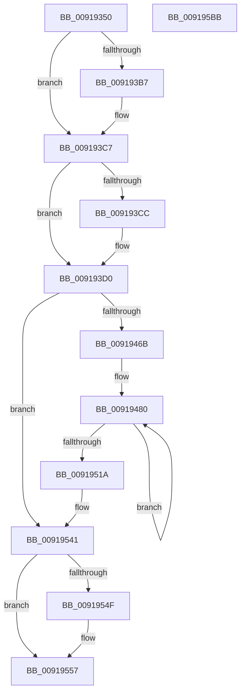

# PsQueryStatisticsProcess

- RVA: `0x00919350`–`0x009195BC` (길이 `620` bytes)
- VA: `0x0000000140919350`
- 실행 섹션: `PAGE`
- PDB 이름 있음: `예`; PDB Function 태그: `아니요`
- unwind 정보 RVA: `0x0008ACD4`
- 디코드: `139`개 명령, `620/620` bytes 표시
- 미해석 바이트: `0` (있으면 어셈블리에 `.byte`로 보존)

> 이 문서는 커널 이미지의 기계어와 PDB 기호를 분석해 생성했습니다. 4번과 5번은 함수 원형과 자료형을 바이너리 사용 방식에서 추정한 C 해석이며 원본 소스 복구 결과는 아닙니다.

## 1. Dependencies

- 직접 호출 지점: **6**; 고유 호출 대상: **6**
- 직접 호출자로 확인된 함수: **7**
- RIP 상대 이미지 참조: **1**

### Outgoing calls
- `0x009193A1` → [KeAbPreAcquire](../../text/21/KeAbPreAcquire_function_00210230.md) (function, `0x00210230`)
- `0x009193C2` → [ExfAcquirePushLockSharedEx](../../text/21/ExfAcquirePushLockSharedEx_function_0021044C.md) (function, `0x0021044C`)
- `0x009194A2` → [KeQueryValuesThread](../../text/30/KeQueryValuesThread_function_0030EE30.md) (function, `0x0030EE30`)
- `0x00919552` → [ExfReleasePushLockShared](../../text/26/ExfReleasePushLockShared_function_00263440.md) (function, `0x00263440`)
- `0x0091955A` → [KeAbPostRelease](../../text/2E/KeAbPostRelease_function_002E1600.md) (function, `0x002E1600`)
- `0x00919564` → [KeLeaveCriticalRegionThread](../../text/25/KeLeaveCriticalRegionThread_function_0025EFF0.md) (function, `0x0025EFF0`)

### Direct callers
- [EtwpPsProvTraceProcess](../8A/EtwpPsProvTraceProcess_function_008A3954.md) at `0x008A3D48`
- [EtwTraceAppStateChange](../8A/EtwTraceAppStateChange_function_008A452C.md) at `0x008A47C5`
- [PspRemoveProcessFromJobChain](../90/PspRemoveProcessFromJobChain_function_00907288.md) at `0x00907389`
- [PspEnforceLimitsProcessCallback](PspEnforceLimitsProcessCallback_function_00919030.md) at `0x00919071`
- [ExpCopyProcessInfo](ExpCopyProcessInfo_function_00919134.md) at `0x00919169`
- [PspQueryProcessAccountingInformationCallback](PspQueryProcessAccountingInformationCallback_function_00919E50.md) at `0x00919EBB`
- [NtQueryInformationProcess](../9A/NtQueryInformationProcess_function_009AA250.md) at `0x009ABE71`

### Static image references
- `0x00919569` → RVA `0x00FC6AA0` (`ALMOSTRO`; read)

## 2. Other-region calls and transfers

- 다른 실행 섹션으로 향하는 call: **6**
  - `0x009193A1` → [KeAbPreAcquire](../../text/21/KeAbPreAcquire_function_00210230.md) (`PAGE` → `.text`)
  - `0x009193C2` → [ExfAcquirePushLockSharedEx](../../text/21/ExfAcquirePushLockSharedEx_function_0021044C.md) (`PAGE` → `.text`)
  - `0x009194A2` → [KeQueryValuesThread](../../text/30/KeQueryValuesThread_function_0030EE30.md) (`PAGE` → `.text`)
  - `0x00919552` → [ExfReleasePushLockShared](../../text/26/ExfReleasePushLockShared_function_00263440.md) (`PAGE` → `.text`)
  - `0x0091955A` → [KeAbPostRelease](../../text/2E/KeAbPostRelease_function_002E1600.md) (`PAGE` → `.text`)
  - `0x00919564` → [KeLeaveCriticalRegionThread](../../text/25/KeLeaveCriticalRegionThread_function_0025EFF0.md) (`PAGE` → `.text`)
- 별도 외부 분기/꼬리 이동을 확인하지 못했습니다.

## 3. Assembly (complete function range)

```asm
00919350  48 89 5C 24 10                  mov qword ptr [rsp + 0x10], rbx
00919355  48 89 4C 24 08                  mov qword ptr [rsp + 8], rcx
0091935A  55                              push rbp
0091935B  56                              push rsi
0091935C  57                              push rdi
0091935D  41 54                           push r12
0091935F  41 55                           push r13
00919361  41 56                           push r14
00919363  41 57                           push r15
00919365  48 83 EC 50                     sub rsp, 0x50
00919369  65 48 8B 04 25 88 01 00 00      mov rax, qword ptr gs:[0x188]
00919372  48 8D B1 E0 05 00 00            lea rsi, [rcx + 0x5e0]
00919379  0F 57 C0                        xorps xmm0, xmm0
0091937C  48 89 44 24 28                  mov qword ptr [rsp + 0x28], rax
00919381  48 8B DA                        mov rbx, rdx
00919384  48 8B E9                        mov rbp, rcx
00919387  45 33 C0                        xor r8d, r8d
0091938A  33 D2                           xor edx, edx
0091938C  66 FF 88 E4 01 00 00            dec word ptr [rax + 0x1e4]
00919393  48 8B CE                        mov rcx, rsi
00919396  90                              nop
00919397  0F 11 44 24 30                  movups xmmword ptr [rsp + 0x30], xmm0
0091939C  0F 11 44 24 40                  movups xmmword ptr [rsp + 0x40], xmm0
009193A1  E8 8A 6E 8F FF                  call 0x140210230
009193A6  48 8B F8                        mov rdi, rax
009193A9  B9 11 00 00 00                  mov ecx, 0x11
009193AE  33 C0                           xor eax, eax
009193B0  F0 48 0F B1 0E                  lock cmpxchg qword ptr [rsi], rcx
009193B5  74 10                           je 0x1409193c7
009193B7  4C 8B CE                        mov r9, rsi
009193BA  4C 8B C7                        mov r8, rdi
009193BD  33 D2                           xor edx, edx
009193BF  48 8B CE                        mov rcx, rsi
009193C2  E8 85 70 8F FF                  call 0x14021044c
009193C7  48 85 FF                        test rdi, rdi
009193CA  74 04                           je 0x1409193d0
009193CC  C6 47 0A 01                     mov byte ptr [rdi + 0xa], 1
009193D0  48 8B 85 80 01 00 00            mov rax, qword ptr [rbp + 0x180]
009193D7  4C 8B BD 38 01 00 00            mov r15, qword ptr [rbp + 0x138]
009193DE  4C 8B A5 40 01 00 00            mov r12, qword ptr [rbp + 0x140]
009193E5  4C 8B AD 48 01 00 00            mov r13, qword ptr [rbp + 0x148]
009193EC  48 8B BD 78 01 00 00            mov rdi, qword ptr [rbp + 0x178]
009193F3  48 89 84 24 A8 00 00 00         mov qword ptr [rsp + 0xa8], rax
009193FB  48 8B 85 20 01 00 00            mov rax, qword ptr [rbp + 0x120]
00919402  48 89 43 18                     mov qword ptr [rbx + 0x18], rax
00919406  48 8B 85 28 01 00 00            mov rax, qword ptr [rbp + 0x128]
0091940D  48 89 43 20                     mov qword ptr [rbx + 0x20], rax
00919411  48 8B 85 A0 03 00 00            mov rax, qword ptr [rbp + 0x3a0]
00919418  48 89 43 28                     mov qword ptr [rbx + 0x28], rax
0091941C  48 8B 85 A8 03 00 00            mov rax, qword ptr [rbp + 0x3a8]
00919423  48 89 43 30                     mov qword ptr [rbx + 0x30], rax
00919427  48 8B 85 B0 03 00 00            mov rax, qword ptr [rbp + 0x3b0]
0091942E  48 89 43 38                     mov qword ptr [rbx + 0x38], rax
00919432  48 8B 85 B8 03 00 00            mov rax, qword ptr [rbp + 0x3b8]
00919439  48 89 43 40                     mov qword ptr [rbx + 0x40], rax
0091943D  48 8B 85 C0 03 00 00            mov rax, qword ptr [rbp + 0x3c0]
00919444  48 89 43 48                     mov qword ptr [rbx + 0x48], rax
00919448  48 8B 85 C8 03 00 00            mov rax, qword ptr [rbp + 0x3c8]
0091944F  48 89 43 50                     mov qword ptr [rbx + 0x50], rax
00919453  48 8D 85 70 03 00 00            lea rax, [rbp + 0x370]
0091945A  4C 8B 30                        mov r14, qword ptr [rax]
0091945D  48 89 44 24 20                  mov qword ptr [rsp + 0x20], rax
00919462  4C 3B F0                        cmp r14, rax
00919465  0F 84 D6 00 00 00               je 0x140919541
0091946B  48 8B AC 24 A8 00 00 00         mov rbp, qword ptr [rsp + 0xa8]
00919473  48 8B F7                        mov rsi, rdi
00919476  66 66 0F 1F 84 00 00 00 00 00   nop word ptr [rax + rax]
00919480  41 8B 86 14 FD FF FF            mov eax, dword ptr [r14 - 0x2ec]
00919487  49 8D BE 88 FA FF FF            lea rdi, [r14 - 0x578]
0091948E  4C 03 F8                        add r15, rax
00919491  48 8D 54 24 30                  lea rdx, [rsp + 0x30]
00919496  8B 87 DC 02 00 00               mov eax, dword ptr [rdi + 0x2dc]
0091949C  48 8B CF                        mov rcx, rdi
0091949F  4C 03 E0                        add r12, rax
009194A2  E8 89 59 9F FF                  call 0x14030ee30
009194A7  8B 44 24 34                     mov eax, dword ptr [rsp + 0x34]
009194AB  48 03 74 24 40                  add rsi, qword ptr [rsp + 0x40]
009194B0  4C 03 E8                        add r13, rax
009194B3  48 8B 47 48                     mov rax, qword ptr [rdi + 0x48]
009194B7  48 01 43 18                     add qword ptr [rbx + 0x18], rax
009194BB  8B 87 54 01 00 00               mov eax, dword ptr [rdi + 0x154]
009194C1  48 01 43 20                     add qword ptr [rbx + 0x20], rax
009194C5  48 8B 87 80 03 00 00            mov rax, qword ptr [rdi + 0x380]
009194CC  48 01 43 28                     add qword ptr [rbx + 0x28], rax
009194D0  48 8B 87 88 03 00 00            mov rax, qword ptr [rdi + 0x388]
009194D7  48 01 43 30                     add qword ptr [rbx + 0x30], rax
009194DB  48 8B 87 90 03 00 00            mov rax, qword ptr [rdi + 0x390]
009194E2  48 01 43 38                     add qword ptr [rbx + 0x38], rax
009194E6  48 8B 8F 98 03 00 00            mov rcx, qword ptr [rdi + 0x398]
009194ED  48 01 4B 40                     add qword ptr [rbx + 0x40], rcx
009194F1  48 8B 8F A0 03 00 00            mov rcx, qword ptr [rdi + 0x3a0]
009194F8  48 01 4B 48                     add qword ptr [rbx + 0x48], rcx
009194FC  48 8B 8F A8 03 00 00            mov rcx, qword ptr [rdi + 0x3a8]
00919503  48 01 4B 50                     add qword ptr [rbx + 0x50], rcx
00919507  4D 8B 36                        mov r14, qword ptr [r14]
0091950A  48 03 6C 24 48                  add rbp, qword ptr [rsp + 0x48]
0091950F  4C 3B 74 24 20                  cmp r14, qword ptr [rsp + 0x20]
00919514  0F 85 66 FF FF FF               jne 0x140919480
0091951A  48 89 B4 24 A0 00 00 00         mov qword ptr [rsp + 0xa0], rsi
00919522  48 8B B4 24 90 00 00 00         mov rsi, qword ptr [rsp + 0x90]
0091952A  48 8B BC 24 A0 00 00 00         mov rdi, qword ptr [rsp + 0xa0]
00919532  48 81 C6 E0 05 00 00            add rsi, 0x5e0
00919539  48 89 AC 24 A8 00 00 00         mov qword ptr [rsp + 0xa8], rbp
00919541  33 C9                           xor ecx, ecx
00919543  B8 11 00 00 00                  mov eax, 0x11
00919548  F0 48 0F B1 0E                  lock cmpxchg qword ptr [rsi], rcx
0091954D  74 08                           je 0x140919557
0091954F  48 8B CE                        mov rcx, rsi
00919552  E8 E9 9E 94 FF                  call 0x140263440
00919557  48 8B CE                        mov rcx, rsi
0091955A  E8 A1 80 9C FF                  call 0x1402e1600
0091955F  48 8B 4C 24 28                  mov rcx, qword ptr [rsp + 0x28]
00919564  E8 87 5A 94 FF                  call 0x14025eff0
00919569  8B 0D 31 D5 6A 00               mov ecx, dword ptr [rip + 0x6ad531]
0091956F  8B C1                           mov eax, ecx
00919571  49 0F AF C7                     imul rax, r15
00919575  48 89 03                        mov qword ptr [rbx], rax
00919578  8B C1                           mov eax, ecx
0091957A  49 0F AF C4                     imul rax, r12
0091957E  48 89 43 08                     mov qword ptr [rbx + 8], rax
00919582  8B C1                           mov eax, ecx
00919584  49 0F AF C5                     imul rax, r13
00919588  48 89 43 10                     mov qword ptr [rbx + 0x10], rax
0091958C  8B C1                           mov eax, ecx
0091958E  48 0F AF C7                     imul rax, rdi
00919592  48 0F AF 8C 24 A8 00 00 00      imul rcx, qword ptr [rsp + 0xa8]
0091959B  48 89 43 58                     mov qword ptr [rbx + 0x58], rax
0091959F  48 89 4B 60                     mov qword ptr [rbx + 0x60], rcx
009195A3  48 8B 9C 24 98 00 00 00         mov rbx, qword ptr [rsp + 0x98]
009195AB  48 83 C4 50                     add rsp, 0x50
009195AF  41 5F                           pop r15
009195B1  41 5E                           pop r14
009195B3  41 5D                           pop r13
009195B5  41 5C                           pop r12
009195B7  5F                              pop rdi
009195B8  5E                              pop rsi
009195B9  5D                              pop rbp
009195BA  C3                              ret
009195BB  CC                              int3
```

## 4. C-style interpretation (structured pseudocode)

```c
__int64 __fastcall PsQueryStatisticsProcess(__int64 a1, __int64 a2, int a3)
{
    __int64 result;
    __int64 v_r12;
    __int64 v_r13;
    __int64 v_r15;
    __int64 v_rbp;
    __int64 v_rsi;
    __int64 v_rsp;
    unsigned __int64 v_stack_m40;
    unsigned __int64 v_stack_m48;
    unsigned int v_stack_m54;
    unsigned __int64 v_stack_m58;
    unsigned __int64 v_stack_m60;
    unsigned __int64 v_stack_m68;
    unsigned __int64 v_stack_p10;
    unsigned __int64 v_stack_p18;
    unsigned __int64 v_stack_p20;
    unsigned __int64 v_stack_p8;

    v_stack_p10 = v_rbx;
    v_stack_p8 = a1;
    v_rsp = (v_rsp) - (80);
    v_stack_m60 = *(unsigned __int64 *)(gs_base + (0 + 392));
    a3 = 0;
    a2 = 0;
    v_stack_m58 = v_xmm0;
    v_stack_m48 = v_xmm0;
    result = KeAbPreAcquire(a1 + 1504, a2, a3, a4);
    result = 0;
    if (!(condition_is_equal)) {
        a4 = a1 + 1504;
        a3 = 0;
        a2 = 0;
        a1 = a1 + 1504;
        result = ExfAcquirePushLockSharedEx(a1, a2, a3, a4);
    }
    if (result != 0) {
        *(unsigned __int8 *)(result + 10) = 1;
    }
    v_stack_p20 = *(unsigned __int64 *)(a1 + 384);
    *(unsigned __int64 *)(a2 + 24) = *(unsigned __int64 *)(a1 + 288);
    *(unsigned __int64 *)(a2 + 32) = *(unsigned __int64 *)(a1 + 296);
    *(unsigned __int64 *)(a2 + 40) = *(unsigned __int64 *)(a1 + 928);
    *(unsigned __int64 *)(a2 + 48) = *(unsigned __int64 *)(a1 + 936);
    *(unsigned __int64 *)(a2 + 56) = *(unsigned __int64 *)(a1 + 944);
    *(unsigned __int64 *)(a2 + 64) = *(unsigned __int64 *)(a1 + 952);
    *(unsigned __int64 *)(a2 + 72) = *(unsigned __int64 *)(a1 + 960);
    *(unsigned __int64 *)(a2 + 80) = *(unsigned __int64 *)(a1 + 968);
    v_stack_m68 = a1 + 880;
    if ((*(unsigned __int64 *)(a1 + 880)) == (a1 + 880)) goto loc_00919541;
loc_00919480:
    v_r15 = (*(unsigned __int64 *)(a1 + 312)) + ((unsigned int)(*(unsigned int *)(*(unsigned __int64 *)(a1 + 880) - 748)));
    v_r12 = (*(unsigned __int64 *)(a1 + 320)) + ((unsigned int)(*(unsigned int *)(*(unsigned __int64 *)(a1 + 880) - 1400 + 732)));
    result = KeQueryValuesThread(*(unsigned __int64 *)(a1 + 880) - 1400, v_stack_m58, a3, a4);
    v_rsi = (*(unsigned __int64 *)(a1 + 376)) + (v_stack_m48);
    v_r13 = (*(unsigned __int64 *)(a1 + 328)) + ((unsigned int)(v_stack_m54));
    v_rbp = (v_stack_p20) + (v_stack_m40);
    if ((*(unsigned __int64 *)(*(unsigned __int64 *)(a1 + 880))) != v_stack_m68) goto loc_00919480;
    v_stack_p18 = v_rsi;
    v_rsi = (v_stack_p8) + (0x5E0ULL);
    v_stack_p20 = v_rbp;
loc_00919541:
    a1 = 0;
    result = 17;
    if (!(condition_is_equal)) {
        a1 = v_rsi;
        result = ExfReleasePushLockShared(a1, v_stack_m58, a3, a4);
    }
    result = KeAbPostRelease(v_rsi, v_stack_m58, a3, a4);
    result = KeLeaveCriticalRegionThread(v_stack_m60, v_stack_m58, a3, a4);
    result = ((unsigned int)((unsigned int)((unsigned int)(*(unsigned int *)(v_rip + 7001393))))) * (v_r15);
    *(unsigned __int64 *)(a2) = result;
    result = ((unsigned int)((unsigned int)((unsigned int)(*(unsigned int *)(v_rip + 7001393))))) * (v_r12);
    *(unsigned __int64 *)(a2 + 8) = result;
    result = ((unsigned int)((unsigned int)((unsigned int)(*(unsigned int *)(v_rip + 7001393))))) * (v_r13);
    *(unsigned __int64 *)(a2 + 16) = result;
    result = ((unsigned int)((unsigned int)((unsigned int)(*(unsigned int *)(v_rip + 7001393))))) * (v_stack_p18);
    a1 = ((unsigned int)(*(unsigned int *)(v_rip + 7001393))) * (v_stack_p20);
    *(unsigned __int64 *)(a2 + 88) = result;
    *(unsigned __int64 *)(a2 + 96) = a1;
    v_rsp = (v_rsp) + (80);
    return result;
}
```

## 5. (Beta) C Style

```c
int64_t PsQueryStatisticsProcess(void *Arg1, void *Arg2, int32_t Arg3)
{
    uint8_t *arg1 = (uint8_t *)Arg1;
    uint8_t *arg2 = (uint8_t *)Arg2;

    int64_t result;
    int64_t local_r12;
    int64_t local_r13;
    int64_t local_r15;
    int64_t local_rbp;
    int64_t local_rsi;
    int64_t local_rsp;
    uint64_t v_stack_m40;
    uint64_t v_stack_m48;
    uint32_t v_stack_m54;
    uint64_t v_stack_m58;
    uint64_t v_stack_m60;
    uint64_t v_stack_m68;
    uint64_t v_stack_p10;
    uint64_t v_stack_p18;
    uint64_t v_stack_p20;
    uint64_t v_stack_p8;

    v_stack_p10 = local_rbx;
    v_stack_p8 = Arg1;
    local_rsp = (local_rsp) - (80);
    v_stack_m60 = *(uint64_t *)(gs_base + (0 + 0x188));
    Arg3 = 0;
    Arg2 = 0;
    v_stack_m58 = v_xmm0;
    v_stack_m48 = v_xmm0;
    result = KeAbPreAcquire(Arg1 + 1504, Arg2, Arg3, a4);
    result = 0;
    if (!(condition_is_equal)) {
        a4 = Arg1 + 1504;
        Arg3 = 0;
        Arg2 = 0;
        Arg1 = Arg1 + 1504;
        result = ExfAcquirePushLockSharedEx(Arg1, Arg2, Arg3, a4);
    }
    if (result != 0) {
        *(uint8_t *)(result + 0xA) = 1;
    }
    v_stack_p20 = *(uint64_t *)(arg1 + 0x180);
    *(uint64_t *)(arg2 + 0x18) = *(uint64_t *)(arg1 + 0x120);
    *(uint64_t *)(arg2 + 0x20) = *(uint64_t *)(arg1 + 0x128);
    *(uint64_t *)(arg2 + 0x28) = *(uint64_t *)(arg1 + 0x3A0);
    *(uint64_t *)(arg2 + 0x30) = *(uint64_t *)(arg1 + 0x3A8);
    *(uint64_t *)(arg2 + 0x38) = *(uint64_t *)(arg1 + 0x3B0);
    *(uint64_t *)(arg2 + 0x40) = *(uint64_t *)(arg1 + 0x3B8);
    *(uint64_t *)(arg2 + 0x48) = *(uint64_t *)(arg1 + 0x3C0);
    *(uint64_t *)(arg2 + 0x50) = *(uint64_t *)(arg1 + 0x3C8);
    v_stack_m68 = Arg1 + 880;
    if ((*(uint64_t *)(arg1 + 0x370)) == (Arg1 + 880)) goto loc_00919541;
loc_00919480:
    local_r15 = (*(uint64_t *)(arg1 + 0x138)) + ((uint32_t)(*(uint32_t *)(*(uint64_t *)(arg1 + 0x370) - 0x2EC)));
    local_r12 = (*(uint64_t *)(arg1 + 0x140)) + ((uint32_t)(*(uint32_t *)(*(uint64_t *)(arg1 + 0x370) - 0x578 + 0x2DC)));
    result = KeQueryValuesThread(*(uint64_t *)(arg1 + 0x370) - 1400, v_stack_m58, Arg3, a4);
    local_rsi = (*(uint64_t *)(arg1 + 0x178)) + (v_stack_m48);
    local_r13 = (*(uint64_t *)(arg1 + 0x148)) + ((uint32_t)(v_stack_m54));
    local_rbp = (v_stack_p20) + (v_stack_m40);
    if ((*(uint64_t *)(*(uint64_t *)(arg1 + 0x370))) != v_stack_m68) goto loc_00919480;
    v_stack_p18 = local_rsi;
    local_rsi = (v_stack_p8) + (0x5E0ULL);
    v_stack_p20 = local_rbp;
loc_00919541:
    Arg1 = 0;
    result = 17;
    if (!(condition_is_equal)) {
        Arg1 = local_rsi;
        result = ExfReleasePushLockShared(Arg1, v_stack_m58, Arg3, a4);
    }
    result = KeAbPostRelease(local_rsi, v_stack_m58, Arg3, a4);
    result = KeLeaveCriticalRegionThread(v_stack_m60, v_stack_m58, Arg3, a4);
    result = ((uint32_t)((uint32_t)((uint32_t)(*(uint32_t *)(v_rip + 0x6AD531))))) * (local_r15);
    *(uint64_t *)(arg2) = result;
    result = ((uint32_t)((uint32_t)((uint32_t)(*(uint32_t *)(v_rip + 0x6AD531))))) * (local_r12);
    *(uint64_t *)(arg2 + 0x8) = result;
    result = ((uint32_t)((uint32_t)((uint32_t)(*(uint32_t *)(v_rip + 0x6AD531))))) * (local_r13);
    *(uint64_t *)(arg2 + 0x10) = result;
    result = ((uint32_t)((uint32_t)((uint32_t)(*(uint32_t *)(v_rip + 0x6AD531))))) * (v_stack_p18);
    Arg1 = ((uint32_t)(*(uint32_t *)(v_rip + 0x6AD531))) * (v_stack_p20);
    *(uint64_t *)(arg2 + 0x58) = result;
    *(void **)(arg2 + 0x60) = Arg1;
    local_rsp = (local_rsp) + (80);
    return result;
}
```

### 관측된 메모리 오프셋

구조체 형식이 확인되지 않은 접근은 인자 기준의 오프셋으로만 기록했습니다.

| 기준 인자 | 오프셋 표현 | 폭 (bit) | 접근 |
|---|---:|---:|---|
| `Arg1` | `+ 0x0` | `64` | `R` |
| `Arg1` | `+ 0x0 + rax*1` | `16` | `R` |
| `Arg1` | `+ 0x120` | `64` | `R` |
| `Arg1` | `+ 0x128` | `64` | `R` |
| `Arg1` | `+ 0x138` | `64` | `R` |
| `Arg1` | `+ 0x140` | `64` | `R` |
| `Arg1` | `+ 0x148` | `64` | `R` |
| `Arg1` | `+ 0x178` | `64` | `R` |
| `Arg1` | `+ 0x180` | `64` | `R` |
| `Arg1` | `+ 0x370` | `64` | `R` |
| `Arg1` | `+ 0x3A0` | `64` | `R` |
| `Arg1` | `+ 0x3A8` | `64` | `R` |
| `Arg1` | `+ 0x3B0` | `64` | `R` |
| `Arg1` | `+ 0x3B8` | `64` | `R` |
| `Arg1` | `+ 0x3C0` | `64` | `R` |
| `Arg1` | `+ 0x3C8` | `64` | `R` |
| `Arg1` | `+ 0x5E0` | `64` | `R` |
| `Arg2` | `+ 0x0` | `64` | `W` |
| `Arg2` | `+ 0x8` | `64` | `W` |
| `Arg2` | `+ 0x10` | `64` | `W` |
| `Arg2` | `+ 0x18` | `64` | `R/W` |
| `Arg2` | `+ 0x18` | `64` | `W` |
| `Arg2` | `+ 0x20` | `64` | `R/W` |
| `Arg2` | `+ 0x20` | `64` | `W` |
| `Arg2` | `+ 0x28` | `64` | `R/W` |
| `Arg2` | `+ 0x28` | `64` | `W` |
| `Arg2` | `+ 0x30` | `64` | `R/W` |
| `Arg2` | `+ 0x30` | `64` | `W` |
| `Arg2` | `+ 0x38` | `64` | `R/W` |
| `Arg2` | `+ 0x38` | `64` | `W` |
| `Arg2` | `+ 0x40` | `64` | `R/W` |
| `Arg2` | `+ 0x40` | `64` | `W` |

추가 오프셋 6개는 표에서 생략했습니다.

## 6. Execution-region graph

[열기: 2D/3D 그래프와 함수 탐색 컨트롤 패널](../../../control-panel.html?section=page&rva=0x00919350&view=graph)

- 2D 그래프는 위에서 아래로 흐르고, 3D 그래프는 빈 공간을 드래그해 회전합니다. Shift+드래그는 이동, 휠은 확대·축소, 함수 노드 선택은 대상 보고서 이동입니다.

### Static fallback


