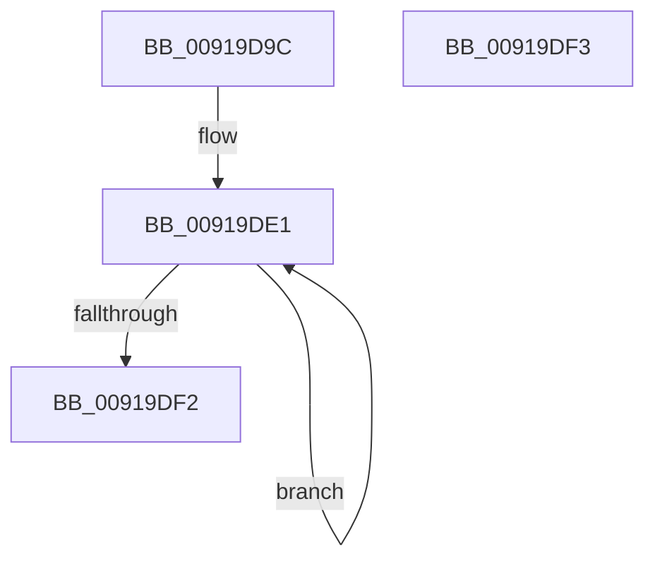

# PspAddAccountingValues

- RVA: `0x00919D9C`–`0x00919DF4` (길이 `88` bytes)
- VA: `0x0000000140919D9C`
- 실행 섹션: `PAGE`
- PDB 이름 있음: `예`; PDB Function 태그: `아니요`
- unwind 정보 RVA: `0x000DB714`
- 디코드: `25`개 명령, `88/88` bytes 표시
- 미해석 바이트: `0` (있으면 어셈블리에 `.byte`로 보존)

> 이 문서는 커널 이미지의 기계어와 PDB 기호를 분석해 생성했습니다. 4번과 5번은 함수 원형과 자료형을 바이너리 사용 방식에서 추정한 C 해석이며 원본 소스 복구 결과는 아닙니다.

## 1. Dependencies

- 직접 호출 지점: **0**; 고유 호출 대상: **0**
- 직접 호출자로 확인된 함수: **2**
- RIP 상대 이미지 참조: **0**

### Outgoing calls
- 직접 디코드된 call 명령이 없습니다.

### Direct callers
- [PspEnforceLimitsJobPostCallback](PspEnforceLimitsJobPostCallback_function_00919720.md) at `0x009199BD`
- [PspQueryProcessAccountingInformationCallback](PspQueryProcessAccountingInformationCallback_function_00919E50.md) at `0x00919EC7`

### Static image references
- 디코드된 RIP-relative 메모리 참조가 없습니다.

## 2. Other-region calls and transfers

- 다른 실행 섹션으로 향하는 call: **0**
- 별도 외부 분기/꼬리 이동을 확인하지 못했습니다.

## 3. Assembly (complete function range)

```asm
00919D9C  48 8B 02                        mov rax, qword ptr [rdx]
00919D9F  4C 8B C2                        mov r8, rdx
00919DA2  48 01 01                        add qword ptr [rcx], rax
00919DA5  48 8B 42 08                     mov rax, qword ptr [rdx + 8]
00919DA9  48 01 41 08                     add qword ptr [rcx + 8], rax
00919DAD  48 8B 42 18                     mov rax, qword ptr [rdx + 0x18]
00919DB1  48 01 41 18                     add qword ptr [rcx + 0x18], rax
00919DB5  48 8B 42 10                     mov rax, qword ptr [rdx + 0x10]
00919DB9  48 01 41 10                     add qword ptr [rcx + 0x10], rax
00919DBD  48 8B 42 58                     mov rax, qword ptr [rdx + 0x58]
00919DC1  48 01 41 58                     add qword ptr [rcx + 0x58], rax
00919DC5  48 8B 42 60                     mov rax, qword ptr [rdx + 0x60]
00919DC9  48 01 41 60                     add qword ptr [rcx + 0x60], rax
00919DCD  48 8B 42 20                     mov rax, qword ptr [rdx + 0x20]
00919DD1  48 8D 51 28                     lea rdx, [rcx + 0x28]
00919DD5  48 01 41 20                     add qword ptr [rcx + 0x20], rax
00919DD9  4C 2B C1                        sub r8, rcx
00919DDC  B9 06 00 00 00                  mov ecx, 6
00919DE1  49 8B 04 10                     mov rax, qword ptr [r8 + rdx]
00919DE5  48 01 02                        add qword ptr [rdx], rax
00919DE8  48 8D 52 08                     lea rdx, [rdx + 8]
00919DEC  48 83 E9 01                     sub rcx, 1
00919DF0  75 EF                           jne 0x140919de1
00919DF2  C3                              ret
00919DF3  CC                              int3
```

## 4. C-style interpretation (structured pseudocode)

```c
__int64 __fastcall PspAddAccountingValues(__int64 a1, __int64 a2)
{
    a3 = (a2) - (a1);
loc_00919DE1:
    a1 = (6) - (1);
    if (condition_is_not_equal) goto loc_00919DE1;
    return *(unsigned __int64 *)(a3 + a1 + 40 * 1);
}
```

## 5. (Beta) C Style

```c
int64_t PspAddAccountingValues(void *Arg1, void *Arg2)
{
    uint8_t *arg1 = (uint8_t *)Arg1;
    uint8_t *arg2 = (uint8_t *)Arg2;

    a3 = (Arg2) - (Arg1);
loc_00919DE1:
    Arg1 = (6) - (1);
    if (condition_is_not_equal) goto loc_00919DE1;
    return *(uint64_t *)(a3 + arg1 + 0x28 * 1);
}
```

### 관측된 메모리 오프셋

구조체 형식이 확인되지 않은 접근은 인자 기준의 오프셋으로만 기록했습니다.

| 기준 인자 | 오프셋 표현 | 폭 (bit) | 접근 |
|---|---:|---:|---|
| `Arg1` | `+ 0x0` | `64` | `R/W` |
| `Arg1` | `+ 0x8` | `64` | `R` |
| `Arg1` | `+ 0x8` | `64` | `R/W` |
| `Arg1` | `+ 0x10` | `64` | `R/W` |
| `Arg1` | `+ 0x18` | `64` | `R/W` |
| `Arg1` | `+ 0x20` | `64` | `R/W` |
| `Arg1` | `+ 0x28` | `64` | `R` |
| `Arg1` | `+ 0x58` | `64` | `R/W` |
| `Arg1` | `+ 0x60` | `64` | `R/W` |
| `Arg2` | `+ 0x0` | `64` | `R` |
| `Arg2` | `+ 0x0 + rdx*1` | `64` | `R` |
| `Arg2` | `+ 0x8` | `64` | `R` |
| `Arg2` | `+ 0x10` | `64` | `R` |
| `Arg2` | `+ 0x18` | `64` | `R` |
| `Arg2` | `+ 0x20` | `64` | `R` |
| `Arg2` | `+ 0x58` | `64` | `R` |
| `Arg2` | `+ 0x60` | `64` | `R` |

## 6. Execution-region graph

[열기: 2D/3D 그래프와 함수 탐색 컨트롤 패널](../../../control-panel.html?section=page&rva=0x00919D9C&view=graph)

- 2D 그래프는 위에서 아래로 흐르고, 3D 그래프는 빈 공간을 드래그해 회전합니다. Shift+드래그는 이동, 휠은 확대·축소, 함수 노드 선택은 대상 보고서 이동입니다.

### Static fallback


