# PspAllocateAndQueryNotificationChannel

- RVA: `0x00917EE4`–`0x00918371` (길이 `1,165` bytes)
- VA: `0x0000000140917EE4`
- 실행 섹션: `PAGE`
- PDB 이름 있음: `예`; PDB Function 태그: `아니요`
- unwind 정보 RVA: `0x0008AB18`
- 디코드: `289`개 명령, `1,165/1,165` bytes 표시
- 미해석 바이트: `0` (있으면 어셈블리에 `.byte`로 보존)

> 이 문서는 커널 이미지의 기계어와 PDB 기호를 분석해 생성했습니다. 4번과 5번은 함수 원형과 자료형을 바이너리 사용 방식에서 추정한 C 해석이며 원본 소스 복구 결과는 아닙니다.

## 1. Dependencies

- 직접 호출 지점: **26**; 고유 호출 대상: **23**
- 직접 호출자로 확인된 함수: **1**
- RIP 상대 이미지 참조: **4**

### Outgoing calls
- `0x00917F6E` → [PspLockRootJobExclusive](PspLockRootJobExclusive_function_00917D0C.md) (function, `0x00917D0C`)
- `0x00917F80` → [ExConvertExclusiveToSharedLite](../../text/34/ExConvertExclusiveToSharedLite_function_0034F700.md) (function, `0x0034F700`)
- `0x00917F8C` → [ExAcquireResourceExclusiveLite](../../text/21/ExAcquireResourceExclusiveLite_function_00214E20.md) (function, `0x00214E20`)
- `0x00917FE0` → [ExReleaseResourceLite](../../text/25/ExReleaseResourceLite_function_0025FA10.md) (function, `0x0025FA10`)
- `0x00917FEB` → [PspUnlockJob](PspUnlockJob_function_00919E00.md) (function, `0x00919E00`)
- `0x0091800C` → [PspDispatchWakeNotification](PspDispatchWakeNotification_function_00917E70.md) (function, `0x00917E70`)
- `0x00918021` → [ExFreePoolWithTag](../../poolcode/B8/ExFreePoolWithTag_function_00B82870.md) (function, `0x00B82870`)
- `0x00918031` → [ExFreePoolWithTag](../../poolcode/B8/ExFreePoolWithTag_function_00B82870.md) (function, `0x00B82870`)
- `0x00918044` → [ObReleaseObjectSecurityEx](../8C/ObReleaseObjectSecurityEx_function_008C6E30.md) (function, `0x008C6E30`)
- `0x00918052` → [_security_check_cookie](../../text/6A/_security_check_cookie_function_006AC640.md) (function, `0x006AC640`)
- `0x0091807E` → [ObpGetObjectSecurity](../87/ObpGetObjectSecurity_function_008717E0.md) (function, `0x008717E0`)
- `0x009180E9` → [PsReferencePrimaryTokenWithTag](../../text/20/PsReferencePrimaryTokenWithTag_function_0020FF80.md) (function, `0x0020FF80`)
- `0x00918103` → [SeQueryInformationToken](../8B/SeQueryInformationToken_function_008B5090.md) (function, `0x008B5090`)
- `0x0091812B` → [ObFastDereferenceObject](../../text/3E/ObFastDereferenceObject_function_003ED5F0.md) (function, `0x003ED5F0`)
- `0x0091815F` → [ExAllocatePool2](../../poolcode/B8/ExAllocatePool2_function_00B820F0.md) (function, `0x00B820F0`)
- `0x0091817D` → [RtlCreateAcl](RtlCreateAcl_function_00916F00.md) (function, `0x00916F00`)
- `0x0091819C` → [RtlpAddKnownAce](../92/RtlpAddKnownAce_function_00929A20.md) (function, `0x00929A20`)
- `0x009181C0` → [RtlpAddKnownAce](../92/RtlpAddKnownAce_function_00929A20.md) (function, `0x00929A20`)
- `0x00918208` → [ZwCreateWnfStateName](../../text/6A/ZwCreateWnfStateName_function_006AEB50.md) (function, `0x006AEB50`)
- `0x00918221` → [PspLockRootJobExclusive](PspLockRootJobExclusive_function_00917D0C.md) (function, `0x00917D0C`)
- `0x0091828A` → [PspEnumJobsAndProcessesInJobHierarchy](PspEnumJobsAndProcessesInJobHierarchy_function_0091A1EC.md) (function, `0x0091A1EC`)
- `0x009182C2` → [PspLockThreadSecurityShared](../../text/3C/PspLockThreadSecurityShared_function_003C4720.md) (function, `0x003C4720`)
- `0x009182E5` → [ObfReferenceObjectWithTag](../../text/21/ObfReferenceObjectWithTag_function_00210710.md) (function, `0x00210710`)
- `0x009182F0` → [PspUnlockThreadSecurityShared](../../text/3C/PspUnlockThreadSecurityShared_function_003C2E40.md) (function, `0x003C2E40`)
- `0x00918350` → [ObfDereferenceObjectWithTag](../../text/2F/ObfDereferenceObjectWithTag_function_002F78E0.md) (function, `0x002F78E0`)
- `0x00918367` → [ZwDeleteWnfStateName](../../text/6A/ZwDeleteWnfStateName_function_006AECF0.md) (function, `0x006AECF0`)

### Direct callers
- [NtQueryInformationJobObject](../9F/NtQueryInformationJobObject_function_009FB860.md) at `0x009FC23E`

### Static image references
- `0x00917F00` → RVA `0x00E0A740` (`.data`; read)
- `0x00918236` → RVA `0x00784E60` (`PspEnableProcessWakeCounters`; read)
- `0x00918244` → RVA `0x00A910D0` (`PspEnableWakeCounters`; read)
- `0x00918298` → RVA `0x00F065E0` (`.data`; read/write)

## 2. Other-region calls and transfers

- 다른 실행 섹션으로 향하는 call: **15**
  - `0x00917F80` → [ExConvertExclusiveToSharedLite](../../text/34/ExConvertExclusiveToSharedLite_function_0034F700.md) (`PAGE` → `.text`)
  - `0x00917F8C` → [ExAcquireResourceExclusiveLite](../../text/21/ExAcquireResourceExclusiveLite_function_00214E20.md) (`PAGE` → `.text`)
  - `0x00917FE0` → [ExReleaseResourceLite](../../text/25/ExReleaseResourceLite_function_0025FA10.md) (`PAGE` → `.text`)
  - `0x00918021` → [ExFreePoolWithTag](../../poolcode/B8/ExFreePoolWithTag_function_00B82870.md) (`PAGE` → `POOLCODE`)
  - `0x00918031` → [ExFreePoolWithTag](../../poolcode/B8/ExFreePoolWithTag_function_00B82870.md) (`PAGE` → `POOLCODE`)
  - `0x00918052` → [_security_check_cookie](../../text/6A/_security_check_cookie_function_006AC640.md) (`PAGE` → `.text`)
  - `0x009180E9` → [PsReferencePrimaryTokenWithTag](../../text/20/PsReferencePrimaryTokenWithTag_function_0020FF80.md) (`PAGE` → `.text`)
  - `0x0091812B` → [ObFastDereferenceObject](../../text/3E/ObFastDereferenceObject_function_003ED5F0.md) (`PAGE` → `.text`)
  - `0x0091815F` → [ExAllocatePool2](../../poolcode/B8/ExAllocatePool2_function_00B820F0.md) (`PAGE` → `POOLCODE`)
  - `0x00918208` → [ZwCreateWnfStateName](../../text/6A/ZwCreateWnfStateName_function_006AEB50.md) (`PAGE` → `.text`)
  - `0x009182C2` → [PspLockThreadSecurityShared](../../text/3C/PspLockThreadSecurityShared_function_003C4720.md) (`PAGE` → `.text`)
  - `0x009182E5` → [ObfReferenceObjectWithTag](../../text/21/ObfReferenceObjectWithTag_function_00210710.md) (`PAGE` → `.text`)
  - `0x009182F0` → [PspUnlockThreadSecurityShared](../../text/3C/PspUnlockThreadSecurityShared_function_003C2E40.md) (`PAGE` → `.text`)
  - `0x00918350` → [ObfDereferenceObjectWithTag](../../text/2F/ObfDereferenceObjectWithTag_function_002F78E0.md) (`PAGE` → `.text`)
  - `0x00918367` → [ZwDeleteWnfStateName](../../text/6A/ZwDeleteWnfStateName_function_006AECF0.md) (`PAGE` → `.text`)
- 별도 외부 분기/꼬리 이동을 확인하지 못했습니다.

## 3. Assembly (complete function range)

```asm
00917EE4  48 89 5C 24 20                  mov qword ptr [rsp + 0x20], rbx
00917EE9  55                              push rbp
00917EEA  56                              push rsi
00917EEB  57                              push rdi
00917EEC  41 54                           push r12
00917EEE  41 55                           push r13
00917EF0  41 56                           push r14
00917EF2  41 57                           push r15
00917EF4  48 8D 6C 24 D9                  lea rbp, [rsp - 0x27]
00917EF9  48 81 EC B0 00 00 00            sub rsp, 0xb0
00917F00  48 8B 05 39 28 4F 00            mov rax, qword ptr [rip + 0x4f2839]
00917F07  48 33 C4                        xor rax, rsp
00917F0A  48 89 45 17                     mov qword ptr [rbp + 0x17], rax
00917F0E  45 33 E4                        xor r12d, r12d
00917F11  33 C0                           xor eax, eax
00917F13  F7 82 10 06 00 00 00 08 00 00   test dword ptr [rdx + 0x610], 0x800
00917F1D  0F 57 C0                        xorps xmm0, xmm0
00917F20  41 8B DC                        mov ebx, r12d
00917F23  4C 89 65 CF                     mov qword ptr [rbp - 0x31], r12
00917F27  4C 8B F1                        mov r14, rcx
00917F2A  48 89 5D BF                     mov qword ptr [rbp - 0x41], rbx
00917F2E  4D 8B E8                        mov r13, r8
00917F31  4C 89 65 C7                     mov qword ptr [rbp - 0x39], r12
00917F35  48 8B FA                        mov rdi, rdx
00917F38  48 89 45 07                     mov qword ptr [rbp + 7], rax
00917F3C  0F 11 45 E7                     movups xmmword ptr [rbp - 0x19], xmm0
00917F40  44 88 65 B8                     mov byte ptr [rbp - 0x48], r12b
00917F44  45 8B FC                        mov r15d, r12d
00917F47  0F 11 45 F7                     movups xmmword ptr [rbp - 9], xmm0
00917F4B  44 88 65 B7                     mov byte ptr [rbp - 0x49], r12b
00917F4F  48 8B CA                        mov rcx, rdx
00917F52  4C 89 65 D7                     mov qword ptr [rbp - 0x29], r12
00917F56  4C 89 65 DF                     mov qword ptr [rbp - 0x21], r12
00917F5A  4C 89 65 0F                     mov qword ptr [rbp + 0xf], r12
00917F5E  0F 84 0F 01 00 00               je 0x140918073
00917F64  4C 8D 45 C7                     lea r8, [rbp - 0x39]
00917F68  49 8B D6                        mov rdx, r14
00917F6B  41 B4 01                        mov r12b, 1
00917F6E  E8 99 FD FF FF                  call 0x140917d0c
00917F73  48 8B 75 C7                     mov rsi, qword ptr [rbp - 0x39]
00917F77  48 3B FE                        cmp rdi, rsi
00917F7A  74 15                           je 0x140917f91
00917F7C  48 8D 4E 38                     lea rcx, [rsi + 0x38]
00917F80  E8 7B 77 A3 FF                  call 0x14034f700
00917F85  48 8D 4F 38                     lea rcx, [rdi + 0x38]
00917F89  41 8A D4                        mov dl, r12b
00917F8C  E8 8F CE 8F FF                  call 0x140214e20
00917F91  0F 10 87 58 04 00 00            movups xmm0, xmmword ptr [rdi + 0x458]
00917F98  33 C0                           xor eax, eax
00917F9A  41 0F 29 45 00                  movaps xmmword ptr [r13], xmm0
00917F9F  0F 10 8F 68 04 00 00            movups xmm1, xmmword ptr [rdi + 0x468]
00917FA6  41 0F 29 4D 10                  movaps xmmword ptr [r13 + 0x10], xmm1
00917FAB  0F 10 87 78 04 00 00            movups xmm0, xmmword ptr [rdi + 0x478]
00917FB2  41 0F 29 45 20                  movaps xmmword ptr [r13 + 0x20], xmm0
00917FB7  0F 10 8F 88 04 00 00            movups xmm1, xmmword ptr [rdi + 0x488]
00917FBE  41 0F 29 4D 30                  movaps xmmword ptr [r13 + 0x30], xmm1
00917FC3  45 84 E4                        test r12b, r12b
00917FC6  74 1D                           je 0x140917fe5
00917FC8  8B C8                           mov ecx, eax
00917FCA  83 F9 01                        cmp ecx, 1
00917FCD  73 0D                           jae 0x140917fdc
00917FCF  8B C1                           mov eax, ecx
00917FD1  48 3B 7C C5 C7                  cmp rdi, qword ptr [rbp + rax*8 - 0x39]
00917FD6  74 0D                           je 0x140917fe5
00917FD8  FF C1                           inc ecx
00917FDA  EB EE                           jmp 0x140917fca
00917FDC  48 8D 4F 38                     lea rcx, [rdi + 0x38]
00917FE0  E8 2B 7A 94 FF                  call 0x14025fa10
00917FE5  49 8B D6                        mov rdx, r14
00917FE8  48 8B CE                        mov rcx, rsi
00917FEB  E8 10 1E 00 00                  call 0x140919e00
00917FF0  45 33 F6                        xor r14d, r14d
00917FF3  44 38 75 B7                     cmp byte ptr [rbp - 0x49], r14b
00917FF7  0F 85 66 03 00 00               jne 0x140918363
00917FFD  45 84 E4                        test r12b, r12b
00918000  75 0F                           jne 0x140918011
00918002  48 8B 55 DF                     mov rdx, qword ptr [rbp - 0x21]
00918006  4D 8B C5                        mov r8, r13
00918009  48 8B CF                        mov rcx, rdi
0091800C  E8 5F FE FF FF                  call 0x140917e70
00918011  41 8B F6                        mov esi, r14d
00918014  4D 85 FF                        test r15, r15
00918017  74 0D                           je 0x140918026
00918019  BA 50 73 57 66                  mov edx, 0x66577350
0091801E  49 8B CF                        mov rcx, r15
00918021  E8 4A A8 26 00                  call 0x140b82870
00918026  48 8B 4D D7                     mov rcx, qword ptr [rbp - 0x29]
0091802A  48 85 C9                        test rcx, rcx
0091802D  74 07                           je 0x140918036
0091802F  33 D2                           xor edx, edx
00918031  E8 3A A8 26 00                  call 0x140b82870
00918036  48 85 DB                        test rbx, rbx
00918039  74 0E                           je 0x140918049
0091803B  8A 55 B8                        mov dl, byte ptr [rbp - 0x48]
0091803E  4C 8B C7                        mov r8, rdi
00918041  48 8B CB                        mov rcx, rbx
00918044  E8 E7 ED FA FF                  call 0x1408c6e30
00918049  8B C6                           mov eax, esi
0091804B  48 8B 4D 17                     mov rcx, qword ptr [rbp + 0x17]
0091804F  48 33 CC                        xor rcx, rsp
00918052  E8 E9 45 D9 FF                  call 0x1406ac640
00918057  48 8B 9C 24 08 01 00 00         mov rbx, qword ptr [rsp + 0x108]
0091805F  48 81 C4 B0 00 00 00            add rsp, 0xb0
00918066  41 5F                           pop r15
00918068  41 5E                           pop r14
0091806A  41 5D                           pop r13
0091806C  41 5C                           pop r12
0091806E  5F                              pop rdi
0091806F  5E                              pop rsi
00918070  5D                              pop rbp
00918071  C3                              ret
00918072  CC                              int3
00918073  45 33 C9                        xor r9d, r9d
00918076  4C 8D 45 B8                     lea r8, [rbp - 0x48]
0091807A  48 8D 55 BF                     lea rdx, [rbp - 0x41]
0091807E  E8 5D 97 F5 FF                  call 0x1408717e0
00918083  8B F0                           mov esi, eax
00918085  85 C0                           test eax, eax
00918087  0F 88 7C 02 00 00               js 0x140918309
0091808D  48 8B 5D BF                     mov rbx, qword ptr [rbp - 0x41]
00918091  48 85 DB                        test rbx, rbx
00918094  0F 84 88 02 00 00               je 0x140918322
0091809A  80 3B 01                        cmp byte ptr [rbx], 1
0091809D  0F 85 89 02 00 00               jne 0x14091832c
009180A3  66 44 39 63 02                  cmp word ptr [rbx + 2], r12w
009180A8  0F 8D 88 02 00 00               jge 0x140918336
009180AE  8B 43 04                        mov eax, dword ptr [rbx + 4]
009180B1  85 C0                           test eax, eax
009180B3  74 04                           je 0x1409180b9
009180B5  4C 8D 24 03                     lea r12, [rbx + rax]
009180B9  65 48 8B 04 25 88 01 00 00      mov rax, qword ptr gs:[0x188]
009180C2  4C 3B F0                        cmp r14, rax
009180C5  0F 85 47 02 00 00               jne 0x140918312
009180CB  48 8B B0 B8 00 00 00            mov rsi, qword ptr [rax + 0xb8]
009180D2  41 8B 86 A0 05 00 00            mov eax, dword ptr [r14 + 0x5a0]
009180D9  A8 08                           test al, 8
009180DB  0F 85 D2 01 00 00               jne 0x1409182b3
009180E1  BA 53 68 72 74                  mov edx, 0x74726853
009180E6  48 8B CE                        mov rcx, rsi
009180E9  E8 92 7E 8F FF                  call 0x14020ff80
009180EE  48 8B D8                        mov rbx, rax
009180F1  41 BF 01 00 00 00               mov r15d, 1
009180F7  4C 8D 45 D7                     lea r8, [rbp - 0x29]
009180FB  BA 01 00 00 00                  mov edx, 1
00918100  48 8B CB                        mov rcx, rbx
00918103  E8 88 CF F9 FF                  call 0x1408b5090
00918108  8B F0                           mov esi, eax
0091810A  41 83 FF 01                     cmp r15d, 1
0091810E  0F 85 2B 02 00 00               jne 0x14091833f
00918114  49 8B 8E B8 00 00 00            mov rcx, qword ptr [r14 + 0xb8]
0091811B  41 B8 53 68 72 74               mov r8d, 0x74726853
00918121  48 81 C1 48 02 00 00            add rcx, 0x248
00918128  48 8B D3                        mov rdx, rbx
0091812B  E8 C0 54 AD FF                  call 0x1403ed5f0
00918130  85 F6                           test esi, esi
00918132  0F 88 D1 01 00 00               js 0x140918309
00918138  48 8B 45 D7                     mov rax, qword ptr [rbp - 0x29]
0091813C  41 B8 50 73 57 66               mov r8d, 0x66577350
00918142  48 8B 08                        mov rcx, qword ptr [rax]
00918145  41 0F B6 44 24 01               movzx eax, byte ptr [r12 + 1]
0091814B  0F B6 51 01                     movzx edx, byte ptr [rcx + 1]
0091814F  B9 40 00 00 00                  mov ecx, 0x40
00918154  03 D0                           add edx, eax
00918156  8D 1C 95 30 00 00 00            lea ebx, [rdx*4 + 0x30]
0091815D  8B D3                           mov edx, ebx
0091815F  E8 8C 9F 26 00                  call 0x140b820f0
00918164  4C 8B F8                        mov r15, rax
00918167  48 85 C0                        test rax, rax
0091816A  0F 84 99 01 00 00               je 0x140918309
00918170  BE 02 00 00 00                  mov esi, 2
00918175  8B D3                           mov edx, ebx
00918177  44 8B C6                        mov r8d, esi
0091817A  48 8B C8                        mov rcx, rax
0091817D  E8 7E ED FF FF                  call 0x140916f00
00918182  BB 00 00 00 80                  mov ebx, 0x80000000
00918187  C6 44 24 28 00                  mov byte ptr [rsp + 0x28], 0
0091818C  44 8B CB                        mov r9d, ebx
0091818F  4C 89 64 24 20                  mov qword ptr [rsp + 0x20], r12
00918194  45 33 C0                        xor r8d, r8d
00918197  8B D6                           mov edx, esi
00918199  49 8B CF                        mov rcx, r15
0091819C  E8 7F 18 01 00                  call 0x140929a20
009181A1  48 8B 45 D7                     mov rax, qword ptr [rbp - 0x29]
009181A5  45 33 E4                        xor r12d, r12d
009181A8  44 88 64 24 28                  mov byte ptr [rsp + 0x28], r12b
009181AD  44 8B CB                        mov r9d, ebx
009181B0  45 33 C0                        xor r8d, r8d
009181B3  8B D6                           mov edx, esi
009181B5  48 8B 08                        mov rcx, qword ptr [rax]
009181B8  48 89 4C 24 20                  mov qword ptr [rsp + 0x20], rcx
009181BD  49 8B CF                        mov rcx, r15
009181C0  E8 5B 18 01 00                  call 0x140929a20
009181C5  0F B7 45 E9                     movzx eax, word ptr [rbp - 0x17]
009181C9  44 8D 46 02                     lea r8d, [rsi + 2]
009181CD  C6 45 E7 01                     mov byte ptr [rbp - 0x19], 1
009181D1  66 85 C0                        test ax, ax
009181D4  78 14                           js 0x1409181ea
009181D6  B9 F7 FF 00 00                  mov ecx, 0xfff7
009181DB  4C 89 7D 07                     mov qword ptr [rbp + 7], r15
009181DF  66 23 C1                        and ax, cx
009181E2  66 41 0B C0                     or ax, r8w
009181E6  66 89 45 E9                     mov word ptr [rbp - 0x17], ax
009181EA  45 33 C9                        xor r9d, r9d
009181ED  48 8D 45 E7                     lea rax, [rbp - 0x19]
009181F1  48 89 44 24 30                  mov qword ptr [rsp + 0x30], rax
009181F6  48 8D 4D 0F                     lea rcx, [rbp + 0xf]
009181FA  44 89 64 24 28                  mov dword ptr [rsp + 0x28], r12d
009181FF  4C 89 64 24 20                  mov qword ptr [rsp + 0x20], r12
00918204  41 8D 51 03                     lea edx, [r9 + 3]
00918208  E8 43 69 D9 FF                  call 0x1406aeb50
0091820D  8B F0                           mov esi, eax
0091820F  85 C0                           test eax, eax
00918211  0F 88 43 01 00 00               js 0x14091835a
00918217  4C 8D 45 C7                     lea r8, [rbp - 0x39]
0091821B  49 8B D6                        mov rdx, r14
0091821E  48 8B CF                        mov rcx, rdi
00918221  E8 E6 FA FF FF                  call 0x140917d0c
00918226  F7 87 10 06 00 00 00 08 00 00   test dword ptr [rdi + 0x610], 0x800
00918230  75 7B                           jne 0x1409182ad
00918232  48 8B 45 0F                     mov rax, qword ptr [rbp + 0xf]
00918236  4C 8D 0D 23 CC E6 FF            lea r9, [rip - 0x1933dd]
0091823D  48 89 87 58 04 00 00            mov qword ptr [rdi + 0x458], rax
00918244  4C 8D 05 85 8E 17 00            lea r8, [rip + 0x178e85]
0091824B  48 8D 45 CF                     lea rax, [rbp - 0x31]
0091824F  C7 44 24 28 02 00 00 00         mov dword ptr [rsp + 0x28], 2
00918257  48 89 45 DF                     mov qword ptr [rbp - 0x21], rax
0091825B  33 D2                           xor edx, edx
0091825D  48 8B 87 A0 04 00 00            mov rax, qword ptr [rdi + 0x4a0]
00918264  48 89 45 CF                     mov qword ptr [rbp - 0x31], rax
00918268  8B 87 A8 04 00 00               mov eax, dword ptr [rdi + 0x4a8]
0091826E  8B 4D D3                        mov ecx, dword ptr [rbp - 0x2d]
00918271  23 C8                           and ecx, eax
00918273  89 4D D3                        mov dword ptr [rbp - 0x2d], ecx
00918276  F7 D1                           not ecx
00918278  23 C8                           and ecx, eax
0091827A  33 C0                           xor eax, eax
0091827C  89 8F A8 04 00 00               mov dword ptr [rdi + 0x4a8], ecx
00918282  48 8B CF                        mov rcx, rdi
00918285  48 89 44 24 20                  mov qword ptr [rsp + 0x20], rax
0091828A  E8 5D 1F 00 00                  call 0x14091a1ec
0091828F  F0 0F BA AF 10 06 00 00 0B      lock bts dword ptr [rdi + 0x610], 0xb
00918298  F0 48 FF 05 40 E3 5E 00         lock inc qword ptr [rip + 0x5ee340]
009182A0  48 8B 5D BF                     mov rbx, qword ptr [rbp - 0x41]
009182A4  48 8B 75 C7                     mov rsi, qword ptr [rbp - 0x39]
009182A8  E9 E4 FC FF FF                  jmp 0x140917f91
009182AD  C6 45 B7 01                     mov byte ptr [rbp - 0x49], 1
009182B1  EB ED                           jmp 0x1409182a0
009182B3  65 4C 8B 3C 25 88 01 00 00      mov r15, qword ptr gs:[0x188]
009182BC  49 8B CE                        mov rcx, r14
009182BF  49 8B D7                        mov rdx, r15
009182C2  E8 59 C4 AA FF                  call 0x1403c4720
009182C7  41 8B 86 A0 05 00 00            mov eax, dword ptr [r14 + 0x5a0]
009182CE  A8 08                           test al, 8
009182D0  74 4C                           je 0x14091831e
009182D2  49 8B 9E 38 05 00 00            mov rbx, qword ptr [r14 + 0x538]
009182D9  BA 53 68 72 74                  mov edx, 0x74726853
009182DE  48 83 E3 F8                     and rbx, 0xfffffffffffffff8
009182E2  48 8B CB                        mov rcx, rbx
009182E5  E8 26 84 8F FF                  call 0x140210710
009182EA  49 8B D7                        mov rdx, r15
009182ED  49 8B CE                        mov rcx, r14
009182F0  E8 4B AB AA FF                  call 0x1403c2e40
009182F5  48 85 DB                        test rbx, rbx
009182F8  0F 84 E3 FD FF FF               je 0x1409180e1
009182FE  41 BF 02 00 00 00               mov r15d, 2
00918304  E9 EE FD FF FF                  jmp 0x1409180f7
00918309  48 8B 5D BF                     mov rbx, qword ptr [rbp - 0x41]
0091830D  E9 14 FD FF FF                  jmp 0x140918026
00918312  49 8B B6 20 02 00 00            mov rsi, qword ptr [r14 + 0x220]
00918319  E9 B4 FD FF FF                  jmp 0x1409180d2
0091831E  33 DB                           xor ebx, ebx
00918320  EB C8                           jmp 0x1409182ea
00918322  BE 22 00 00 C0                  mov esi, 0xc0000022
00918327  E9 FA FC FF FF                  jmp 0x140918026
0091832C  BE 58 00 00 C0                  mov esi, 0xc0000058
00918331  E9 F0 FC FF FF                  jmp 0x140918026
00918336  4C 8B 63 08                     mov r12, qword ptr [rbx + 8]
0091833A  E9 7A FD FF FF                  jmp 0x1409180b9
0091833F  48 85 DB                        test rbx, rbx
00918342  0F 84 E8 FD FF FF               je 0x140918130
00918348  BA 53 68 72 74                  mov edx, 0x74726853
0091834D  48 8B CB                        mov rcx, rbx
00918350  E8 8B F5 9D FF                  call 0x1402f78e0
00918355  E9 D6 FD FF FF                  jmp 0x140918130
0091835A  48 8B 5D BF                     mov rbx, qword ptr [rbp - 0x41]
0091835E  E9 B6 FC FF FF                  jmp 0x140918019
00918363  48 8D 4D 0F                     lea rcx, [rbp + 0xf]
00918367  E8 84 69 D9 FF                  call 0x1406aecf0
0091836C  E9 A0 FC FF FF                  jmp 0x140918011
```

## 4. C-style interpretation (structured pseudocode)

```c
__int64 __fastcall PspAllocateAndQueryNotificationChannel(__int64 a1, __int64 a2, __int64 a3, int a4)
{
    __int64 result;
    __int64 v_r12;
    __int64 v_r14;
    __int64 v_rbx;
    __int64 v_rsp;
    unsigned __int64 v_stack_m48;
    unsigned __int64 v_stack_m50;
    unsigned __int64 v_stack_m58;
    unsigned __int64 v_stack_m5F;
    unsigned __int64 v_stack_m68;
    unsigned __int16 v_stack_m76;
    unsigned __int64 v_stack_m78;
    unsigned __int64 v_stack_m80;
    unsigned __int64 v_stack_m88;
    unsigned int v_stack_m8C;
    unsigned __int64 v_stack_m90;
    unsigned __int64 v_stack_m98;
    unsigned __int64 v_stack_mA0;
    unsigned __int8 v_stack_mA7;
    unsigned __int8 v_stack_mA8;
    unsigned __int64 v_stack_p20;
    unsigned __int8 v_stack_p28;
    unsigned __int64 v_stack_p30;

    v_stack_p20 = v_rbx;
    v_rsp = (v_rsp) - (176);
    result = (*(unsigned __int64 *)(v_rip + 5187641)) ^ (v_rsp);
    v_stack_m48 = result;
    v_r12 = 0;
    result = 0;
    v_stack_m90 = 0;
    v_stack_mA0 = 0;
    v_stack_m98 = 0;
    v_stack_m58 = 0;
    v_stack_m78 = v_xmm0;
    v_stack_mA7 = 0;
    v_stack_m68 = v_xmm0;
    v_stack_mA8 = 0;
    v_stack_m88 = 0;
    v_stack_m80 = 0;
    v_stack_m50 = 0;
    if (((*(unsigned int *)(a2 + 1552)) & (0x800ULL)) == 0) goto loc_00918073;
    result = PspLockRootJobExclusive(a2, a1, v_stack_m98, a4);
    if (a2 != v_stack_m98) {
        a1 = v_stack_m98 + 56;
        result = ExConvertExclusiveToSharedLite(a1, a1, v_stack_m98, a4);
        a1 = a2 + 56;
        a2 = 1;
        result = ExAcquireResourceExclusiveLite(a1, a2, v_stack_m98, a4);
    }
    result = 0;
    *(unsigned __int64 *)(a3) = v_xmm0;
    *(unsigned __int64 *)(a3 + 16) = v_xmm1;
    *(unsigned __int64 *)(a3 + 32) = v_xmm0;
    *(unsigned __int64 *)(a3 + 48) = v_xmm1;
    if (1 == 0) goto loc_00917FE5;
loc_00917FCA:
    if (0 >= 1) goto loc_00917FDC;
    if (a2 == (*(unsigned __int64 *)(v_stack_m5F + 0 * 8 - 57))) goto loc_00917FE5;
    a1 = (unsigned int)((0) + 1);
    goto loc_00917FCA;
loc_00917FDC:
    result = ExReleaseResourceLite(a2 + 56, a2, v_stack_m98, a4);
loc_00917FE5:
    result = PspUnlockJob(v_stack_m98, a1, v_stack_m98, a4);
    v_r14 = 0;
    if (v_stack_mA8 != 0) goto loc_00918363;
    if (1 == 0) {
        a2 = v_stack_m80;
        a3 = a3;
        a1 = a2;
        result = PspDispatchWakeNotification(a1, a2, a3, a4);
    }
    if (0 != 0) {
        a2 = 0x66577350ULL;
        a1 = 0;
        result = ExFreePoolWithTag(a1, a2, a3, a4);
    }
    if (v_stack_m88 != 0) {
        a2 = 0;
        result = ExFreePoolWithTag(v_stack_m88, a2, a3, a4);
    }
    if (0 != 0) {
        a2 = v_stack_mA7;
        a3 = a2;
        a1 = 0;
        result = ObReleaseObjectSecurityEx(a1, a2, a3, a4);
    }
    a1 = (v_stack_m48) ^ (v_rsp);
    result = _security_check_cookie(a1, a2, a3, a4);
    v_rsp = (v_rsp) + (176);
    return result;
loc_00918073:
    a4 = 0;
    result = ObpGetObjectSecurity(a1, v_stack_mA0, v_stack_mA7, a4);
    if (sign_flag) goto loc_00918309;
    if (v_stack_mA0 == 0) goto loc_00918322;
    if ((*(unsigned __int8 *)(v_stack_mA0)) != 1) goto loc_0091832C;
    if ((*(unsigned __int16 *)(v_stack_mA0 + 2)) >= 1) goto loc_00918336;
    v_r12 = 1;
    if ((unsigned int)((unsigned int)(*(unsigned int *)(v_stack_mA0 + 4))) != 0) {
        v_r12 = v_stack_mA0 + (unsigned int)(*(unsigned int *)(v_stack_mA0 + 4)) * 1;
    }
    if (0 != (*(unsigned __int64 *)(gs_base + (0 + 392)))) goto loc_00918312;
loc_009180D2:
    if ((((unsigned __int8)((unsigned int)(*(unsigned int *)(v_r14 + 1440)))) & (8)) != 0) goto loc_009182B3;
loc_009180E1:
    result = PsReferencePrimaryTokenWithTag(*(unsigned __int64 *)(*(unsigned __int64 *)(gs_base + (0 + 392)) + 184), (unsigned int)(0x74726853ULL), v_stack_mA7, a4);
loc_009180F7:
    result = SeQueryInformationToken(result, 1, v_stack_m88, a4);
    if (1 != 1) goto loc_0091833F;
    a1 = (*(unsigned __int64 *)(v_r14 + 184)) + (584);
    result = ObFastDereferenceObject(a1, result, (unsigned int)(0x74726853ULL), a4);
loc_00918130:
    if (sign_flag) goto loc_00918309;
    a2 = (unsigned int)((*(unsigned __int8 *)(*(unsigned __int64 *)(v_stack_m88) + 1)) + ((unsigned int)(*(unsigned __int8 *)(v_r12 + 1))));
    result = ExAllocatePool2(64, (unsigned int)((unsigned int)(a2 * 4 + 48)), (unsigned int)(0x66577350ULL), a4);
    if (result == 0) goto loc_00918309;
    result = RtlCreateAcl(result, (unsigned int)((unsigned int)(a2 * 4 + 48)), 2, a4);
    v_stack_p28 = 0;
    v_stack_p20 = v_r12;
    a3 = 0;
    result = RtlpAddKnownAce(result, 2, a3, (unsigned int)((unsigned int)((unsigned int)(0x80000000ULL))));
    v_r12 = 0;
    v_stack_p28 = 0;
    a3 = 0;
    v_stack_p20 = *(unsigned __int64 *)(v_stack_m88);
    result = RtlpAddKnownAce(result, 2, a3, (unsigned int)((unsigned int)((unsigned int)(0x80000000ULL))));
    v_stack_m78 = 1;
    result = v_stack_m76;
    if (!(sign_flag)) {
        a1 = 0xFFF7ULL;
        v_stack_m58 = result;
        result = (unsigned __int16)((v_stack_m76) & ((unsigned __int16)(a1)));
        result = (unsigned __int16)((result) | ((unsigned __int16)(2 + 2)));
        v_stack_m76 = (unsigned __int16)(result);
    }
    a4 = 0;
    v_stack_p30 = v_stack_m78;
    v_stack_p28 = 0;
    v_stack_p20 = 0;
    result = ZwCreateWnfStateName(v_stack_m50, a4 + 3, 2 + 2, a4);
    if (sign_flag) goto loc_0091835A;
    result = PspLockRootJobExclusive(a2, 0, v_stack_m98, a4);
    if (((*(unsigned int *)(a2 + 1552)) & (0x800ULL)) != 0) goto loc_009182AD;
    *(unsigned __int64 *)(a2 + 1112) = v_stack_m50;
    v_stack_p28 = 2;
    v_stack_m80 = v_stack_m90;
    a2 = 0;
    v_stack_m90 = *(unsigned __int64 *)(a2 + 1184);
    a1 = (unsigned int)(((unsigned int)(v_stack_m8C)) & ((unsigned int)((unsigned int)(*(unsigned int *)(a2 + 1192)))));
    v_stack_m8C = (unsigned int)(a1);
    a1 = (unsigned int)(~(a1));
    a1 = (unsigned int)((a1) & ((unsigned int)((unsigned int)(*(unsigned int *)(a2 + 1192)))));
    result = 0;
    *(unsigned int *)(a2 + 1192) = (unsigned int)(a1);
    v_stack_p20 = 0;
    result = PspEnumJobsAndProcessesInJobHierarchy(0, a2, v_rip + 1543813, v_rip - 1651677);
loc_009182A0:
    goto loc_00917F91;
loc_009182AD:
    v_stack_mA8 = 1;
    goto loc_009182A0;
loc_009182B3:
    result = PspLockThreadSecurityShared(0, *(unsigned __int64 *)(gs_base + (0 + 392)), v_rip + 1543813, v_rip - 1651677);
    if ((((unsigned __int8)((unsigned int)(*(unsigned int *)(v_r14 + 1440)))) & (8)) == 0) goto loc_0091831E;
    v_rbx = (*(unsigned __int64 *)(v_r14 + 1336)) & (-8);
    result = ObfReferenceObjectWithTag(v_rbx, (unsigned int)(0x74726853ULL), v_rip + 1543813, v_rip - 1651677);
loc_009182EA:
    result = PspUnlockThreadSecurityShared(0, *(unsigned __int64 *)(gs_base + (0 + 392)), v_rip + 1543813, v_rip - 1651677);
    if (v_rbx == 0) goto loc_009180E1;
    goto loc_009180F7;
loc_00918309:
    goto loc_00918026;
loc_00918312:
    goto loc_009180D2;
loc_0091831E:
    v_rbx = 0;
    goto loc_009182EA;
loc_00918322:
    goto loc_00918026;
loc_0091832C:
    goto loc_00918026;
loc_00918336:
    goto loc_009180B9;
loc_0091833F:
    if (0 == 0) goto loc_00918130;
    result = ObfDereferenceObjectWithTag(0, (unsigned int)(0x74726853ULL), v_rip + 1543813, v_rip - 1651677);
    goto loc_00918130;
loc_0091835A:
    goto loc_00918019;
loc_00918363:
    result = ZwDeleteWnfStateName(v_stack_m50, (unsigned int)(0x74726853ULL), v_rip + 1543813, v_rip - 1651677);
    goto loc_00918011;
}
```

## 5. (Beta) C Style

```c
int64_t PspAllocateAndQueryNotificationChannel(int64_t Arg1, void *Arg2, void *Arg3, int32_t Arg4)
{
    uint8_t *arg2 = (uint8_t *)Arg2;
    uint8_t *arg3 = (uint8_t *)Arg3;

    int64_t result;
    int64_t local_r12;
    int64_t local_r14;
    int64_t local_rbx;
    int64_t local_rsp;
    uint64_t v_stack_m48;
    uint64_t v_stack_m50;
    uint64_t v_stack_m58;
    uint64_t v_stack_m5F;
    uint64_t v_stack_m68;
    uint16_t v_stack_m76;
    uint64_t v_stack_m78;
    uint64_t v_stack_m80;
    uint64_t v_stack_m88;
    uint32_t v_stack_m8C;
    uint64_t v_stack_m90;
    uint64_t v_stack_m98;
    uint64_t v_stack_mA0;
    uint8_t v_stack_mA7;
    uint8_t v_stack_mA8;
    uint64_t v_stack_p20;
    uint8_t v_stack_p28;
    uint64_t v_stack_p30;

    v_stack_p20 = local_rbx;
    local_rsp = (local_rsp) - (176);
    result = (*(uint64_t *)(v_rip + 0x4F2839)) ^ (local_rsp);
    v_stack_m48 = result;
    local_r12 = 0;
    result = 0;
    v_stack_m90 = 0;
    v_stack_mA0 = 0;
    v_stack_m98 = 0;
    v_stack_m58 = 0;
    v_stack_m78 = v_xmm0;
    v_stack_mA7 = 0;
    v_stack_m68 = v_xmm0;
    v_stack_mA8 = 0;
    v_stack_m88 = 0;
    v_stack_m80 = 0;
    v_stack_m50 = 0;
    if (((*(uint32_t *)(arg2 + 0x610)) & (0x800ULL)) == 0) goto loc_00918073;
    result = PspLockRootJobExclusive(Arg2, Arg1, v_stack_m98, Arg4);
    if (Arg2 != v_stack_m98) {
        Arg1 = v_stack_m98 + 56;
        result = ExConvertExclusiveToSharedLite(Arg1, Arg1, v_stack_m98, Arg4);
        Arg1 = Arg2 + 56;
        Arg2 = 1;
        result = ExAcquireResourceExclusiveLite(Arg1, Arg2, v_stack_m98, Arg4);
    }
    result = 0;
    *(uint64_t *)(arg3) = v_xmm0;
    *(uint64_t *)(arg3 + 0x10) = v_xmm1;
    *(uint64_t *)(arg3 + 0x20) = v_xmm0;
    *(uint64_t *)(arg3 + 0x30) = v_xmm1;
    if (1 == 0) goto loc_00917FE5;
loc_00917FCA:
    if (0 >= 1) goto loc_00917FDC;
    if (Arg2 == (*(uint64_t *)(v_stack_m5F + 0x0 * 8 - 0x39))) goto loc_00917FE5;
    Arg1 = (uint32_t)((0) + 1);
    goto loc_00917FCA;
loc_00917FDC:
    result = ExReleaseResourceLite(Arg2 + 56, Arg2, v_stack_m98, Arg4);
loc_00917FE5:
    result = PspUnlockJob(v_stack_m98, Arg1, v_stack_m98, Arg4);
    local_r14 = 0;
    if (v_stack_mA8 != 0) goto loc_00918363;
    if (1 == 0) {
        Arg2 = v_stack_m80;
        Arg3 = Arg3;
        Arg1 = Arg2;
        result = PspDispatchWakeNotification(Arg1, Arg2, Arg3, Arg4);
    }
    if (0 != 0) {
        Arg2 = 0x66577350ULL;
        Arg1 = 0;
        result = ExFreePoolWithTag(Arg1, Arg2, Arg3, Arg4);
    }
    if (v_stack_m88 != 0) {
        Arg2 = 0;
        result = ExFreePoolWithTag(v_stack_m88, Arg2, Arg3, Arg4);
    }
    if (0 != 0) {
        Arg2 = v_stack_mA7;
        Arg3 = Arg2;
        Arg1 = 0;
        result = ObReleaseObjectSecurityEx(Arg1, Arg2, Arg3, Arg4);
    }
    Arg1 = (v_stack_m48) ^ (local_rsp);
    result = _security_check_cookie(Arg1, Arg2, Arg3, Arg4);
    local_rsp = (local_rsp) + (176);
    return result;
loc_00918073:
    Arg4 = 0;
    result = ObpGetObjectSecurity(Arg1, v_stack_mA0, v_stack_mA7, Arg4);
    if (sign_flag) goto loc_00918309;
    if (v_stack_mA0 == 0) goto loc_00918322;
    if ((*(uint8_t *)(v_stack_mA0)) != 1) goto loc_0091832C;
    if ((*(uint16_t *)(v_stack_mA0 + 0x2)) >= 1) goto loc_00918336;
    local_r12 = 1;
    if ((uint32_t)((uint32_t)(*(uint32_t *)(v_stack_mA0 + 0x4))) != 0) {
        local_r12 = v_stack_mA0 + (uint32_t)(*(uint32_t *)(v_stack_mA0 + 0x4)) * 1;
    }
    if (0 != (*(uint64_t *)(gs_base + (0 + 0x188)))) goto loc_00918312;
loc_009180D2:
    if ((((uint8_t)((uint32_t)(*(uint32_t *)(local_r14 + 0x5A0)))) & (8)) != 0) goto loc_009182B3;
loc_009180E1:
    result = PsReferencePrimaryTokenWithTag(*(uint64_t *)(*(uint64_t *)(gs_base + (0 + 0x188)) + 0xB8), (uint32_t)(0x74726853ULL), v_stack_mA7, Arg4);
loc_009180F7:
    result = SeQueryInformationToken(result, 1, v_stack_m88, Arg4);
    if (1 != 1) goto loc_0091833F;
    Arg1 = (*(uint64_t *)(local_r14 + 0xB8)) + (584);
    result = ObFastDereferenceObject(Arg1, result, (uint32_t)(0x74726853ULL), Arg4);
loc_00918130:
    if (sign_flag) goto loc_00918309;
    Arg2 = (uint32_t)((*(uint8_t *)(*(uint64_t *)(v_stack_m88) + 0x1)) + ((uint32_t)(*(uint8_t *)(local_r12 + 0x1))));
    result = ExAllocatePool2(64, (uint32_t)((uint32_t)(Arg2 * 4 + 48)), (uint32_t)(0x66577350ULL), Arg4);
    if (result == 0) goto loc_00918309;
    result = RtlCreateAcl(result, (uint32_t)((uint32_t)(Arg2 * 4 + 48)), 2, Arg4);
    v_stack_p28 = 0;
    v_stack_p20 = local_r12;
    Arg3 = 0;
    result = RtlpAddKnownAce(result, 2, Arg3, (uint32_t)((uint32_t)((uint32_t)(0x80000000ULL))));
    local_r12 = 0;
    v_stack_p28 = 0;
    Arg3 = 0;
    v_stack_p20 = *(uint64_t *)(v_stack_m88);
    result = RtlpAddKnownAce(result, 2, Arg3, (uint32_t)((uint32_t)((uint32_t)(0x80000000ULL))));
    v_stack_m78 = 1;
    result = v_stack_m76;
    if (!(sign_flag)) {
        Arg1 = 0xFFF7ULL;
        v_stack_m58 = result;
        result = (uint16_t)((v_stack_m76) & ((uint16_t)(Arg1)));
        result = (uint16_t)((result) | ((uint16_t)(2 + 2)));
        v_stack_m76 = (uint16_t)(result);
    }
    Arg4 = 0;
    v_stack_p30 = v_stack_m78;
    v_stack_p28 = 0;
    v_stack_p20 = 0;
    result = ZwCreateWnfStateName(v_stack_m50, Arg4 + 3, 2 + 2, Arg4);
    if (sign_flag) goto loc_0091835A;
    result = PspLockRootJobExclusive(Arg2, 0, v_stack_m98, Arg4);
    if (((*(uint32_t *)(arg2 + 0x610)) & (0x800ULL)) != 0) goto loc_009182AD;
    *(uint64_t *)(arg2 + 0x458) = v_stack_m50;
    v_stack_p28 = 2;
    v_stack_m80 = v_stack_m90;
    Arg2 = 0;
    v_stack_m90 = *(uint64_t *)(arg2 + 0x4A0);
    Arg1 = (uint32_t)(((uint32_t)(v_stack_m8C)) & ((uint32_t)((uint32_t)(*(uint32_t *)(arg2 + 0x4A8)))));
    v_stack_m8C = (uint32_t)(Arg1);
    Arg1 = (uint32_t)(~(Arg1));
    Arg1 = (uint32_t)((Arg1) & ((uint32_t)((uint32_t)(*(uint32_t *)(arg2 + 0x4A8)))));
    result = 0;
    *(uint32_t *)(arg2 + 0x4A8) = (uint32_t)(Arg1);
    v_stack_p20 = 0;
    result = PspEnumJobsAndProcessesInJobHierarchy(0, Arg2, v_rip + 1543813, v_rip - 1651677);
loc_009182A0:
    goto loc_00917F91;
loc_009182AD:
    v_stack_mA8 = 1;
    goto loc_009182A0;
loc_009182B3:
    result = PspLockThreadSecurityShared(0, *(uint64_t *)(gs_base + (0 + 0x188)), v_rip + 1543813, v_rip - 1651677);
    if ((((uint8_t)((uint32_t)(*(uint32_t *)(local_r14 + 0x5A0)))) & (8)) == 0) goto loc_0091831E;
    local_rbx = (*(uint64_t *)(local_r14 + 0x538)) & (-8);
    result = ObfReferenceObjectWithTag(local_rbx, (uint32_t)(0x74726853ULL), v_rip + 1543813, v_rip - 1651677);
loc_009182EA:
    result = PspUnlockThreadSecurityShared(0, *(uint64_t *)(gs_base + (0 + 0x188)), v_rip + 1543813, v_rip - 1651677);
    if (local_rbx == 0) goto loc_009180E1;
    goto loc_009180F7;
loc_00918309:
    goto loc_00918026;
loc_00918312:
    goto loc_009180D2;
loc_0091831E:
    local_rbx = 0;
    goto loc_009182EA;
loc_00918322:
    goto loc_00918026;
loc_0091832C:
    goto loc_00918026;
loc_00918336:
    goto loc_009180B9;
loc_0091833F:
    if (0 == 0) goto loc_00918130;
    result = ObfDereferenceObjectWithTag(0, (uint32_t)(0x74726853ULL), v_rip + 1543813, v_rip - 1651677);
    goto loc_00918130;
loc_0091835A:
    goto loc_00918019;
loc_00918363:
    result = ZwDeleteWnfStateName(v_stack_m50, (uint32_t)(0x74726853ULL), v_rip + 1543813, v_rip - 1651677);
    goto loc_00918011;
}
```

### 관측된 메모리 오프셋

구조체 형식이 확인되지 않은 접근은 인자 기준의 오프셋으로만 기록했습니다.

| 기준 인자 | 오프셋 표현 | 폭 (bit) | 접근 |
|---|---:|---:|---|
| `Arg2` | `+ 0x458` | `64` | `W` |
| `Arg2` | `+ 0x4A0` | `64` | `R` |
| `Arg2` | `+ 0x4A8` | `32` | `R` |
| `Arg2` | `+ 0x4A8` | `32` | `W` |
| `Arg2` | `+ 0x610` | `32` | `R` |
| `Arg2` | `+ 0x610` | `32` | `R/W` |
| `Arg3` | `+ 0x0` | `128` | `W` |
| `Arg3` | `+ 0x10` | `128` | `W` |
| `Arg3` | `+ 0x20` | `128` | `W` |
| `Arg3` | `+ 0x30` | `128` | `W` |

## 6. Execution-region graph

[열기: 2D/3D 그래프와 함수 탐색 컨트롤 패널](../../../control-panel.html?section=page&rva=0x00917EE4&view=graph)

- 2D 그래프는 위에서 아래로 흐르고, 3D 그래프는 빈 공간을 드래그해 회전합니다. Shift+드래그는 이동, 휠은 확대·축소, 함수 노드 선택은 대상 보고서 이동입니다.

### Static fallback

```mermaid
flowchart TD
  bb_00917EE4[BB_00917EE4]
  bb_00917F64[BB_00917F64]
  bb_00917F7C[BB_00917F7C]
  bb_00917F91[BB_00917F91]
  bb_00917FC8[BB_00917FC8]
  bb_00917FCA[BB_00917FCA]
  bb_00917FCF[BB_00917FCF]
  bb_00917FD8[BB_00917FD8]
  bb_00917FDC[BB_00917FDC]
  bb_00917FE5[BB_00917FE5]
  bb_00917FFD[BB_00917FFD]
  bb_00918002[BB_00918002]
  bb_00918011[BB_00918011]
  bb_00918019[BB_00918019]
  bb_00918026[BB_00918026]
  bb_0091802F[BB_0091802F]
  bb_00918036[BB_00918036]
  bb_0091803B[BB_0091803B]
  bb_00918049[BB_00918049]
  bb_00918072[BB_00918072]
  bb_00918073[BB_00918073]
  bb_0091808D[BB_0091808D]
  bb_0091809A[BB_0091809A]
  bb_009180A3[BB_009180A3]
  bb_009180AE[BB_009180AE]
  bb_009180B5[BB_009180B5]
  bb_009180B9[BB_009180B9]
  bb_009180CB[BB_009180CB]
  bb_009180D2[BB_009180D2]
  bb_009180E1[BB_009180E1]
  bb_009180F7[BB_009180F7]
  bb_00918114[BB_00918114]
  bb_00918130[BB_00918130]
  bb_00918138[BB_00918138]
  bb_00918170[BB_00918170]
  bb_009181D6[BB_009181D6]
  bb_009181EA[BB_009181EA]
  bb_00918217[BB_00918217]
  bb_00918232[BB_00918232]
  bb_009182A0[BB_009182A0]
  bb_009182AD[BB_009182AD]
  bb_009182B3[BB_009182B3]
  bb_009182D2[BB_009182D2]
  bb_009182EA[BB_009182EA]
  bb_009182FE[BB_009182FE]
  bb_00918309[BB_00918309]
  bb_00918312[BB_00918312]
  bb_0091831E[BB_0091831E]
  bb_00918322[BB_00918322]
  bb_0091832C[BB_0091832C]
  bb_00918336[BB_00918336]
  bb_0091833F[BB_0091833F]
  bb_00918348[BB_00918348]
  bb_0091835A[BB_0091835A]
  bb_00918363[BB_00918363]
  bb_00917EE4 -->|branch| bb_00918073
  bb_00917EE4 -->|fallthrough| bb_00917F64
  bb_00917F64 -->|branch| bb_00917F91
  bb_00917F64 -->|fallthrough| bb_00917F7C
  bb_00917F7C -->|flow| bb_00917F91
  bb_00917F91 -->|branch| bb_00917FE5
  bb_00917F91 -->|fallthrough| bb_00917FC8
  bb_00917FC8 -->|flow| bb_00917FCA
  bb_00917FCA -->|branch| bb_00917FDC
  bb_00917FCA -->|fallthrough| bb_00917FCF
  bb_00917FCF -->|branch| bb_00917FE5
  bb_00917FCF -->|fallthrough| bb_00917FD8
  bb_00917FD8 -->|branch| bb_00917FCA
  bb_00917FDC -->|flow| bb_00917FE5
  bb_00917FE5 -->|branch| bb_00918363
  bb_00917FE5 -->|fallthrough| bb_00917FFD
  bb_00917FFD -->|branch| bb_00918011
  bb_00917FFD -->|fallthrough| bb_00918002
  bb_00918002 -->|flow| bb_00918011
  bb_00918011 -->|branch| bb_00918026
  bb_00918011 -->|fallthrough| bb_00918019
  bb_00918019 -->|flow| bb_00918026
  bb_00918026 -->|branch| bb_00918036
  bb_00918026 -->|fallthrough| bb_0091802F
  bb_0091802F -->|flow| bb_00918036
  bb_00918036 -->|branch| bb_00918049
  bb_00918036 -->|fallthrough| bb_0091803B
  bb_0091803B -->|flow| bb_00918049
  bb_00918072 -->|flow| bb_00918073
  bb_00918073 -->|branch| bb_00918309
  bb_00918073 -->|fallthrough| bb_0091808D
  bb_0091808D -->|branch| bb_00918322
  bb_0091808D -->|fallthrough| bb_0091809A
  bb_0091809A -->|branch| bb_0091832C
  bb_0091809A -->|fallthrough| bb_009180A3
  bb_009180A3 -->|branch| bb_00918336
  bb_009180A3 -->|fallthrough| bb_009180AE
  bb_009180AE -->|branch| bb_009180B9
  bb_009180AE -->|fallthrough| bb_009180B5
  bb_009180B5 -->|flow| bb_009180B9
  bb_009180B9 -->|branch| bb_00918312
  bb_009180B9 -->|fallthrough| bb_009180CB
  bb_009180CB -->|flow| bb_009180D2
  bb_009180D2 -->|branch| bb_009182B3
  bb_009180D2 -->|fallthrough| bb_009180E1
  bb_009180E1 -->|flow| bb_009180F7
  bb_009180F7 -->|branch| bb_0091833F
  bb_009180F7 -->|fallthrough| bb_00918114
  bb_00918114 -->|flow| bb_00918130
  bb_00918130 -->|branch| bb_00918309
  bb_00918130 -->|fallthrough| bb_00918138
  bb_00918138 -->|branch| bb_00918309
  bb_00918138 -->|fallthrough| bb_00918170
  bb_00918170 -->|branch| bb_009181EA
  bb_00918170 -->|fallthrough| bb_009181D6
  bb_009181D6 -->|flow| bb_009181EA
  bb_009181EA -->|branch| bb_0091835A
  bb_009181EA -->|fallthrough| bb_00918217
  bb_00918217 -->|branch| bb_009182AD
  bb_00918217 -->|fallthrough| bb_00918232
  bb_00918232 -->|flow| bb_009182A0
  bb_009182A0 -->|branch| bb_00917F91
  bb_009182AD -->|branch| bb_009182A0
  bb_009182B3 -->|branch| bb_0091831E
  bb_009182B3 -->|fallthrough| bb_009182D2
  bb_009182D2 -->|flow| bb_009182EA
  bb_009182EA -->|branch| bb_009180E1
  bb_009182EA -->|fallthrough| bb_009182FE
  bb_009182FE -->|branch| bb_009180F7
  bb_00918309 -->|branch| bb_00918026
  bb_00918312 -->|branch| bb_009180D2
  bb_0091831E -->|branch| bb_009182EA
  bb_00918322 -->|branch| bb_00918026
  bb_0091832C -->|branch| bb_00918026
  bb_00918336 -->|branch| bb_009180B9
  bb_0091833F -->|branch| bb_00918130
  bb_0091833F -->|fallthrough| bb_00918348
  bb_00918348 -->|branch| bb_00918130
  bb_0091835A -->|branch| bb_00918019
  bb_00918363 -->|branch| bb_00918011
```


