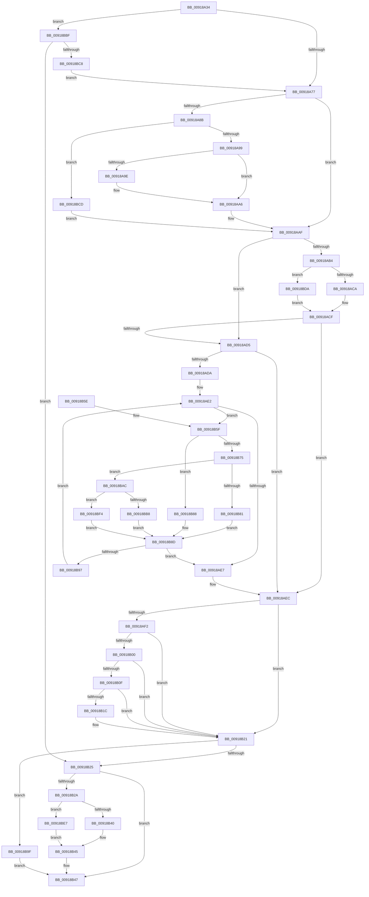

# PspCallJobHierarchyCallbacks

- RVA: `0x00918A34`–`0x00918BFE` (길이 `458` bytes)
- VA: `0x0000000140918A34`
- 실행 섹션: `PAGE`
- PDB 이름 있음: `예`; PDB Function 태그: `아니요`
- unwind 정보 RVA: `0x0008ABEC`
- 디코드: `129`개 명령, `458/458` bytes 표시
- 미해석 바이트: `0` (있으면 어셈블리에 `.byte`로 보존)

> 이 문서는 커널 이미지의 기계어와 PDB 기호를 분석해 생성했습니다. 4번과 5번은 함수 원형과 자료형을 바이너리 사용 방식에서 추정한 C 해석이며 원본 소스 복구 결과는 아닙니다.

## 1. Dependencies

- 직접 호출 지점: **12**; 고유 호출 대상: **10**
- 직접 호출자로 확인된 함수: **1**
- RIP 상대 이미지 참조: **5**

### Outgoing calls
- `0x00918AAA` → [ExAcquireResourceExclusiveLite](../../text/21/ExAcquireResourceExclusiveLite_function_00214E20.md) (function, `0x00214E20`)
- `0x00918ACA` → [PspEnforceLimitsJobPreCallback](PspEnforceLimitsJobPreCallback_function_00918C10.md) (function, `0x00918C10`)
- `0x00918AF6` → [ExReleaseResourceLite](../../text/25/ExReleaseResourceLite_function_0025FA10.md) (function, `0x0025FA10`)
- `0x00918B1C` → [KiCheckForKernelApcDelivery](../../text/2E/KiCheckForKernelApcDelivery_function_002E2C80.md) (function, `0x002E2C80`)
- `0x00918B40` → [PspEnforceLimitsJobPostCallback](PspEnforceLimitsJobPostCallback_function_00919720.md) (function, `0x00919720`)
- `0x00918B81` → [PspEnforceLimitsProcessCallback](PspEnforceLimitsProcessCallback_function_00919030.md) (function, `0x00919030`)
- `0x00918B88` → [PspQueryProcessIdListCallback](PspQueryProcessIdListCallback_function_00918FE0.md) (function, `0x00918FE0`)
- `0x00918BB8` → [PspQueryProcessAccountingInformationCallback](PspQueryProcessAccountingInformationCallback_function_00919E50.md) (function, `0x00919E50`)
- `0x00918BD0` → [PspLockJobShared](PspLockJobShared_function_0091A490.md) (function, `0x0091A490`)
- `0x00918BDD` → [guard_dispatch_icall](../../text/6B/guard_dispatch_icall_function_006BAAD0.md) (function, `0x006BAAD0`)
- `0x00918BEA` → [guard_dispatch_icall](../../text/6B/guard_dispatch_icall_function_006BAAD0.md) (function, `0x006BAAD0`)
- `0x00918BF7` → [guard_dispatch_icall](../../text/6B/guard_dispatch_icall_function_006BAAD0.md) (function, `0x006BAAD0`)

### Direct callers
- [PspEnumJobsAndProcessesInJobHierarchy](PspEnumJobsAndProcessesInJobHierarchy_function_0091A1EC.md) at `0x0091A25F`
- [PspEnumJobsAndProcessesInJobHierarchy](PspEnumJobsAndProcessesInJobHierarchy_function_0091A1EC.md) at `0x0091A2BD`
- [PspEnumJobsAndProcessesInJobHierarchy](PspEnumJobsAndProcessesInJobHierarchy_function_0091A1EC.md) at `0x0091A322`

### Static image references
- `0x00918AB4` → RVA `0x00918C10` (`PspEnforceLimitsJobPreCallback`; read)
- `0x00918B2A` → RVA `0x00919720` (`PspEnforceLimitsJobPostCallback`; read)
- `0x00918B5F` → RVA `0x00918FE0` (`PspQueryProcessIdListCallback`; read)
- `0x00918B75` → RVA `0x00919030` (`PspEnforceLimitsProcessCallback`; read)
- `0x00918BAC` → RVA `0x00919E50` (`PspQueryProcessAccountingInformationCallback`; read)

## 2. Other-region calls and transfers

- 다른 실행 섹션으로 향하는 call: **6**
  - `0x00918AAA` → [ExAcquireResourceExclusiveLite](../../text/21/ExAcquireResourceExclusiveLite_function_00214E20.md) (`PAGE` → `.text`)
  - `0x00918AF6` → [ExReleaseResourceLite](../../text/25/ExReleaseResourceLite_function_0025FA10.md) (`PAGE` → `.text`)
  - `0x00918B1C` → [KiCheckForKernelApcDelivery](../../text/2E/KiCheckForKernelApcDelivery_function_002E2C80.md) (`PAGE` → `.text`)
  - `0x00918BDD` → [guard_dispatch_icall](../../text/6B/guard_dispatch_icall_function_006BAAD0.md) (`PAGE` → `.text`)
  - `0x00918BEA` → [guard_dispatch_icall](../../text/6B/guard_dispatch_icall_function_006BAAD0.md) (`PAGE` → `.text`)
  - `0x00918BF7` → [guard_dispatch_icall](../../text/6B/guard_dispatch_icall_function_006BAAD0.md) (`PAGE` → `.text`)
- 별도 외부 분기/꼬리 이동을 확인하지 못했습니다.

## 3. Assembly (complete function range)

```asm
00918A34  48 89 5C 24 08                  mov qword ptr [rsp + 8], rbx
00918A39  4C 89 44 24 18                  mov qword ptr [rsp + 0x18], r8
00918A3E  55                              push rbp
00918A3F  56                              push rsi
00918A40  57                              push rdi
00918A41  41 54                           push r12
00918A43  41 55                           push r13
00918A45  41 56                           push r14
00918A47  41 57                           push r15
00918A49  48 83 EC 20                     sub rsp, 0x20
00918A4D  65 48 8B 34 25 88 01 00 00      mov rsi, qword ptr gs:[0x188]
00918A56  33 DB                           xor ebx, ebx
00918A58  4C 8B BC 24 80 00 00 00         mov r15, qword ptr [rsp + 0x80]
00918A60  4D 8B E1                        mov r12, r9
00918A63  4D 8B E8                        mov r13, r8
00918A66  4C 8B F2                        mov r14, rdx
00918A69  48 8B E9                        mov rbp, rcx
00918A6C  8B FB                           mov edi, ebx
00918A6E  48 85 D2                        test rdx, rdx
00918A71  0F 84 48 01 00 00               je 0x140918bbf
00918A77  8B 84 24 88 00 00 00            mov eax, dword ptr [rsp + 0x88]
00918A7E  BA 01 00 00 00                  mov edx, 1
00918A83  23 C2                           and eax, edx
00918A85  89 44 24 68                     mov dword ptr [rsp + 0x68], eax
00918A89  75 24                           jne 0x140918aaf
00918A8B  F6 84 24 88 00 00 00 04         test byte ptr [rsp + 0x88], 4
00918A93  0F 84 34 01 00 00               je 0x140918bcd
00918A99  48 85 F6                        test rsi, rsi
00918A9C  74 08                           je 0x140918aa6
00918A9E  66 FF 8E E6 01 00 00            dec word ptr [rsi + 0x1e6]
00918AA5  90                              nop
00918AA6  48 83 C1 38                     add rcx, 0x38
00918AAA  E8 71 C3 8F FF                  call 0x140214e20
00918AAF  4D 85 F6                        test r14, r14
00918AB2  74 21                           je 0x140918ad5
00918AB4  48 8D 05 55 01 00 00            lea rax, [rip + 0x155]
00918ABB  49 8B D7                        mov rdx, r15
00918ABE  48 8B CD                        mov rcx, rbp
00918AC1  4C 3B F0                        cmp r14, rax
00918AC4  0F 85 10 01 00 00               jne 0x140918bda
00918ACA  E8 41 01 00 00                  call 0x140918c10
00918ACF  8B F8                           mov edi, eax
00918AD1  85 C0                           test eax, eax
00918AD3  78 17                           js 0x140918aec
00918AD5  4D 85 E4                        test r12, r12
00918AD8  74 12                           je 0x140918aec
00918ADA  4C 8D 6D 28                     lea r13, [rbp + 0x28]
00918ADE  4D 8B 75 00                     mov r14, qword ptr [r13]
00918AE2  4D 3B F5                        cmp r14, r13
00918AE5  75 78                           jne 0x140918b5f
00918AE7  4C 8B 6C 24 70                  mov r13, qword ptr [rsp + 0x70]
00918AEC  39 5C 24 68                     cmp dword ptr [rsp + 0x68], ebx
00918AF0  75 2F                           jne 0x140918b21
00918AF2  48 8D 4D 38                     lea rcx, [rbp + 0x38]
00918AF6  E8 15 6F 94 FF                  call 0x14025fa10
00918AFB  48 85 F6                        test rsi, rsi
00918AFE  74 21                           je 0x140918b21
00918B00  B9 01 00 00 00                  mov ecx, 1
00918B05  90                              nop
00918B06  66 01 8E E6 01 00 00            add word ptr [rsi + 0x1e6], cx
00918B0D  75 12                           jne 0x140918b21
00918B0F  48 8D 86 98 00 00 00            lea rax, [rsi + 0x98]
00918B16  90                              nop
00918B17  48 39 00                        cmp qword ptr [rax], rax
00918B1A  74 05                           je 0x140918b21
00918B1C  E8 5F A1 9C FF                  call 0x1402e2c80
00918B21  85 FF                           test edi, edi
00918B23  78 7A                           js 0x140918b9f
00918B25  4D 85 ED                        test r13, r13
00918B28  74 1D                           je 0x140918b47
00918B2A  48 8D 05 EF 0B 00 00            lea rax, [rip + 0xbef]
00918B31  49 8B D7                        mov rdx, r15
00918B34  48 8B CD                        mov rcx, rbp
00918B37  4C 3B E8                        cmp r13, rax
00918B3A  0F 85 A7 00 00 00               jne 0x140918be7
00918B40  E8 DB 0B 00 00                  call 0x140919720
00918B45  8B F8                           mov edi, eax
00918B47  48 8B 5C 24 60                  mov rbx, qword ptr [rsp + 0x60]
00918B4C  8B C7                           mov eax, edi
00918B4E  48 83 C4 20                     add rsp, 0x20
00918B52  41 5F                           pop r15
00918B54  41 5E                           pop r14
00918B56  41 5D                           pop r13
00918B58  41 5C                           pop r12
00918B5A  5F                              pop rdi
00918B5B  5E                              pop rsi
00918B5C  5D                              pop rbp
00918B5D  C3                              ret
00918B5E  CC                              int3
00918B5F  48 8D 05 7A 04 00 00            lea rax, [rip + 0x47a]
00918B66  49 8B D7                        mov rdx, r15
00918B69  49 8D 8E A8 FC FF FF            lea rcx, [r14 - 0x358]
00918B70  4C 3B E0                        cmp r12, rax
00918B73  74 13                           je 0x140918b88
00918B75  48 8D 05 B4 04 00 00            lea rax, [rip + 0x4b4]
00918B7C  4C 3B E0                        cmp r12, rax
00918B7F  75 2B                           jne 0x140918bac
00918B81  E8 AA 04 00 00                  call 0x140919030
00918B86  EB 05                           jmp 0x140918b8d
00918B88  E8 53 04 00 00                  call 0x140918fe0
00918B8D  8B F8                           mov edi, eax
00918B8F  85 C0                           test eax, eax
00918B91  0F 88 50 FF FF FF               js 0x140918ae7
00918B97  4D 8B 36                        mov r14, qword ptr [r14]
00918B9A  E9 43 FF FF FF                  jmp 0x140918ae2
00918B9F  81 FF 20 01 00 C0               cmp edi, 0xc0000120
00918BA5  0F 45 DF                        cmovne ebx, edi
00918BA8  8B FB                           mov edi, ebx
00918BAA  EB 9B                           jmp 0x140918b47
00918BAC  48 8D 05 9D 12 00 00            lea rax, [rip + 0x129d]
00918BB3  4C 3B E0                        cmp r12, rax
00918BB6  75 3C                           jne 0x140918bf4
00918BB8  E8 93 12 00 00                  call 0x140919e50
00918BBD  EB CE                           jmp 0x140918b8d
00918BBF  4D 85 E4                        test r12, r12
00918BC2  0F 84 5D FF FF FF               je 0x140918b25
00918BC8  E9 AA FE FF FF                  jmp 0x140918a77
00918BCD  48 8B D6                        mov rdx, rsi
00918BD0  E8 BB 18 00 00                  call 0x14091a490
00918BD5  E9 D5 FE FF FF                  jmp 0x140918aaf
00918BDA  49 8B C6                        mov rax, r14
00918BDD  E8 EE 1E DA FF                  call 0x1406baad0
00918BE2  E9 E8 FE FF FF                  jmp 0x140918acf
00918BE7  49 8B C5                        mov rax, r13
00918BEA  E8 E1 1E DA FF                  call 0x1406baad0
00918BEF  E9 51 FF FF FF                  jmp 0x140918b45
00918BF4  49 8B C4                        mov rax, r12
00918BF7  E8 D4 1E DA FF                  call 0x1406baad0
00918BFC  EB 8F                           jmp 0x140918b8d
```

## 4. C-style interpretation (structured pseudocode)

```c
__int64 __fastcall PspCallJobHierarchyCallbacks(__int64 a1, __int64 a2, __int64 a3, __int64 a4, __int64 a5, unsigned __int8 a6)
{
    __int64 result;
    __int64 v_rbx;
    __int64 v_rsp;
    unsigned int v_stack_p10;
    unsigned __int64 v_stack_p18;
    unsigned __int64 v_stack_p8;

    v_stack_p8 = v_rbx;
    v_stack_p18 = a3;
    v_rsp = (v_rsp) - (32);
    v_rbx = 0;
    if (a2 == 0) goto loc_00918BBF;
loc_00918A77:
    result = (unsigned int)(((unsigned int)(a6)) & (1));
    v_stack_p10 = (unsigned int)(result);
    if (condition_is_not_equal) goto loc_00918AAF;
    if (((a6) & (4)) == 0) goto loc_00918BCD;
    if (*(unsigned __int64 *)(gs_base + (0 + 392)) != 0) {
    }
    a1 = (a1) + (56);
    result = ExAcquireResourceExclusiveLite(a1, 1, a3, a4);
loc_00918AAF:
    if (a2 == 0) goto loc_00918AD5;
    if (a2 != (v_rip + 341)) goto loc_00918BDA;
    result = PspEnforceLimitsJobPreCallback(a1, a5, a3, a4);
loc_00918ACF:
    if (sign_flag) goto loc_00918AEC;
loc_00918AD5:
    if (a4 == 0) goto loc_00918AEC;
loc_00918AE2:
    if ((*(unsigned __int64 *)(a1 + 40)) != (a1 + 40)) goto loc_00918B5F;
loc_00918AE7:
loc_00918AEC:
    if (v_stack_p10 != 0) goto loc_00918B21;
    result = ExReleaseResourceLite(a1 + 56, a5, a3, a4);
    if (*(unsigned __int64 *)(gs_base + (0 + 392)) == 0) goto loc_00918B21;
    if (*(unsigned __int64 *)(gs_base + (0 + 392)) != 0) goto loc_00918B21;
    result = *(unsigned __int64 *)(gs_base + (0 + 392)) + 152;
    if ((*(unsigned __int64 *)(*(unsigned __int64 *)(gs_base + (0 + 392)) + 152)) != (*(unsigned __int64 *)(gs_base + (0 + 392)) + 152)) {
        result = KiCheckForKernelApcDelivery(1, a5, a3, a4);
    }
    if (sign_flag) goto loc_00918B9F;
loc_00918B25:
    if (v_stack_p18 == 0) goto loc_00918B47;
    if (v_stack_p18 != (v_rip + 3055)) goto loc_00918BE7;
    result = PspEnforceLimitsJobPostCallback(a1, a5, a3, a4);
loc_00918B45:
loc_00918B47:
    v_rsp = (v_rsp) + (32);
    return (unsigned int)((unsigned int)((unsigned int)((unsigned int)(result))));
loc_00918B5F:
    if (a4 == (v_rip + 1146)) goto loc_00918B88;
    if (a4 != (v_rip + 1204)) goto loc_00918BAC;
    result = PspEnforceLimitsProcessCallback(*(unsigned __int64 *)(a1 + 40) - 856, a5, a3, a4);
    goto loc_00918B8D;
loc_00918B88:
    result = PspQueryProcessIdListCallback(*(unsigned __int64 *)(a1 + 40) - 856, a5, a3, a4);
loc_00918B8D:
    if (sign_flag) goto loc_00918AE7;
    goto loc_00918AE2;
loc_00918B9F:
    v_rbx = v_stack_p8;
    if (((unsigned int)((unsigned int)((unsigned int)(result)))) != 0xC0000120ULL) { v_rbx = (unsigned int)((unsigned int)((unsigned int)(result))); }
    goto loc_00918B47;
loc_00918BAC:
    if (a4 != (v_rip + 4765)) goto loc_00918BF4;
    result = PspQueryProcessAccountingInformationCallback(*(unsigned __int64 *)(a1 + 40) - 856, a5, a3, a4);
    goto loc_00918B8D;
loc_00918BBF:
    if (a4 == 0) goto loc_00918B25;
    goto loc_00918A77;
loc_00918BCD:
    result = PspLockJobShared(*(unsigned __int64 *)(a1 + 40) - 856, *(unsigned __int64 *)(gs_base + (0 + 392)), a3, a4);
    goto loc_00918AAF;
loc_00918BDA:
    result = guard_dispatch_icall(*(unsigned __int64 *)(a1 + 40) - 856, *(unsigned __int64 *)(gs_base + (0 + 392)), a3, a4);
    goto loc_00918ACF;
loc_00918BE7:
    result = guard_dispatch_icall(*(unsigned __int64 *)(a1 + 40) - 856, *(unsigned __int64 *)(gs_base + (0 + 392)), a3, a4);
    goto loc_00918B45;
loc_00918BF4:
    result = guard_dispatch_icall(*(unsigned __int64 *)(a1 + 40) - 856, *(unsigned __int64 *)(gs_base + (0 + 392)), a3, a4);
    goto loc_00918B8D;
}
```

## 5. (Beta) C Style

```c
int64_t PspCallJobHierarchyCallbacks(void *Arg1, int64_t Arg2, int64_t Arg3, int64_t Arg4, int64_t Arg5, uint8_t Arg6)
{
    uint8_t *arg1 = (uint8_t *)Arg1;

    int64_t result;
    int64_t local_rbx;
    int64_t local_rsp;
    uint32_t v_stack_p10;
    uint64_t v_stack_p18;
    uint64_t v_stack_p8;

    v_stack_p8 = local_rbx;
    v_stack_p18 = Arg3;
    local_rsp = (local_rsp) - (32);
    local_rbx = 0;
    if (Arg2 == 0) goto loc_00918BBF;
loc_00918A77:
    result = (uint32_t)(((uint32_t)(Arg6)) & (1));
    v_stack_p10 = (uint32_t)(result);
    if (condition_is_not_equal) goto loc_00918AAF;
    if (((Arg6) & (4)) == 0) goto loc_00918BCD;
    if (*(uint64_t *)(gs_base + (0 + 0x188)) != 0) {
    }
    Arg1 = (Arg1) + (56);
    result = ExAcquireResourceExclusiveLite(Arg1, 1, Arg3, Arg4);
loc_00918AAF:
    if (Arg2 == 0) goto loc_00918AD5;
    if (Arg2 != (v_rip + 341)) goto loc_00918BDA;
    result = PspEnforceLimitsJobPreCallback(Arg1, Arg5, Arg3, Arg4);
loc_00918ACF:
    if (sign_flag) goto loc_00918AEC;
loc_00918AD5:
    if (Arg4 == 0) goto loc_00918AEC;
loc_00918AE2:
    if ((*(uint64_t *)(arg1 + 0x28)) != (Arg1 + 40)) goto loc_00918B5F;
loc_00918AE7:
loc_00918AEC:
    if (v_stack_p10 != 0) goto loc_00918B21;
    result = ExReleaseResourceLite(Arg1 + 56, Arg5, Arg3, Arg4);
    if (*(uint64_t *)(gs_base + (0 + 0x188)) == 0) goto loc_00918B21;
    if (*(uint64_t *)(gs_base + (0 + 0x188)) != 0) goto loc_00918B21;
    result = *(uint64_t *)(gs_base + (0 + 0x188)) + 152;
    if ((*(uint64_t *)(*(uint64_t *)(gs_base + (0 + 0x188)) + 0x98)) != (*(uint64_t *)(gs_base + (0 + 0x188)) + 152)) {
        result = KiCheckForKernelApcDelivery(1, Arg5, Arg3, Arg4);
    }
    if (sign_flag) goto loc_00918B9F;
loc_00918B25:
    if (v_stack_p18 == 0) goto loc_00918B47;
    if (v_stack_p18 != (v_rip + 3055)) goto loc_00918BE7;
    result = PspEnforceLimitsJobPostCallback(Arg1, Arg5, Arg3, Arg4);
loc_00918B45:
loc_00918B47:
    local_rsp = (local_rsp) + (32);
    return (uint32_t)((uint32_t)((uint32_t)((uint32_t)(result))));
loc_00918B5F:
    if (Arg4 == (v_rip + 1146)) goto loc_00918B88;
    if (Arg4 != (v_rip + 1204)) goto loc_00918BAC;
    result = PspEnforceLimitsProcessCallback(*(uint64_t *)(arg1 + 0x28) - 856, Arg5, Arg3, Arg4);
    goto loc_00918B8D;
loc_00918B88:
    result = PspQueryProcessIdListCallback(*(uint64_t *)(arg1 + 0x28) - 856, Arg5, Arg3, Arg4);
loc_00918B8D:
    if (sign_flag) goto loc_00918AE7;
    goto loc_00918AE2;
loc_00918B9F:
    local_rbx = v_stack_p8;
    if (((uint32_t)((uint32_t)((uint32_t)(result)))) != 0xC0000120ULL) { local_rbx = (uint32_t)((uint32_t)((uint32_t)(result))); }
    goto loc_00918B47;
loc_00918BAC:
    if (Arg4 != (v_rip + 4765)) goto loc_00918BF4;
    result = PspQueryProcessAccountingInformationCallback(*(uint64_t *)(arg1 + 0x28) - 856, Arg5, Arg3, Arg4);
    goto loc_00918B8D;
loc_00918BBF:
    if (Arg4 == 0) goto loc_00918B25;
    goto loc_00918A77;
loc_00918BCD:
    result = PspLockJobShared(*(uint64_t *)(arg1 + 0x28) - 856, *(uint64_t *)(gs_base + (0 + 0x188)), Arg3, Arg4);
    goto loc_00918AAF;
loc_00918BDA:
    result = guard_dispatch_icall(*(uint64_t *)(arg1 + 0x28) - 856, *(uint64_t *)(gs_base + (0 + 0x188)), Arg3, Arg4);
    goto loc_00918ACF;
loc_00918BE7:
    result = guard_dispatch_icall(*(uint64_t *)(arg1 + 0x28) - 856, *(uint64_t *)(gs_base + (0 + 0x188)), Arg3, Arg4);
    goto loc_00918B45;
loc_00918BF4:
    result = guard_dispatch_icall(*(uint64_t *)(arg1 + 0x28) - 856, *(uint64_t *)(gs_base + (0 + 0x188)), Arg3, Arg4);
    goto loc_00918B8D;
}
```

### 관측된 메모리 오프셋

구조체 형식이 확인되지 않은 접근은 인자 기준의 오프셋으로만 기록했습니다.

| 기준 인자 | 오프셋 표현 | 폭 (bit) | 접근 |
|---|---:|---:|---|
| `Arg1` | `+ 0x0` | `64` | `R` |
| `Arg1` | `+ 0x28` | `64` | `R` |
| `Arg1` | `+ 0x38` | `64` | `R` |

## 6. Execution-region graph

[열기: 2D/3D 그래프와 함수 탐색 컨트롤 패널](../../../control-panel.html?section=page&rva=0x00918A34&view=graph)

- 2D 그래프는 위에서 아래로 흐르고, 3D 그래프는 빈 공간을 드래그해 회전합니다. Shift+드래그는 이동, 휠은 확대·축소, 함수 노드 선택은 대상 보고서 이동입니다.

### Static fallback


