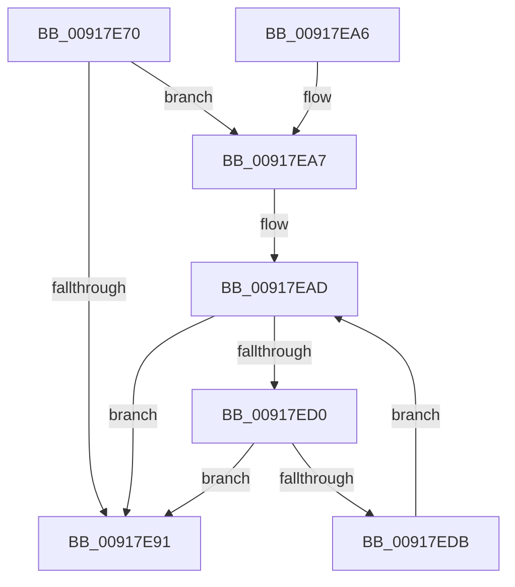

# PspDispatchWakeNotification

- RVA: `0x00917E70`–`0x00917EDD` (길이 `109` bytes)
- VA: `0x0000000140917E70`
- 실행 섹션: `PAGE`
- PDB 이름 있음: `예`; PDB Function 태그: `아니요`
- unwind 정보 RVA: `0x0008AB00`
- 디코드: `36`개 명령, `109/109` bytes 표시
- 미해석 바이트: `0` (있으면 어셈블리에 `.byte`로 보존)

> 이 문서는 커널 이미지의 기계어와 PDB 기호를 분석해 생성했습니다. 4번과 5번은 함수 원형과 자료형을 바이너리 사용 방식에서 추정한 C 해석이며 원본 소스 복구 결과는 아닙니다.

## 1. Dependencies

- 직접 호출 지점: **1**; 고유 호출 대상: **1**
- 직접 호출자로 확인된 함수: **1**
- RIP 상대 이미지 참조: **0**

### Outgoing calls
- `0x00917EC7` → [PspSendWakeNotification](../9F/PspSendWakeNotification_function_009FB394.md) (function, `0x009FB394`)

### Direct callers
- [PspAllocateAndQueryNotificationChannel](PspAllocateAndQueryNotificationChannel_function_00917EE4.md) at `0x0091800C`

### Static image references
- 디코드된 RIP-relative 메모리 참조가 없습니다.

## 2. Other-region calls and transfers

- 다른 실행 섹션으로 향하는 call: **0**
- 별도 외부 분기/꼬리 이동을 확인하지 못했습니다.

## 3. Assembly (complete function range)

```asm
00917E70  48 89 5C 24 08                  mov qword ptr [rsp + 8], rbx
00917E75  48 89 6C 24 10                  mov qword ptr [rsp + 0x10], rbp
00917E7A  48 89 74 24 18                  mov qword ptr [rsp + 0x18], rsi
00917E7F  57                              push rdi
00917E80  48 83 EC 30                     sub rsp, 0x30
00917E84  8B 42 04                        mov eax, dword ptr [rdx + 4]
00917E87  48 8B F2                        mov rsi, rdx
00917E8A  0B 02                           or eax, dword ptr [rdx]
00917E8C  48 8B E9                        mov rbp, rcx
00917E8F  75 16                           jne 0x140917ea7
00917E91  48 8B 5C 24 40                  mov rbx, qword ptr [rsp + 0x40]
00917E96  48 8B 6C 24 48                  mov rbp, qword ptr [rsp + 0x48]
00917E9B  48 8B 74 24 50                  mov rsi, qword ptr [rsp + 0x50]
00917EA0  48 83 C4 30                     add rsp, 0x30
00917EA4  5F                              pop rdi
00917EA5  C3                              ret
00917EA6  CC                              int3
00917EA7  33 DB                           xor ebx, ebx
00917EA9  49 8D 78 08                     lea rdi, [r8 + 8]
00917EAD  4C 8B 0F                        mov r9, qword ptr [rdi]
00917EB0  4C 8B C6                        mov r8, rsi
00917EB3  49 8B C1                        mov rax, r9
00917EB6  8B D3                           mov edx, ebx
00917EB8  48 F7 D8                        neg rax
00917EBB  1B C9                           sbb ecx, ecx
00917EBD  83 E1 03                        and ecx, 3
00917EC0  89 4C 24 20                     mov dword ptr [rsp + 0x20], ecx
00917EC4  48 8B CD                        mov rcx, rbp
00917EC7  E8 C8 34 0E 00                  call 0x1409fb394
00917ECC  84 C0                           test al, al
00917ECE  75 C1                           jne 0x140917e91
00917ED0  FF C3                           inc ebx
00917ED2  48 83 C7 08                     add rdi, 8
00917ED6  83 FB 07                        cmp ebx, 7
00917ED9  73 B6                           jae 0x140917e91
00917EDB  EB D0                           jmp 0x140917ead
```

## 4. C-style interpretation (structured pseudocode)

```c
__int64 __fastcall PspDispatchWakeNotification(__int64 a1, __int64 a2, __int64 a3)
{
    __int64 result;
    __int64 v_rbx;
    __int64 v_rdi;
    __int64 v_rsp;
    unsigned __int64 v_stack_p10;
    unsigned __int64 v_stack_p18;
    unsigned int v_stack_p20;
    unsigned __int64 v_stack_p8;

    v_stack_p8 = v_rbx;
    v_stack_p10 = v_rbp;
    v_stack_p18 = v_rsi;
    v_rsp = (v_rsp) - (48);
    result = (unsigned int)(((unsigned int)(*(unsigned int *)(a2 + 4))) | (*(unsigned int *)(a2)));
    if (condition_is_not_equal) goto loc_00917EA7;
loc_00917E91:
    v_rsp = (v_rsp) + (48);
    return result;
loc_00917EA7:
    v_rbx = 0;
loc_00917EAD:
    result = -(*(unsigned __int64 *)(a3 + 8));
    a1 = (unsigned int)((a1) & (3));
    v_stack_p20 = (unsigned int)(a1);
    result = PspSendWakeNotification(v_stack_p10, 0, v_stack_p18, *(unsigned __int64 *)(a3 + 8));
    if ((unsigned __int8)(result) != 0) goto loc_00917E91;
    v_rbx = (unsigned int)((v_rbx) + 1);
    v_rdi = (a3 + 8) + (8);
    if (((unsigned int)(v_rbx)) >= 7) goto loc_00917E91;
    goto loc_00917EAD;
}
```

## 5. (Beta) C Style

```c
int64_t PspDispatchWakeNotification(int64_t Arg1, void *Arg2, void *Arg3)
{
    uint8_t *arg2 = (uint8_t *)Arg2;
    uint8_t *arg3 = (uint8_t *)Arg3;

    int64_t result;
    int64_t local_rbx;
    int64_t local_rdi;
    int64_t local_rsp;
    uint64_t v_stack_p10;
    uint64_t v_stack_p18;
    uint32_t v_stack_p20;
    uint64_t v_stack_p8;

    v_stack_p8 = local_rbx;
    v_stack_p10 = local_rbp;
    v_stack_p18 = local_rsi;
    local_rsp = (local_rsp) - (48);
    result = (uint32_t)(((uint32_t)(*(uint32_t *)(arg2 + 0x4))) | (*(uint32_t *)(arg2)));
    if (condition_is_not_equal) goto loc_00917EA7;
loc_00917E91:
    local_rsp = (local_rsp) + (48);
    return result;
loc_00917EA7:
    local_rbx = 0;
loc_00917EAD:
    result = -(*(uint64_t *)(arg3 + 0x8));
    Arg1 = (uint32_t)((Arg1) & (3));
    v_stack_p20 = (uint32_t)(Arg1);
    result = PspSendWakeNotification(v_stack_p10, 0, v_stack_p18, *(uint64_t *)(arg3 + 0x8));
    if ((uint8_t)(result) != 0) goto loc_00917E91;
    local_rbx = (uint32_t)((local_rbx) + 1);
    local_rdi = (Arg3 + 8) + (8);
    if (((uint32_t)(local_rbx)) >= 7) goto loc_00917E91;
    goto loc_00917EAD;
}
```

### 관측된 메모리 오프셋

구조체 형식이 확인되지 않은 접근은 인자 기준의 오프셋으로만 기록했습니다.

| 기준 인자 | 오프셋 표현 | 폭 (bit) | 접근 |
|---|---:|---:|---|
| `Arg2` | `+ 0x0` | `32` | `R` |
| `Arg2` | `+ 0x4` | `32` | `R` |
| `Arg3` | `+ 0x0` | `64` | `R` |
| `Arg3` | `+ 0x8` | `64` | `R` |

## 6. Execution-region graph

[열기: 2D/3D 그래프와 함수 탐색 컨트롤 패널](../../../control-panel.html?section=page&rva=0x00917E70&view=graph)

- 2D 그래프는 위에서 아래로 흐르고, 3D 그래프는 빈 공간을 드래그해 회전합니다. Shift+드래그는 이동, 휠은 확대·축소, 함수 노드 선택은 대상 보고서 이동입니다.

### Static fallback


