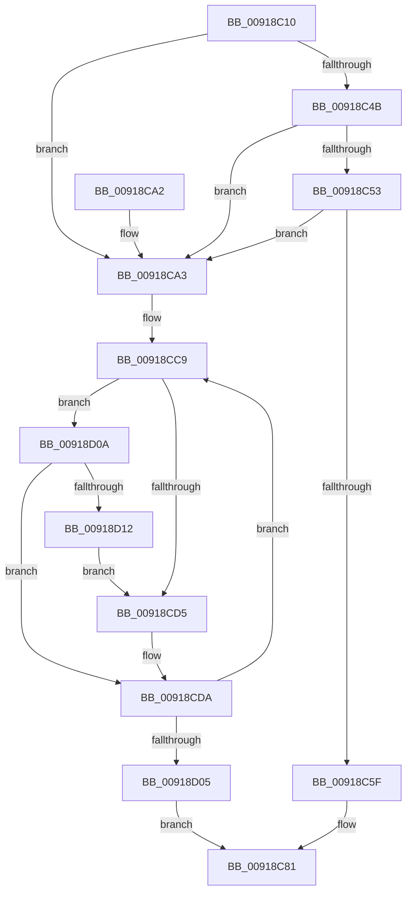

# PspEnforceLimitsJobPreCallback

- RVA: `0x00918C10`–`0x00918D14` (길이 `260` bytes)
- VA: `0x0000000140918C10`
- 실행 섹션: `PAGE`
- PDB 이름 있음: `예`; PDB Function 태그: `아니요`
- unwind 정보 RVA: `0x0008AC08`
- 디코드: `67`개 명령, `260/260` bytes 표시
- 미해석 바이트: `0` (있으면 어셈블리에 `.byte`로 보존)

> 이 문서는 커널 이미지의 기계어와 PDB 기호를 분석해 생성했습니다. 4번과 5번은 함수 원형과 자료형을 바이너리 사용 방식에서 추정한 C 해석이며 원본 소스 복구 결과는 아닙니다.

## 1. Dependencies

- 직접 호출 지점: **2**; 고유 호출 대상: **2**
- 직접 호출자로 확인된 함수: **1**
- RIP 상대 이미지 참조: **1**

### Outgoing calls
- `0x00918C6C` → [memset](../../text/6C/memset_function_006C6C40.md) (function, `0x006C6C40`)
- `0x00918CEA` → [PspQueryRateControlHistory](PspQueryRateControlHistory_function_00918D1C.md) (function, `0x00918D1C`)

### Direct callers
- [PspCallJobHierarchyCallbacks](PspCallJobHierarchyCallbacks_function_00918A34.md) at `0x00918ACA`

### Static image references
- `0x00918C2D` → RVA `0x00FD9C70` (`PAGEDATA`; read)

## 2. Other-region calls and transfers

- 다른 실행 섹션으로 향하는 call: **1**
  - `0x00918C6C` → [memset](../../text/6C/memset_function_006C6C40.md) (`PAGE` → `.text`)
- 별도 외부 분기/꼬리 이동을 확인하지 못했습니다.

## 3. Assembly (complete function range)

```asm
00918C10  48 8B C4                        mov rax, rsp
00918C13  48 89 58 08                     mov qword ptr [rax + 8], rbx
00918C17  48 89 68 10                     mov qword ptr [rax + 0x10], rbp
00918C1B  48 89 70 18                     mov qword ptr [rax + 0x18], rsi
00918C1F  48 89 78 20                     mov qword ptr [rax + 0x20], rdi
00918C23  41 54                           push r12
00918C25  41 56                           push r14
00918C27  41 57                           push r15
00918C29  48 83 EC 30                     sub rsp, 0x30
00918C2D  8B 05 3D 10 6C 00               mov eax, dword ptr [rip + 0x6c103d]
00918C33  33 FF                           xor edi, edi
00918C35  89 81 B8 05 00 00               mov dword ptr [rcx + 0x5b8], eax
00918C3B  48 8B F2                        mov rsi, rdx
00918C3E  8B 81 20 04 00 00               mov eax, dword ptr [rcx + 0x420]
00918C44  48 8B D9                        mov rbx, rcx
00918C47  A8 06                           test al, 6
00918C49  75 58                           jne 0x140918ca3
00918C4B  39 B9 38 04 00 00               cmp dword ptr [rcx + 0x438], edi
00918C51  75 50                           jne 0x140918ca3
00918C53  F7 81 10 06 00 00 00 08 00 00   test dword ptr [rcx + 0x610], 0x800
00918C5D  75 44                           jne 0x140918ca3
00918C5F  48 81 C1 48 05 00 00            add rcx, 0x548
00918C66  44 8D 47 68                     lea r8d, [rdi + 0x68]
00918C6A  33 D2                           xor edx, edx
00918C6C  E8 CF DF DA FF                  call 0x1406c6c40
00918C71  F0 81 A3 10 06 00 00 FF FF BF FF  lock and dword ptr [rbx + 0x610], 0xffbfffff
00918C7C  BF 20 01 00 C0                  mov edi, 0xc0000120
00918C81  48 8B 5C 24 50                  mov rbx, qword ptr [rsp + 0x50]
00918C86  8B C7                           mov eax, edi
00918C88  48 8B 7C 24 68                  mov rdi, qword ptr [rsp + 0x68]
00918C8D  48 8B 6C 24 58                  mov rbp, qword ptr [rsp + 0x58]
00918C92  48 8B 74 24 60                  mov rsi, qword ptr [rsp + 0x60]
00918C97  48 83 C4 30                     add rsp, 0x30
00918C9B  41 5F                           pop r15
00918C9D  41 5E                           pop r14
00918C9F  41 5C                           pop r12
00918CA1  C3                              ret
00918CA2  CC                              int3
00918CA3  48 8B 81 E0 03 00 00            mov rax, qword ptr [rcx + 0x3e0]
00918CAA  4C 8D 62 2C                     lea r12, [rdx + 0x2c]
00918CAE  48 89 02                        mov qword ptr [rdx], rax
00918CB1  44 8B FF                        mov r15d, edi
00918CB4  48 8B 81 08 04 00 00            mov rax, qword ptr [rcx + 0x408]
00918CBB  41 BE 3C 00 00 00               mov r14d, 0x3c
00918CC1  48 89 42 08                     mov qword ptr [rdx + 8], rax
00918CC5  48 89 7A 10                     mov qword ptr [rdx + 0x10], rdi
00918CC9  48 8B AB C0 04 00 00            mov rbp, qword ptr [rbx + 0x4c0]
00918CD0  48 85 ED                        test rbp, rbp
00918CD3  75 35                           jne 0x140918d0a
00918CD5  BD 01 00 00 00                  mov ebp, 1
00918CDA  4D 8B CC                        mov r9, r12
00918CDD  44 89 7C 24 20                  mov dword ptr [rsp + 0x20], r15d
00918CE2  45 33 C0                        xor r8d, r8d
00918CE5  8B D5                           mov edx, ebp
00918CE7  48 8B CB                        mov rcx, rbx
00918CEA  E8 2D 00 00 00                  call 0x140918d1c
00918CEF  42 89 6C 36 E4                  mov dword ptr [rsi + r14 - 0x1c], ebp
00918CF4  41 FF C7                        inc r15d
00918CF7  49 83 C6 04                     add r14, 4
00918CFB  49 83 C4 04                     add r12, 4
00918CFF  41 83 FF 03                     cmp r15d, 3
00918D03  7C C4                           jl 0x140918cc9
00918D05  E9 77 FF FF FF                  jmp 0x140918c81
00918D0A  41 8B 2C 2E                     mov ebp, dword ptr [r14 + rbp]
00918D0E  85 ED                           test ebp, ebp
00918D10  75 C8                           jne 0x140918cda
00918D12  EB C1                           jmp 0x140918cd5
```

## 4. C-style interpretation (structured pseudocode)

```c
__int64 __fastcall PspEnforceLimitsJobPreCallback(__int64 a1, __int64 a2)
{
    __int64 result;
    __int64 v_r12;
    __int64 v_r14;
    __int64 v_r15;
    __int64 v_rdi;
    __int64 v_rsp;
    unsigned __int64 v_stack_p10;
    unsigned __int64 v_stack_p18;
    unsigned __int64 v_stack_p20;
    unsigned __int64 v_stack_p8;

    *(unsigned __int64 *)(v_rsp + 8) = v_rbx;
    *(unsigned __int64 *)(v_rsp + 16) = v_rbp;
    *(unsigned __int64 *)(v_rsp + 24) = v_rsi;
    *(unsigned __int64 *)(v_rsp + 32) = v_rdi;
    v_rsp = (v_rsp) - (48);
    v_rdi = 0;
    *(unsigned int *)(a1 + 1464) = (unsigned int)((unsigned int)(*(unsigned int *)(v_rip + 7082045)));
    if ((((unsigned __int8)((unsigned int)(*(unsigned int *)(a1 + 1056)))) & (6)) != 0) goto loc_00918CA3;
    if ((*(unsigned int *)(a1 + 1080)) != 0) goto loc_00918CA3;
    if (((*(unsigned int *)(a1 + 1552)) & (0x800ULL)) != 0) goto loc_00918CA3;
    a1 = (a1) + (0x548ULL);
    a2 = 0;
    result = memset(a1, a2, v_rdi + 104, a4);
loc_00918C81:
    v_rsp = (v_rsp) + (48);
    return (unsigned int)((unsigned int)((unsigned int)(0xC0000120ULL)));
loc_00918CA3:
    *(unsigned __int64 *)(a2) = *(unsigned __int64 *)(a1 + 992);
    *(unsigned __int64 *)(a2 + 8) = *(unsigned __int64 *)(a1 + 1032);
    *(unsigned __int64 *)(a2 + 16) = v_stack_p20;
loc_00918CC9:
    if (*(unsigned __int64 *)(v_stack_p8 + 1216) != 0) goto loc_00918D0A;
loc_00918CD5:
loc_00918CDA:
    v_stack_p20 = (unsigned int)((unsigned int)((unsigned int)(v_stack_p20)));
    a3 = 0;
    result = PspQueryRateControlHistory(v_stack_p8, 1, a3, a2 + 44);
    *(unsigned int *)(v_stack_p18 + 60 * 1 - 28) = 1;
    v_r15 = (unsigned int)(((unsigned int)((unsigned int)(v_stack_p20))) + 1);
    v_r14 = (60) + (4);
    v_r12 = (a2 + 44) + (4);
    if (((unsigned int)(v_r15)) < 3) goto loc_00918CC9;
    goto loc_00918C81;
loc_00918D0A:
    if ((unsigned int)((unsigned int)(*(unsigned int *)(v_r14 + 1 * 1))) != 0) goto loc_00918CDA;
    goto loc_00918CD5;
}
```

## 5. (Beta) C Style

```c
int64_t PspEnforceLimitsJobPreCallback(void *Arg1, void *Arg2)
{
    uint8_t *arg1 = (uint8_t *)Arg1;
    uint8_t *arg2 = (uint8_t *)Arg2;

    int64_t result;
    int64_t local_r12;
    int64_t local_r14;
    int64_t local_r15;
    int64_t local_rdi;
    int64_t local_rsp;
    uint64_t v_stack_p10;
    uint64_t v_stack_p18;
    uint64_t v_stack_p20;
    uint64_t v_stack_p8;

    *(uint64_t *)(local_rsp + 0x8) = local_rbx;
    *(uint64_t *)(local_rsp + 0x10) = local_rbp;
    *(uint64_t *)(local_rsp + 0x18) = local_rsi;
    *(uint64_t *)(local_rsp + 0x20) = local_rdi;
    local_rsp = (local_rsp) - (48);
    local_rdi = 0;
    *(uint32_t *)(arg1 + 0x5B8) = (uint32_t)((uint32_t)(*(uint32_t *)(v_rip + 0x6C103D)));
    if ((((uint8_t)((uint32_t)(*(uint32_t *)(arg1 + 0x420)))) & (6)) != 0) goto loc_00918CA3;
    if ((*(uint32_t *)(arg1 + 0x438)) != 0) goto loc_00918CA3;
    if (((*(uint32_t *)(arg1 + 0x610)) & (0x800ULL)) != 0) goto loc_00918CA3;
    Arg1 = (Arg1) + (0x548ULL);
    Arg2 = 0;
    result = memset(Arg1, Arg2, local_rdi + 104, a4);
loc_00918C81:
    local_rsp = (local_rsp) + (48);
    return (uint32_t)((uint32_t)((uint32_t)(0xC0000120ULL)));
loc_00918CA3:
    *(uint64_t *)(arg2) = *(uint64_t *)(arg1 + 0x3E0);
    *(uint64_t *)(arg2 + 0x8) = *(uint64_t *)(arg1 + 0x408);
    *(uint64_t *)(arg2 + 0x10) = v_stack_p20;
loc_00918CC9:
    if (*(uint64_t *)(v_stack_p8 + 0x4C0) != 0) goto loc_00918D0A;
loc_00918CD5:
loc_00918CDA:
    v_stack_p20 = (uint32_t)((uint32_t)((uint32_t)(v_stack_p20)));
    a3 = 0;
    result = PspQueryRateControlHistory(v_stack_p8, 1, a3, Arg2 + 44);
    *(uint32_t *)(v_stack_p18 + 0x3C * 1 - 0x1C) = 1;
    local_r15 = (uint32_t)(((uint32_t)((uint32_t)(v_stack_p20))) + 1);
    local_r14 = (60) + (4);
    local_r12 = (Arg2 + 44) + (4);
    if (((uint32_t)(local_r15)) < 3) goto loc_00918CC9;
    goto loc_00918C81;
loc_00918D0A:
    if ((uint32_t)((uint32_t)(*(uint32_t *)(local_r14 + 0x1 * 1))) != 0) goto loc_00918CDA;
    goto loc_00918CD5;
}
```

### 관측된 메모리 오프셋

구조체 형식이 확인되지 않은 접근은 인자 기준의 오프셋으로만 기록했습니다.

| 기준 인자 | 오프셋 표현 | 폭 (bit) | 접근 |
|---|---:|---:|---|
| `Arg1` | `+ 0x3E0` | `64` | `R` |
| `Arg1` | `+ 0x408` | `64` | `R` |
| `Arg1` | `+ 0x420` | `32` | `R` |
| `Arg1` | `+ 0x438` | `32` | `R` |
| `Arg1` | `+ 0x4C0` | `64` | `R` |
| `Arg1` | `+ 0x5B8` | `32` | `W` |
| `Arg1` | `+ 0x610` | `32` | `R` |
| `Arg1` | `+ 0x610` | `32` | `R/W` |
| `Arg2` | `- 0x1C + r14*1` | `32` | `W` |
| `Arg2` | `+ 0x0` | `64` | `W` |
| `Arg2` | `+ 0x8` | `64` | `W` |
| `Arg2` | `+ 0x10` | `64` | `W` |
| `Arg2` | `+ 0x2C` | `64` | `R` |

## 6. Execution-region graph

[열기: 2D/3D 그래프와 함수 탐색 컨트롤 패널](../../../control-panel.html?section=page&rva=0x00918C10&view=graph)

- 2D 그래프는 위에서 아래로 흐르고, 3D 그래프는 빈 공간을 드래그해 회전합니다. Shift+드래그는 이동, 휠은 확대·축소, 함수 노드 선택은 대상 보고서 이동입니다.

### Static fallback


